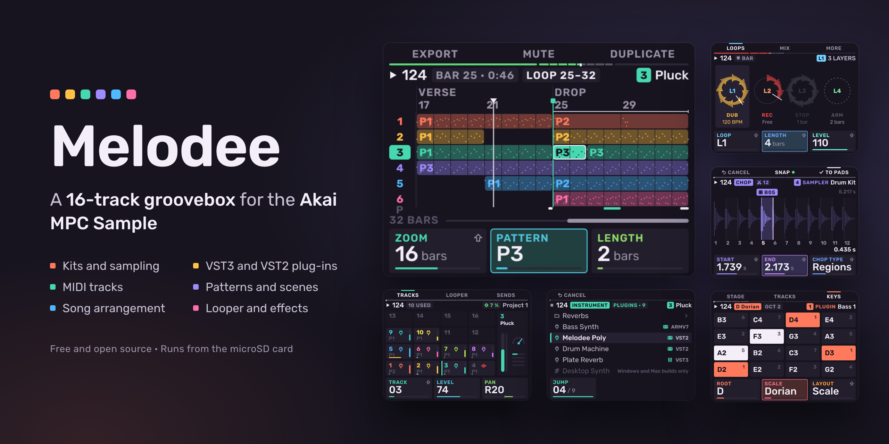

<h1 align="center"></h1>

<p align="center">A 16-track groovebox for the Akai MPC Sample</p>



Melodee is a 16-track groovebox for the **Akai MPC Sample**. It runs on the
MPC in place of the stock app, started from the microSD card. Each pad is a
track: a drum kit or sampled instrument, a plug-in instrument, or a MIDI track
for external gear. Tracks play patterns, patterns make scenes and a song,
and every track has a mixer strip and an effect chain that takes plug-in
effects.

Melodee does not change anything on the MPC itself. It runs from files on
the card. Choose **MPC APP** on its Exit screen, or remove its `autorun`
folder from the card, and the stock app runs as before.

Back up your card before you install Melodee.

New to Melodee? Start with the [quickstart](docs/QUICKSTART.md). For every
page and control, read the [user guide](docs/GUIDE.md).

## Features

- **16 tracks**, one per pad. Hold **PAD BANK** and press a pad to select a
  track from any page.
- **VST3, LV2, CLAP and VST2 plug-in host**: load instruments and effects from
  the card. Use a plug-in instrument as a track's sound, and plug-in effects
  on track, bus, master and loop chains. Melodee runs 64-bit ARM Linux builds, Open
  MPC plug-ins, and 32-bit ARM plug-ins through a bridge. It loads each
  plug-in's presets, keeps its state in the project, plays drum machine
  plug-ins on pads, and compensates for plug-in latency.
- **Melodee synths**: three Open MPC instruments of its own, Melodee Poly
  (analog-style polysynth), Melodee PD (phase distortion) and Melodee Chip
  (chip voice), each with factory presets.
- **Kits** of 128 pads in 8 banks, with the stock Sample mode pages (Trim,
  Mix, Amp Env, Tune, Play, Filter, Filt Env) plus Layers, Follow (tempo
  follow), Cloud (granular) and a kit filter.
- **Sampling**: Chop, Sample Record, Audio Recall, Resample and 16 Levels.
- **Sampled instruments**: SFZ, MPC keygroup and drum programs (`.xpm`,
  `.xty`), MPC expansions (`.xpn`), Logic EXS24 (`.exs`), SoundFont (`.sf2`)
  and DecentSampler (`.dspreset`), streamed from the card. Stock MPC Sample
  projects (`.xpj`) open too.
- **MIDI tracks** for external synths and drum machines over USB-C or the
  MIDI jacks, with program changes, CC knobs and SysEx.
- **Sequencing**: 16 patterns per track, up to 128 bars each. Step
  sequencer, piano roll, step entry, parameter locks, ratchets and trig
  conditions. Scenes, pattern chains and follow actions.
- **Song**: an arrangement with a lane per track, markers and a tempo lane.
  Export a WAV mixdown, stems or a MIDI file.
- **Looper**: four loops that follow the tempo, with overdub and undo.
- **Effects**: 41 effects. A six-slot chain on every track, four send buses
  and the master. Knob FX, Pad FX, Flex Beat and the master compressor work
  as on the stock app.
- **Sync**: MIDI clock and MTC in and out, and CV clock out.

## Requirements

- Akai MPC Sample with firmware **1.3.0.12**. On any other firmware Melodee
  does not start and the stock app keeps running.
- A microSD card.

## Install

1. Download the latest `Melodee-MPC-Sample-<version>.zip` from
   [Releases](https://github.com/keremimo/melodee-sample/releases).
2. Back up the card. If the card already has an `autorun` folder at its top
   level, move it somewhere safe.
3. Unzip it. The zip holds one folder, `autorun`. Copy that folder to the
   top level of the card. Do not edit or rename anything inside it.
4. Put the card in the MPC and switch it on. The stock app starts first.
   A few seconds later Melodee starts.

The [quickstart](docs/QUICKSTART.md) has the full steps, with screenshots.

### Plug-ins

Put plug-ins in a folder named `Plugins` at the top level of the card, in
any subfolders. Melodee loads:

- VST3 bundles with a `Contents/aarch64-linux/` build
- LV2 bundles (`.lv2` folders) built for 64-bit ARM Linux (aarch64)
- CLAP plug-ins (`.clap` files) built for 64-bit ARM Linux (aarch64)
- [Open MPC](https://open-mpc.github.io) plug-in folders
- VST2 `.so` files built for 64-bit ARM (aarch64) or 32-bit ARM (armv7)

Plug-ins built only for Windows or macOS do not run on the MPC. The
plug-in picker shows them dimmed, with the reason.

The Melodee synths are free downloads:
[Melodee Poly](https://github.com/keremimo/mpc-vst-melodee-poly/releases/latest), [Melodee PD](https://github.com/keremimo/mpc-vst-melodee-pd/releases/latest) and
[Melodee Chip](https://github.com/keremimo/mpc-vst-melodee-chip/releases/latest). From each release, download the
`-mpc-sample.zip`, unzip it and copy the plug-in folder inside (for example
`Ellic Studio - VST - Melodee Poly`) into `Plugins`. The synths also run on
MPC OS devices that load Open MPC plug-ins; those devices use the
`-mpc-aarch64.zip` or `-mpc-armv7.zip`.

## Documentation

| Document | What it covers |
| --- | --- |
| [Quickstart](docs/QUICKSTART.md) | Install, first start, a first beat, saving |
| [User guide](docs/GUIDE.md) | Every page and control, and a chapter for users of the stock app |
| [Reference](docs/MELODEE.md) | The complete control reference, file formats and internals |

The design notes for the [Looper](docs/LOOPER.md) and
[MIDI tracks](docs/MIDI_TRACKS.md) record the choices made while each was
built. They are for developers; the user guide covers both.

## Build from source

Melodee is built for linux/arm64 in a Docker image. You need Docker and
Python 3.

```sh
git clone --recurse-submodules https://github.com/keremimo/melodee-sample.git
cd melodee-sample
./build.sh
```

`./build.sh` builds `build/melodee`, then runs the tests, a sound
self-test, a monkey test and the page previews (`build/melodee-preview/`).

| Path | Contents |
| --- | --- |
| `src/melodee/` | The app: model, engines, pages, shell, design system |
| `src/main.cpp` | Connects Melodee to the sample-base runtime |
| `base/` | [sample-base](https://github.com/keremimo/sample-base) (git submodule): drivers, runtime, build, install scripts |
| `tests/` | Engine, sequencer and shell tests, layout and release checks |
| `tools/make_release.py`, `release/` | The SD card release zip |

To run a build on an MPC over SSH, use `device.py` (the base's device tool):

```sh
python3 device.py start
```

`start` copies Melodee into RAM and starts it. `status`, `ctl` and
`screenshot` talk to the running app. `install-sd` starts it from the card at
every boot.

To make a release zip from a committed tree:

```sh
./release.sh v0.1.0
```

This writes `dist/Melodee-MPC-Sample-<version>.zip`.

To move the base to its latest commit:

```sh
git -C base pull origin main
git add base
```

## Support

Melodee is free. If you use it, you can support it on
[Ko-fi](https://ko-fi.com/keremimo).

## Credits and licence

Melodee is made by Kerem Kiliç (Ellic Studio).

Melodee is licensed under AGPL-3.0-only ([LICENSE](LICENSE)). It uses JUCE
under the AGPLv3 and the Rubik typeface under the SIL Open Font License 1.1
([THIRD_PARTY.md](THIRD_PARTY.md)). The boot animation's logo and backdrop
are not covered by the AGPL.

Melodee is not affiliated with or endorsed by inMusic or Akai Professional.
MPC and MPC Sample are trademarks of inMusic Brands.
