# Melodee user guide

This guide explains every part of Melodee for the Akai MPC Sample. If you
have not installed Melodee yet, start with the [quickstart](QUICKSTART.md).
For the complete control reference, see [MELODEE.md](MELODEE.md).

## Contents

1. [Overview](#overview)
2. [Coming from the stock MPC Sample](#coming-from-the-stock-mpc-sample)
3. [Basics](#basics)
4. [Tracks](#tracks)
5. [Kits and sampling](#kits-and-sampling)
6. [Plug-ins](#plug-ins)
7. [Instrument and MIDI tracks](#instrument-and-midi-tracks)
8. [Sequencing](#sequencing)
9. [Song](#song)
10. [Looper](#looper)
11. [Mixer and effects](#mixer-and-effects)
12. [MIDI and sync](#midi-and-sync)
13. [Projects and files](#projects-and-files)
14. [Settings](#settings)
15. [Exit and troubleshooting](#exit-and-troubleshooting)
16. [Shortcut tables](#shortcut-tables)

## Overview

Melodee is a groovebox app for the MPC Sample. It runs from the microSD card
in place of the stock app. It changes nothing on the MPC itself.

A Melodee **project** has:

- **16 tracks**, one for each pad. A track is one of these types:
  - **Kit** (SAMPLER): 128 pads in 8 banks (A–H), each pad playing a sample
    or a sampled instrument.
  - **Plug-in** (PLUGIN): a VST3, CLAP or VST2 instrument from the card.
  - **MIDI**: notes, CCs and program changes sent to an external instrument.
- **16 patterns per track**. A pattern holds notes and knob movements
  (Motion), up to 128 bars long. Each track plays one pattern at a time and
  can change pattern on its own.
- **16 scenes**. Scene 3 is pattern 3 of every track. Launch a scene to change
  all tracks at once.
- **A song**: an arrangement of pattern clips on a timeline, one lane per
  track.
- **A mixer**: a level, pan and four sends per track, four buses (A–D) and
  the master.
- **Effects**: a six-slot chain on every track, bus and the master.
- **The Looper**: four audio loops (L1–L4) that follow the tempo.

## Coming from the stock MPC Sample

Melodee keeps the MPC Sample's printed controls. If you know the stock app,
most of what you do still works. This chapter lists what is the same, what
is different, and how to change your habits.

### What stays the same

- The printed button names keep their meaning: **CHOP** chops, **SAMPLE
  RECORD** records a sample, **SAMPLE SELECT** opens the browser, **NOTE
  REPEAT** repeats, **16 LEVELS** spreads a pad over all 16 pads, **MUTE**
  mutes, **LOOP** loops the current pad.
- The printed **SHIFT** jobs work as on the stock app: **SHIFT** + **SAMPLE**
  opens Input Config, **SHIFT** + **SEQ** opens Step Edit, **SHIFT** +
  **ERASE** copies, **SHIFT** + **PAD FX** opens Flex Beat, **SHIFT** +
  **CHOP** sets Note On, **SHIFT** + **LOOP** reverses the pad, **SHIFT** +
  **16 LEVELS** sets the type, **SHIFT** + **TAP TEMPO** sets the metronome,
  **SHIFT** + **PLAY** continues, **SHIFT** + **−** / **+** undo and redo.
- The **SHIFT** + pad jobs printed under the pads work as on the stock app.
  The one change is **Pad 8**: it opens Settings, and MIDI Config is one of
  its pages.
- A kit has 128 pads in 8 banks (A–H). Press **PAD BANK** for the next bank
  and **SHIFT** + **PAD BANK** for the previous one.
- A kit's pad pages are the stock Sample mode pages, in the same order:
  Trim, Mix and Amp Env on **B1**; Tune and Play on **B2**; Filter and Filt
  Env on **B3**. The knobs do the same jobs.
- Hold **SAMPLE** and press a pad to select that pad without playing it.
- Push the encoder to move to the next knob card.
- **SEQ RECORD** and **PLAY** record a pattern. **ERASE** + pad erases a pad
  or its notes, as on the stock app.
- **SHIFT** + **Pad 12** opens Song. **SHIFT** + **Pad 16** opens Project.
- Knob FX, Pad FX, Flex Beat and the master compressor work as on the stock
  app, with the stock effects in the stock order.

### What is different

| On the stock app | In Melodee |
| --- | --- |
| A project is one kit. | A project has 16 tracks. Track 1 starts as a kit. The other tracks can be kits, plug-in instruments or MIDI tracks. |
| **PAD BANK** held + Pads 1–8 jumps to bank A–H. | **PAD BANK** held + pad selects track 1–16. To jump banks, hold **PAD BANK** and turn the encoder or press **−** / **+**. |
| **SAMPLE** opens Sample mode. | **SAMPLE** opens **Stage**, the selected track's quick pages. On a kit, Stage has the Sample mode pages. Press **SAMPLE** again for **Tracks** (the mixer), and again for **Pads** (kit) or **Keys** (instrument). |
| In Sequence mode the pads select sequences. | **SEQ** opens **Patterns**, and the pads play the selected track. To select a pattern, hold **SEQ** and press a pad. |
| A sequence plays every pad of the kit. | Each track has its own 16 patterns. To change every track at once, launch a **scene**: hold **SEQ** + **SHIFT** and press a pad. |
| Song mode is a list of sequences. | **Song** is a timeline with a lane per track. You place pattern clips on it, add markers and tempo changes. |
| The project saves in the background. | Save with **SHIFT** + **Pad 16**, then **B1** (**SAVE**). Leaving through the Exit screen also saves. |
| Projects are on the internal drive. | Projects are on the card in `Melodee/Projects`. Stock projects open as copies (see [MPC Sample projects](#mpc-sample-projects)). |
| **SHIFT** + **KNOB FX** (FX Select) picks pad effects. | **SHIFT** + **KNOB FX** opens the effect chains: Track, Sends, Bus and Master, six slots each. |
| Hold **TAP TEMPO** and turn the encoder to set the tempo. | Hold **TAP TEMPO** to open the **Tempo** page. Or hold **SEQ** and turn the encoder. |
| Press **STOP** twice to stop all sound. | Press **SHIFT** + **STOP** to stop all notes. |
| **SHIFT** + **SEQ RECORD** brings the last loop into the sequence. | **SHIFT** + **SEQ RECORD** (Recall) puts the last phrase you played on every track into each track's next empty pattern. |
| No looper. | Press **LOOP** and **16 LEVELS** together to open the **Looper**. |
| Power off with **POWER**. | A short press of **POWER** opens the Exit screen: stay, power off, or go back to the stock app. |

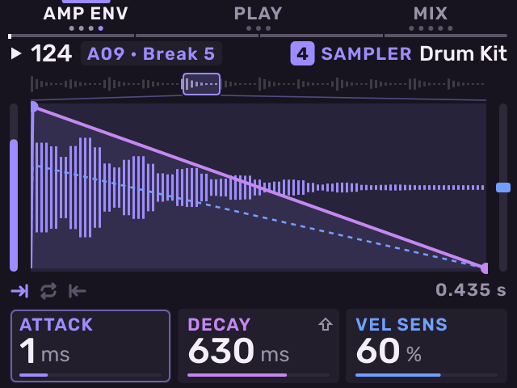

### Change your habits

These are the actions stock users look for first.

1. **Pick a track before you play.** The pads play the selected track. Hold
   **PAD BANK** and press a pad to choose one. The header shows the selected
   track on the right.
2. **Use the kit as before.** Track 1 is a kit. **SAMPLE SELECT**, **SAMPLE**,
   **CHOP**, **SAMPLE RECORD** and **16 LEVELS** work on the kit as on the
   stock app.
3. **Hold SEQ to change patterns.** A tap of **SEQ** opens a page. Holding
   **SEQ** turns the pads into the selected track's patterns. The pattern
   changes at the next bar, or at once when stopped.

   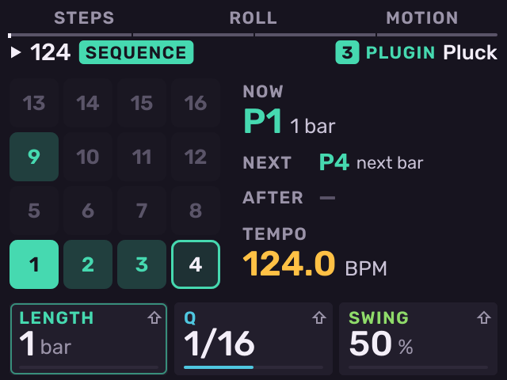

4. **Use SHIFT + encoder push to go back.** Melodee's pages open from each
   other. **SHIFT** + push goes back one page. **B1** is BACK or CANCEL on
   every sheet.
5. **Save on purpose.** There is no background save. Save with **SHIFT** +
   **Pad 16**, **B1**.
6. **Open your stock projects.** On the Project page, press **B2** (**OPEN**)
   and open the **MPC Sample** row at the top of the list.

## Basics

### The panel

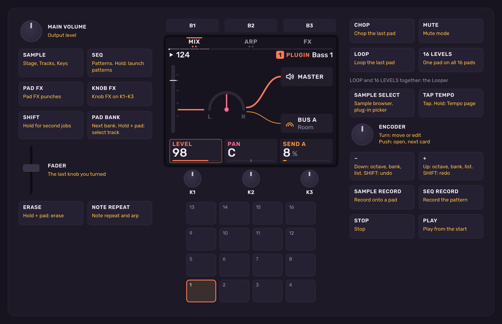

### The screen

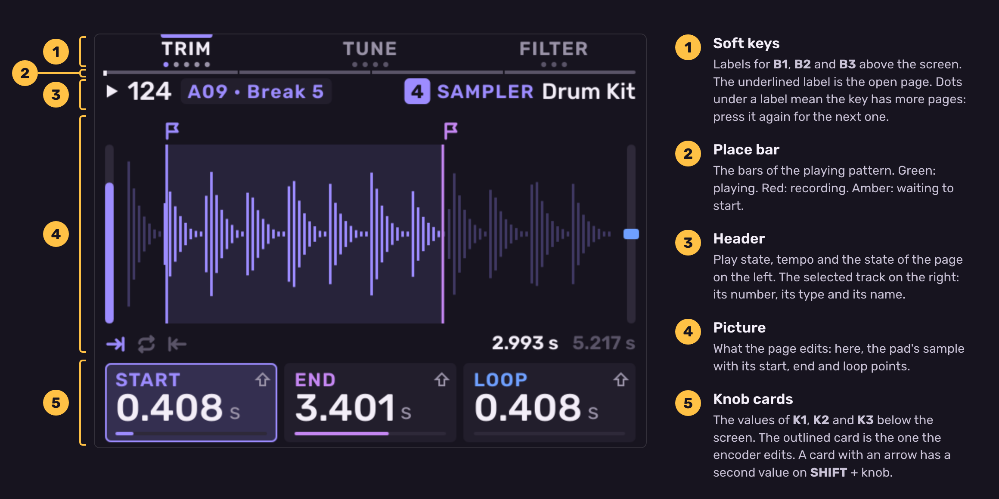

The header shows a state with a symbol and a short word: a play triangle, a
stop square, a red dot while recording, a red ring while recording is
armed. The **place bar** under the soft keys shows where playback is: green
while playing, red while recording, amber while waiting for a bar to start.

Lists work the same way on every page: the symbol before a name shows what
the row is (folder, sample, instrument, plug-in), and facts about it are at
the right edge. **K1** jumps through any list.

### Navigation

| Control | Action |
| --- | --- |
| **B1**, **B2**, **B3** | Select the page or action named above each key. A lit key pressed again goes to its next page. |
| **K1**, **K2**, **K3** | Set the value on the card above each knob. |
| **SHIFT** + **K1**–**K3** | Set the second value of a card with an arrow. |
| Encoder (turn) | Move through a list, or fine-tune the outlined card. |
| Encoder (push) | Open the item under the cursor, or move to the next card. |
| **SHIFT** + encoder push | Go back one page. |
| **−** / **+** | Change the octave on play pages, the bank on kit pages, or move through a list. |
| **SHIFT** + **−** / **+** | Undo / redo. |

### Knob takeover

**K1**–**K3** are absolute knobs. When a knob is not at the value on its
card, the card shows the value dim with a tick where the knob is. By
default the knobs use **Scaled** takeover: the value moves toward the knob
until they meet. Change this in [Settings](#settings) (**KNOBS**).

### Undo

**SHIFT** + **−** undoes, **SHIFT** + **+** redoes. Melodee keeps the last
32 steps. A recording take is one step. Turning a knob is one step per
control. Mute, solo and the transport are not undo steps. Loading or
creating a project clears the undo history.

### Erase and copy

- **ERASE** + pad on a kit, stopped: empty the pad.
- **ERASE** + pad on a kit, playing: erase that pad's notes from the pattern.
- **ERASE** + pad on a synth, plug-in or MIDI track: erase that key's notes
  (asks first).
- **ERASE** + knob: set the value back to its default.
- **ERASE** + fader: clear the fader's Motion lane (asks first).
- **ERASE** pressed alone erases what the page has selected:

| Page | ERASE alone |
| --- | --- |
| Roll | The selected note |
| Steps | The step under the cursor |
| Step Edit | The selected event |
| Patterns | The pattern (asks first) |
| Tracks | The track (asks first) |
| Scenes | The scene's name and tempo |
| Looper | The selected loop (asks first) |
| Effect chains | The selected effect |
| Chop | The selected slice |
| Layers | The selected layer |
| Mod | The selected target |
| Project | The selected project: press twice |
| Song | The clip under the cursor |

- **SHIFT** + **ERASE** copies. Where it picks, press the source, then the
  target. Press **ERASE** to stop.

| Where | SHIFT + ERASE |
| --- | --- |
| **PAD BANK** held, or Tracks | Tracks |
| **SEQ** held, or Patterns | Patterns |
| Steps | A step to another step |
| Roll, Step Edit, a synth's play pages | A key's notes to another key |
| A kit's play pages | Kit pads |
| Song | The clip, placed after itself |
| Project | The selected project |
| Effect chains | The selected effect, placed after itself |
| Chop | The selected slice, onto the next empty pad |

When an action deletes something, Melodee asks first. The question says
what is lost and whether undo brings it back. **B1** cancels, **B3** does
it. Or turn the encoder to pick one and push it.

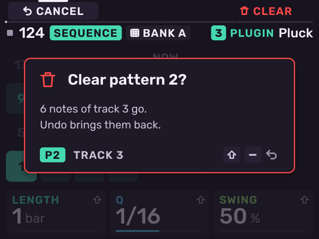

### Mute and solo

Press **MUTE** to turn on mute mode. Hold **MUTE** for mute mode only while
it is held.

- On a kit page, the pads mute kit pads.
- On other pages, the pads mute tracks.
- **SHIFT** + pad solos.
- **SHIFT** + **MUTE** unmutes everything.

Muted pads light red. Soloed pads light white.

### Pad lights

The pads show what a press does on the page:

- A track's colour: the track's notes or pads.
- White: the selected pad, or a panel job (for example while **SHIFT** is
  held).
- Red: muted, about to be erased, or recording.
- Brighter means more important: the selected pad, a note's velocity, a
  playing pattern.
- A blink means the pad waits for the next bar.

Change the pad lights to white or off in [Settings](#settings) (**PADS**).

## Tracks

### Select a track

Hold **PAD BANK** and press a pad. This works on any page. Pad 1 is track 1.
While **PAD BANK** is held for a second, the screen shows all 16 tracks.

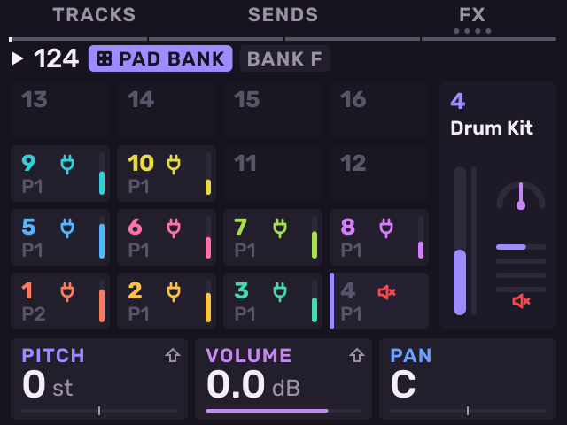

While **PAD BANK** is held:

- Press **B2** (**MOVE**), then a track, then a pad to move the track there.
  A track already there swaps places with it.
- Press **B3** (**COPY**), then a track, then a pad to copy the track there.
- Press **ERASE** + pad to clear that track (asks first).
- Turn the encoder or press **−** / **+** to change the kit's bank.

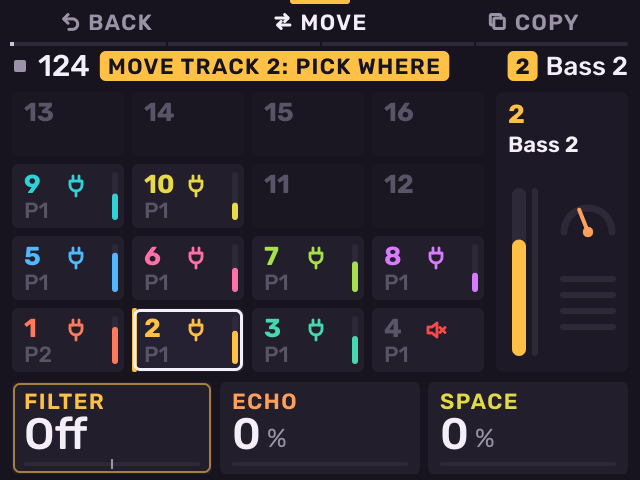

### The Tracks page

Press **SAMPLE** twice (**SAMPLE** from Stage) to open **Tracks**: all 16
tracks as the pads are laid out, with the selected track as a mixer strip on
the right.

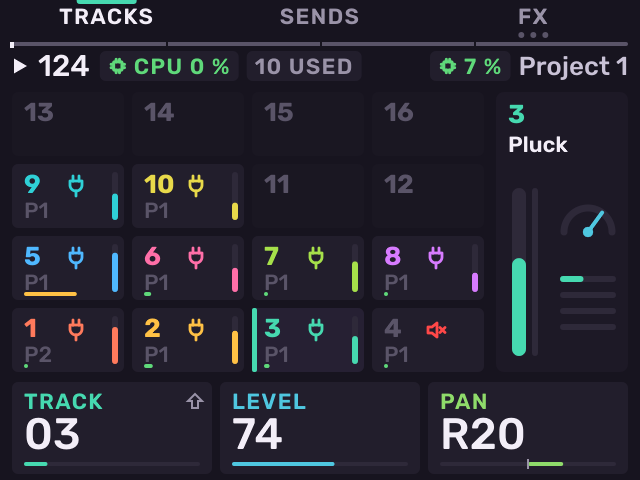

Each cell shows the track number, the pattern it plays, a symbol for its
type and its level. A crossed speaker means muted. The bar along the
bottom of a cell shows how much processing the track uses (green, amber
from 60 %, red from 85 %).

| Control | Action |
| --- | --- |
| Pads | Select a track. |
| **K1** | Select a track. |
| **K2** | Level of the selected track. |
| **K3** | Pan of the selected track. |
| **SHIFT** + **K1** | Track speed: ×½, ×¾, ×1, ×1½ or ×2. The track's patterns play that much slower or faster. |
| Fader | Level of the selected track. |
| Encoder push | Open the track's Stage. |
| **B2** | Open the Looper. |
| **B3** | Open Sends. |
| **SHIFT** + **B2** / **B3** | Move / copy a track. |

### Make a new track

Select an empty track and press **SAMPLE**. Stage shows three choices,
one above each soft key. The knob under each tile changes what it makes.

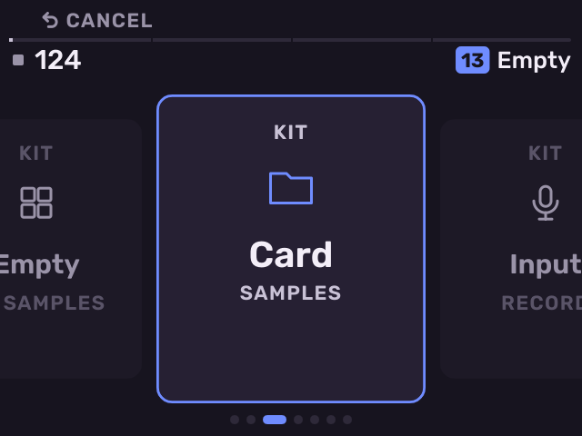

- **B1** (**SYNTH**): a plug-in track. The plug-in picker opens.
- **B2** (**KIT**): a kit. **K2** sets where its first sound comes from:
  samples on the card, or a recording from the input.
- **B3** (**MIDI**): a MIDI track. **K3** sets the MIDI port.

Or turn the encoder to move between the three and push it to make the one
lit.

## Kits and sampling

A kit has 128 pads in 8 banks (A–H). Each pad plays a region of a sample, or
a sampled instrument. A project holds up to 64 samples.

### Stage on a kit

Press **SAMPLE** to open Stage. On a kit, Stage shows the pages of the last
pad you hit. Hit a pad to edit it, or hold **SAMPLE** and press a pad to
select it without playing it.

| Key | Pages |
| --- | --- |
| **B1** | **TRIM**, **LAYERS**, **MIX**, **AMP ENV**, **SENDS** |
| **B2** | **TUNE**, **PLAY**, **FOLLOW**, **CLOUD** |
| **B3** | **FILTER**, **FILT ENV**, **KIT FILT** |

Press the lit key again to go to its next page. Each track remembers its
last page. Press **−** / **+** to change the bank.

**TRIM**

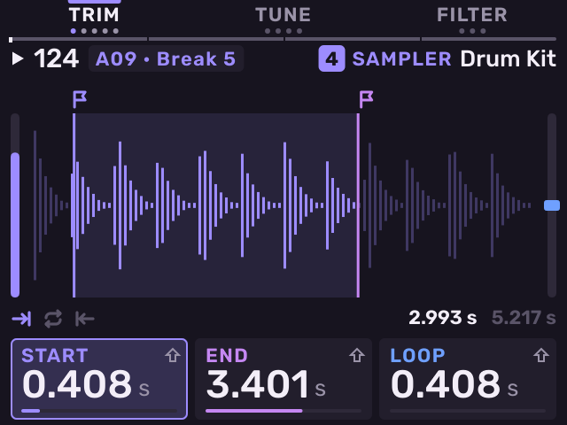

- **K1**: start. **K2**: end. **K3**: loop point.
- **SHIFT** + **K1**–**K3**: zoom in at that point.
- **SHIFT** + **B1**: Loop Lock. **SHIFT** + **B2**: Normalize.

**LAYERS**: up to four samples on one pad.

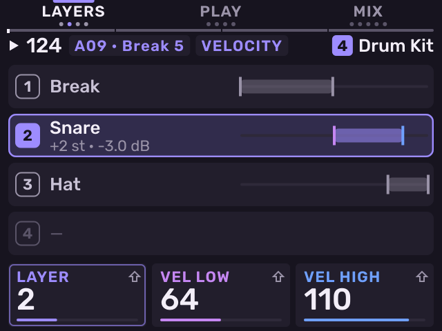

- **K1**: the layer. **K2** / **K3**: the lowest and highest velocity that
  plays it.
- **SHIFT** + **K1**: how a hit picks layers: **Velocity** (every layer in
  range plays), **Cycle** (the next layer each hit) or **Random**.
- **SHIFT** + **K2** / **K3**: the layer's tune and level.
- **SHIFT** + **B1** (**LOAD**): load a sample onto the layer. **SHIFT** +
  **B2** (**CLEAR**): remove the layer.

**MIX**: **K1** volume, **K2** kit volume, **K3** pan.

**AMP ENV**: **K1** attack, **K2** decay (release in Note On mode), **K3**
velocity sensitivity. **SHIFT** + **K2** sets whether decay starts from the
start or the end.

**SENDS**: the kit track's four sends. **K1** selects bus A–D, **K2** sets
the send, **K3** the bus return.

**TUNE**: **K1** semitones, **K2** fine tune in cents, **K3** Warp (Off,
50–200 %, or Seq to fit the sample to the tempo). **SHIFT** + **K3** sets
the number of beats in the sample.

**PLAY**: **K1** Mono or Poly, **K2** mute group, **K3** start offset.
**SHIFT** + **K2**: Pad Link. **SHIFT** + **K3**: loop crossfade. New pads
are Mono: a new hit stops the pad's last one at the same pitch, so 16 Levels
chords still sound. A loaded instrument is Poly.

**FOLLOW**: the kit follows the project tempo. **K1** on or off, **K2** the
mode (Beats, Tones or Tape), **K3** how pitch follows.

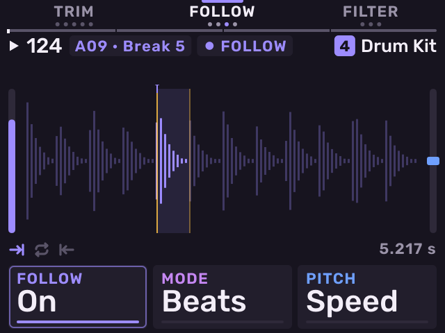

**CLOUD**: every pad of the kit plays as a grain cloud. **K1** position,
**K2** grain size, **K3** density. **SHIFT** + **K1** scan, **SHIFT** +
**K2** spread, **SHIFT** + **K3** Cloud on or off.

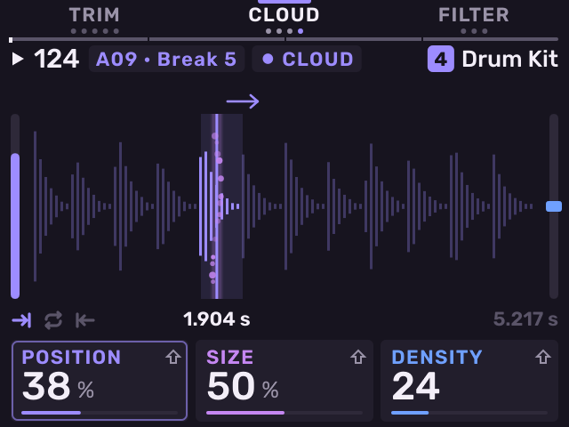

**FILTER**: **K1** cutoff, **K2** resonance, **K3** type (Off, Classic,
LPF2, LPF4, HPF2, HPF4, BPF2, BPF4).

**FILT ENV**: **K1** attack, **K2** decay, **K3** depth.

**KIT FILT**: one filter after every pad of the kit: cutoff, resonance and
type.

### The Pads page

Press **SAMPLE** three times to open **Pads**: the bank in view, each pad
with its own waveform. **K1** pitch, **K2** level, **K3** pan of the last
pad. Push the encoder to open a map of all the sample pages.

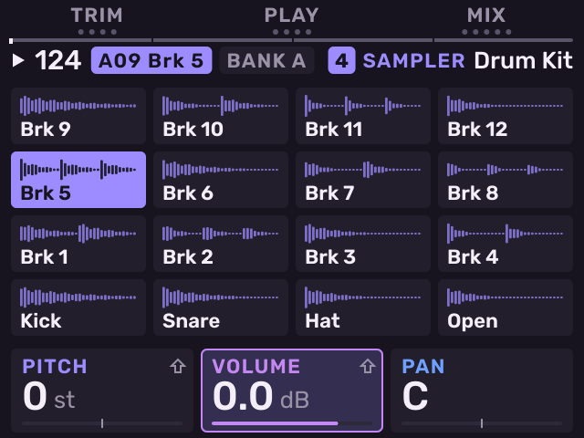

### Loading samples

Press **SAMPLE SELECT** on a kit to open the sample browser.

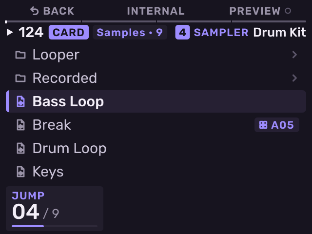

| Control | Action |
| --- | --- |
| Encoder, **−** / **+** | Move through the list. |
| Encoder push | Open a folder, or load the file onto the last pad you hit. |
| **B1** | Go back out of a folder. |
| **B2** | Switch between the card (**CARD**) and the MPC's factory samples (**INTERNAL**). The internal drive is read only. |
| **B3** | **PREVIEW**: play each file when you move to it. |
| **SHIFT** + pad | Load the file onto the next empty pad. |

Put your samples in a folder named `Samples` at the top level of the card.
Melodee reads WAV (16, 24 or 32-bit), MP3 and FLAC files, any sample
rate, up to 60 seconds. MP3 and FLAC rows show their format at the right. It writes recordings and edits into `Samples` too.

### Sampled instruments

The browser loads multi-sampled instruments onto one pad. Each is tagged
with its type.

| Type | Files |
| --- | --- |
| SFZ | `.sfz` |
| MPC keygroup program | `.xpm`, or `.xty` from MPC 3 |
| MPC drum program | `.xpm` or `.xty`, tagged **KIT**: loads as the whole kit |
| MPC expansion | `.xpn`, tagged **INSTALL**: installs into `Samples/Expansions` |
| Logic EXS24 / Sampler | `.exs`, with its samples in the same folder |
| SoundFont | `.sf2`: opens as a folder of presets |
| DecentSampler | `.dspreset` |

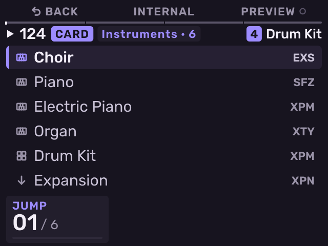

The first load decodes the instrument's files into `Melodee/Cache` on the
card. This can take a while for a large library. After that the instrument
opens at once and streams from the card.

On an instrument pad, Stage's **TRIM** page shows **ZONES**: the
instrument's key and velocity zones over a keyboard. The key you play
selects the zone. **K1** selects a zone, **K2** tunes it and **K3** sets its
level, for this pad only. If the instrument asks for something Melodee does
not play, it is named on this page.

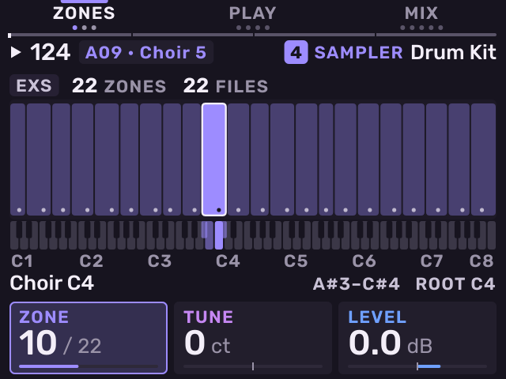

To play an instrument in pitch, use **16 LEVELS** with the type Scale or
Tune (see [16 Levels](#16-levels)). While 16 Levels is on, a MIDI keyboard
plays the instrument at its real pitch.

### Banks

A bank file saves one bank of 16 pads, with their settings and effects.

- To save the bank in view: open the sample browser and press **SHIFT** +
  **SAMPLE SELECT**. Name the bank. It is saved in `Samples/Banks`.
- To load a bank: select the bank with **PAD BANK**, then push the encoder
  on a bank file (tagged **BANK**) in the browser.

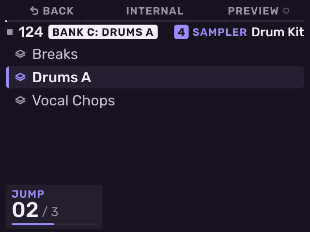

### Chop

Press **CHOP** to slice the last pad's sample. The pads play the slices.

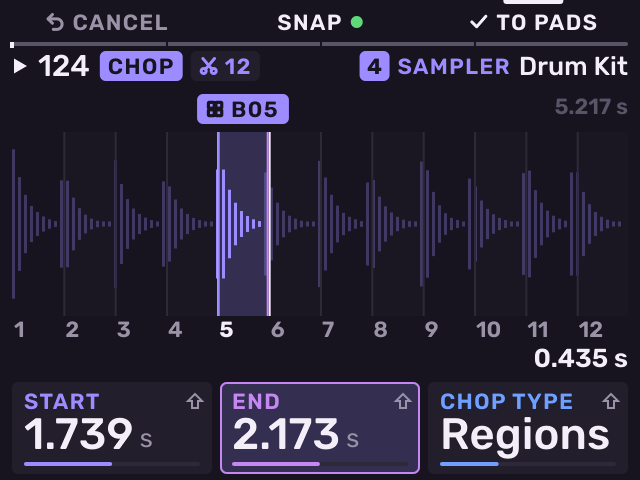

| Control | Action |
| --- | --- |
| **K1** / **K2** | Start / end of the selected slice. |
| **K3** | Chop type: Threshold, Regions, Beats or Manual. |
| **SHIFT** + **K3** | The amount for that type (threshold, number of regions, beats). |
| **SHIFT** + **K1** / **K2** | Zoom. |
| **B2** (**SNAP**) | Snap cuts to zero crossings, so slices do not click. |
| **B3** (**TO PADS**) | Put the slices on pads. |
| **B1** (**CANCEL**) | Leave without changing the pads. |
| **SHIFT** + **B1** | Extract the slice to a new file on the next empty pad. |
| **SHIFT** + **B2** / **B3** | Split / merge slices. |
| **ERASE** + pad | Remove a slice. |

**Beats chop**: Melodee finds the sample's own tempo when it loads, and
Beats cuts a slice every 1–8 of its beats from the start of the region. The
tempo shows at the top right. Each cut lands on the hit at that beat. To cut
on the bar, set the region's start on the first beat. A sample with no
steady beat uses the project's tempo.

**Manual chop**: set **K3** to Manual, or push the encoder. Pad 1 plays the
sample. Tap other pads while it plays to cut there.

Press **CHOP** again to return to **TRIM**. Melodee keeps each sample's
slices with the project.

### Record a sample

Press **SAMPLE RECORD** on a kit to open **Record**.

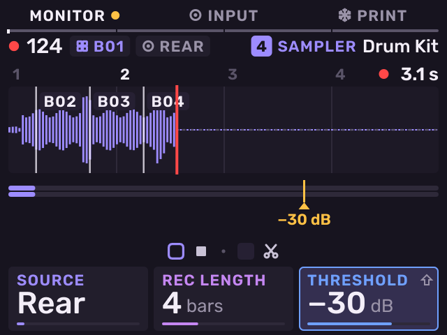

1. Use **K1** to choose the source, **K2** the length (Free, Seq, or 1–16
   bars) and **K3** the threshold.
2. Tap a pad. Recording starts at the threshold, or when the pattern comes
   round if the length is Seq.
3. Tap other pads during the take to cut it there.
4. To stop, tap the pad again, press **STOP** or push the encoder. To stop
   and open **TRIM**, press **SAMPLE RECORD**.

Takes are saved in `Samples/Recorded`, up to 60 seconds each.

**Input Config** (**SHIFT** + **SAMPLE**, or **B2** on Record) sets the
input. **K1** source: Mic, Rear (L, R or both), USB (L, R or both),
Resample, or any track with a sound. **K2** length, **K3** threshold,
**SHIFT** + **K3** gain. **B2** sets monitoring (Off, Auto, On). **B3**
records through Knob FX.

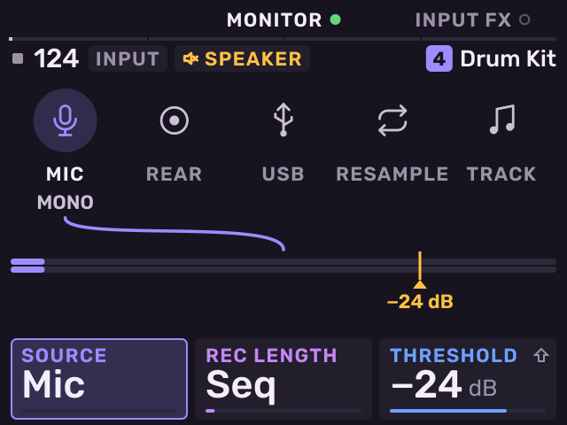

To sample a Melodee track, choose **Track** as the source. During the take
the pads play that track.

### Audio Recall and Resample

- **Audio Recall** (**SHIFT** + **SAMPLE RECORD**): the input is always
  recorded into a 25-second buffer. Audio Recall puts the last phrase onto
  the next empty pad.
- **Resample** (**SHIFT** + **Pad 11**, then a pad): records the selected
  pattern with every track playing onto the pad you press. On the Song page,
  it records the song.
- **Trim Sample** (**SHIFT** + **Pad 13**): save the pad's region as a new
  file and set the pad to all of it.
- **Save Sample** (**SHIFT** + **SAMPLE SELECT**): save the pad's region as
  a WAV file in `Samples`.

### 16 Levels

Press **16 LEVELS** to spread the last pad (or a plug-in track's last note)
over all 16 pads. Press it again to go back.

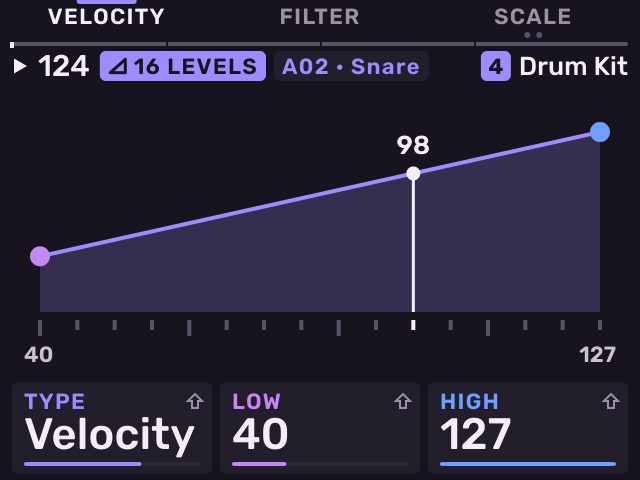

Use **K1** or **SHIFT** + **16 LEVELS** to choose the type:

- **Velocity**: each pad plays louder, from pad 1 to pad 16.
- **Filter** (kits): each pad opens the filter more.
- **Tune**: each pad plays a semitone higher. The original pitch is on pad 4.
- **Scale**: each pad plays the next note of the project's scale. **K2**
  sets the root, **K3** the scale.
- **Loop**: opens the Looper.

For Velocity, Filter and Tune, **K2** sets pad 1's value and **K3** pad 16's.
Press **−** / **+** to change the octave in Scale and Tune.

While 16 Levels is on a kit pad, a MIDI keyboard plays that pad on every key.
C4 (key 60) plays a sample as the pad plays it; an instrument plays at its
real pitch.

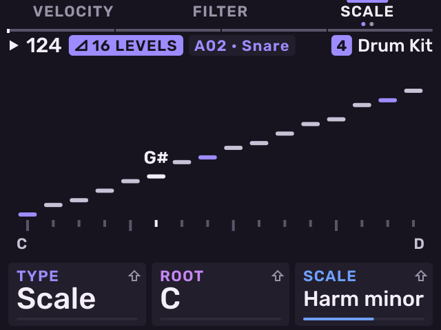

### Loop, reverse and Note On

These act on the last pad from any page:

- **LOOP**: loop the pad on or off.
- **SHIFT** + **LOOP**: reverse the pad.
- **SHIFT** + **CHOP**: switch between Note On (plays while held) and One
  Shot.
- **SHIFT** + **Pad 15** (Warp): Time stretch or Pitch for the kit.

## Plug-ins

Melodee hosts VST3, CLAP and VST2 plug-ins, instruments and effects.

### What runs

Put plug-ins in a folder named `Plugins` at the top level of the card, in
any subfolders. Melodee loads plug-ins built for the MPC's ARM processor:

- VST3 bundles with a `Contents/aarch64-linux/` build.
- CLAP plug-ins (`.clap` files) built for 64-bit ARM Linux (aarch64).
- [Open MPC](https://open-mpc.github.io) plug-in folders (a VST2 `.so`
  with a `plugin-meta.xml`).
- VST2 `.so` files for 64-bit ARM (aarch64), or 32-bit ARM (armv7). 32-bit
  plug-ins run in a separate bridge process. If one crashes, only the
  bridge stops.

Most commercial plug-ins have no Linux ARM build. The picker shows plug-ins
that cannot run dimmed, with the reason.

The Melodee synths are Open MPC plug-ins:

| Plug-in | Sound |
| --- | --- |
| **Melodee Poly** | Two oscillators with sync and noise, four-pole ladder filter, two envelopes, LFO, poly mod, glide, unison, drift. Eight voices. |
| **Melodee PD** | Phase distortion with eight waveforms, two lines, DCW and DCA envelopes. Eight voices. |
| **Melodee Chip** | Chip voice with ring and sync, pulse width LFO, crush and a multimode filter. Six voices. |

Each has factory presets, pad pressure and its own mod matrix. They are free
downloads: [Melodee Poly](https://github.com/keremimo/mpc-vst-melodee-poly/releases/latest), [Melodee PD](https://github.com/keremimo/mpc-vst-melodee-pd/releases/latest) and
[Melodee Chip](https://github.com/keremimo/mpc-vst-melodee-chip/releases/latest). From each release, download the
`-mpc-sample.zip` and copy it into `Plugins`. The next time the plug-in
picker opens, Melodee unzips it, deletes the zip and lists the plug-in folder
(for example `Ellic Studio - VST - Melodee Poly`). A zip that cannot be
unzipped stays, dimmed, with **Won't unzip**.

### Plug-in instruments

1. Select an empty track and press **SAMPLE**.
2. Press **B1** (**SYNTH**). The plug-in picker opens on `Plugins`.
3. Turn the encoder to a plug-in and push to load it.

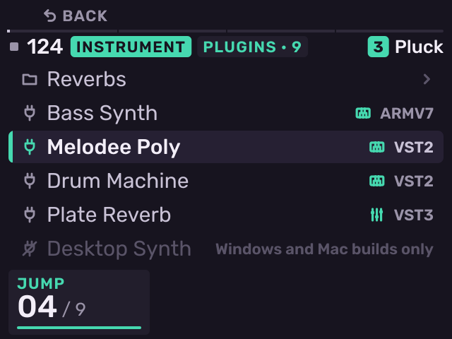

The picker tags each plug-in with its format (VST3, CLAP, VST2, ARMV7) and shows
a keyboard for instruments or sliders for effects. A bundle with many
plug-ins shows as one row with a count; push to open it.

To change a track's plug-in, press **SAMPLE SELECT** on the track.

**Edit**: push the encoder on Stage (**MIX**, **SENDS**, **ARP** or
**CHORD**) or on **Keys** to open the plug-in's parameters.

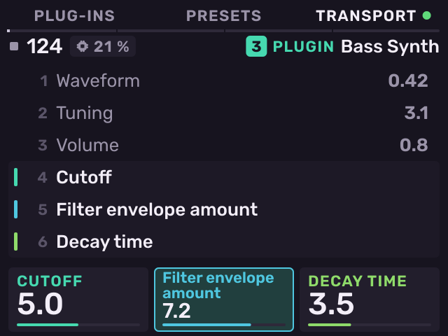

- **K1**–**K3** set the three parameters shown, in their colours.
- Turn the encoder or press **−** / **+** to move to other parameters.
- The header shows how much of each audio block the plug-in uses.
- **B1** opens the picker. **B2** (**PRESETS**) opens the plug-in's presets.

**Presets**: turn the encoder to a preset and push to load it. The page
stays open, so you can play each preset in turn. **B1** goes back.
CLAP plug-ins list no presets here.

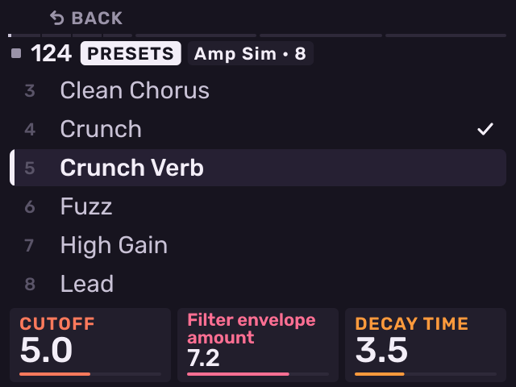

The project saves each plug-in's state, so presets and edits come back when
you load the project.

### Drum machine plug-ins

A drum machine plug-in that names its voices (for example Open MPC drum
machines) sets its track's pads to **Drums**: pad 1 of bank A plays note 36,
the drum rack layout of the MPC and most DAWs. Each pad shows the voice it
plays. For any other drum plug-in, set **K3** to Drums on **Keys**.

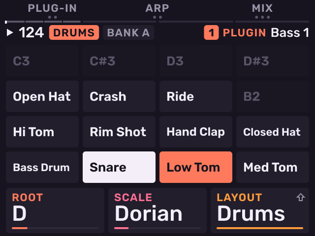

### Plug-in effects

On an effect chain (see [Effect chains](#effect-chains)), open the effect
picker and choose the last family, **Plug-ins**. Track, bus, master and
loop chains take plug-ins.

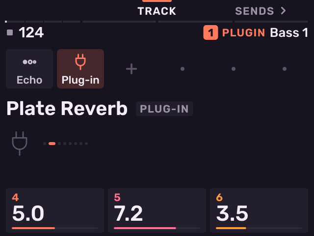

To open a plug-in effect's presets, push the encoder on its slot.

### Amp sim: Neural Amp Modeler

Neural Amp Modeler plays amp and pedal captures (`.nam` files) with a cab
IR. Its MPC Sample build comes as `NeuralAmpModeler-<version>-mpc-sample.zip`:
unzip it into `Plugins`. Put the files it plays in
`Melodee/Plugin Data/Neural Amp Modeler`:

- `Models`: `.nam` captures, in folders if you like.
- `IRs`: cab impulse responses (`.wav`).

Melodee makes both folders the first time the plug-in opens. Files added
later show the next time it opens.

Load it as a plug-in effect on a track chain. Its first row is **Model**,
**Cab** and **Output**; turn **K1** or **K2** to pick a file. The second row
is **Bass**, **Middle** and **Treble**. Captures always play at their lite
size, which the MPC runs in about a sixth of a block. A cab IR longer than
8192 samples is cut there.

### Plugin Data

Plug-ins save their settings and presets in `Melodee/Plugin Data` on the
card, laid out as a Linux home folder. Most use a hidden `.config` folder
there. On a Mac, press Cmd-Shift-. in Finder to show it.

### Latency and sample rate

Melodee compensates for plug-in latency: tracks, buses and MIDI out are
delayed to line up with the slowest path. Settings' **AUDIO** page shows
the compensation (**PDC**). Open MPC plug-ins run at 44.1 kHz. At 48 or 96
kHz Melodee converts their audio, so they play in tune at any rate.

## Instrument and MIDI tracks

### Stage on a plug-in track

| Key | Pages |
| --- | --- |
| **B1** | **MIX**, **SENDS** |
| **B2** | **ARP**, **CHORD** |
| **B3** | **FX** |

**MIX**: **K1** level, **K2** pan, **K3** send to bus A.

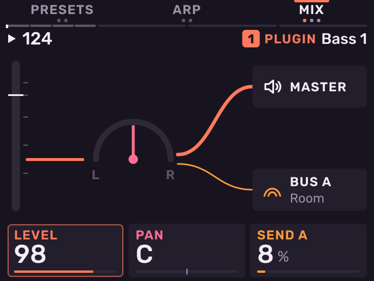

**SENDS**: **K1** selects bus A–D, **K2** sets the send to it, **K3** the
bus return. The picture shows the four buses and each bus's first effect.

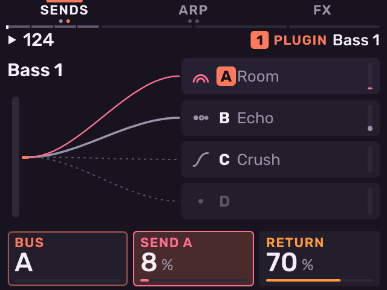

**ARP**: **K1** mode (Up, Down, Up-down, Random, Order), **K2** rate (1/4 to
1/32T), **K3** octaves. **SHIFT** + **K1** gate, **SHIFT** + **K3** hold.
**NOTE REPEAT** turns the arpeggiator on.

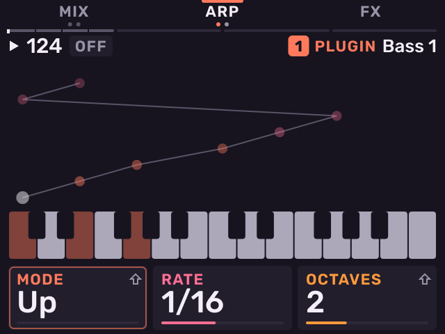

**CHORD**: one pad plays a chord from the scale. **K1** type (Triad, Dia 7,
Sus2, Sus4, Power, Dia 9), **K2** voicing (Close, Open, Drop 2, Spread),
**K3** inversion. **SHIFT** + **K1** turns chords on or off. **SHIFT** +
**K3** hold.

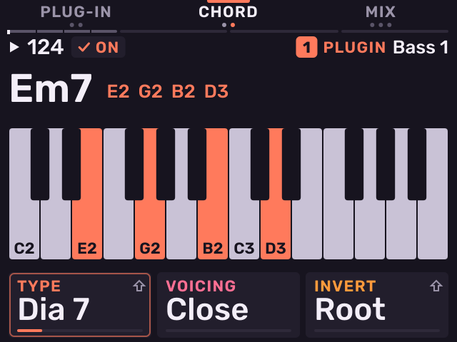

**FX**: the track's effect chain. The cards edit the selected slot. Push the
encoder for the next slot. With no effects, push opens the effect picker.

### Keys

Press **SAMPLE** twice from Stage to open **Keys**. The 16 pads fill the
screen. Each pad shows its note and its degree in the scale. Root notes are
in the track's colour.

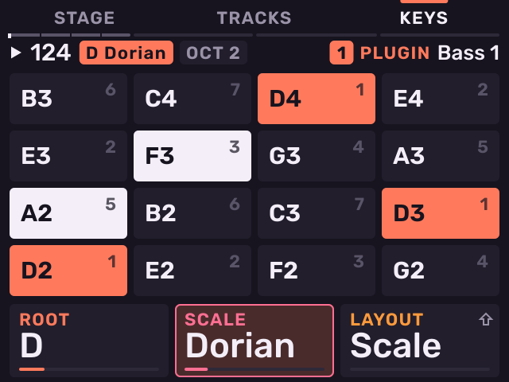

- **K1**: root. **K2**: scale. **K3**: layout (Scale, Chromatic, Chords,
  16 Levels or Drums).
- **−** / **+**: octave.
- **SHIFT** + **K3**: transpose the pads −12 to +12 semitones.
- Encoder push: open Edit.

The key and scale belong to the project. The layout belongs to each track.

### MIDI tracks

A MIDI track sends its pads, patterns and arpeggiator to an external
instrument on its own port and channel.

| Key | Pages |
| --- | --- |
| **B1** | **DEVICE**, **PROGRAM** |
| **B2** | **CC** |
| **B3** | **ARP**, **CHORD** |

**DEVICE**: **K1** port (the MIDI Out jack, USB-C, all USB devices, or a
USB device by name), **K2** channel. The picture shows the notes going out.

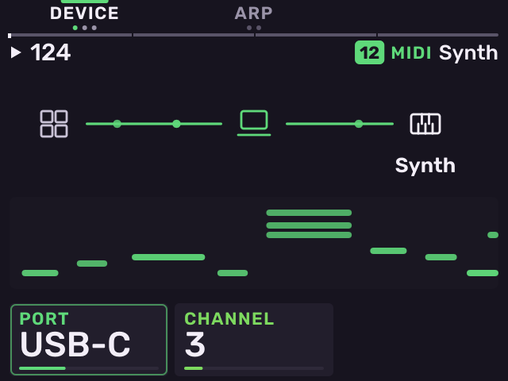

**PROGRAM**: bank MSB, bank LSB and program number. Melodee sends them
when they change and when the track loads.

**CC**: three MIDI CCs on **K1**–**K3**. **SHIFT** + knob selects the CC
number. Knob moves record as Motion.

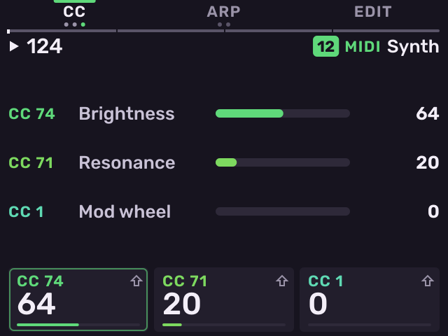

Edit on a MIDI track has more pages: eight **SLOTS** pages with 24 knobs
(CC, 14-bit CC, pitch bend, channel pressure or NRPN), **EXPRESS** (pitch
bend and pad pressure), **PADS** (Keys or Drums with General MIDI drum
names), **AUDIO** (route an input into the track's mixer strip) and
**SYSEX** (send a `.syx` file from the `SysEx` folder on the card). For
how MIDI tracks were designed, see the
[MIDI tracks design notes](MIDI_TRACKS.md).

## Sequencing

### Patterns

Press **SEQ** to open **Patterns**. Tracks are listed down the screen and
their 16 patterns across it. A filled cell has notes. The pads play the
selected track.

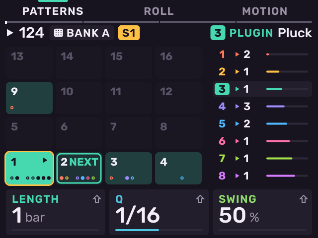

| Control | Action |
| --- | --- |
| **K1** | Pattern length: 1, 2, 4 … 128 bars. **SHIFT**: any number of bars. |
| **K2** | Grid (Q): 1/4 to 1/64, with triplets. **SHIFT**: time signature. |
| **K3** | Swing (50–75 %). **SHIFT**: metronome level. |
| Encoder | Move the playhead by a beat. **SHIFT** + **PLAY** continues from there. |
| Encoder push | Open Scenes. |
| **SEQ** | Open the selected track's editor: Steps, Roll or Motion. |

### Hold SEQ

Hold **SEQ** on any page. The pads become the selected track's patterns:

- The playing pattern is bright, a queued pattern blinks, patterns with
  notes are dim.
- Press a pad to launch that pattern at the next bar (at once when stopped).
- Press more pads in the same hold to make a **pattern chain** (up to
  eight). Each pattern plays once, then the next.
- **SHIFT** + pad launches that **scene**: the pattern on every track that
  has notes there.
- Hold a pad and press another to copy the pattern.
- **ERASE** + pad clears the pattern (asks first).
- **K1**–**K3** set the pattern's length, grid and swing. The encoder sets
  the tempo.
- **B1**–**B3** open Steps, Roll and Motion.
- **−** / **+** launch the previous / next pattern.

After 0.3 seconds the **Sequence** sheet shows the patterns and the chain:
what plays now, what plays next, and the tempo.

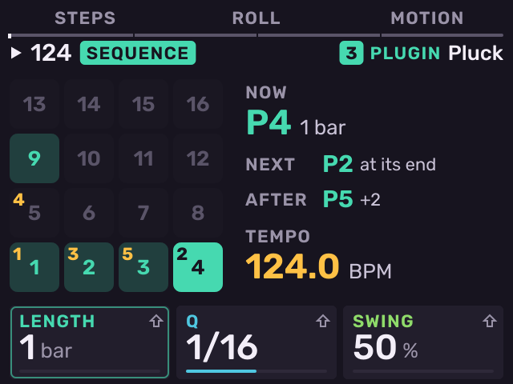

### Record

1. Select a track and a pattern.
2. Press **SEQ RECORD**. When stopped, this arms recording.
3. Press **PLAY**. Recording starts. When playing, **SEQ RECORD** records at
   once.
4. Press **SEQ RECORD** again to stop recording. Playback continues.

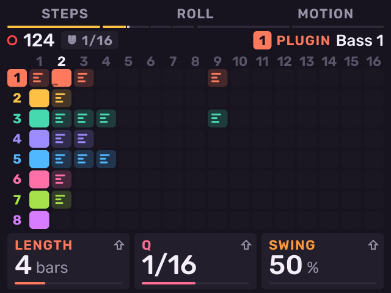

Recording adds to the notes already in the pattern. Each take is one undo
step. Turn a knob while recording to record it as Motion.

- **SHIFT** + **Pad 4**: count-in on or off.
- **SHIFT** + **TAP TEMPO**: metronome Off, On, or Rec (only while
  recording).
- **SHIFT** + **Pad 10**: **Rec Quantize**. **B3** turns it on or off. The
  encoder sets the grid: the pattern's Q, or its own.
- Hold **PLAY** while playing: Fill. Notes with a FILL condition play.

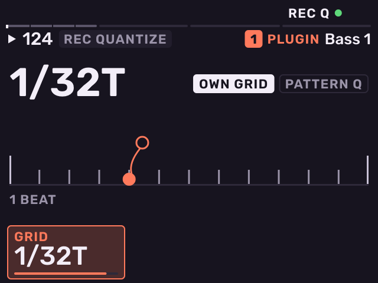

**Recall** (**SHIFT** + **SEQ RECORD**): Melodee always keeps the notes you
play, recording or not. Recall puts the last phrase into patterns: every
track that played goes into its next empty pattern, and those patterns
start playing. This is one undo step.

### The pattern editors

On Patterns, press **SEQ** to open the selected track's editor. **B1**
**STEPS**, **B2** **ROLL** and **B3** **MOTION** switch between them. Press
**SEQ** to go back to Patterns.

**Steps**

Steps shows the 16 steps of one bar on the pads. Each step's notes stack by
pitch and grow taller with velocity.

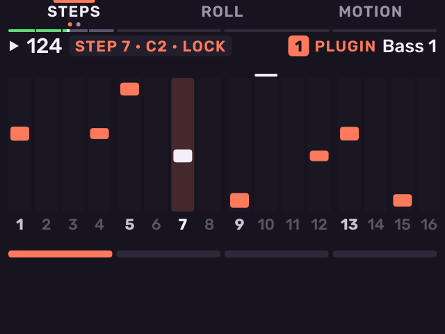

- Press a pad to set or clear a step. On a kit, Steps edits the last pad
  you hit. Turn the encoder while holding a step to move its note to
  another pad.
- **K1** length, **K2** velocity, **K3** chance of the step's note.
- **Hold a step** and turn a knob to lock a value on that step (a parameter
  lock). A locked step shows a square at its top.
- Press **STEPS** again for the **TRIG** row: **K1** ratchet (1–8 hits),
  **K2** ramp, **K3** trig condition (Always, n:m, Fill, First, Pre, Nei and
  their opposites).
- On a kit, press **STEPS** a third time for **EUCLID**: **K1** hits,
  **K2** steps, **K3** rotation.
- On a kit, **SHIFT** + **K1** sets the lane length, so a pad's lane can
  loop at its own length.
- Push the encoder for **VARY**: Thinner, Busier, Humanised, Reversed,
  Octave up or down. **B3** (**DO IT**) writes the result into the next empty
  pattern.

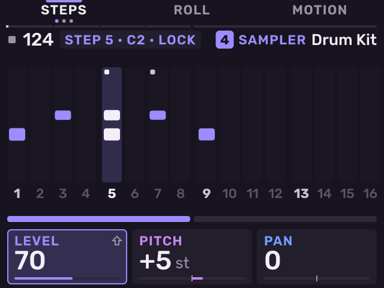

**Roll**

Roll is a piano roll. On a kit, each row is a pad.

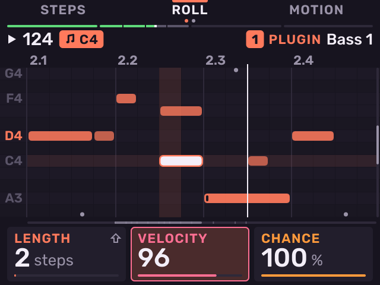

- Turn the encoder to move the cursor a step. **SHIFT** + encoder moves note
  to note. **−** / **+** move the cursor's pitch.
- A pad writes a note at the cursor, one step long.
- **K1** length, **K2** velocity, **K3** chance of the note under the cursor.
  **SHIFT** + **K1**: nudge the note early or late.
- **ERASE** pressed alone deletes the note under the cursor.
- Push the encoder for the note sheet: accent, slide, tie and delete as
  cards. Turn the encoder to pick one and push it. **B1** closes it.
- Press **ROLL** again for the note's ratchet.

**Step Edit**

Press **SHIFT** + **SEQ** to enter notes one step at a time, with the
transport stopped.

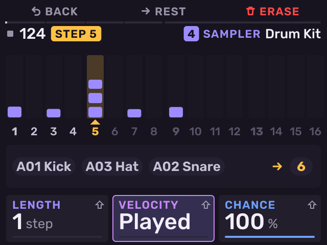

- Play a pad or a chord. It is written at the caret, and the caret moves to
  the next step.
- **B2** (**REST**) moves on without writing. **B3** (**ERASE**) goes back
  and clears that step. The encoder moves the caret.
- **K1** note length in steps, **K2** velocity (Played uses your velocity),
  **K3** chance.
- **B1**, encoder push or **SEQ** go back to the editor.

**Motion**

Motion shows the pattern's recorded knob movements as lanes. To record
Motion, turn a knob while **SEQ RECORD** is on. To clear a lane, press
**ERASE** + the knob.

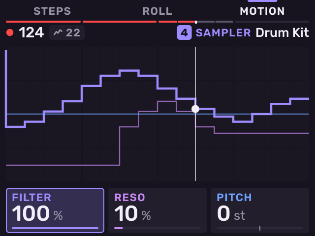

Press **MOTION** again for **MOD**:

- **B1** (**MOD**): eight modulators. Each is an LFO (synced or free) or an
  envelope follower of a track or bus. It moves up to four parameters
  anywhere in the project. **B3** (**ADD**) assigns the last knob you turned.
- **B2** (**MACRO**): eight macros. Each turns up to eight parameters at
  once, each between its own low and high value.

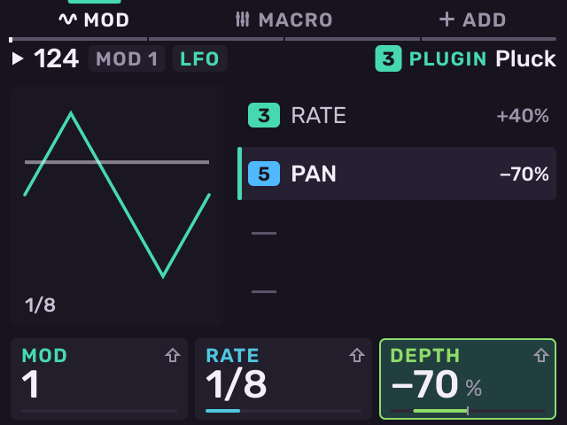

### Time Correct

Press **SHIFT** + **Pad 14**. Time Correct changes how the pattern plays
without moving the notes.

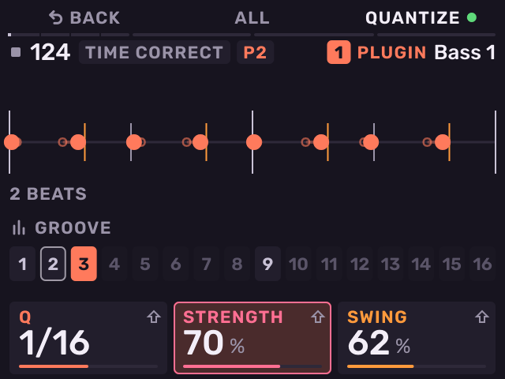

- **K1** grid, **K2** strength, **K3** swing.
- **SHIFT** + **K1** humanize, **SHIFT** + **K2** velocity humanize,
  **SHIFT** + **K3** groove amount.
- Press a pad to take the groove from another pattern of the track.
- **B3** (**QUANTIZE**) turns it off and on, to compare.
- **B2** (**ALL**) applies the same settings to the track's other patterns.

**SHIFT** + **Pad 2** / **Pad 3** halve / double the pattern length.
**SHIFT** + **Pad 6** / **Pad 7** play it at half / double speed.

### Scenes and follow actions

Push the encoder on Patterns to open **Scenes**. A scene is one column of
patterns: scene 3 is pattern 3 on every track.

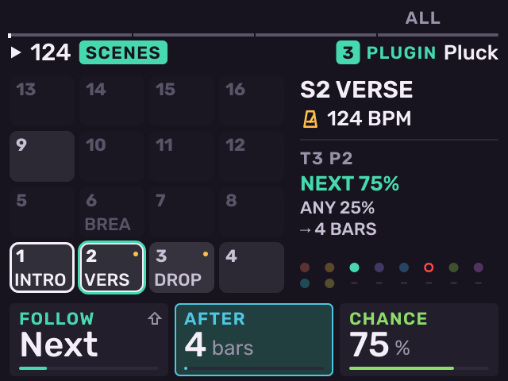

- Press a pad to launch its scene at the next bar. Tracks with no notes in
  that column keep playing.
- Push the encoder to name the scene. Turn the encoder to give it a tempo.
- **ERASE** + pad clears the scene's name and tempo.

The cards set the **follow action** of the selected track's pattern: what
the pattern does after it has played for a while.

- **K1** (**FOLLOW**): Next, Previous, Any, Again or Stop.
- **K2** (**AFTER**): after 1–64 bars, or 1–64 plays.
- **K3** (**CHANCE**): the chance of the first action. **SHIFT** + **K1**
  (**OR**) sets the second action.
- **B3** (**ALL**) applies the follow action to every track in the column.

### Tempo

Hold **TAP TEMPO** for half a second to open the **Tempo** page. Tap **TAP
TEMPO** to set the tempo by tapping.

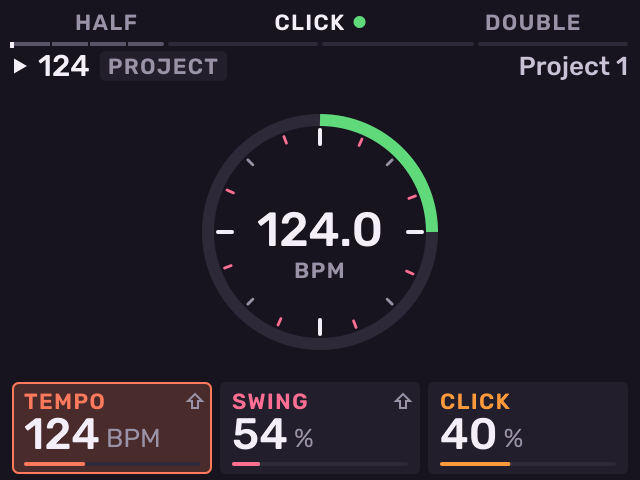

- **K1** tempo, **K2** swing, **K3** click level.
- **B1** halves, **B3** doubles the tempo. **B2** (**CLICK**) sets the
  metronome Off, On or Rec.
- The encoder changes the tempo by 0.1 BPM, **−** / **+** by 1 BPM.
- Push the encoder to switch between one tempo for the project and a tempo
  for each pattern.

## Song

Press **SHIFT** + **Pad 12** to open **Song**. Each track has a lane. Each
lane holds clips of that track's patterns.

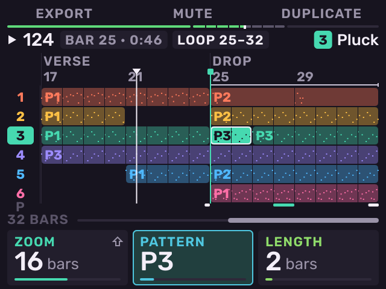

| Control | Action |
| --- | --- |
| Encoder | Move the cursor by a bar. |
| Pads | Select a lane. |
| **K1** | Zoom (4–64 bars). |
| **K2** / **K3** | The next clip's pattern and length, or the clip under the cursor. |
| **B3** | Place a clip. On a clip: duplicate it after itself. |
| **B2** | Mute or unmute the clip. |
| **SHIFT** + **B2** | The clip's Motion on or off. |
| **SHIFT** + **B3** | Make the clip's pattern its own copy. |
| Encoder push | Open the clip's notes. On empty time, place a clip. |
| **CHOP** | Split the clip at the cursor. |
| **ERASE** | Delete the clip. |
| **NOTE REPEAT** | Repeat the clip up to the next marker. |
| **LOOP** | Loop the clip's bars. |
| **SHIFT** + encoder push | Add a marker. On a marker: name it. |
| **−** / **+** | Jump between markers. |
| **PLAY** | Play the song from the cursor. |

When the song plays, patterns you launch are recorded as clips.

**Tempo lane**: **SHIFT** + **K1** sets the tempo from the cursor's bar.
**SHIFT** + **K2** sets the change as a step or a ramp.

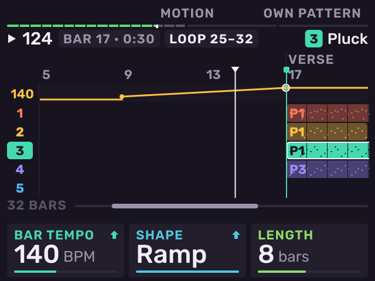

### Export

Press **B1** (**EXPORT**):

- **B2** exports. Turn the encoder first to choose what: a mixdown (32-bit
  float, 24-bit or 16-bit WAV), **STEMS** (one WAV per track and bus, plus
  the mix), or a **MIDI FILE**.
- **B3** (**NEW PATTERN**) writes the song into new patterns, end to end.

Exports go to `Melodee/Mixdowns`, `Melodee/Stems/<name>/` and
`Melodee/MIDI` on the card. A `.mid` file in the browser loads its notes
onto the selected track's pattern.

## Looper

The Looper records four audio loops, L1 to L4, that follow the tempo. Each
loop is a track with its own mixer strip and effect chain.

To open the Looper, press **LOOP** and **16 LEVELS** together, from any
page. The first time, the Looper is off: press **B3** or push the encoder to
turn it on.

**B1** (**LOOPS**) shows four rings, one for each loop: its waveform, a hand
where it plays, its state and its length. Red: recording. Amber: overdub.
Grey: stopped.

- **K1** selects the loop, **K2** its length (Free, or 1–16 bars), **K3**
  its level.
- **SHIFT** + **K1** feedback, **SHIFT** + **K2** quantize (Bar, Beat,
  Off), **SHIFT** + **K3** what happens after a take (Play, Overdub, Stop).

To record a loop:

1. Press **B3** (**MORE**) and turn **K1** (**SOURCE**) to choose what the
   loop records: the input, a track, another loop, or the mix.
2. Press **PLAY**, then push the encoder. The loop starts recording at the
   next bar.
3. Push again: the loop closes at the next bar and plays.
4. Push while it plays to overdub. Push again to stop overdubbing.

The pads control the loops too, one column per loop:

| Pads | Action |
| --- | --- |
| 13–16 | Record, overdub, play |
| 9–12 | Play or stop at the next bar (**SHIFT**: at once) |
| 5–8 | Undo, then redo, the last overdub |
| 1–4 | Hold to clear the loop |

**B3** (**MORE**) opens the loop's sheet. **B2** (**COMMIT**) puts the loop
onto the next empty pad of the selected kit. **B3** plays or stops the loop
at the next bar. With **SHIFT** held: **CLEAR**, **+ NOTE** (commit and add
a note at bar 1) and **STOP** / **PLAY** at once.

**B2** (**MIX**) shows L1–L4 as mixer strips. **SHIFT** + **KNOB FX** opens
the selected loop's effect chain.

Loops are saved with the project, in a folder next to the project file.
For how the Looper was designed, see the
[Looper design notes](LOOPER.md).

## Mixer and effects

### Signal flow

Each track plays through its effect chain (six slots), its level and pan,
and its sends to four buses (A–D). Each bus has its own chain (six slots)
and a return level. Everything then goes through the master chain (six
slots), the master compressor and **MAIN VOLUME**. A kit pad can have its
own chain of four effects before the track's chain.

### Sends

Press **B3** on Tracks to open **Sends**: one bus at a time, with every
track's send to it.

**K1** sets the selected track's send, **K2** selects the bus, **K3** sets
the bus return.

### Effect chains

Press **SHIFT** + **KNOB FX** to open the effect chains. **B1** and **B3**
move between **TRACK**, **SENDS**, **BUS** and **MASTER**. On a kit,
**B1** from TRACK opens the last pad's own chain.

- Turn the encoder to select a slot.
- Push the encoder on the **+** to open the effect picker. Choose a family,
  then an effect.
- Push the encoder on an effect to open its sheet: change, presets, bypass,
  move and remove as cards, with bypass picked. Turn the encoder to pick one
  and push it. **B1** closes it.
- **K1**–**K3** set the effect's values. **−** / **+** show its second row.

Melodee has 41 effects in six families:

| Family | Effects |
| --- | --- |
| Space | Room, Reverb, Plate, Shimmer, Spring |
| Time | Echo, Tape echo, Ping pong, Looper, Diff delay, Sample delay |
| Motion | Chorus, Flanger, Phaser, Pedal chorus, Pedal phaser, Auto-pan, Tremolo, Ensemble, Multi-chorus |
| Dirt | Drive, Tape, Crush, Spit, Fuzz, Amp sim, Tube drive, Soft clipper, Vintage, Vinyl, Tape emulator |
| Tone | EQ, Filter, Formant, Width, Auto-wah |
| Dynamics | Compressor, Gate, Transient, Limiter, Pumper |

The seventh family, **Plug-ins**, loads a VST effect.

- **Sidechain**: the last row of a Compressor or Gate has **KEY**. Set it to
  a track or bus, and that sound controls the effect. For example, duck a
  bass under the kick.
- **Tempo sync**: the delays have a **SYNC** setting. Set a note value (1/32
  to 1/1, with triplets and dotted) and the delay time follows the tempo.

### Knob FX

Press **KNOB FX** to turn on Knob FX mode. **K1**–**K3** control one
performance effect on any page until you press **KNOB FX** again.

- Turn the encoder or press **−** / **+** to choose the effect: the MPC's 28,
  then Melodee's 15. Push the encoder to load it.
- **B1** (**A**) and **B2** (**B**) hold two settings of the knobs. The
  fader moves the effect from A to B.
- Press pads to send kit pads (on a kit) or tracks through the effect.
  **SHIFT** + **B2** selects all. **B3** bypasses the effect.

### Pad FX

Press **PAD FX**. Hold pads to play effect punches: up to four at once. Pad
pressure sets the depth.

- 47 punches in three banks: the MPC's 16 in the stock order, then Melodee 1
  and Melodee 2. Press **PAD BANK** or **−** / **+** to change the bank.
- **B1** (**LATCH**) keeps the last punch on.
- **B2** switches between the master and the selected track.
- **B3** (**KEEP**) records the punches of the last pass into the pattern.
  They play back with it. **ERASE** + pad removes a pad's kept punches.
- **SHIFT** + **B3** (**QUANTIZE**) turns quantize on or off. On (the
  default), a punch pressed while the sequence plays starts on the next
  line of the **SNAP** grid. Off, it starts at once, and the header shows
  a magnet with **OFF**. Punches always stop at once.

Press **PAD FX** again on a kit for **Pad Punch**: each kit pad gets its
own punch. **SHIFT** + **PAD FX** opens **Flex Beat**: pad 1 is Empty, pads
2–16 are 15 time effects on the master. **K1** One Shot or Loop, **K3** mix,
**B3** quantize.

### Compressor

Press **SHIFT** + **Pad 5** for the master compressor.

- **K1** attack, **K2** release, **K3** amount. **SHIFT** + **K3** In Boost.
- **B1** Sidechain, **B2** Color, **B3** Bypass.
- With Sidechain on, the pads select the track that triggers the
  compressor. On a kit, push the encoder to select a single pad (for example
  the kick).

The picture shows one bar: the gain reduction across it and the trigger
hits along the bottom.

### Fader

The fader controls the last knob you turned on the selected track: an
engine parameter, an effect, a pad value, the level, pan or a send. Some
pages give it their own job: the level on Tracks, the send on Sends, A to
B on Knob FX, the amount on the Compressor and the mix on Flex Beat.

Press **SHIFT** + **Pad 9** to open the **Fader** page.

- **B2** (**PIN**) keeps the fader on its current target.
- **B3** turns the fader on or off.
- Turn the encoder to choose a fader target. On a kit track: Pad Volume,
  Pad Pan, Pad Tune, Pad Attack, Pad Decay, Pad Cutoff, Kit Volume. On
  every track: Mod Wheel, Track Level, Track Pan, Send A, Send B, Send C,
  Send D. On a plug-in or MIDI track: Pitch Bend, after Mod Wheel.

On Pitch Bend, the wide middle of the fader is no bend. When you let go of
your notes and leave the fader still for a second, the bend springs back to
the middle; bring the fader back through the middle to bend again. The
plug-in must respond to pitch bend (Melodee Poly, PD and Chip do).

The fader light shows the value. With **SEQ RECORD** on, the fader records
Motion.

## MIDI and sync

Press **SHIFT** + **Pad 8**, then open **MIDI**. Turn the encoder to a row,
push to edit it, and press **−** / **+** to change it.

| Row | Setting |
| --- | --- |
| Port | External (the MIDI jacks) or USB |
| In channel | All or 1–16. Notes on this channel play the selected track. |
| Out channel | The channel for pads and patterns |
| Track channel | A track's own channel: it plays that track whichever track is selected |
| Pad MIDI in / out | Never, Always or Empty |
| MIDI sync in / out | Off, MIDI Clock or MTC |
| MIDI thru | On or off |
| Receive program change | A program change launches that pattern |
| CV/sync out | Clock pulses on the sync output, with base and division |
| Takeover rows | Knob, Knob FX and fader takeover |
| MIDI panic | Ends every note on every channel and port |
| Reset factory settings | Asks first |

- **MIDI in**: notes, pressure, CC 1 (mod wheel), the pitch wheel (on plug-in
  and MIDI tracks) and All Notes Off. A kit
  plays note 36 as pad A01. Notes record with **SEQ RECORD**.
- **MIDI clock in**: Start, Continue, Stop and tempo. The header shows **EXT
  CLOCK**.
- **MTC in** (24, 25, 29.97 drop-frame and 30 fps): Melodee follows the
  timecode. The header shows **EXT MTC**.
- **MIDI out**: pads, patterns, the arpeggiator, MIDI clock, MTC and the CV
  clock.

## Projects and files

### The Project page

Press **SHIFT** + **Pad 16**.

- **B1** (**SAVE**): save the project. The first time, name it.
- **B2** (**OPEN**): the list of projects on the card.
- **B3** (**NEW**): start a new project (asks first).

Or turn the encoder to pick one and push it.

The header shows **UNSAVED** in amber while the project has changes.

In the list:

- Turn the encoder to move. **K1** jumps, **K2** sorts.
- Push the encoder or press **B3** to open a folder. **B1** goes back.
- Push the encoder on a project to open its sheet. Its jobs are cards:
  Save, Save as new, Rename, Duplicate, Move to folder, New folder here,
  Open at start and Delete. Another project has Load and **Load kit**
  (no patterns) first, which loads its first kit onto the selected track.
- Save (or Load) is picked when the sheet opens. Turn the encoder to pick
  another card and push it. **B1** closes the sheet. Delete asks again.

While a project loads, a Loading sheet shows its progress. The audio fades
out and back in.

### Naming

The Name sheet opens when you save or rename a project, sample, bank or
marker.

- The pads type like phone keys. Each pad shows the letter it types next.
  Pad 14 types a space, pad 15 switches to digits, pad 16 deletes.
- Turn the encoder to move the cursor. **K1** chooses a suggested name.
- **ERASE** deletes. **SHIFT** + **ERASE** clears the name.
- **B2** switches between capitals and lower case.
- **B3** (**SAVE**) or encoder push saves. **B1** cancels.

### MPC Sample projects

Melodee opens stock MPC Sample projects (`.xpj`). On the project list, open
the **MPC Sample** row at the top to see the stock app's projects.

Load opens a copy. The stock project is not changed. Save makes a Melodee
project (`.mldp`) that plays the samples from where they are.

- Each Drum track becomes a kit track. Each sequence becomes that numbered
  pattern, with its tempo.
- Carried over: pad regions, tune, volume, pan, play type, mono, mute
  group, envelope, loop, Warp, filter, and pads with several layers.
- Not carried over: Pad FX, insert effects, sends and songs.

### SD card access

Connect the MPC to a computer to copy files to and from the card, without
taking it out.

1. Connect the MPC to the computer with a USB-C cable.
2. Open the project list (**SHIFT** + **Pad 16**, **B2**) and push the
   encoder on **SD card access** at the top.
3. The card appears on the computer as a drive. Copy your files.
4. Eject the drive on the computer.
5. Press **B1** (**TAKE BACK**). Melodee reads the card again.

While the card is on the computer, the pads still play the selected track.
USB audio and USB MIDI keep working. If you press **B1** before you eject
the drive, Melodee asks whether to take the card back anyway.

### Files on the card

| Folder | Contents |
| --- | --- |
| `autorun/` | Melodee itself. Do not change it. |
| `Melodee/Projects/` | Projects (`.mldp`), and each project's loops |
| `Melodee/Mixdowns/` | Song mixdowns |
| `Melodee/Stems/` | Stems |
| `Melodee/MIDI/` | Exported MIDI files |
| `Melodee/Cache/` | Decoded instrument samples. Safe to delete: Melodee makes them again. |
| `Melodee/Plugin Data/` | Plug-in settings and presets |
| `Melodee/settings` | Melodee's settings |
| `Samples/` | Your samples. Melodee writes `Recorded/`, `Edits/`, `Banks/`, `Looper/` and `Expansions/` here. |
| `Plugins/` | VST3, CLAP and VST2 plug-ins |
| `SysEx/` | `.syx` files for MIDI tracks |

### Update Melodee

1. Download the new release zip (`Melodee-MPC-Sample-<version>.zip`).
   Do not unzip it.
2. Copy the zip to the top level of the card, with **SD card access** or
   a card reader.
3. When playback is stopped, Melodee asks **Update to <version>?**. Press
   **B3** (**INSTALL**). To keep this version for now, press **B1**
   (**LATER**). Melodee asks again after SD card access or the next time
   it starts.
4. Melodee saves the project, checks the zip, writes it to the card and
   restarts. The header then shows **Updated to <version>**. Melodee
   deletes the zip from the card.

Melodee only offers official releases. A zip that was changed, or that
did not come from Melodee's releases page, is ignored. If the update fails
(for example, the card is full), the screen shows the reason and nothing is
changed. Press **B1** to close it. The previous version stays on the card
in `autorun/melodee.prev`.

## Settings

Press **SHIFT** + **Pad 8**. Turn the encoder to a page and push to open
it. **B1** goes back.

| Page | Settings |
| --- | --- |
| **PADS** | Pad response (soft, medium, hard, full level), pad pressure, pad lights, what Double Seq copies, Recall length and grid |
| **KNOBS** | Knob, Knob FX and fader takeover: Pickup, Scaled or Instant |
| **SCREEN** | Palette, brightness, place bar at the top or bottom |
| **AUDIO** | Sample rate (44.1, 48 or 96 kHz) and audio buffer (256 to 1024 frames). A longer buffer gives fewer crackles on a busy project. A shorter one responds sooner. |
| **SAMPLING** | Audio Recall settings, and when a Free take ends on its own |
| **MIDI** | MIDI Config (see [MIDI and sync](#midi-and-sync)) |
| **ABOUT** | How the MPC is doing: processor load, audio dropouts, card space, plug-in load |

Settings are the same for every project. A sample rate change stops
playback for about a second while the audio restarts.

## Exit and troubleshooting

### Exit

Press **POWER** briefly. The Exit screen opens.

- **B1** (**STAY**): go back to Melodee.
- **B2** (**POWER OFF**): save the project and switch the MPC off.
- **B3** (**MPC APP**): save the project and run the stock app until the
  next time the MPC is switched on.

Or turn the encoder to pick one and push it. **STAY** is picked when the
screen opens.

The next time Melodee starts, it opens the project set to open at start,
or else the last project you opened or saved.

### Troubleshooting

**Melodee does not start.** Check that the MPC has firmware 1.3.0.12 and
that the `autorun` folder is at the top level of the card, with its files
unchanged.

**The stock app came back.** If Melodee crashes or fails to start, the
stock app starts instead. Switch the MPC off and on to start Melodee again.

**Crackles or dropouts.** Open Settings, **ABOUT**. It shows the processor
load per core, the audio dropouts, and card read problems. Use a larger
audio buffer in **AUDIO**, or remove effects or plug-ins from the busiest
track (the Tracks page shows each track's load).

**A plug-in does not load.** The picker shows the reason, for example
"Windows and Mac builds only". Melodee runs only Linux ARM builds.

**An instrument loads slowly.** The first load decodes its files into
`Melodee/Cache`. Later loads are fast.

When you report a problem, say what you pressed, what you saw, and the
version on the **ABOUT** page.

## Shortcut tables

### Buttons

| Button | Press | With **SHIFT** |
| --- | --- | --- |
| **SAMPLE** | Stage, then Tracks, then Keys or Pads. Held + pad: select a kit pad without playing it. | Input Config |
| **SEQ** | Patterns, then the track's editor. Held: launch patterns. | Step Edit |
| **PAD FX** | Pad FX. Again on a kit: Pad Punch. | Flex Beat |
| **KNOB FX** | Knob FX mode on or off | Effect chains |
| **PAD BANK** | Next bank. Held + pad: select a track. | Previous bank |
| **ERASE** | Alone: erase the selection. Held + pad, knob, step or fader: erase | Copy |
| **NOTE REPEAT** | Tap to latch, hold for momentary | |
| **CHOP** | Chop the last pad | Note On / One Shot |
| **MUTE** | Mute mode. Tap to latch, hold for momentary. | Unmute all |
| **LOOP** | Loop the last pad. Held: the pads control the Looper. With **16 LEVELS**: open the Looper. | Reverse. Hold 0.5 s: Looper on or off. |
| **16 LEVELS** | 16 Levels on or off | 16 Levels type |
| **SAMPLE SELECT** | Sample browser on a kit, plug-in picker on a plug-in track, sounds on a MIDI track | Save Sample. On the browser: Save Bank. |
| **TAP TEMPO** | Tap tempo. Hold: Tempo page. | Metronome Off, On, Rec |
| Encoder push | Open, or next card | Back |
| **−** / **+** | Octave, bank, or list | Undo / redo |
| **SAMPLE RECORD** | Record onto a pad | Audio Recall |
| **SEQ RECORD** | Arm or stop recording | Recall |
| **STOP** | Stop | All notes off |
| **PLAY** | Play from the start. Held while playing: Fill. | Continue |

### SHIFT + pads

| Pad | Job | Pad | Job |
| --- | --- | --- | --- |
| 1 | Full Level | 9 | Fader |
| 2 | Half Seq | 10 | Rec Quantize |
| 3 | Double Seq | 11 | Resample |
| 4 | Count-In | 12 | Song |
| 5 | Compressor | 13 | Trim Sample |
| 6 | Half Speed | 14 | Time Correct |
| 7 | Double Speed | 15 | Warp: Time stretch or Pitch |
| 8 | Settings (MIDI Config is one page) | 16 | Project |

On the sample browser, **SHIFT** + pad loads the selected file onto the next
empty pad instead.
