# Melodee quickstart

This guide takes you from the release zip to a saved beat with a kit and a
plug-in instrument. For every page and control, read the
[user guide](GUIDE.md).

1. [Install](#1-install)
2. [Learn the controls](#2-learn-the-controls)
3. [Select a track](#3-select-a-track)
4. [Load samples into a kit](#4-load-samples-into-a-kit)
5. [Edit a pad](#5-edit-a-pad)
6. [Record a beat](#6-record-a-beat)
7. [Add a plug-in instrument](#7-add-a-plug-in-instrument)
8. [Save the project](#8-save-the-project)
9. [Exit Melodee](#9-exit-melodee)

## 1. Install

You need:

- An Akai MPC Sample with firmware **1.3.0.12**, **1.4.0.7** or
  **1.4.0.8**. On any other firmware Melodee does not start and the stock app keeps running.
- On firmware 1.4: **Developer Mode** on, in the stock app's Settings on
  the **DEV ENHANCEMENTS (BETA)** page.
- A microSD card.
- The release zip, `Melodee-MPC-Sample-<version>.zip`.

The zip holds the `autorun` folder and an `autorun.sh` file. The
`README.txt` and the licences are in `autorun/melodee/`.

To install Melodee:

1. Back up the card. If it has an `autorun` folder at its top level, move
   that folder somewhere safe. Melodee's `autorun` folder replaces it.
2. Unzip the release and copy the `autorun` folder and `autorun.sh` to
   the top level of the card. The card now has `autorun.sh`,
   `autorun/autorun.sh` and `autorun/melodee/`. Do not edit or rename
   anything inside them: the MPC does not start an autorun whose files
   have changed.
3. Optional: to use plug-ins, make a folder named `Plugins` inside the
   `Melodee` folder on the card (`Melodee/Plugins`) and copy your plug-ins
   into it. A plug-in's release zip can go in as it is: Melodee unzips it
   the next time the plug-in picker opens. See
   [Plug-ins](guide/plug-ins.md) for what runs.
4. Put the card in the MPC and switch it on. The stock app starts first.
   On firmware 1.4 it asks whether to run the card's autorun script: press
   Yes. A few seconds later Melodee starts, with a new project open on
   track 1.

Melodee changes nothing on the MPC itself. To stop it from starting, delete
the `autorun` folder and `autorun.sh` from the card.

While Melodee runs, connect the MPC to a computer with USB-C and open
**http://melodee.local** in a browser. The page installs plug-ins and
updates, moves files to and from the card, and holds this quickstart and
the user guide. To update Melodee later, see
[Update Melodee](guide/projects-and-files.md#update-melodee).

## 2. Learn the controls

The printed buttons keep their MPC meaning. The jobs printed under the pads
are **SHIFT** + pad, as on the stock app. The map below shows what each
button does in Melodee.

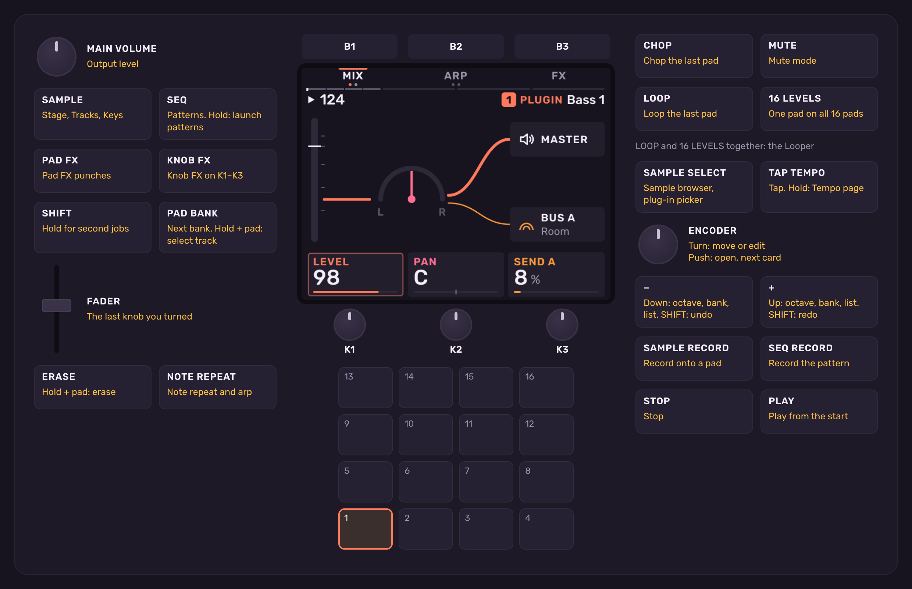

Every page uses the same layout:

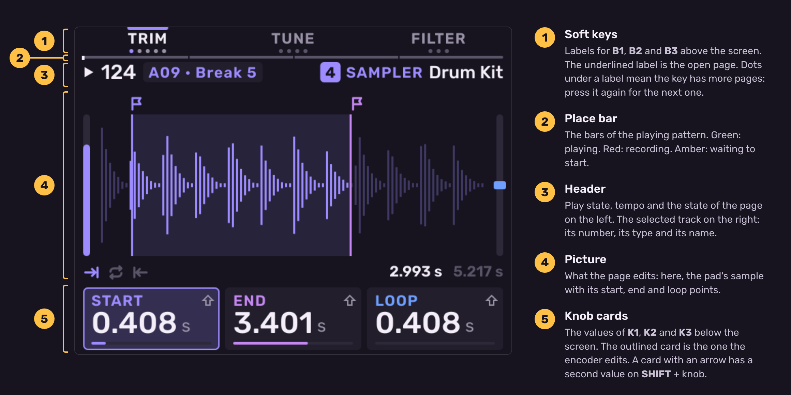

These controls work the same on every page:

| Control | Action |
| --- | --- |
| **B1**, **B2**, **B3** | Select the page or action named above each key. |
| **K1**, **K2**, **K3** | Set the value on the card above each knob. |
| Encoder (turn) | Move through a list, or fine-tune the outlined card. |
| Encoder (push) | Open the item under the cursor, or move to the next card. |
| Encoder (hold) | Open the **Menu**: the page's jobs (**HERE**) and the 16 places (**GO**). |
| **SHIFT** + encoder push | Go back one page. |
| **SHIFT** + **−** / **+** | Undo / redo. |

Melodee starts on **Full**, which shows every page. **Basic** shows the
stock app's pages plus tracks, plug-ins, the mixer and Song. To switch, press
**SHIFT** + **Pad 8** (Settings) and turn **K1** (**FEATURES**). See
[Basic and Full](guide/settings.md#basic-and-full).

Melodee has four short lessons. Hold the encoder, press **B3** (**GO**),
then pad 16 (**LEARN**). See [Lessons](guide/basics.md#lessons).

## 3. Select a track

Melodee has 16 tracks, one for each pad. Pad 1 (bottom left) is track 1.

To select a track, hold **PAD BANK** and press a pad. This works on any
page.

A new project has no tracks. It opens on track 1 with the track types, so
you choose what it is first ([step 4](#4-load-samples-into-a-kit) makes it a
kit). The other tracks stay empty until you choose what they are (see
[step 7](#7-add-a-plug-in-instrument)).

To mix the tracks, press **PAD FX** and **KNOB FX** together to open the
mixer. Every track is a strip; the selected one is lit. Hold **+** to see
its card (its sends, EQ or compressor), hold **−** to go back to the
strips. Press a pad or turn the encoder to pick a track. The
fader sets its level, **K1**–**K3** its sends A–C. Press **B2** for its EQ
and **B3** for its compressor (see
[The mixer](guide/mixer-and-effects.md#the-mixer)).

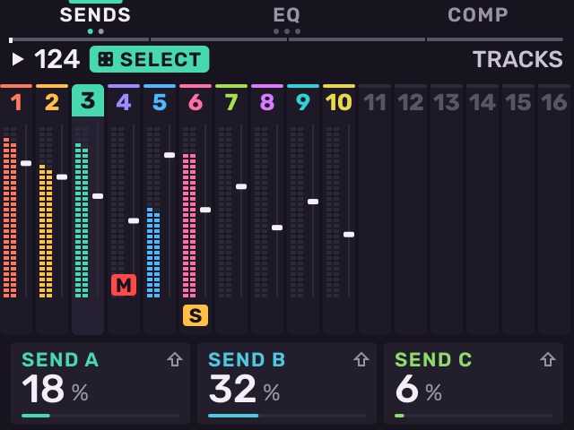

## 4. Load samples into a kit

Melodee reads WAV (16, 24 or 32-bit), MP3, FLAC, Ogg Vorbis and AIFF files (any sample rate;
a WAV up to 6 hours) from `Melodee/Samples` on the card, or anywhere else on it. It can
also read the MPC's internal factory samples.

1. Select track 1 (hold **PAD BANK**, press pad 1). In a new project it
   shows the track types.
2. Turn the encoder to **Drum** and push it, then push it on **Card**.
   Track 1 is now a kit, and the sample browser opens. On a track that is already a
   kit, press **SAMPLE SELECT** to open the browser.
3. Turn the encoder to move through the list. Push the encoder to open a
   folder. Press **B1** to go back out of a folder.
4. Press **B2** to switch between the card (**CARD**) and the MPC's
   factory samples (**INTERNAL**).
5. Press **B3** to turn on **PREVIEW**. Each file plays when you move to it.
   **PREVIEW** stays on until you turn it off.
6. Hit the pad you want to load onto, then push the encoder on a file. The
   file loads onto the last pad you hit.

To load a file onto the next empty pad, hold **SHIFT** and press any pad.

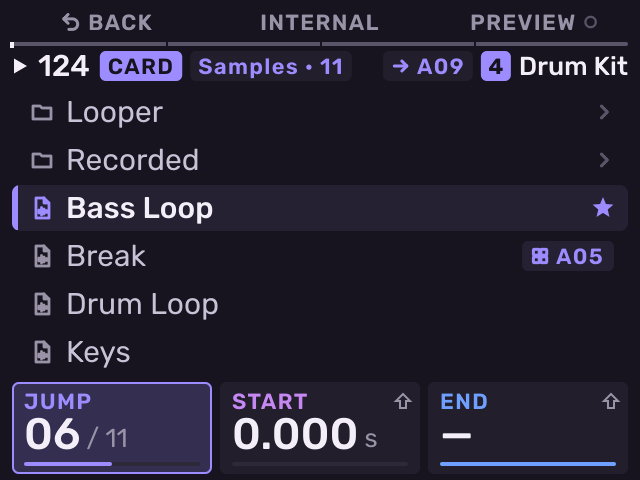

The browser also loads SFZ, MPC programs and expansions, EXS24, SoundFont
and DecentSampler instruments onto a pad. See
[Sampled instruments](guide/kits-and-sampling.md#sampled-instruments).
Push on an MPC kit to open **LOAD KIT**: it loads the whole kit, or only the
banks you pick. See [Loading samples](guide/kits-and-sampling.md#loading-samples).

## 5. Edit a pad

Press **SAMPLE** to open **Stage**. Stage holds the quick pages of the
selected track. On a kit, these are the stock Sample mode pages for the last
pad you hit.

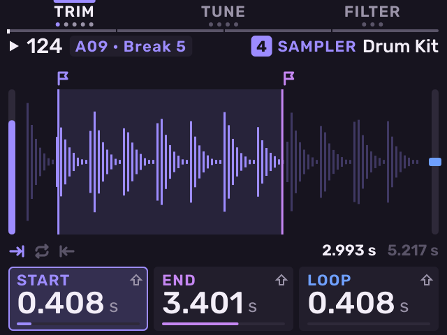

- **B1** cycles **TRIM**, **LAYERS**, **TUNE** and **AMP ENV** (on a sampled
  instrument: **ZONES**, **TUNE** and **AMP ENV**).
- **B2** cycles **PLAY**, **COLOUR**, **FOLLOW** and **CLOUD**.
- **B3** cycles **MIX**, **SENDS**, **FILTER**, **FILT ENV** and **KIT FILT**.

Press the lit key again to go to its next page. The dots under a key show
which page of its cycle is open.

In Basic, a kit pad has the stock app's seven pages: **TRIM**, **TUNE** and
**AMP ENV** on **B1**, **PLAY** on **B2**, and **MIX**, **FILTER** and
**FILT ENV** on **B3**. Full adds the other pages.

On **TRIM**, use **K1** to set the start point, **K2** the end point and
**K3** the loop point. Hold **SHIFT** and turn a knob to zoom in at that
point.

To chop a sample into slices, press **CHOP**. See [Chop](guide/kits-and-sampling.md#chop).

## 6. Record a beat

1. Press **SEQ** to open **Sequences**. If Patterns, Roll or Motion opens
   instead, press **B1** (**SEQUENCES**). The bank's 16 sequences are laid out as
   the pads: pad 1 bottom left. A sequence keeps one pattern for each
   track.
2. Hold **SEQ** and use **K1** to set the pattern length in bars and **K2**
   the grid (Q) of the selected track's pattern. **K3** sets the swing of
   the project.
3. To change to another sequence, press its pad. Pad 1 is sequence 1. Every
   track goes to the pattern that sequence keeps. A new sequence keeps
   nothing: the tracks play on until you launch a pattern. On other pages,
   hold **SEQ** and press **SHIFT** + a pad.

   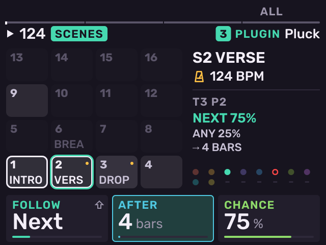

   To put one track on another pattern, press **B1** again for
   **Patterns**. Its pads are the selected track's patterns. On any page,
   hold **SEQ** and press a pad for the same. The sequence you are on keeps
   the pattern you launch.

4. Press **SEQ RECORD**. The button flashes and the screen shows that
   recording is armed.
5. Press **PLAY**. Recording starts. Play the pads.

   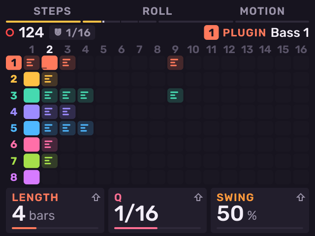

6. Press **SEQ RECORD** again to stop recording. Playback continues.
7. Press **STOP** to stop.

Each take is one undo step. Press **SHIFT** + **−** to undo it.

Recording options:

- **SHIFT** + **Pad 4**: turn the one-bar count-in on or off.
- **SHIFT** + **Pad 10**: turn **Rec Quantize** on or off. It is on at
  first: recorded notes land on the pattern's Q.
- **SHIFT** + **TAP TEMPO**: set the metronome to Off, On or Rec.

To edit the notes, press **B2** (**ROLL**) for the piano roll, or **SHIFT** +
**SEQ** for **Step Edit**. In Step Edit, press **SHIFT** + **B1** (**PADS**)
for **STEPS** mode: each pad sets or clears a step of the bar. On a kit,
STEPS edits the last pad you hit.

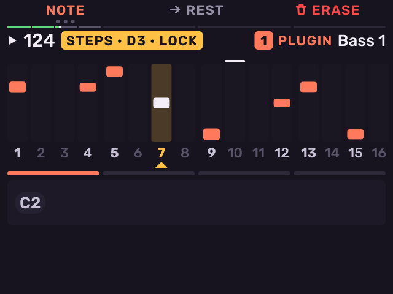

## 7. Add a plug-in instrument

Melodee loads VST3, LV2, CLAP and VST2 instruments built for the MPC's ARM processor,
including the Melodee Poly, Melodee PD and Melodee Chip synths. Put them in
the `Melodee/Plugins` folder on the card first (see [step 1](#1-install)). The
Melodee synths are free downloads; see [Plug-ins](guide/plug-ins.md).

1. Hold **PAD BANK** and press pad 2 to select track 2.
2. The track is empty, so Stage opens with the track types, as on the MPC:
   **Drum** (an empty kit, samples from the card, or a recording),
   **Keygroup** (an instrument played across the keys), **Plugin** (a
   plug-in instrument), **MIDI** (an external instrument on the MIDI Out
   jack or USB) and **Audio** (a recording of the input).

   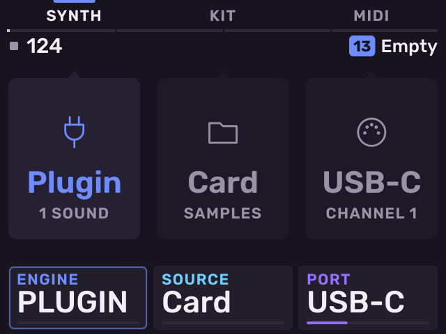

3. Turn the encoder to **Plugin** and push it. The plug-in picker opens on
   the `Melodee/Plugins` folder.
4. Turn the encoder to a plug-in and push the encoder to load it.
   Plug-ins that cannot run on the MPC are dimmed. Once it loads, Melodee
   goes back to the page you were on.

   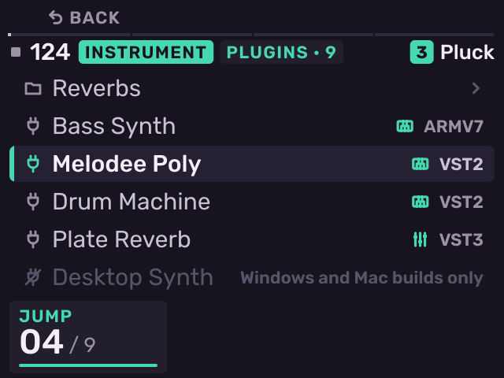

5. Press **SAMPLE** to open Stage, and play the pads. To set the key and
   scale the pads play in, hold **SAMPLE** to see **Keys** and turn **K1**
   for the root, **K2** for the scale and **K3** for the pad layout. Press
   **−** / **+** to change the octave.

   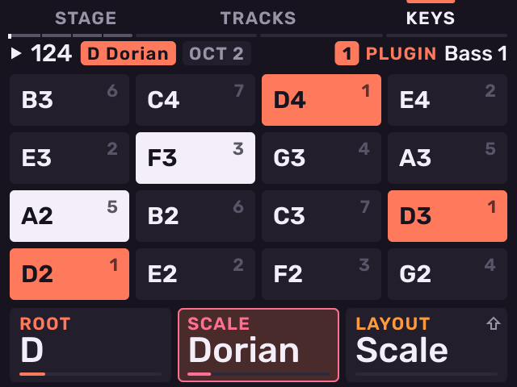

6. Press **SAMPLE** again for **PRESETS**, the first page of **B1**. Turn
   the encoder to step through the plug-in's presets, or push it for the
   whole list. **K1**–**K3** are **FILTER**, **ECHO** and **SPACE** on
   every plug-in.

   

7. Press **B1** for **EDIT**, its next page: the plug-in's own parameters
   come on **K1**–**K3**, in rows of three. Turn the encoder to move through
   the rows, and press **−** / **+** for the plug-in's page before or after.

   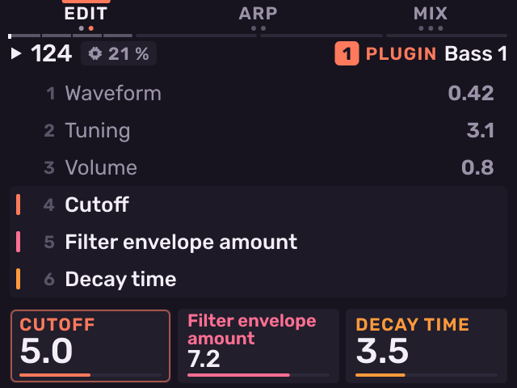

Record the plug-in track the same way as the kit in
[step 6](#6-record-a-beat).

## 8. Save the project

Melodee saves the project by itself, three seconds after you last used a
control while nothing plays. A new project is saved as **Project 1**,
**Project 2** and so on. To give it a name of its own:

1. Press **SHIFT** + **Pad 16** to open **Project**.
2. Press **B1** (**SAVE AS**).

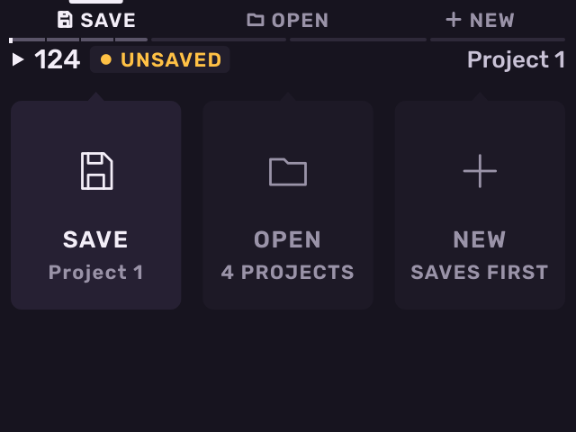

Melodee asks for a name. The pads type like phone
keys: each pad shows the letter it types next. Pad 14 types a space, pad 15
switches to digits and pad 16 deletes. Turn the encoder to move the cursor.
Press **B3** (**SAVE**) or push the encoder to save. Press **B1** to cancel.

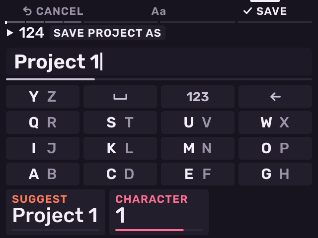

Projects are saved in `Melodee/Projects` on the card. To open another
project, press **B2** (**OPEN**) on the Project page.

## 9. Exit Melodee

Press **POWER** briefly. The Exit screen opens:

- **B1** (**STAY**): go back to Melodee.
- **B2** (**POWER OFF**): save the project and switch the MPC off.
- **B3** (**MPC APP**): save the project and go back to the stock app until
  the next time the MPC is switched on.

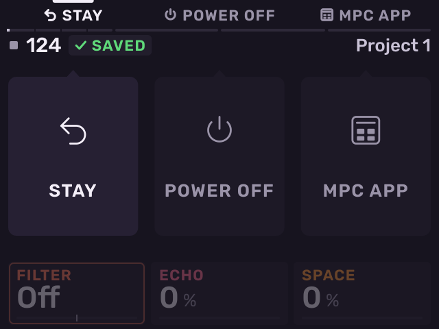

When Melodee starts again, it opens the project you had open.

## Next steps

- [Coming from the stock MPC Sample](guide/coming-from-the-stock-mpc-sample.md):
  what is the same and what is different.
- [Sequencing](guide/sequencing.md): patterns, sequences, Roll, Step Edit and
  parameter locks.
- [Song](guide/song.md): arrange patterns and export a mixdown or an MPC 3
  project.
- [Keygroup tracks](guide/instrument-and-midi-tracks.md#keygroup-tracks) and
  the auto sampler, which samples a plug-in or an external instrument.
- [Audio tracks](guide/audio-tracks.md): record the input into a pattern.
- [Chord progressions](guide/instrument-and-midi-tracks.md#chord-progressions):
  hold **16 LEVELS** and press **B2** (**CHORDS**).
- [Looper](guide/looper.md): press **LOOP** and **16 LEVELS** together (in
  Full).
- [Effects](guide/mixer-and-effects.md): effect chains, Knob FX and Pad FX.
