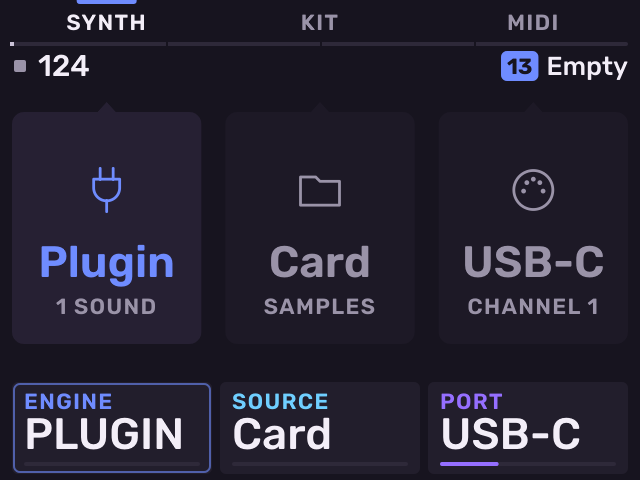

# Melodee quickstart

This guide takes you from the release zip to a saved beat with a kit and a
plug-in instrument. For every page and control, read the
[user guide](GUIDE.md).

1. [Install](#1-install)
2. [Learn the controls](#2-learn-the-controls)
3. [Select a track](#3-select-a-track)
4. [Load samples into a kit](#4-load-samples-into-a-kit)
5. [Edit a pad](#5-edit-a-pad)
6. [Record a beat](#6-record-a-beat)
7. [Add a plug-in instrument](#7-add-a-plug-in-instrument)
8. [Save the project](#8-save-the-project)
9. [Exit Melodee](#9-exit-melodee)

## 1. Install

You need:

- An Akai MPC Sample with firmware **1.3.0.12**. On any other firmware
  Melodee does not start and the stock app keeps running.
- A microSD card.
- The release zip, `Melodee-MPC-Sample-<version>.zip`.

The zip holds one folder, `autorun`. Its `README.txt` and the licences are
inside it, in `autorun/melodee/`.

To install Melodee:

1. Back up the card. If it has an `autorun` folder at its top level, move
   that folder somewhere safe. Melodee's `autorun` folder replaces it.
2. Unzip the release and copy the `autorun` folder to the top level of the
   card. The card now has `autorun/autorun.sh` and `autorun/melodee/`. Do
   not edit or rename anything inside `autorun`: the MPC does not start an
   autorun whose files have changed.
3. Optional: to use plug-ins, make a folder named `Plugins` at the top level
   of the card and copy your plug-ins into it. See
   [Plug-ins](GUIDE.md#plug-ins) for what runs.
4. Put the card in the MPC and switch it on. The stock app starts first. A
   few seconds later Melodee starts.

Melodee changes nothing on the MPC itself. To stop it from starting, delete
the `autorun` folder from the card.

## 2. Learn the controls

The printed buttons keep their MPC meaning. The jobs printed under the pads
are **SHIFT** + pad, as on the stock app. The map below shows what each
button does in Melodee.

Every page uses the same layout:

These controls work the same on every page:

| Control | Action |
| --- | --- |
| **B1**, **B2**, **B3** | Select the page or action named above each key. |
| **K1**, **K2**, **K3** | Set the value on the card above each knob. |
| Encoder (turn) | Move through a list, or fine-tune the outlined card. |
| Encoder (push) | Open the item under the cursor, or move to the next card. |
| **SHIFT** + encoder push | Go back one page. |
| **SHIFT** + **−** / **+** | Undo / redo. |

## 3. Select a track

Melodee has 16 tracks, one for each pad. Pad 1 (bottom left) is track 1.

To select a track, hold **PAD BANK** and press a pad. This works on any
page. If you hold **PAD BANK** for one second, the screen shows all 16
tracks.

A new project has an empty kit on track 1. The other tracks are empty until
you choose what they are (see [step 7](#7-add-a-plug-in-instrument)).

To see all tracks as a mixer, press **SAMPLE** twice to open **Tracks**.
Each cell shows a track's number, its pattern, its type and its level. Use
**K2** to set the selected track's level and **K3** to set its pan.

## 4. Load samples into a kit

Melodee reads WAV (16, 24 or 32-bit), MP3 and FLAC files (any sample rate,
up to 60 seconds) from a folder named `Samples` at the top level of the card. It can
also read the MPC's internal factory samples.

1. Select track 1 (hold **PAD BANK**, press pad 1).
2. Press **SAMPLE SELECT**. The sample browser opens.
3. Turn the encoder to move through the list. Push the encoder to open a
   folder. Press **B1** to go back out of a folder.
4. Press **B2** to switch between the card (**CARD**) and the MPC's
   factory samples (**INTERNAL**).
5. Press **B3** to turn on **PREVIEW**. Each file plays when you move to it.
6. Hit the pad you want to load onto, then push the encoder on a file. The
   file loads onto the last pad you hit.

To load a file onto the next empty pad, hold **SHIFT** and press any pad.

The browser also loads SFZ, MPC programs and expansions, EXS24, SoundFont
and DecentSampler instruments onto a pad. See
[Sampled instruments](GUIDE.md#sampled-instruments).

## 5. Edit a pad

Press **SAMPLE** to open **Stage**. Stage holds the quick pages of the
selected track. On a kit, these are the stock Sample mode pages for the last
pad you hit.

- **B1** cycles **TRIM**, **LAYERS**, **TUNE** and **AMP ENV**.
- **B2** cycles **PLAY**, **FOLLOW** and **CLOUD**.
- **B3** cycles **MIX**, **SENDS**, **FILTER**, **FILT ENV** and **KIT FILT**.

Press the lit key again to go to its next page. The dots under a key show
which page of its cycle is open.

On **TRIM**, use **K1** to set the start point, **K2** the end point and
**K3** the loop point. Hold **SHIFT** and turn a knob to zoom in at that
point.

To chop a sample into slices, press **CHOP**. See [Chop](GUIDE.md#chop).

## 6. Record a beat

1. Press **SEQ** to open **Patterns**. Tracks are listed down the screen and
   their 16 patterns across it. The pads play the selected track.
2. Use **K1** to set the pattern length in bars, **K2** the grid (Q) and
   **K3** the swing.
3. To choose a pattern, hold **SEQ** and press a pad. Pad 1 is pattern 1.

   

4. Press **SEQ RECORD**. The button flashes and the screen shows that
   recording is armed.
5. Press **PLAY**. Recording starts. Play the pads.

   

6. Press **SEQ RECORD** again to stop recording. Playback continues.
7. Press **STOP** to stop.

Each take is one undo step. Press **SHIFT** + **−** to undo it.

Recording options:

- **SHIFT** + **Pad 4**: turn the one-bar count-in on or off.
- **SHIFT** + **Pad 10**: open **Rec Quantize**. Press **B3** to turn it on
  or off, and turn the encoder to choose the grid.
- **SHIFT** + **TAP TEMPO**: set the metronome to Off, On or Rec.

To edit the notes, press **SEQ** again on the Patterns page. The editor
opens: **Steps** on a kit, **Roll** on an instrument track. **B1** opens
**Steps**, **B2** the piano roll (**Roll**) and **B3** **Motion**. On
Steps, each pad sets or clears a step. On a kit, Steps edits the last pad
you hit.

## 7. Add a plug-in instrument

Melodee loads VST3, LV2, CLAP and VST2 instruments built for the MPC's ARM processor,
including the Melodee Poly, Melodee PD and Melodee Chip synths. Put them in
the `Plugins` folder on the card first (see [step 1](#1-install)). The
Melodee synths are free downloads; see [Plug-ins](GUIDE.md#plug-ins).

1. Hold **PAD BANK** and press pad 2 to select track 2.
2. Press **SAMPLE**. An empty track shows three choices: **SYNTH** (a
   plug-in instrument), **KIT** (samples) and **MIDI** (an external
   instrument).

   

3. Press **B1** (**SYNTH**). The plug-in picker opens on the `Plugins`
   folder.
4. Turn the encoder to a plug-in and push the encoder to load it.
   Plug-ins that cannot run on the MPC are dimmed.

   

5. Play the pads. To play the pads as a keyboard in a key and scale, press
   **SAMPLE** twice more to open **Keys**. Use **K1** to set the root, **K2**
   the scale and **K3** the pad layout. Press **−** / **+** to change the
   octave.

   

6. To edit the plug-in's parameters, push the encoder on **Keys** or on
   Stage. **Edit** opens with the plug-in's parameters on **K1**–**K3**.
   Press **B2** (**PRESETS**) to load one of its presets.

   

Record the plug-in track the same way as the kit in
[step 6](#6-record-a-beat).

## 8. Save the project

1. Press **SHIFT** + **Pad 16** to open **Project**.
2. Press **B1** (**SAVE**).

The first time you save, Melodee asks for a name. The pads type like phone
keys: each pad shows the letter it types next. Pad 14 types a space, pad 15
switches to digits and pad 16 deletes. Turn the encoder to move the cursor.
Press **B3** (**SAVE**) or push the encoder to save. Press **B1** to cancel.

Projects are saved in `Melodee/Projects` on the card. To open another
project, press **B2** (**OPEN**) on the Project page.

## 9. Exit Melodee

Press **POWER** briefly. The Exit screen opens:

- **B1** (**STAY**): go back to Melodee.
- **B2** (**POWER OFF**): save the project and switch the MPC off.
- **B3** (**MPC APP**): save the project and go back to the stock app until
  the next time the MPC is switched on.

When Melodee starts again, it opens the project you had open.

## Next steps

- [Coming from the stock MPC Sample](GUIDE.md#coming-from-the-stock-mpc-sample):
  what is the same and what is different.
- [Sequencing](GUIDE.md#sequencing): patterns, scenes, Steps, Roll, Step
  Edit and parameter locks.
- [Song](GUIDE.md#song): arrange patterns and export a mixdown.
- [Looper](GUIDE.md#looper): press **LOOP** and **16 LEVELS** together.
- [Effects](GUIDE.md#mixer-and-effects): effect chains, Knob FX and Pad FX.
