# Melodee quickstart

You have the release zip and an MPC Sample. This page takes you from the
card to a saved beat, one screen at a time. Everything else is in
[MELODEE.md](MELODEE.md).

Melodee is an alpha. A crash, or any failure to start, puts the stock MPC
app back; nothing on the MPC itself is changed, only files on the card.

## 1. Install

You need an MPC Sample on firmware **1.3.0.12** exactly. On any other
firmware Melodee does not start and the stock app keeps running.

The zip holds an `autorun` folder, a `README.txt` and the licences.

1. Back up the microSD card. If it already has an `autorun` folder at its
   top level, move that somewhere safe: Melodee's replaces it.
2. Copy the zip's `autorun` folder to the top of the card, so the card has
   `autorun/autorun.sh` and `autorun/melodee/`. Do not edit or rename
   anything inside it: the MPC refuses an autorun whose files changed.
3. Put the card in the MPC and switch it on. The stock app starts first; a
   few seconds later Melodee takes over the screen.

**Back to the stock app:** press Power briefly. The Exit sheet opens: **B3
LEAVE** saves the project and returns to the stock app until the next time
the MPC is switched on; B1 stays in Melodee. To stop Melodee starting at
all, delete the `autorun` folder from the card.

## 2. The screen

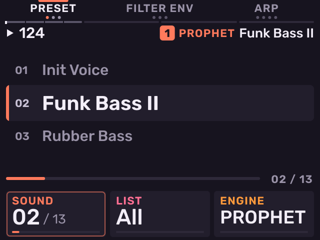

Every page is laid out the same way:

- **Top row: B1, B2, B3.** The three buttons above the screen are the
  page's soft keys; the name over each says what it does. The highlighted
  one is where you are.
- **Header.** Left: play state and tempo. Right: the selected track's
  number, its engine and its sound.
- **Picture.** What the page edits: a sound list, an envelope, a waveform,
  a grid.
- **Bottom row: K1, K2, K3.** The three knobs under the screen turn the
  cards above them. The card with a ring is the one touched last. A card
  with an arrow (⇧) has a second job on Shift + that knob.

The printed buttons keep their MPC meaning, and the jobs printed under the
pads are Shift + pad.

## 3. Stage: the track's quick pages

Press **Sample** from any page to get to Stage: the quick pages of the
selected track. What you see depends on what the track is.

- **B1–B3** each hold up to three pages. Press the highlighted key again
  to step to its next page; another key jumps to its page. The dots under
  each key show which of its pages you are on. Each track remembers its
  own page.
- **K1–K3** turn the cards. The **wheel** fine-edits the ringed card, and
  **Push** moves the ring to the next card.
- The pads play the track. −/+ change the octave (a kit's bank).

A new project has one empty kit on track 1, in C Chromatic; the other tracks
are empty until you give them an engine.

**A synth: PRESET (B1).** K1 or the wheel walks the sounds; the one you
stop on loads a moment later. K2 picks the list (all, starred, recent), K3
the engine. Push opens the full Sounds list.

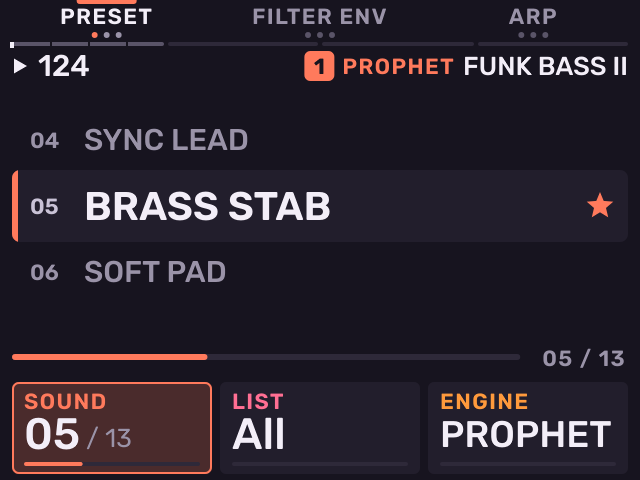

**A synth: AMP ENV (B2, second page).** B2 holds the shape pages: on a
PROPHET FILTER ENV, AMP ENV, LFO. B1 is PRESET, TONE, MIX; B3 is ARP, the
engine's own page, FX.

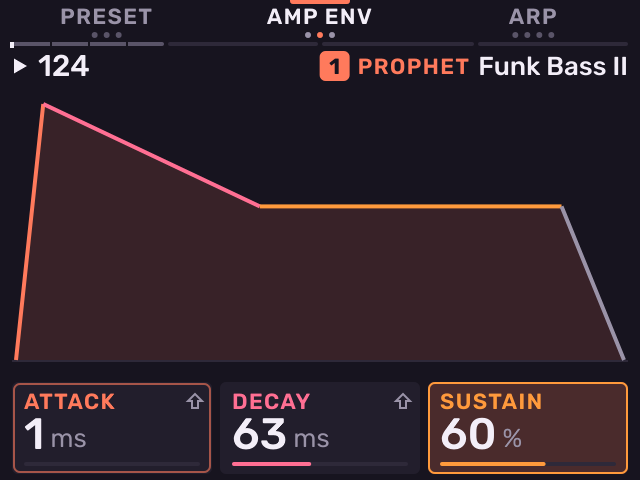

**A kit: TRIM (B1).** The last pad you hit: its waveform, with K1 start,
K2 end, K3 loop point. B1 goes on to MIX and AMP ENV, B2 is TUNE and PLAY,
B3 FILTER and FILT ENV.

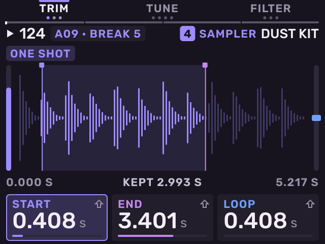

**A 909: VOICE (B1, second page).** Edits the drum the last pad played;
the B1 key reads its name (here SNARE, for the clap on pad 3). B1 also
holds PRESET and LEVELS, B2 is MIX, B3 FX.

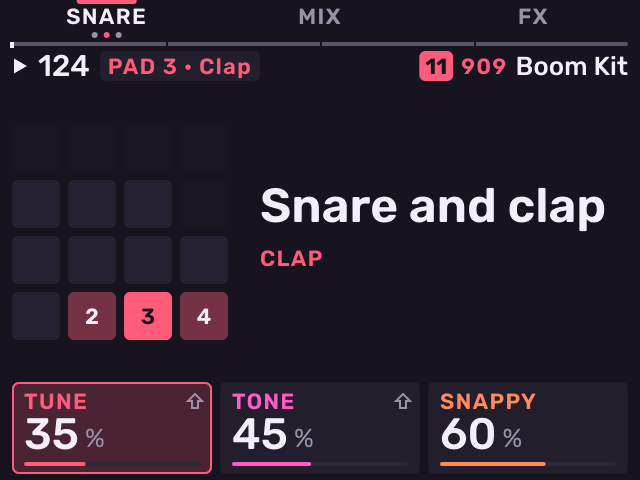

**A MIDI track: CC (B2).** Three controllers on K1–K3, sent to the
track's port and channel as you turn; Shift + K picks a controller's
number. B1 is DEVICE and PROGRAM, B3 ARP.

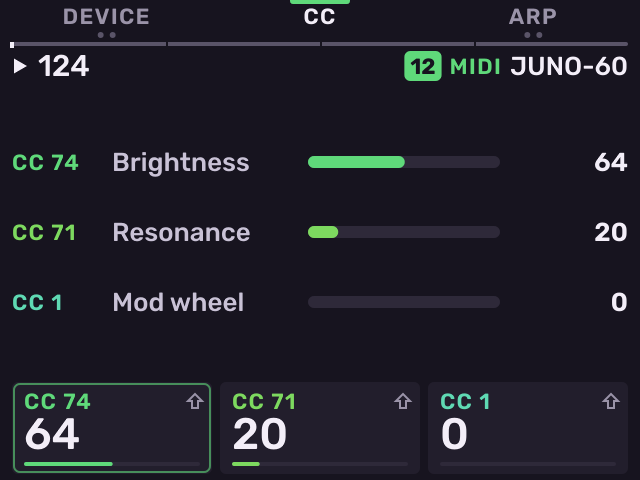

An empty track offers B1 SYNTH, B2 KIT, B3 MIDI: pick with the knobs,
then Push makes the track that.

## 4. Picking a track

Sixteen tracks, one per pad: pad 1 (bottom left) is track 1.

**Hold Pad Bank and tap a pad** to select that track, from any page. While
Pad Bank is held a second the screen shows the tracks, eight at a time.

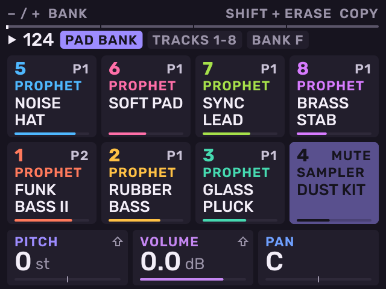

**Tap Pad Bank twice** (quickly) on a synth or MIDI track for the Tracks
screen, which stays open (on a kit quick taps only switch banks).
Each cell shows the track's engine, sound, the pattern playing and its
level. B1 shows tracks 1–8, B2 tracks 9–16, B3 goes back to Stage. Tap a
pad to select its track and go back to Stage; K2 sets the selected track's
level, K3 its pattern.

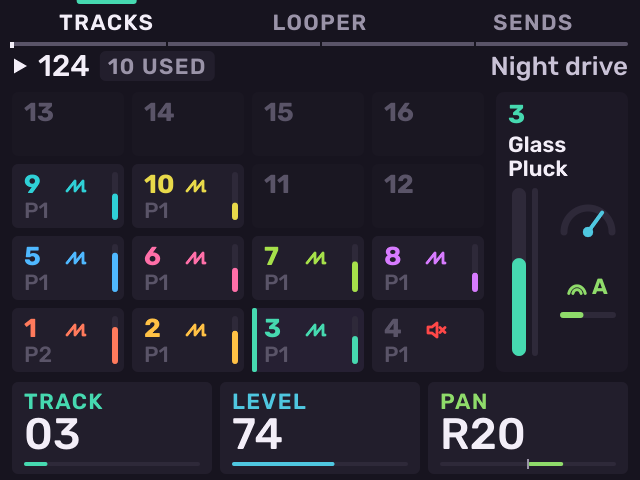

## 5. Making a beat

Press **Seq** for Patterns: tracks down, sixteen patterns across. The pads
play the selected track. **Hold Seq** and they are its patterns: tap one
to queue it (at the next bar, or at once when stopped); the screen shows
them after a moment. K1 sets the pattern's length in bars, K2 its grid
(Q), K3 swing; holding Seq, they do that from any page, and the wheel
sets the tempo. Tap Seq again for the editor (Steps, Roll, Motion on B1–B3).

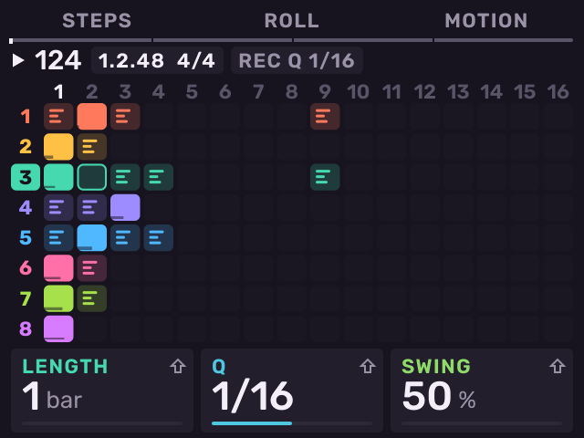

To record:

1. Select a track (step 4) and a pattern (hold Seq, tap its pad).
2. Press **Seq Record**. Stopped, it arms (REC ARMED, the button flashes).
3. Press **Play**. Recording starts; play the pads. Seq Record while
   playing records at once.
4. Press **Seq Record** again to stop recording; playback goes on.
   **Stop** stops.

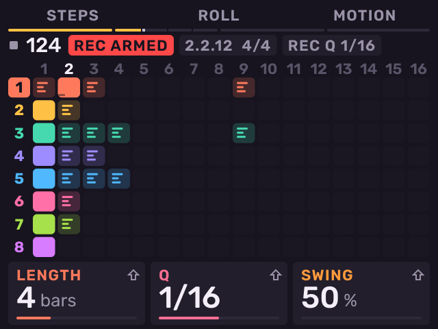

Play starts from the top. Each take is one undo step: **Shift + −** undoes,
Shift + + redoes. Shift + Pad 4 turns on a bar of count-in. Shift + Pad 10
opens Rec Quantize: B3 turns it on or off (notes land on the grid), the
wheel picks the grid (the pattern's Q, or 1/16, 1/32 and the rest).

## 6. Samples

Samples live on a kit track (track 1 on a new project). Put WAV files in a
`Samples` folder on the card; 16, 24 or 32-bit, any rate, up to 60 s.

**Load: Sample Select.** On a kit, Sample Select opens the browser. The
wheel moves, Push opens a folder or loads the file onto the last pad you
hit. B2 switches between the card and the MPC's internal factory samples;
B3 PREVIEW plays each file as you land on it. Shift + pad loads onto the
next empty pad.

**Multisampled instruments.** An `.sfz` loads the same way, onto one pad. Press **16 Levels** on it and choose Tune with Shift + 16 Levels to play it chromatically on the pads; a MIDI keyboard plays it at real pitch while 16 Levels is on. The first load prepares its files on the card, which can take a while for a big library; after that it opens at once.

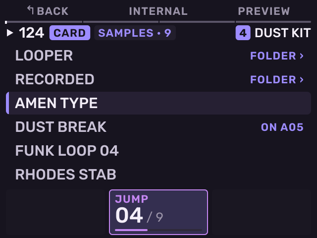

**Cut: Chop.** Chop slices the last pad's sample. K1 and K2 move the
slice's start and end, K3 picks how it slices (Threshold, Regions, Beats,
Manual). The pads play the slices. B3 TO PADS lays them out on pads; B1
DROP goes back.

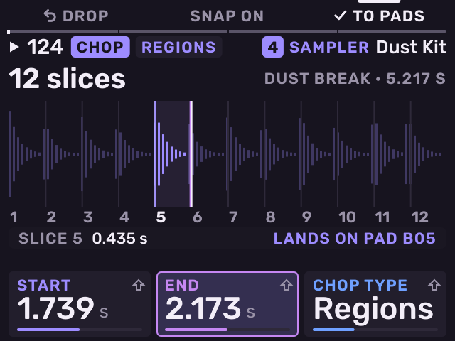

**Record: Sample Record.** On a kit, Sample Record opens Record. K1 picks
the source (mic, rear inputs, USB), K2 the length, K3 the level the take
starts at. Tap a pad to record onto it; other pads tapped during the take
cut it there. The pad again, Stop or Push ends the take; Sample Record
ends it and opens TRIM. Shift + Sample opens the full Input Config.

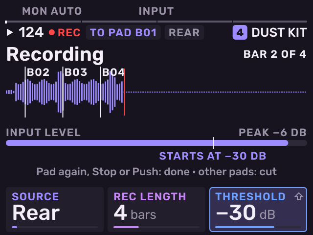

## 7. Loops

Four audio loops that follow the tempo, on tracks of their own (L1–L4).

**Open: tap Loop twice** (quickly), or hold it half a second. The first
time, the Looper is off: B3 or Push turns it on.

Each row is one loop: its state (ARM, REC, DUB, PLAY, STOP), its
waveform, its length and what it records. K1 picks the loop, K2 its length
(Free or 1–16 bars, set before recording), K3 its level. A loop playing at
a tempo other than the one it was recorded at shows that tempo in amber; it
keeps its pitch and stays on the beat.

To record a loop:

1. Pick what it records: **B3 MORE**, then Push on **Source** steps through
   Input, the tracks, the other loops and Mix. B1 closes the sheet.
2. Press **Play**, then **Push**. The loop arms and starts recording on the
   next bar.
3. Push again: it closes on the next bar and plays. (A set length closes
   by itself.)
4. Push while it plays to overdub, Push again to stop overdubbing.

The pads are the loops too, a column each: the top row records and
overdubs, the next plays or stops on the next bar, the third undoes the
last overdub, and the bottom row held clears the loop.

**B3 MORE** holds the rest: stop, undo, **Commit to pad** (the loop onto
the next empty pad of the selected kit track, + a note at bar 1 if you
like), clear and Looper off. **B2 MIX** is L1–L4's levels, pans and sends;
Shift + Knob FX opens a loop's effects.

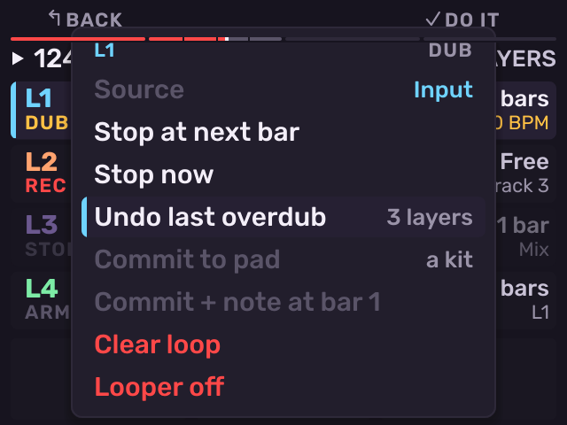

Loops are saved with the project, next to its file.

## 8. Save the project

Press **Shift + Pad 16** for Project. Turn the wheel to the open project
(marked OPEN) and Push for its sheet. **Save** is first: B3 DO IT or
Push.

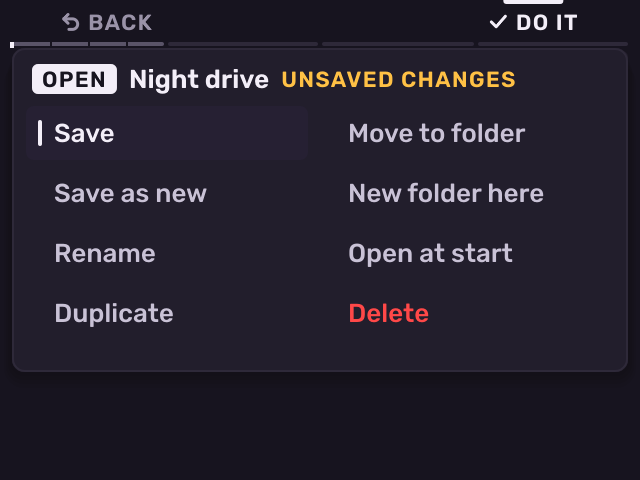

The first time, Melodee asks for a name. The pads type like phone keys
(pad 14 space, pad 15 digits, pad 16 delete), the wheel moves the cursor.
B3 or Push saves, B1 cancels.

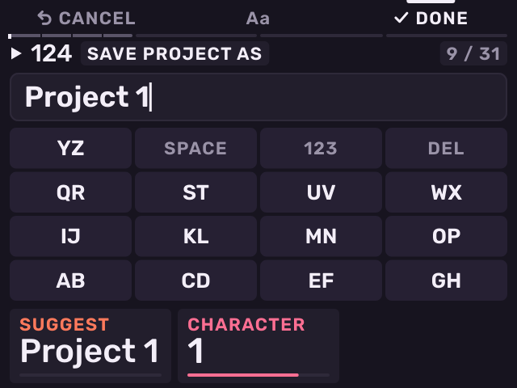

Projects go to `Melodee/Projects` on the card. Leaving through the Exit
sheet saves too.

## 9. Where to go next

[MELODEE.md](MELODEE.md) covers every button, page and Shift job: Keys
and Mix (press Sample again), the editors and Step Edit (Seq, Shift + Seq),
Song (Shift + Pad 12), the effects (Knob FX, Pad FX, Shift + Knob FX),
16 Levels, Note Repeat and the arp, the Looper, MIDI and SD card access.
