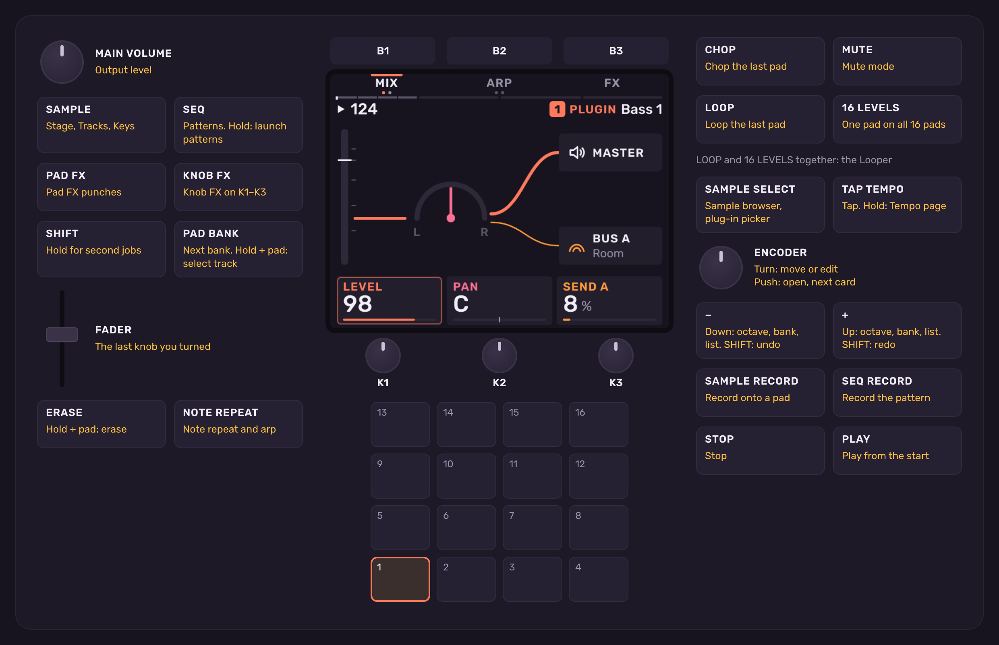
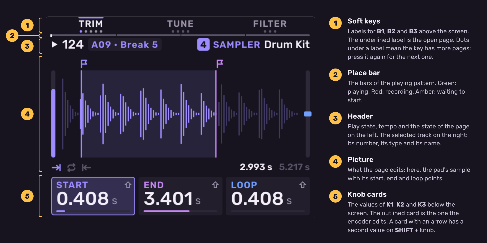
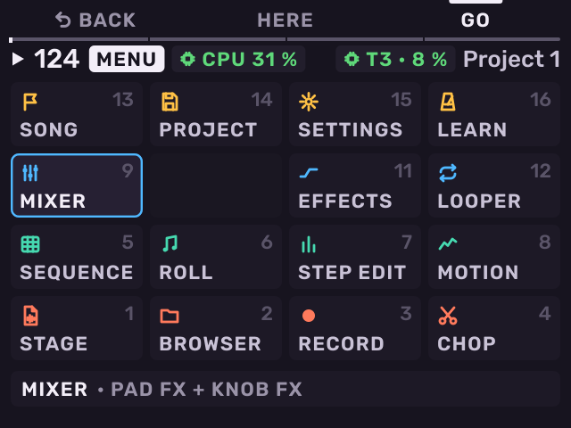
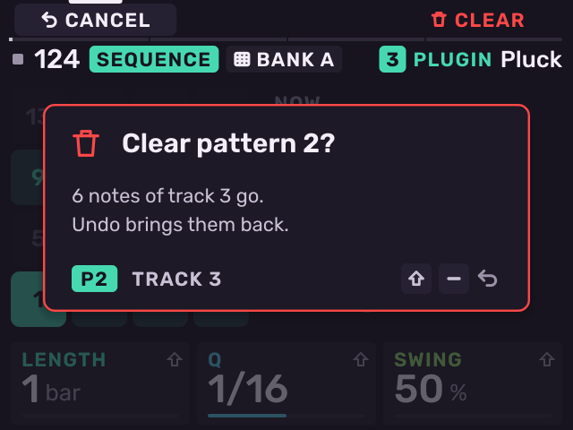

# Basics

Previous: [Coming from the stock MPC Sample](coming-from-the-stock-mpc-sample.md) · [Contents](../GUIDE.md) · Next: [Tracks](tracks.md)

## The panel

The level meters right of the screen show the mix, left and right, before
**MAIN VOLUME**. On Record and Input Config, and while a recording waits or
runs, they show the input instead. They light as on the stock app: the
three green lights and the yellow light past −24, −12, −6 and −3 dBFS, the
red light past −0.1 dBFS.

## The screen

The header shows a state with a symbol and a short word: a play triangle, a
stop square, a red dot while recording, a red ring while recording is
armed. The **place bar** under the soft keys shows where playback is: green
while playing, red while recording, amber while waiting for a bar to start.

When the pads do not play the selected track, the first chip in the header
says what they do: **TRACKS**, **PATTERNS**, **SEQUENCES**, **STEPS**,
**PAD FX**, **LOOPS**, **LEVELS** or **CHORDS**. The button of that job is bright; on
the mixer, where the pads select channels, that is **PAD BANK**. Press **SAMPLE** to
open the sound's page, where the pads play again.

Lists work the same way on every page: the symbol before a name shows what
the row is (folder, sample, instrument, plug-in), and facts about it are at
the right edge. **K1** jumps through any list.

## Navigation

| Control | Action |
| --- | --- |
| **B1**, **B2**, **B3** | Select the page or action named above each key. A lit key pressed again goes to its next page. A key with several pages lists them by name for a moment after each press. |
| **K1**, **K2**, **K3** | Set the value on the card above each knob. |
| **SHIFT** + **K1**–**K3** | Set the second value of a card with an arrow. |
| Encoder (turn) | Move through a list, or fine-tune the outlined card. |
| Encoder (push) | Open the item under the cursor, or move to the next card. It acts when you let go. |
| Encoder (hold) | Open the **Menu** (see below). |
| **SHIFT** + encoder push | Go back one page. |
| The button that opened a page | On Fader, Time Correct, Compressor, Settings, Song, Project, Input Config, Step Edit, the sample browser and the PRINT sheet, press it again to close the page. |
| **−** / **+** | Change the octave on play pages, the bank on kit pages, or move through a list. |
| **SHIFT** + **−** / **+** | Undo / redo. |

## Held keys

Three keys work the same way when you hold them, on any page: the pads pick
something and **K1**–**K3** set it. Let go and the page's own cards are
back. A held key's cards also take over from Knob FX.

| Hold | The pads pick | K1–K3 set |
| --- | --- | --- |
| **SAMPLE** | A kit pad, without playing it | Its pitch, volume and pan |
| **SEQ** | A sequence, on every track. On Patterns: a pattern of the selected track | The length and Q of the selected track's pattern, and the project's swing |
| **PAD BANK** | A track | Its level, pan and send to bus A |

On an instrument track, **SAMPLE** held shows the keys and their root, scale
and layout instead.

## The Menu

Hold the encoder for a moment to open the **Menu** over any page. It has two
halves. **B1** (**BACK**) closes it.

**B2** (**HERE**) lists what the open page can do that no printed button
says, as cards. Each card shows its shortcut under its name, so the Menu
also teaches the shortcuts. Turn the encoder to pick a card and push it.

**B3** (**GO**) shows the 16 places, laid out as the pads. Press a pad to
open its place, or turn the encoder and push. The pads light in four
colours: sound, sequence, mix and project. The line at the foot shows how
the lit place opens without the Menu.

| Pad | Place | Pad | Place |
| --- | --- | --- | --- |
| 1 | Stage | 9 | Mixer |
| 2 | Browser | 10 | – |
| 3 | Record | 11 | Effects |
| 4 | Chop | 12 | Looper |
| 5 | Sequence | 13 | Song |
| 6 | Roll | 14 | Project |
| 7 | Step Edit | 15 | Settings |
| 8 | Motion | 16 | Learn |

The Menu opens on **HERE** when the page has something to list (Stage, the
mixer's pages, Sequences, Patterns, Roll, Motion, MOD and Step Edit), and on
**GO** otherwise. Any other button closes the Menu and does its own job.
Pad 10 is empty. In Basic (see [Settings](settings.md#basic-and-full)),
pads 8 and 12 are empty too.

The Menu's header shows how much of the processor the tracks use (**CPU**),
and the selected track's share (snowflake: frozen).

## Lessons

Pad 16 on **GO** opens **LEARN**, a list of short lessons. Turn the encoder
to pick one and push it, or press **B3** (**START**). **B1** goes back. A
finished lesson keeps a check.

| Lesson | What it covers |
| --- | --- |
| First beat | Play two pads and record them into a pattern. |
| Sequences | Launch sequences from the Sequences page, then a track's pattern with **SEQ** held. |
| Mix a track | Open the mixer, set a track's level and pan, open its effects. |
| Shape a pad | Set a pad's end on Trim, then its tune. |

During a lesson:

- Each step uses one control. The header shows the step number and what to
  do.
- The step's button or pad blinks, and every other light is off. **B1**–**B3**
  and **K1**–**K3** have no light: the key's label or the knob's card
  pulses on the screen instead.
- Any other press does nothing.
- The lesson runs on its own project, with the MPC's factory kit. Your
  project is saved first and opens again when the lesson ends. The lesson's
  project is never saved.
- The lesson shows Basic's pages, also when Melodee is on Full.
- To leave, hold the encoder and press pad 16 (**LEAVE**).

Lessons need the card and the MPC's factory kits on its internal storage.

## Knob takeover

**K1**–**K3** are absolute knobs. When a knob is not at the value on its
card, the card shows the value dim with a tick where the knob is. By
default the knobs use **Scaled** takeover: the value moves toward the knob
until they meet. Change this in [Settings](settings.md) (**KNOBS**).

## Undo

**SHIFT** + **−** undoes, **SHIFT** + **+** redoes. Melodee keeps the last
512 steps.

Hold **SHIFT** + **−** for a moment to open the undo list. It shows the
steps, newest on top, each with its track and how long ago. **NOW** marks
where you are; steps you undid are above it, dim.

- Turn the encoder, or press **−** / **+**, to pick a step. The steps above
  it go dim: they are undone when you go there.
- Push the encoder, or press **B3** (**UNDO** or **REDO** and how many), to
  go back or forward to the state after that step. **START** is the state
  before every step in the list.
- **B1** (**BACK**) closes the list with no change. Any other button closes
  it and does its own job. A recording take is one step. Turning a knob is one step per
control. Mute, solo and the transport are not undo steps. Loading or
creating a project clears the undo history.

## Erase and copy

- **ERASE** + pad on a kit, stopped: empty the pad.
- **ERASE** + an empty pad on a kit, stopped: close the gap. The pads after
  it move down one, with their notes, through its bank and the next one: in
  bank A, B's pad 1 moves onto A16 and B's pads move down one, leaving B16
  empty. Bank C stays, and a gap in bank H never pulls from A. To take a pad
  out and close the gap, press **ERASE** + that pad twice: the first press
  shows `Deleted A05 · again closes gap`, the second which pads moved, such
  as `A06-B01 moved down one`.
- **ERASE** + pad on a kit, playing: hold both to erase that pad's notes as
  the playhead passes them. Notes outside the hold stay. One undo.
- **ERASE** + pad on a keygroup, plug-in or MIDI track: erase that key's
  notes (asks first).
- **ERASE** + **CHOP** on Chop: take every cut out, so the region is one
  slice again. One undo.
- **ERASE** + **SEQ RECORD** on a kit: erase all notes of the selected pad
  from the pattern (asks first). With 16 Levels on, this is the 16 Levels
  pad, so every level goes.
- **ERASE** + knob: set the value back to its default.
- **ERASE** + fader: clear the fader's Motion lane (asks first).
- **ERASE** pressed alone erases what the page has selected:

| Page | ERASE alone |
| --- | --- |
| Roll | The selected note, or the marked notes |
| Step Edit | The selected event. In STEPS mode: the caret's step |
| Sequences | The selected sequence's name and tempo |
| Patterns | The pattern (asks first). On the **SEQUENCE** cards: the sequence's name and tempo |
| Tracks | The track (asks first) |
| Looper | The selected loop (asks first) |
| Effect chains | The selected effect |
| Chop | The selected slice: it joins the slice before it (slice 1 joins the next) |
| Layers | The selected layer |
| Mod | The selected target |
| Project | The selected project: press twice |
| Song | The clip under the cursor |
| Sample browser, plug-in picker | The file or folder under the cursor, deleted from the card (asks first) |

- **SHIFT** + **ERASE** copies. Where it picks, press the source, then the
  target. Press **ERASE** to stop.

| Where | SHIFT + ERASE |
| --- | --- |
| **PAD BANK** held, or Tracks | Tracks |
| **SEQ** held, or Patterns | The selected track's patterns |
| Sequences | A sequence, with copies of its patterns (see [Sequences page](sequencing.md#sequences-page)) |
| Step Edit in STEPS mode | A step to another step |
| Roll with marked notes | The marked notes: push the encoder to paste them at the cursor |
| Roll, Step Edit in PLAY mode, the play pages of a keygroup, plug-in or MIDI track | A key's notes to another key |
| A kit's play pages | Kit pads. To copy to another kit, hold **PAD BANK** and press its pad between the source and the target. |
| Song | The clip, placed after itself |
| Project | The selected project |
| Effect chains | The selected effect, placed after itself |
| Chop | The selected slice, onto the next empty pad |

When an action deletes something, Melodee asks first. The question says
what is lost and whether undo brings it back. **B1** cancels, **B3** does
it. Or turn the encoder to pick one and push it.

## Mute and solo

Press **MUTE** to turn on mute mode. Hold **MUTE** for mute mode only while
it is held.

- On a kit page, the pads mute kit pads.
- On other pages, the pads mute tracks.
- On the mixer's second row (**PAD BANK**), the pads mute submixes and
  buses.
- **SHIFT** + pad solos.
- **SHIFT** + **MUTE** unmutes everything.

Muted pads light red. Soloed pads light white.

A track mute is kept in the sequence in hand. Launching a sequence sets each
track's mute as the sequence keeps it, at the next bar. See
[Sequences](sequencing.md#sequences). Solo and kit pad mutes are not kept.

**Mute** in [Settings](settings.md) (**SEQ**) sets what a mute does:

- **Audio**: the track or pad is silent at once, as on the MPC.
- **Notes**: the track or pad plays no new notes. What it plays rings out.
  A MIDI track sends each note's Note Off when it is due.

With **SEQ RECORD** on, kit pad mutes are recorded in the pattern. See
[Sequencing](sequencing.md) (**Motion**).

## Pad lights

The pads show what a press does on the page:

- A track's colour: the track's notes or pads. A kit pad with a colour of
  its own lights in that colour (see **COLOUR**).
- White: the selected pad, or a panel job (for example while **SHIFT** is
  held).
- Red: muted, about to be erased, or recording.
- Brighter means more important: the selected pad, a note's velocity, a
  playing pattern.
- A blink means the pad waits for the next bar.

Change the pad lights to white or off, and how fast a pad fades after its
sound stops, in [Settings](settings.md) (**PADS**).

## Light show

Hold **SAMPLE** and press **MUTE** to turn the light show on or off. Every
light on the panel keeps time with the tempo, and a pad you press flashes
white. The pads, buttons and pages work as usual. While the light show is
on, hold **SAMPLE** and press **−** / **+** to pick its style: **Pulse**,
**Sweep**, **Chase**, **Ripple** or **Levels** (the pads show the mix as a
meter). The light show is off when Melodee starts.

---

Previous: [Coming from the stock MPC Sample](coming-from-the-stock-mpc-sample.md) · [Contents](../GUIDE.md) · Next: [Tracks](tracks.md)
