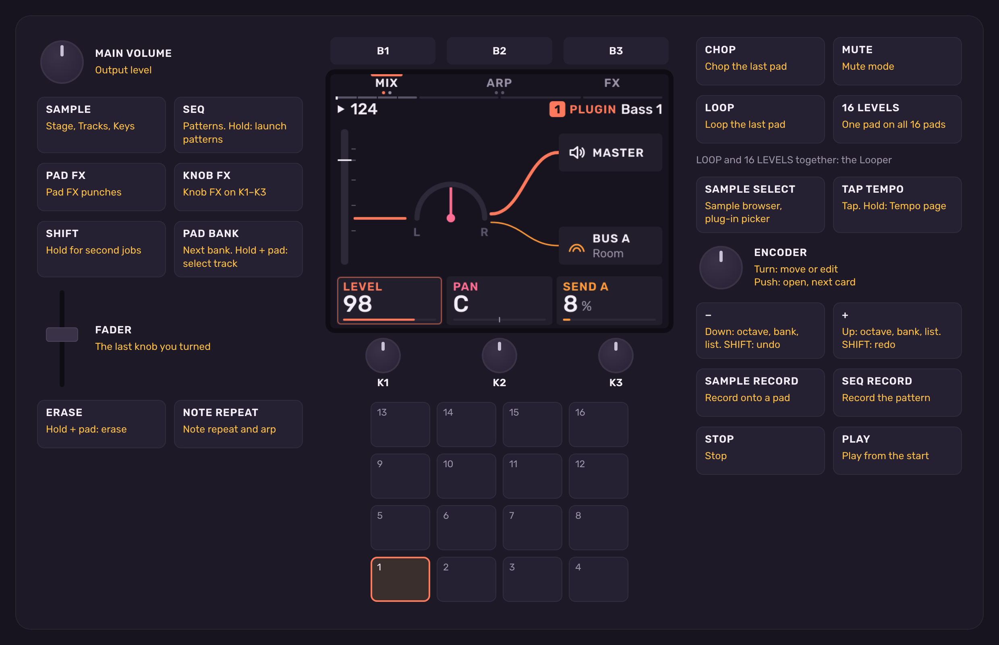
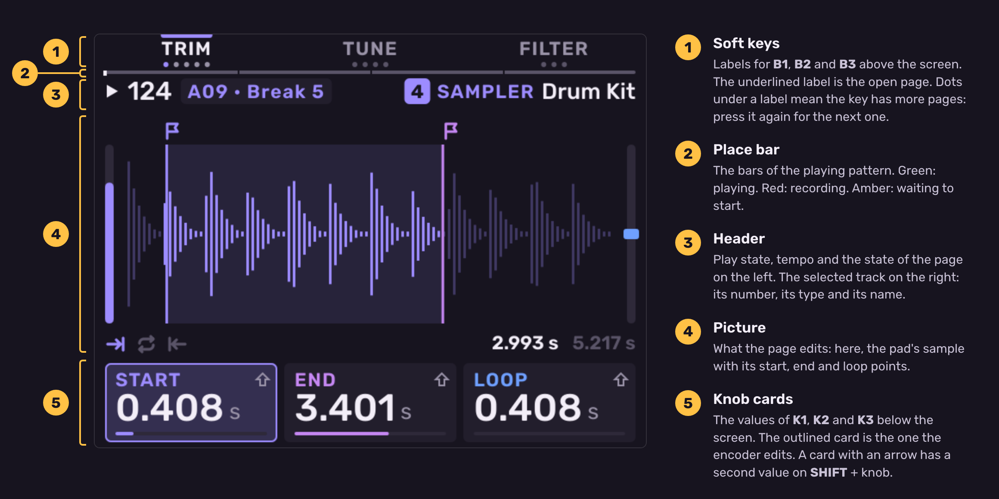
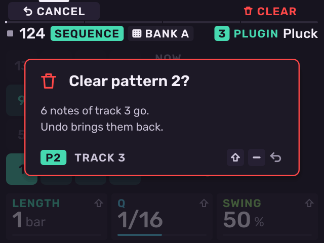

# Basics

Previous: [Coming from the stock MPC Sample](coming-from-the-stock-mpc-sample.md) · [Contents](../GUIDE.md) · Next: [Tracks](tracks.md)

## The panel

## The screen

The header shows a state with a symbol and a short word: a play triangle, a
stop square, a red dot while recording, a red ring while recording is
armed. The **place bar** under the soft keys shows where playback is: green
while playing, red while recording, amber while waiting for a bar to start.

Lists work the same way on every page: the symbol before a name shows what
the row is (folder, sample, instrument, plug-in), and facts about it are at
the right edge. **K1** jumps through any list.

## Navigation

| Control | Action |
| --- | --- |
| **B1**, **B2**, **B3** | Select the page or action named above each key. A lit key pressed again goes to its next page. |
| **K1**, **K2**, **K3** | Set the value on the card above each knob. |
| **SHIFT** + **K1**–**K3** | Set the second value of a card with an arrow. |
| Encoder (turn) | Move through a list, or fine-tune the outlined card. |
| Encoder (push) | Open the item under the cursor, or move to the next card. |
| **SHIFT** + encoder push | Go back one page. |
| The button that opened a page | On Fader, Rec Quantize, Time Correct, Compressor, Settings, Song, Project, Input Config and Step Edit, press it again to close the page. |
| **−** / **+** | Change the octave on play pages, the bank on kit pages, or move through a list. |
| **SHIFT** + **−** / **+** | Undo / redo. |

## Knob takeover

**K1**–**K3** are absolute knobs. When a knob is not at the value on its
card, the card shows the value dim with a tick where the knob is. By
default the knobs use **Scaled** takeover: the value moves toward the knob
until they meet. Change this in [Settings](settings.md) (**KNOBS**).

## Undo

**SHIFT** + **−** undoes, **SHIFT** + **+** redoes. Melodee keeps the last
32 steps. A recording take is one step. Turning a knob is one step per
control. Mute, solo and the transport are not undo steps. Loading or
creating a project clears the undo history.

## Erase and copy

- **ERASE** + pad on a kit, stopped: empty the pad.
- **ERASE** + pad on a kit, playing: erase that pad's notes from the pattern.
- **ERASE** + pad on a synth, plug-in or MIDI track: erase that key's notes
  (asks first).
- **ERASE** + **SEQ RECORD** on a kit: erase all notes of the selected pad
  from the pattern (asks first). With 16 Levels on, this is the 16 Levels
  pad, so every level goes.
- **ERASE** + knob: set the value back to its default.
- **ERASE** + fader: clear the fader's Motion lane (asks first).
- **ERASE** pressed alone erases what the page has selected:

| Page | ERASE alone |
| --- | --- |
| Roll | The selected note, or the marked notes |
| Step Edit | The selected event. In STEPS mode: the caret's step |
| Patterns | The pattern (asks first). On the **SCENE** cards: the scene's name and tempo |
| Tracks | The track (asks first) |
| Looper | The selected loop (asks first) |
| Effect chains | The selected effect |
| Chop | The selected slice |
| Layers | The selected layer |
| Mod | The selected target |
| Project | The selected project: press twice |
| Song | The clip under the cursor |

- **SHIFT** + **ERASE** copies. Where it picks, press the source, then the
  target. Press **ERASE** to stop.

| Where | SHIFT + ERASE |
| --- | --- |
| **PAD BANK** held, or Tracks | Tracks |
| **SEQ** held, or Patterns | Patterns |
| Step Edit in STEPS mode | A step to another step |
| Roll with marked notes | The marked notes: push the encoder to paste them at the cursor |
| Roll, Step Edit in PLAY mode, a synth's play pages | A key's notes to another key |
| A kit's play pages | Kit pads |
| Song | The clip, placed after itself |
| Project | The selected project |
| Effect chains | The selected effect, placed after itself |
| Chop | The selected slice, onto the next empty pad |

When an action deletes something, Melodee asks first. The question says
what is lost and whether undo brings it back. **B1** cancels, **B3** does
it. Or turn the encoder to pick one and push it.

## Mute and solo

Press **MUTE** to turn on mute mode. Hold **MUTE** for mute mode only while
it is held.

- On a kit page, the pads mute kit pads.
- On other pages, the pads mute tracks.
- **SHIFT** + pad solos.
- **SHIFT** + **MUTE** unmutes everything.

Muted pads light red. Soloed pads light white.

## Pad lights

The pads show what a press does on the page:

- A track's colour: the track's notes or pads. A kit pad with a colour of
  its own lights in that colour (see **COLOUR**).
- White: the selected pad, or a panel job (for example while **SHIFT** is
  held).
- Red: muted, about to be erased, or recording.
- Brighter means more important: the selected pad, a note's velocity, a
  playing pattern.
- A blink means the pad waits for the next bar.

Change the pad lights to white or off, and how fast a pad fades after its
sound stops, in [Settings](settings.md) (**LIGHTS**).

## Light show

Hold **SAMPLE** and press **MUTE** to turn the light show on or off. Every
light on the panel keeps time with the tempo, and a pad you press flashes
white. The pads, buttons and pages work as usual. While the light show is
on, hold **SAMPLE** and press **−** / **+** to pick its style: **Pulse**,
**Sweep**, **Chase**, **Ripple** or **Levels** (the pads show the mix as a
meter). The light show is off when Melodee starts.

---

Previous: [Coming from the stock MPC Sample](coming-from-the-stock-mpc-sample.md) · [Contents](../GUIDE.md) · Next: [Tracks](tracks.md)
