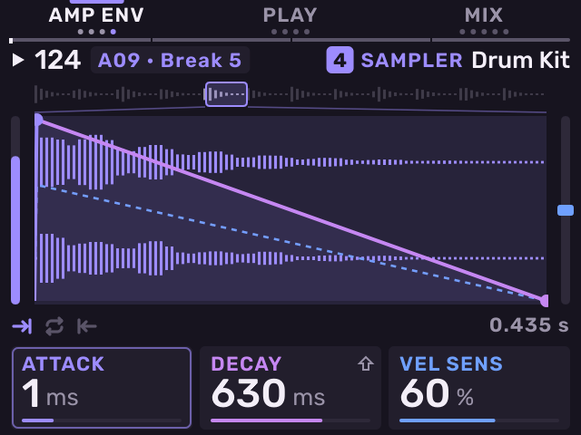
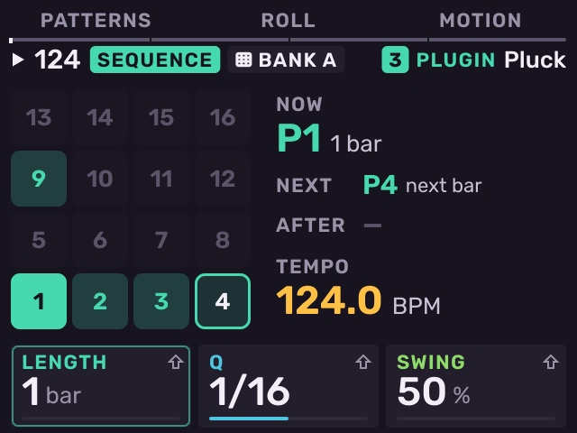

# Coming from the stock MPC Sample

Previous: [Overview](overview.md) · [Contents](../GUIDE.md) · Next: [Basics](basics.md)

Melodee keeps the MPC Sample's printed controls. If you know the stock app,
most of what you do still works. This chapter lists what is the same, what
is different, and how to change your habits.

## What stays the same

- The printed button names keep their meaning: **CHOP** chops, **SAMPLE
  RECORD** records a sample, **SAMPLE SELECT** opens the browser, **NOTE
  REPEAT** repeats, **16 LEVELS** spreads a pad over all 16 pads, **MUTE**
  mutes, **LOOP** loops the current pad.
- The printed **SHIFT** jobs work as on the stock app: **SHIFT** + **SAMPLE**
  opens Input Config, **SHIFT** + **SEQ** opens Step Edit, **SHIFT** +
  **ERASE** copies, **SHIFT** + **PAD FX** opens Flex Beat, **SHIFT** +
  **CHOP** sets Note On, **SHIFT** + **LOOP** reverses the pad, **SHIFT** +
  **16 LEVELS** sets the type, **SHIFT** + **TAP TEMPO** sets the metronome,
  **SHIFT** + **PLAY** continues, **SHIFT** + **−** / **+** undo and redo.
- The **SHIFT** + pad jobs printed under the pads work as on the stock app.
  The one change is **Pad 8**: it opens Settings, and MIDI Config is one of
  its pages.
- A kit has 128 pads in 8 banks (A–H). Press **PAD BANK** for the next bank
  and **SHIFT** + **PAD BANK** for the previous one.
- A kit's pad pages are the stock Sample mode pages: Trim, Tune, Amp Env,
  Play, Mix, Filter and Filt Env. The knobs do the same jobs. On Stage they
  are grouped by what they do: Trim, Tune and Amp Env on **B1**; Play on
  **B2**; Mix, Filter and Filt Env on **B3**.
- MPC kits keep their pad colours.
- Hold **SAMPLE** and press a pad to select that pad without playing it.
- Push the encoder to move to the next knob card.
- **SEQ RECORD** and **PLAY** record a pattern. **ERASE** + pad erases a pad
  or its notes, as on the stock app. **ERASE** + **SEQ RECORD** erases the
  selected pad's notes, and asks first in the stock app's words.
- **SHIFT** + **Pad 12** opens Song. **SHIFT** + **Pad 16** opens Project.
- Knob FX, Pad FX, Flex Beat and the master compressor work as on the stock
  app, with the stock effects in the stock order.

## What is different

| On the stock app | In Melodee |
| --- | --- |
| A project is one kit. | A project has 16 tracks. Track 1 starts as a kit. The other tracks can be kits, plug-in instruments or MIDI tracks. |
| **PAD BANK** held + Pads 1–8 jumps to bank A–H. | **PAD BANK** held + pad selects track 1–16. To jump banks, hold **PAD BANK** and turn the encoder or press **−** / **+**. |
| **SAMPLE** opens Sample mode. | **SAMPLE** opens **Stage**, the selected track's sound pages, from any page. On a kit, Stage has the Sample mode pages. On Stage, **SAMPLE** goes back to **B1**'s first page. Hold **SAMPLE** to see the track's pads: **Pads** on a kit, **Keys** on an instrument. |
| In Sequence mode the pads select sequences. | **SEQ** opens **Patterns**, **Roll** or **Motion**. On Patterns the pads launch the selected track's patterns, laid out as the pads. You can also hold **SEQ** and press a pad on any page. |
| A sequence plays every pad of the kit. | Each track has its own 128 patterns, in banks A–H. To change every track at once, launch a **scene**: hold **SEQ** + **SHIFT** and press a pad. |
| Song mode is a list of sequences. | **Song** is a timeline with a lane per track. You place pattern clips on it, add markers and tempo changes. |
| The project saves in the background. | Save with **SHIFT** + **Pad 16**, then **B1** (**SAVE**). Leaving through the Exit screen also saves. |
| Projects are on the internal drive. | Melodee's projects are on the card in `Melodee/Projects`. On the project list, **B2** (**INTERNAL**) shows the internal drive. Stock projects open as copies (see [MPC Sample projects](projects-and-files.md#mpc-sample-projects)). |
| **SHIFT** + **KNOB FX** (FX Select) picks pad effects. | **SHIFT** + **KNOB FX** opens the effect chains: Track, Sends, Bus and Master, six slots each. |
| Hold **TAP TEMPO** and turn the encoder to set the tempo. | Hold **TAP TEMPO** to open the **Tempo** page. Or hold **SEQ** and turn the encoder. |
| Press **STOP** twice to stop all sound. | Press **SHIFT** + **STOP** to stop all notes. |
| **SHIFT** + **SEQ RECORD** brings the last loop into the sequence. | **SHIFT** + **SEQ RECORD** (Recall) puts the last phrase you played on every track into each track's next empty pattern. |
| **SAMPLE RECORD** records a sample. | On a kit, the same. On a plug-in or MIDI track, **SAMPLE RECORD** opens the **PRINT** sheet, which freezes the track to audio (see [Freeze a track](tracks.md#freeze-a-track)). |
| No looper. | Press **LOOP** and **16 LEVELS** together to open the **Looper**. |
| No mixer. | Press **PAD FX** and **KNOB FX** together to open the mixer: **Tracks**, **Sends** and the effect chains. |
| Power off with **POWER**. | A short press of **POWER** opens the Exit screen: stay, power off, or go back to the stock app. |

## Change your habits

These are the actions stock users look for first.

1. **Pick a track before you play.** The pads play the selected track. Hold
   **PAD BANK** and press a pad to choose one. The header shows the selected
   track on the right.
2. **Use the kit as before.** Track 1 is a kit. **SAMPLE SELECT**, **SAMPLE**,
   **CHOP**, **SAMPLE RECORD** and **16 LEVELS** work on the kit as on the
   stock app.
3. **Hold SEQ to change patterns.** A tap of **SEQ** opens **Patterns** (or
   Roll or Motion, if one of them was open last on the track). Holding
   **SEQ** turns the pads into the selected track's patterns, from any
   page. The pattern changes at the next bar, or at once when stopped.

   

4. **Use SHIFT + encoder push to go back.** Melodee's pages open from each
   other. **SHIFT** + push goes back one page. **B1** is BACK or CANCEL on
   every sheet. A page you opened with a **SHIFT** + pad job closes when you
   press that job again.
5. **Save on purpose.** There is no background save. Save with **SHIFT** +
   **Pad 16**, **B1**.
6. **Open your stock projects.** On the Project page, press **B2** (**OPEN**).
   Press **B2** (**INTERNAL**) for the projects on the internal drive, or
   open the **MPC Sample** folder for stock projects on the card.

---

Previous: [Overview](overview.md) · [Contents](../GUIDE.md) · Next: [Basics](basics.md)
