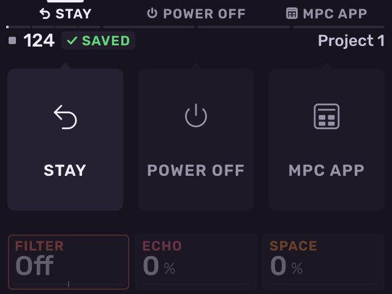
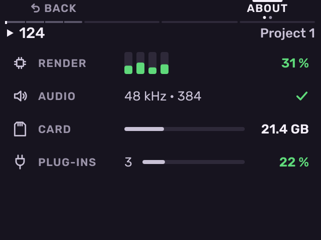

# Exit and troubleshooting

Previous: [Settings](settings.md) · [Contents](../GUIDE.md) · Next: [Shortcut tables](shortcut-tables.md)

## Exit

Press **POWER** briefly. The Exit screen opens.

- **B1** (**STAY**): go back to Melodee.
- **B2** (**POWER OFF**): save the project and switch the MPC off.
- **B3** (**MPC APP**): save the project and run the stock app until the
  next time the MPC is switched on.

Or turn the encoder to pick one and push it. **STAY** is picked when the
screen opens.

The next time Melodee starts, it opens the project set to open at start,
or else the last project you opened or saved.

## Troubleshooting

**Melodee does not start.** Check that the MPC has firmware 1.3.0.12 and
that the `autorun` folder is at the top level of the card, with its files
unchanged.

**The stock app came back.** If Melodee crashes or fails to start, the
stock app starts instead. Switch the MPC off and on to start Melodee again.

**Crackles or dropouts.** Open Settings, **ABOUT**. It shows the processor
load per core, the audio dropouts, and card read problems. Use a larger
audio buffer in **AUDIO**, or remove effects or plug-ins from the busiest
track (the Tracks page shows each track's load).

**A plug-in does not load.** The picker shows the reason, for example
"Windows and Mac builds only". Melodee runs only Linux ARM builds.

**An instrument loads slowly.** The first load decodes its files into
`Melodee/Cache`. Later loads are fast.

When you report a problem, say what you pressed, what you saw, and the
version on the **ABOUT** page.

---

Previous: [Settings](settings.md) · [Contents](../GUIDE.md) · Next: [Shortcut tables](shortcut-tables.md)
