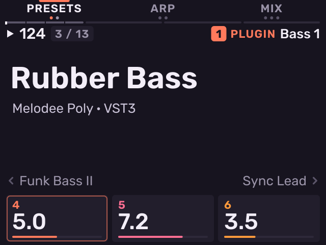
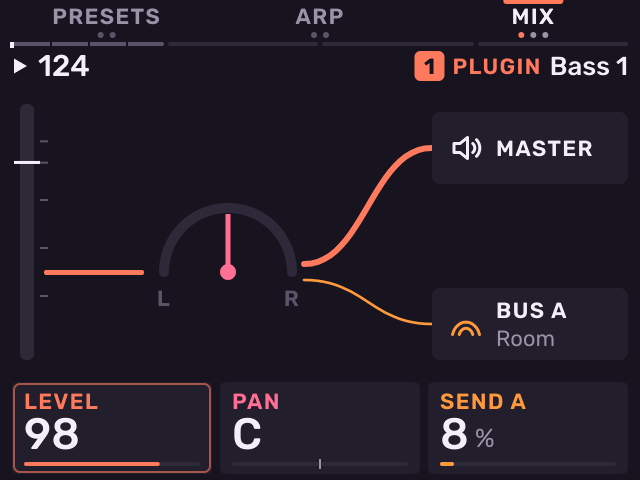
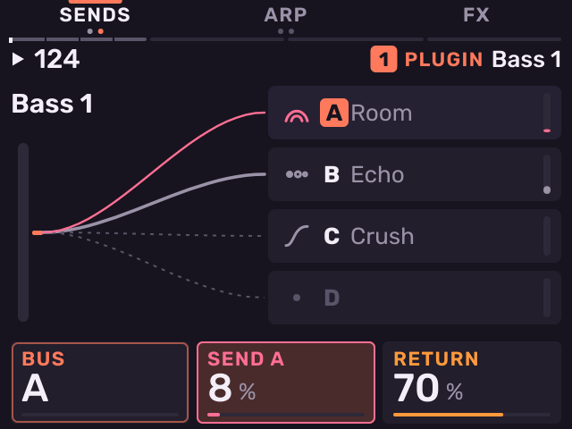
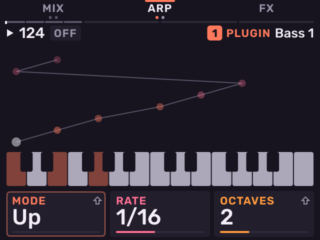
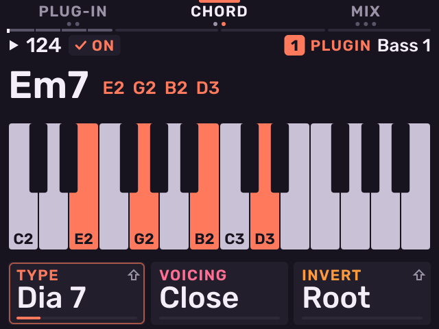
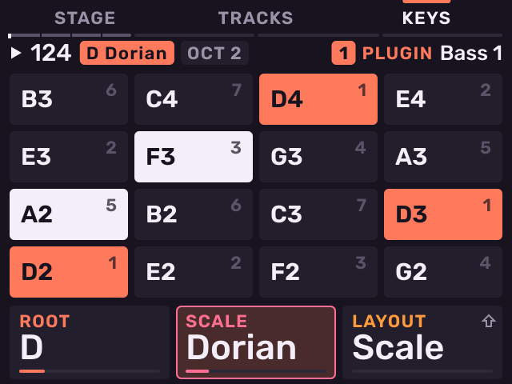
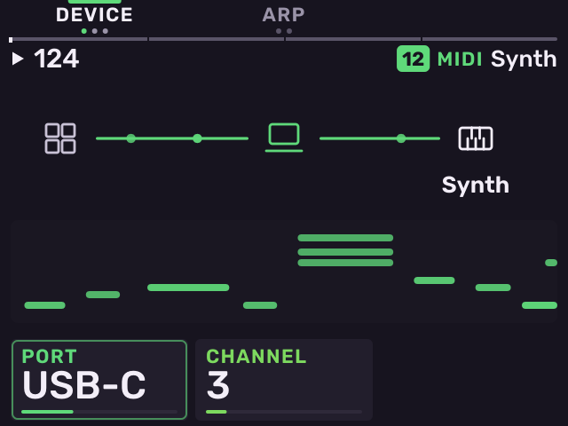
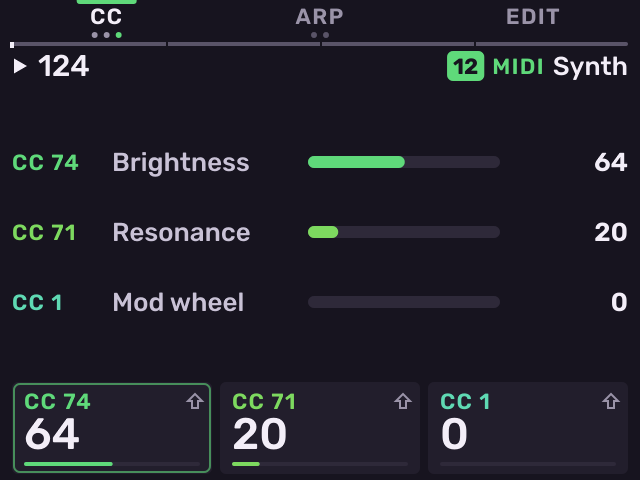

# Instrument and MIDI tracks

Previous: [Plug-ins](plug-ins.md) · [Contents](../GUIDE.md) · Next: [Sequencing](sequencing.md)

## Stage on a plug-in track

| Key | Pages |
| --- | --- |
| **B1** | **PRESETS** (or **PLUG-IN**), **EDIT** |
| **B2** | **ARP**, **CHORD** |
| **B3** | **MIX**, **SENDS**, **FX** |

**PRESETS**: the plug-in's presets. The name of the one playing is large,
with the ones before and after it in the corners. Turn the encoder to load
the next one; it loads when you stop turning. Push the encoder for the whole
list. **K1**–**K3** set the plug-in's first three parameters. A plug-in with
no presets shows **PLUG-IN** instead: its name, its format and how much of
each audio block it uses.

**EDIT**: all of the plug-in's parameters, as on the Edit page. Turn the
encoder or press **−** / **+** to move through them.

**MIX**: **K1** level, **K2** pan, **K3** send to bus A.

**SENDS**: **K1** selects bus A–D, **K2** sets the send to it, **K3** the
bus return. The picture shows the four buses and each bus's first effect.

**ARP**: **K1** mode (Up, Down, Up-down, Random, Order), **K2** rate (1/4 to
1/32T), **K3** octaves. **SHIFT** + **K1** gate, **SHIFT** + **K3** hold.
**NOTE REPEAT** turns the arpeggiator on.

**CHORD**: one pad plays a chord from the scale. **K1** type (Triad, Dia 7,
Sus2, Sus4, Power, Dia 9), **K2** voicing (Close, Open, Drop 2, Spread),
**K3** inversion. **SHIFT** + **K1** turns chords on or off. **SHIFT** +
**K3** hold.

**FX**: the track's effect chain. The cards edit the selected slot. Push the
encoder for the next slot. With no effects, push opens the effect picker.

## Keys

Hold **SAMPLE** on an instrument track to see **Keys**. The 16 pads fill the
screen. Each pad shows its note and its degree in the scale. Root notes are
in the track's colour. While you hold **SAMPLE**, **K1** sets the root, **K2**
the scale and **K3** the pad layout.

- **K1**: root. **K2**: scale. **K3**: layout (Scale, Chromatic, Chords,
  16 Levels or Drums).
- **−** / **+**: octave.
- **SHIFT** + **K3**: transpose the pads −12 to +12 semitones.
- Encoder push: open Edit.

The key and scale belong to the project. The layout belongs to each track.

## MIDI tracks

A MIDI track sends its pads, patterns and arpeggiator to an external
instrument on its own port and channel.

| Key | Pages |
| --- | --- |
| **B1** | **DEVICE**, **PROGRAM**, **CC** |
| **B2** | **ARP**, **CHORD** |
| **B3** | **EDIT**: opens the Edit pages (below). |

**DEVICE**: **K1** port (the MIDI Out jack, USB-C, all USB devices, or a
USB device by name), **K2** channel. The picture shows the notes going out.

**PROGRAM**: bank MSB, bank LSB and program number. Melodee sends them
when they change and when the track loads.

**EDIT** (**B3**): every page of the MIDI track: device, program, eight
pages of slots, the drum map (**PADS**), expression, audio in and SysEx.
Press **SAMPLE** to go back to Stage.

**CC**: three MIDI CCs on **K1**–**K3**. **SHIFT** + knob selects the CC
number. Knob moves record as Motion.

Edit on a MIDI track has more pages: eight **SLOTS** pages with 24 knobs
(CC, 14-bit CC, pitch bend, channel pressure or NRPN), **EXPRESS** (pitch
bend and pad pressure), **PADS** (Keys or Drums with General MIDI drum
names), **AUDIO** (route an input into the track's mixer strip) and
**SYSEX** (send a `.syx` file from the `SysEx` folder on the card). For
how MIDI tracks were designed, see the
[MIDI tracks design notes](../MIDI_TRACKS.md).

---

Previous: [Plug-ins](plug-ins.md) · [Contents](../GUIDE.md) · Next: [Sequencing](sequencing.md)
