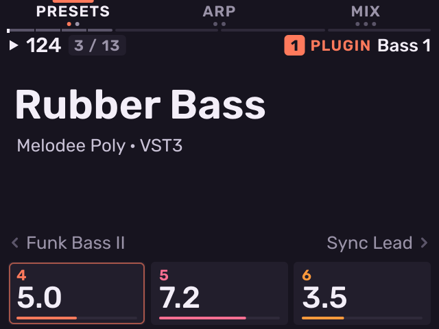
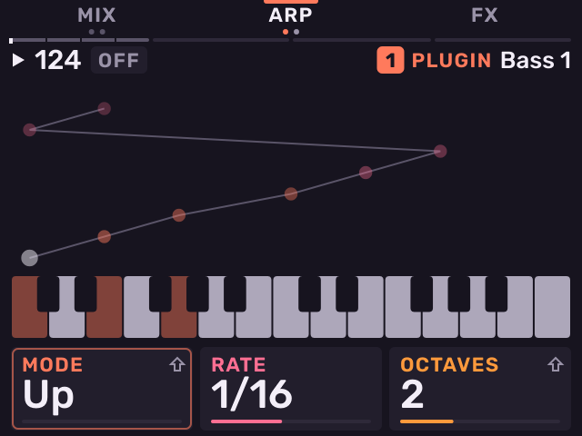
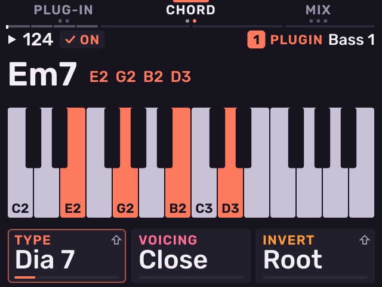
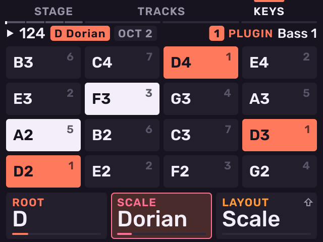
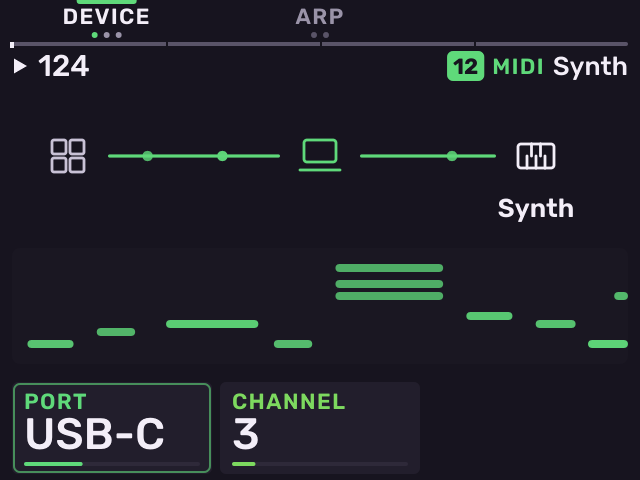
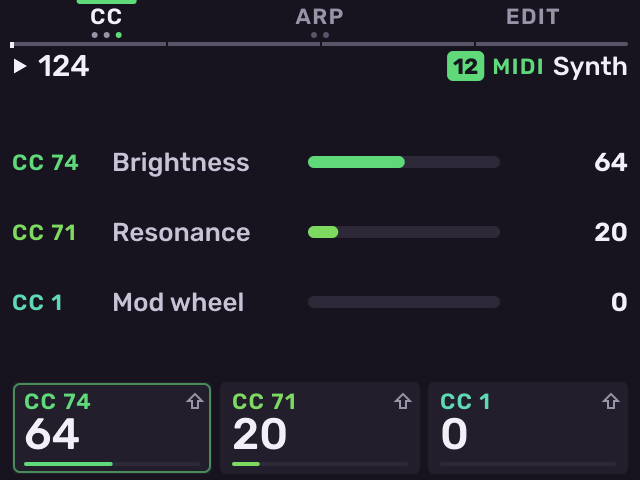

# Instrument and MIDI tracks

Previous: [Plug-ins](plug-ins.md) · [Contents](../GUIDE.md) · Next: [Audio tracks](audio-tracks.md)

## Stage on a plug-in track

| Key | Pages |
| --- | --- |
| **B1** | **PRESETS** (or **PLUG-IN**), **PANEL** (a plug-in that draws its own screen), **EDIT** |
| **B2** | **ARP**, **CHORD** |
| **B3** | **FX** |

Hold **SHIFT** on a **B1** page for the plug-in's own keys:

| Key | With **SHIFT** |
| --- | --- |
| **B1** | **PLUG-INS**: the plug-in picker |
| **B2** | **PRESETS**: the whole preset list |
| **B3** | **TRANSPORT**: whether the plug-in hears Play and Stop |

**PRESETS**: the plug-in's presets. The name of the one playing is large,
with the ones before and after it in the corners. Turn the encoder to load
the next one; it loads when you stop turning. Push the encoder for the whole
list. A plug-in with no presets shows **PLUG-IN** instead: its name, its
format and how much of each audio block it uses.

**K1**–**K3** are the same three knobs on every plug-in, applied to what it
plays:

- **K1** (**FILTER**): left of the middle a low pass, right of it a high
  pass, off in the middle.
- **K2** (**ECHO**): how much goes into a dotted-eighth echo at the tempo.
- **K3** (**SPACE**): how much goes into a reverb.

The echo's repeats and the reverb's tail ring on when you turn their knob
back. The knobs are saved with the track and record as Motion. **ERASE** +
knob sets one back to off.

**PANEL**: the plug-in's own page, when it draws one (see
[A plug-in's own screen](plug-ins.md#a-plug-ins-own-screen)).

**EDIT**: all of the plug-in's parameters. Turn the encoder or press
**−** / **+** to move through them. Picking a plug-in opens this page.

The track's level, pan and sends are on the [mixer](mixer-and-effects.md#the-mixer).

**ARP**: **K1** mode (Up, Down, Up-down, Random, Order), **K2** rate (1/4 to
1/64T), **K3** octaves (1–4). **SHIFT** + **K1** gate, **SHIFT** + **K2**
turns the arpeggiator on or off, **SHIFT** + **K3** hold. The arpeggiator is separate from
**NOTE REPEAT**: Note Repeat plays every pad held together on each step.

**CHORD**: one pad plays a chord from the scale. **K1** type (Triad, Dia 7,
Sus2, Sus4, Power, Dia 9), **K2** voicing (Close, Open, Drop 2, Spread),
**K3** inversion. **SHIFT** + **K1** turns chords on or off. **SHIFT** +
**K3** hold.

**FX**: the track's effect chain. The cards edit the selected slot. Push the
encoder for the next slot. After the last effect comes the **+**: push there
to open the effect picker and add one at the end.

## Keygroup tracks

A keygroup track plays one instrument across its pads and keys: an SFZ, an
MPC keygroup program, an EXS, a DecentSampler preset, a SoundFont preset, or
a single sample. Its pads play notes, as on a plug-in track.

To make one: select an empty track, turn to **Keygroup** and push the
encoder. Pick the instrument or sample in the browser. **SAMPLE SELECT** on
the track opens the browser again to change it. **B3** (**PREVIEW**) plays
each sample, program or instrument when you move to it, as on a kit.
Melodee keeps the **PREVIEW** setting when you restart.

| Key | Pages |
| --- | --- |
| **B1** | **TRIM** (**ZONES** on an instrument), **TUNE**, **AMP ENV**, **FILTER**, **FILT ENV** |
| **B2** | **PLAY**, **ARP**, **CHORD** |
| **B3** | **FX** |

**TUNE** moves every note.

The fader starts on the sound's volume and can take pitch bend. A MIDI
keyboard's pitch wheel and sustain pedal play it too.

In an MPC 3 export a keygroup track is an MPC keygroup track, and an MPC 3
project's keygroup tracks open as keygroup tracks.

### A single sample's note

When a sample is loaded or recorded, Melodee finds the note it holds: a bass
note, a sung note, a synth note, or the root of a chord stab. A keygroup
track of that one sample plays it at its own pitch on the key of that note,
between G3 and F#4. The pads and a MIDI keyboard then play the notes they
name.

1. Make a keygroup track and load a bass note played in E.
2. Play E4 on the pads or a MIDI keyboard. The sample plays as recorded.
3. Play D4. The sample plays a tone lower.

- A drum, a phrase, a noise or a sliding pitch has no note. It plays at its
  own pitch on C4 (note 60).
- An instrument (SFZ, program, EXS, DecentSampler, SoundFont) keeps the
  notes set in its file.
- Samples in projects saved with older versions play on C4, as before.
- **TUNE** moves the sample from there.
- An MPC 3 export plays the sample from the same note.

### Auto sample a plug-in

Auto sample plays a plug-in track one key at a time and records each note.
The result is an MPC keygroup program on a new keygroup track, which takes
almost no CPU and opens on MPC One, Live, Key, X, Force and MPC Beats.

1. Select the plug-in track and set the sound you want.
2. Press **SHIFT** + **Pad 11** (Resample). **SHIFT** + **Pad 11** again closes the sheet.
3. Wait for the check (**CHECKING**, a few seconds). It plays a few notes and
   finds out what the plug-in is. While the plug-in is still opening, the
   sheet shows **OPENING** and starts the check when it is ready; **WAITING**
   means a print is under way.
4. Set the cards. **B2** (or the encoder) shows the next row.
5. Press **B3 SAMPLE** (or push the encoder).

| Row | K1 | K2 | K3 |
| --- | --- | --- | --- |
| **KEYS** | **LOW**: lowest note | **HIGH**: highest note | **STEP**: semitones between notes, 1–24 |
| **NOTE** | **LAYERS**: velocity layers, Auto or 1–8 | **HOLD**: how long each key is held (up to 20 s), or Auto | **TAIL**: longest release measured |
| **SOUND** | **TAP**: Pre FX or Post FX | **LOOP**: Auto, On or Off | **LEVEL**: as played, or loudest at −1 dB |

Under the keys the sheet shows how many samples it makes, the keys, about
how long sampling takes (**TIME**, once the check has played the plug-in)
and the most it takes on the card (**CARD**).

The pads play the plug-in so you can try the sound first; **−** / **+** move
their octave. While it samples, the marks over the keys light as each note is
done, and the note being recorded is drawn as it plays: the held part, then
the release. **B1 CANCEL** stops it and deletes what was made.

When it is done, the program is in **Melodee/Samples/Keygroups/<name>/**:

- **<name>.xty**: the track file for MPC 3. Melodee's browser shows this
  one.
- **<name>_[TrackData]**: the samples, and **<name>.xpm**, the program for
  an MPC on version 2 and MPC Beats. To use it there, copy the whole
  **<name>** folder and load the .xpm from inside **<name>_[TrackData]**.
  An .xpm holds 4 velocity layers a keygroup. With more, each of its 4 plays
  the velocities of two (8 layers: layers 2, 4, 6 and 8). The .xty and the
  keygroup track in Melodee have all of them.

The first empty track becomes a keygroup track with the plug-in track's
patterns, Song clips, mix and pitch bend. With **TAP** at Pre FX it also
gets the plug-in track's effects (not plug-in effects); at Post FX the
effects are in the samples. The plug-in track stays as it was. **SHIFT** + **−** undoes the new
track; the files stay on the card.

The check sets these for you; the sheet's chip shows the type:

| Found | What Auto sample does |
| --- | --- |
| **KEYS** | Samples every **STEP** keys, as set. |
| **MONO** | The program plays one note at a time and glides like the plug-in (**GLIDE** shows the time). **Mono, legato**: a key pressed while another is held carries the note on. **Mono, retrigger**: it starts the note again. |
| **SPLIT** | The plug-in has two sounds side by side on the keyboard (a bass under a lead). A line on the keys shows where the upper one starts. Each side is checked on its own and gets its own mono or poly playing, hold, loops, release and velocity response. |
| **DRUMS** | Samples each key that makes a sound, one sample per key. **STEP** is not used. Each drum plays whole however short the tap. |
| **VELOCITY** | How many velocity layers the sound needs: **Tone, 5 layers** where its tone changes with velocity, **Accent at 101** where it jumps (a layer starts there), **Level only** where only its level changes (one layer: the keygroup's Velocity follows it). **LAYERS** at Auto takes that many, up to 8. |
| **TAKES ×3** | Each key is recorded three times and the program plays them in turn. |
| **LOOPS** | The sound keeps sounding while a key is held, so each note loops and plays on for as long as you hold the pad. With **LOOP** at Auto this follows the check; set it to On or Off to choose yourself. |
| **HOLD Auto** | A steady sound is held 2 s. A sound that moves while held (a slow LFO, detuned oscillators) is held 8 s and gets a long loop, so its movement carries on. A sound that fades is held until it has died away. |

On a keygroup track from a **MONO** program, a key pressed while another is
held does what the plug-in did: it carries the note on to the new key
(legato), or starts the note again (retrigger). Let that key go while the
first is still held and the note goes back to the first. A **Slide** step always
carries the note on, on any keygroup track. The glide is saved in the
program, so it also works on an MPC. MPC 3 exports set **Mono Retrig** to
match. An MPC on version 2 has no such setting and always starts the note
again.

- Each key covers the notes halfway to the next sampled key.
- **LOOP** finds a loop in the held part of each note and crossfades it, so
  pads and organs sustain. Sounds that move while held get a loop several
  seconds long. Sounds that fade while held (plucks, a 303) are not looped at
  Auto; put **LOOP** On to hold them.
- When you let a key go, the note fades as the plug-in's did: Auto sample
  measures how fast the plug-in falls and how much of it rings on (echoes,
  reverb), and sets the program's release to match. A sound that rings on
  plays as two keygroups over the same keys, one with the short release and
  one with the long.
- **VEL**, in the row over the cards, shows the check's 16 hits of one key,
  soft to hard, each bar as tall as its tone. The layers alternate full and
  faint; an accent's are amber. Each layer is recorded at its top velocity.
- **LEVEL** starts as played: the keygroup track is as loud as the plug-in
  track at the same settings. At −1 dB every sample is raised by the same
  amount (the loudest to −1 dB), so velocity layers keep their balance.
- The program follows velocity as far as the plug-in did. A plug-in that
  plays every note at one level gives a program that does the same.
- A key where the plug-in makes no sound is left out.
- A sample that is the same on both sides (a mono synth) is saved as a mono
  WAV. It takes half the room on the card and in memory and sounds the same.

Some things samples cannot hold, so the program does not have them:

- What the mod wheel, aftertouch and other controllers do in the plug-in.
- Movement that follows the tempo (an arpeggio, a synced LFO or delay). It
  is recorded at the tempo it was sampled at.
- More than one split. One is found; a plug-in with three sounds side by
  side gets two.
- On an MPC, the mono side of a split cuts its last note but does not glide,
  and a program plays as mono or poly as a whole. In Melodee each side plays
  as the plug-in did, unless the program has more than 4 velocity layers: the
  track then plays the .xty, where the mono side does not glide either.

### Auto sample an external instrument

Auto sample also works on a MIDI track. Melodee plays the instrument over
MIDI and records its sound from an input. This runs in real time: each note
plays for its hold and its release.

1. Connect the instrument: MIDI from the MPC (the MIDI Out jack or USB) and
   its audio to the rear inputs.
2. Select the MIDI track and play the pads to check that the instrument
   answers.
3. Press **SHIFT** + **Pad 11** (Resample).
4. On the **SOUND** row, set **INPUT** (**K1**) to the input the instrument
   is on: Rear, Rear L, Rear R, Mic or USB. It starts at Rear.
5. Play a pad and watch the **IN** meter. Amber is close to clipping: turn
   the instrument down.
6. Set the other cards as for a plug-in and press **B3 SAMPLE**.

Melodee first listens to the input once with nothing playing, then plays
one short note to measure how long the instrument takes to answer. The check
(**CHECKING**) follows, and the sampling starts straight after it without
listening to the input again. Each sample starts where its sound starts.

- Do not play the instrument while it samples. Pressing **PLAY** stops it.
- **INPUT** is the track's own audio input (the **AUDIO** page in Edit; see
  [Hear the instrument through the track](#hear-the-instrument-through-the-track)),
  so you hear the instrument through the track. Input Config's source is not
  used and does not change; its gain applies.
- **No sound at the input**: check the cables, the MIDI channel and
  **INPUT**.
- **The input is not quiet**: something is sounding or humming at the input
  before the first note.
- **G#3 clips** (the key named): the instrument reached full scale on that
  key, three samples in a row or more. Turn the instrument down and sample
  again. A peak that touches full scale for one or two samples is kept.
- When sampling stops, the reason stays at the top of the sheet in amber,
  with the key it stopped on in amber on the keys, until you press
  **SAMPLE** again.
- The program goes on the first empty track as a keygroup track with the
  MIDI track's patterns, Song clips and mix. The MIDI track stays as it was.

## Keys

Hold **SAMPLE** on an instrument track to see **Keys**. The 16 pads fill the
screen. Each pad shows its note and its degree in the scale. Root notes are
in the track's colour. While you hold **SAMPLE**, **K1** sets the root, **K2**
the scale and **K3** the pad layout.

- **K1**: root. **K2**: scale. **K3**: layout (Scale, Chromatic, Chords,
  16 Levels, Drums or Prog). Drums lays the pads out as a kit's; see
  [Drum machine plug-ins](plug-ins.md#drum-machine-plug-ins). Prog plays
  chord progressions; see [Chord progressions](#chord-progressions).
- **−** / **+**: octave.
- **SHIFT** + **K3**: transpose the pads −12 to +12 semitones.
- Encoder push: open Edit.

The key and scale belong to the project. The layout belongs to each track.
To play the scale on a MIDI keyboard's white keys, see
[Play the scale on the white keys](midi-and-sync.md#play-the-scale-on-the-white-keys).

## Chord progressions

The quickest way to chords, on any track but an audio track or one on the
Drums layout: hold **16 LEVELS** and press
**B2** (**CHORDS**). The pads then play the track's chord progression. Hold
**16 LEVELS** again for **B2** (**FILE**), the progression files on the
card, and **B3** (**SET**), to make chords of your own. See
[16 Levels](kits-and-sampling.md#16-levels). The encoder Menu's **HERE** on
Stage has **CHORDS** and **CHORD FILE** too.

The **Prog** layout plays a chord progression: each pad plays one chord.
Melodee reads MPC 3 progression files (`.progression`). A progression has up
to 48 chords, 16 in each of pad banks A to C.

1. Hold **SAMPLE** on an instrument track to see **Keys**.
2. Turn **K3** to **Prog**.
3. Turn the encoder to select a progression. Its name shows on the screen.
4. Play the pads. Press **PAD BANK** for banks B and C.

The chord marked as the root in the file is in the track's colour. A pad
with no chord is dark.

| Control | Action |
| --- | --- |
| Encoder | Select the progression |
| **K1** | Key. All chords move to the new key. |
| **K2** | Voicing: File (as in the file), Close, Open or Spread |
| **K3** | Layout |
| **−** / **+** | Octave |
| **PAD BANK** | Banks A–C |

Melodee looks for progressions in these folders on the SD card:

- `Melodee/Progressions` (your own progressions)
- `Progressions`
- `Melodee/Samples/Expansions` (in each expansion's folders)

### Make your own chords

1. On **Keys**, set **K3** to Scale, Chromatic or Chords.
2. Hold the pads of the chord. **B2** shows **STORE**.
3. Press **B2**. The layout changes to **Prog**. Empty pads are outlined.
4. Press the pad for the chord. To cancel, press **B1** (**BACK**).

Melodee saves the progression to `Melodee/Progressions` on the SD card. A
new progression is named Mine 1, Mine 2 and so on. When you add a chord to a
progression from another folder, Melodee saves the changed copy in
`Melodee/Progressions` and does not change the original file.

The project keeps the progression of each track, its key and its voicing.

## MIDI tracks

A MIDI track sends its pads, patterns and arpeggiator to an external
instrument on its own port and channel.

To make one: select an empty track, turn to **MIDI** and push the encoder.
Turn to **Out jack**, **USB-C** or **All USB** and push again.

| Key | Pages |
| --- | --- |
| **B1** | **DEVICE**, **PROGRAM**, **CC** |
| **B2** | **ARP**, **CHORD** |
| **B3** | **EDIT**: opens the Edit pages. |

**DEVICE**: **K1** port (the MIDI Out jack, USB-C, all USB devices, or a
USB device by name), **K2** channel. The picture shows the notes going out.

**PROGRAM**: bank MSB, bank LSB and program number. Melodee sends them
when they change and when the track loads. **Off** sends none.

**EDIT** (**B3**): every page of the MIDI track (see
[Edit pages on a MIDI track](#edit-pages-on-a-midi-track)). Press **SAMPLE**
to go back to Stage.

**CC**: three MIDI CCs on **K1**–**K3**. **SHIFT** + knob sets what the
knob sends: a CC number, a 14-bit CC, pitch bend, channel pressure or an
NRPN. Knob moves record as Motion.

**SHIFT** + **Pad 11** samples the instrument into a keygroup program; see
[Auto sample an external instrument](#auto-sample-an-external-instrument). For
how MIDI tracks were designed, see the
[MIDI tracks design notes](../MIDI_TRACKS.md).

### Edit pages on a MIDI track

Press **B3** (**EDIT**) on Stage. **B1** and **B3** go to the page before
and after. **B2** (**MAP**) lists every page: turn the encoder to one and
push to open it. On a page with two rows of cards, turn the encoder to
change rows.

| Page | K1 | K2 | K3 |
| --- | --- | --- | --- |
| **DEVICE** | **PORT** | **CHANNEL** | **DELAY**: −50 to +50 ms. − sends the pattern's notes that much early, for an instrument heard late (one on a computer: about −12 ms); + later. What you play goes out at once, later only by a + delay |
| **PROGRAM** | **BANK MSB** | **BANK LSB** | **PROGRAM**. Second row: this pattern's own program, sent when the pattern starts |
| **SLOTS 1**–**8** | Three knobs a page, 24 in all. Second row: what each sends (CC, 14-bit CC, pitch bend, channel pressure or NRPN). | | |
| **PADS** | **LAYOUT**, as on Keys | **NOTE**: on Drums, the note of the last pad played, with its General MIDI drum name | |
| **EXPRESS** | **BEND** | **PRESSURE**: how pad pressure goes out (Poly, Channel or Off) | |
| **AUDIO** | **INPUT** | **MONITOR** | **LEVEL** |
| **SYSEX** | **FILE**: a `.syx` file in `Melodee/SysEx` on the card | **ON LOAD**: send it when the project loads | Push the encoder to send it now |

The first three slots are the **CC** page's knobs on Stage.

### Hear the instrument through the track

The **AUDIO** page brings the instrument's sound back into Melodee on the
MIDI track. It then plays through the track's level, pan, effects and sends,
as any other track's sound does.

1. Connect the instrument's audio to the rear inputs (or the mic input, or
   USB).
2. Select the MIDI track and press **B3** (**EDIT**) on Stage.
3. Press **B2** (**MAP**), turn to **Audio** and push the encoder.
4. Turn **K1** (**INPUT**) to the input the instrument is on.
5. Play the pads. The instrument plays through the track.

| Control | Action |
| --- | --- |
| **K1** (**INPUT**) | None, Rear L, Rear R, Rear, Mic or USB. |
| **K2** (**MONITOR**) | On: the input plays through the track. Off: the track is silent. |
| **K3** (**LEVEL**) | The input's level in the track. |

USB from a computer plays straight to the jacks while Settings' **USB-C in**
is **Direct** (the default), at the track's **LEVEL**, level and pan but
without its effects, so an instrument on the computer answers the pads
sooner. **MONITOR** still turns it on and off, and muting the track fades it
out. Set **USB-C in** to **Tracks** to hear it through the track's effects.

The MPC takes sound from the mic or the rear inputs, not both at once, and
the rear inputs come first. While another MIDI track or a Looper loop uses
the rear inputs, a track set to **Mic** shows **IN USE** and is silent. Two
MIDI tracks can take Rear L and Rear R. Input Config and audio tracks follow
the same rule.

---

Previous: [Plug-ins](plug-ins.md) · [Contents](../GUIDE.md) · Next: [Audio tracks](audio-tracks.md)
