# Kits and sampling

Previous: [Tracks](tracks.md) · [Contents](../GUIDE.md) · Next: [Plug-ins](plug-ins.md)

A kit has 128 pads in 8 banks (A–H). Each pad plays a region of a sample, or
a sampled instrument. A project holds as many samples as fit in memory. When
memory is full, a sample longer than 2 seconds plays from the card instead. A
shorter one is not loaded: its pad stays silent and **Memory full** shows on
the screen.

To empty a pad, or to close the gap an empty pad leaves, see
[Erase and copy](basics.md#erase-and-copy).

## Stage on a kit

Press **SAMPLE** to open Stage. On a kit, Stage shows the pages of the last
pad you hit. Hit a pad to edit it, or hold **SAMPLE** and press a pad to
select it without playing it.

| Key | Pages |
| --- | --- |
| **B1** | **TRIM**, **LAYERS**, **TUNE**, **AMP ENV** |
| **B2** | **PLAY**, **COLOUR**, **FOLLOW**, **CLOUD** |
| **B3** | **MIX**, **SENDS**, **FILTER**, **FILT ENV**, **KIT FILT** |

Every track uses the keys the same way: **B1** for the sound's source, **B2**
for how it plays, **B3** for where it goes. Press the lit key again to go to
its next page. Each track remembers its last page. Press **SAMPLE** on
Stage to go back to **TRIM**. Press **−** / **+** to change the bank.

In Basic, a kit pad has the stock app's seven pages: **TRIM**, **TUNE** and
**AMP ENV** on **B1**, **PLAY** on **B2**, and **MIX**, **FILTER** and
**FILT ENV** on **B3**. The other pages are in Full (see
[Basic and Full](settings.md#basic-and-full)).

**TRIM**

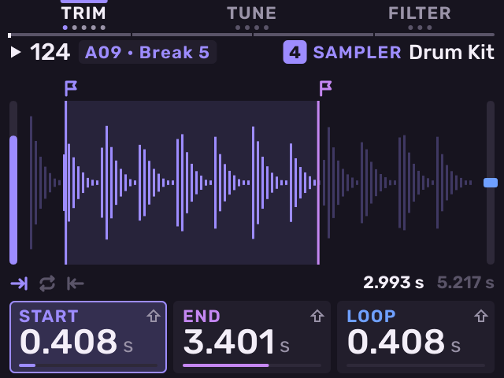

- **K1**: start. **K2**: end. **K3**: loop point.
- After you turn **K1**–**K3**, turn the encoder to move that point in fine
  steps. Zoomed all the way in, one step is one frame. Turn it fast to
  travel further.
- **SHIFT** + **K1**–**K3**: zoom in at that point.
- **SHIFT** + **B1**: Loop Lock. **SHIFT** + **B2**: Normalize.
  **SHIFT** + **B3**: Stems (see [Stems](#stems)).

A stereo sample's waveform shows both sides, left above right, on every
Stage page and on Chop.

**LAYERS**: up to four samples on one pad. A pad with a sampled instrument
has no **LAYERS** page (see [Sampled instruments](#sampled-instruments)).

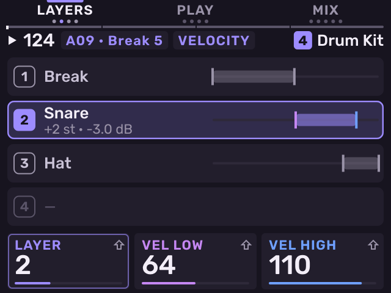

- **K1**: the layer. **K2** / **K3**: the lowest and highest velocity that
  plays it.
- **SHIFT** + **K1**: how a hit picks layers: **Velocity** (every layer in
  range plays), **Cycle** (the next layer each hit), **Random**, **Cycle hold**
  or **Random hold**. The hold choices pick like Cycle and Random, but while **NOTE REPEAT** repeats the pad, every repeat plays the
  layer the first one picked until you let go.
- **SHIFT** + **K2** / **K3**: the layer's tune and level.
- **SHIFT** + **B1** (**LOAD**): load a sample onto the layer. **SHIFT** +
  **B2** (**CLEAR**): remove the layer.

**MIX**: **K1** volume, **K2** kit volume, **K3** pan.

**AMP ENV**: **K1** attack, **K2** decay (release in Note On mode), **K3**
velocity sensitivity. At 100 %, a hit at velocity 64 plays 6 dB below a
full hit, and softer hits quieter still. **SHIFT** + **K2** sets whether
decay starts from the start or the end. From the start, a one shot fades
to silence over its decay; sustain is for Note On mode.

**SENDS**: the last pad's own sends. **K1** sets the pad's send to the bus
shown, **K2** selects bus A–D, **K3** the bus return. The kit track's own
sends are on the [mixer](mixer-and-effects.md#sends). A pad's send is taken
after its
Pad FX, volume and pan, and follows the kit's level, pan and mute. The pads
light as bright as their send to the bus shown; pads that send nothing stay
dark. With Seq Record on, turning a pad's send writes a lane of that pad.
See [Pad sends](mixer-and-effects.md#pad-sends) for an example.

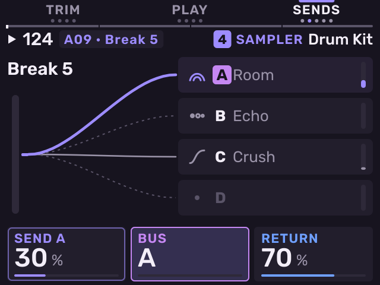

**TUNE**: **K1** semitones, **K2** fine tune in cents, **K3** Warp (Off,
50–200 %, or Seq to fit the sample to the tempo). **SHIFT** + **K3** sets
the number of beats in the sample.

**PLAY**: **K1** Mono or Poly, **K2** mute group, **K3** start offset.
**SHIFT** + **K2**: Pad Link. **SHIFT** + **K3**: loop crossfade. New pads
are Mono: a new hit stops the pad's last one, also in 16 Levels. Set Poly
to play chords. An instrument loaded on an empty pad is Poly.

**COLOUR**: the bank's pads, each in its colour; the last pad you hit has
a ring. **K1** or the encoder changes that pad's colour: **Track** (the
track's colour), one of 16 colours, or **Kit** (the colour the pad came with
from an MPC kit; turn back to the end of the list to get it back). Hit
another pad to colour it. The pads light in their
colours on every kit page.

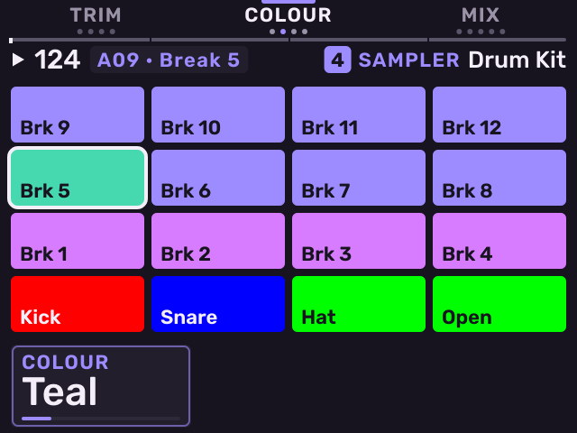

**FOLLOW**: the kit follows the project tempo. **K1** on or off, **K2** the
mode (Beats, Tones or Tape), **K3** how pitch follows.

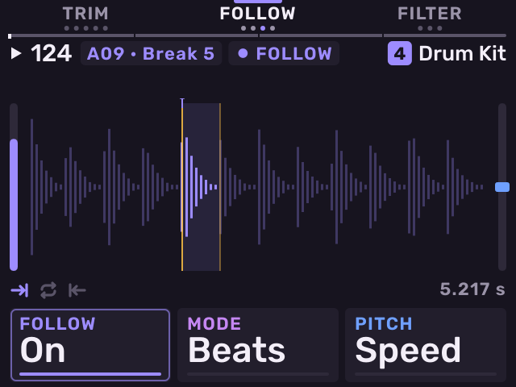

**CLOUD**: the selected pad plays as a grain cloud. Each pad has its own
Cloud settings. **K1** position,
**K2** grain size, **K3** density. **SHIFT** + **K1** scan, **SHIFT** +
**K2** spread, **SHIFT** + **K3** Cloud on or off.

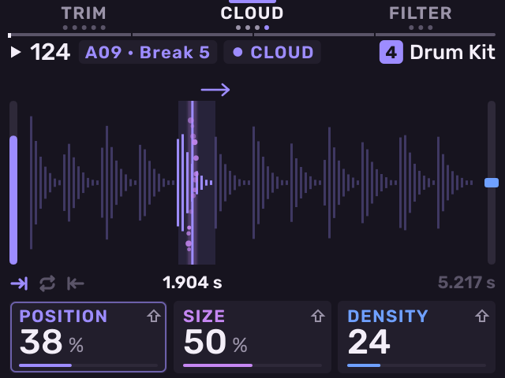

**FILTER**: **K1** cutoff, **K2** resonance, **K3** type (Off, Classic,
LPF2, LPF4, HPF2, HPF4, BPF2, BPF4).

**FILT ENV**: **K1** attack, **K2** decay, **K3** depth.

**KIT FILT**: one filter after every pad of the kit: cutoff, resonance and
type.

## The Pads page

Hold **SAMPLE** on a kit to see **Pads**: the bank in view, each pad with
its own waveform. While you hold it, press a pad to select it without
playing it, and turn **K1** pitch, **K2** volume, **K3** pan of the last pad.
**B1**–**B3** open Stage's pages. On **Step Edit** and **Roll** the editor stays
in view and the header names the held pad.

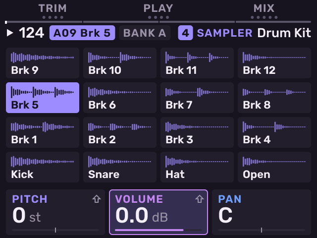

## Loading samples

Press **SAMPLE SELECT** on a kit to open the sample browser. Press it again
to close it. The header shows the pad a file loads onto (→ A09), the last pad
you hit.

The browser opens at the top of the card the first time. After that it opens
where you left it. Kits, keygroups, audio tracks and the rest each keep their
own folder.

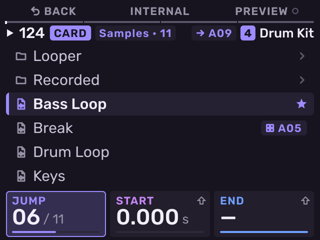

| Control | Action |
| --- | --- |
| Encoder, **−** / **+** | Move through the list. |
| **K1** (**JUMP**) | Jump through the list. |
| Encoder push | Open a folder, or load the file onto the last pad you hit. The pad keeps its settings. |
| **B1** | Go back out of a folder. At the top, **CANCEL** closes the browser. |
| **B2** | Switch between the card (**CARD**) and the MPC's factory samples (**INTERNAL**). The key names the other drive. Each drive keeps its folder and row. The internal drive is read only. |
| **B3** | **PREVIEW**: play each file when you move to it. Melodee keeps this setting when you restart. |
| **SHIFT** + **B3** | **STAR**: star the file under the cursor, or take its star off. The key's light shows whether it is starred. |
| **SHIFT** + pad | Load the file onto the next empty pad. |
| **ERASE** | Delete the file or folder under the cursor from the card. Melodee asks first: **B3 DELETE**, **B1 CANCEL**. In **STARRED** or **RECENT**: take the file off that list. The file stays on the card. |

### Trim a sample before loading it

**K2** and **K3** set the start and end of the sample under the cursor
before it goes onto a pad. Turn either knob to open the trim view over the
list. It shows the whole sample and, below it, a closer view round the point
you turned last. The file on the card is not changed: the pad gets the start
and end.

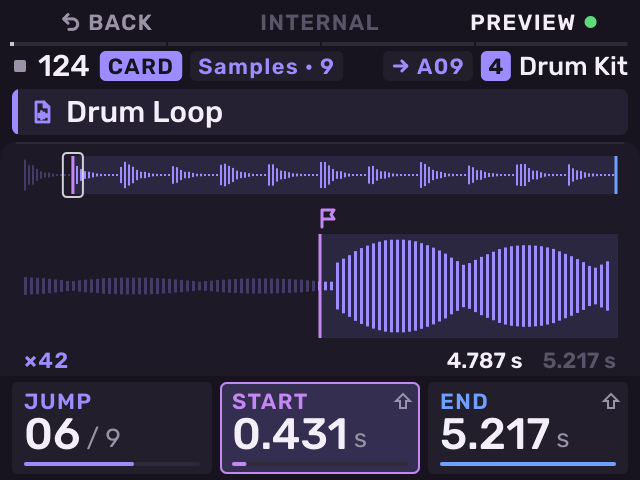

1. Move to a sample and turn **K2** (**START**) or **K3** (**END**).
2. Turn the encoder to move that point in finer steps.
3. Press the encoder to load the sample onto the last pad you hit, with its
   start and end set. **SHIFT** + pad loads it onto the next empty pad.

With **PREVIEW** on, the part you keep plays once each time you stop moving
**START**. Each time you stop moving **END**, its last second plays.

| Control | Action |
| --- | --- |
| **K2** / **K3** | Start and end. The first turn opens the trim view. |
| **SHIFT** + **K2** / **K3** | Zoom in on the start or the end, as on Trim. |
| Encoder | Move the point you turned last, in finer steps. |
| Encoder push | Load the trimmed sample onto the last pad you hit. |
| **SHIFT** + pad | Load the trimmed sample onto the next empty pad. |
| **−** / **+**, **K1** | Move to another file. The trim view closes. |
| **B1** | Close the trim view without loading. |
| **ERASE** | Set the start and end back to the whole sample. **ERASE** + **K2** or **K3**: only that one. |

In a folder, MPC kits come first, then instruments, then folders, then
samples.

The first two rows of `Melodee/Samples`, and of the card's top folder, are
**STARRED** and **RECENT**. Each shows how many files it holds. Push opens
one like a folder; **B1** goes back.

- **STARRED**: the files you starred, by name. A starred file shows a star
  in every folder.
- **RECENT**: the last 16 files you loaded from the browser, newest first.

Each row shows the folder its file is in. A file deleted or moved on the
card is left out. Melodee keeps the two lists in `Melodee/Starred.txt` and
`Melodee/Recent.txt`. Push on a MIDI file (a note icon, **MIDI**) puts its notes on the
track's pattern in place of the notes there.

**ERASE** deletes for good; undo does not bring a file back.

- A folder goes with everything in it.
- An MPC 3 track file (`.xty`) or program goes with its own data folder, so
  an auto sampled keygroup goes whole. To delete one, press **ERASE** on its
  folder in `Melodee/Samples/Keygroups`, or on its `.xty` inside.
- A file the open project uses is not deleted (**In use by this project**).
  Take it off its pad or track first, or open another project.
- Only files on the card can be deleted, and not the folders at the top of
  the card or anything in the `Melodee` folder outside `Melodee/Samples`.
  Plug-ins are deleted in the plug-in picker, projects on the Project page.

Put your samples in `Melodee/Samples` on the card, or anywhere else on it.
Melodee reads WAV (16, 24 or 32-bit), MP3, FLAC, Ogg Vorbis and AIFF files, any sample
rate. A sample can be up to 6 hours long. One longer than 10 seconds plays
from the card, not from memory: a WAV straight from its file, an MP3, FLAC,
Ogg or AIFF from a WAV that Melodee makes of it in `Melodee/Cache` on the
card. Making that WAV takes a moment the first time the sample loads; later
loads use it again. Your own file is not changed. Without a card, or with no
room on it, a long MP3, FLAC, Ogg or AIFF is read into memory whole. MP3, FLAC, Ogg and AIFF rows show their format at
the right. A row with a pad chip is a sample this kit already plays. Melodee
writes recordings and edits into `Melodee/Samples` too. Melodee makes no
folders at the top of the card: everything it writes is in `Melodee`.

Older versions kept samples in a `Samples` folder at the top of the card.
Those still load. To tidy the card, move what is in it into
`Melodee/Samples`: projects then find their samples in the new place.

To move samples without taking the card out, connect the MPC to a computer
with USB-C and open **http://melodee.local** while Melodee runs. On
**Files**, open a folder, then drop files on the list or press **Upload**.
Press a sample to hear it in the browser, the arrow to download it, the bin
to delete it. **Folder** makes a new folder.

## Sampled instruments

To play an instrument across the keys, make a
[keygroup track](instrument-and-midi-tracks.md#keygroup-tracks) for it. On a
kit, the browser loads an instrument onto one pad. Each row has a keyboard
icon and its type at the right.

| Type | Files |
| --- | --- |
| SFZ | `.sfz`, shown as **SFZ** |
| MPC keygroup program | `.xpm` (**XPM**), or `.xty` from MPC 3 (**XTY**) |
| MPC drum program | `.xpm` or `.xty` with a pads icon: Push opens **LOAD KIT** (see [Loading banks of an MPC kit](#loading-banks-of-an-mpc-kit)) |
| MPC expansion | `.xpn` with a down arrow: installs into `Melodee/Samples/Expansions` |
| Logic EXS24 / Sampler | `.exs` (**EXS**), with its samples in the same folder |
| SoundFont | `.sf2` (**SF2**): opens as a folder of presets |
| DecentSampler | `.dspreset` (**DS**): opens with its controls as its own screen sets them |

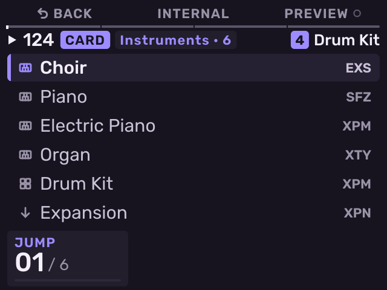

An instrument streams from the card. One made of WAV files opens at once:
its files are played as they are. FLAC, Ogg, AIFF and SoundFont samples are
decoded into `Melodee/Cache` on the card the first time, which can take a
while for a large library. After that the instrument opens at once.

On an instrument pad, Stage's **TRIM** page shows **ZONES**: the
instrument's key and velocity zones over a keyboard. The key you play
selects the zone. **K1** selects a zone, **K2** tunes it and **K3** sets its
level, for this pad only. If the instrument asks for something Melodee does
not play, it is named on this page.

An instrument has its velocity layers in its zones, so an instrument pad has
no **LAYERS** page: **B1** steps through **ZONES**, **TUNE** and **AMP ENV**.
Loading an instrument onto a pad removes the pad's layers.

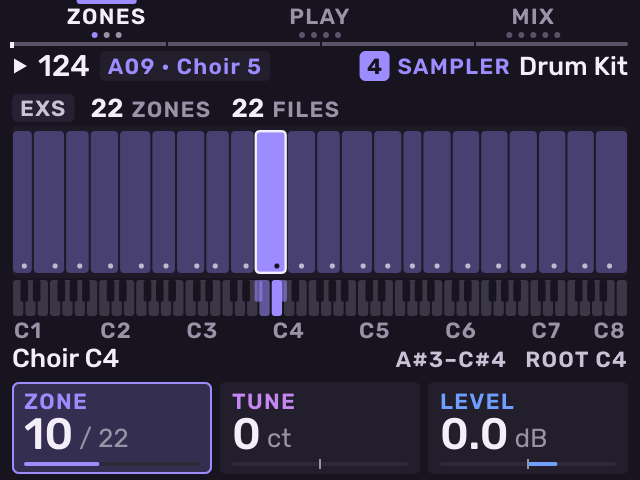

To play an instrument in pitch on a kit, use **16 LEVELS** with the type
Scale or Tune (see [16 Levels](#16-levels)). While 16 Levels is on, a MIDI
keyboard plays the instrument at its real pitch.

A project saved before keygroup tracks opens each kit's instrument pad as a
keygroup track of its own, with its notes. A pad of an MPC drum program stays
on its kit.

## Banks

A bank file saves one bank of 16 pads, with their settings and effects.

- To save the bank in view: open the sample browser and press **SHIFT** +
  **SAMPLE SELECT**. Name the bank. It is saved in `Melodee/Samples/Banks`.
- To load a bank: select the bank with **PAD BANK**, then push the encoder
  on a bank file (the stacked-layers icon) in the browser.

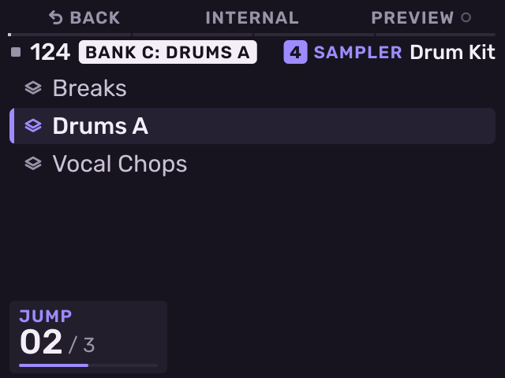

### Loading banks of an MPC kit

**LOAD KIT** puts banks of an MPC drum program (`.xpm` or `.xty`, a pads
icon in the browser) into banks of your kit. Only the program's filled pads
are loaded: the other pads and banks of your kit stay as they are.

1. Select bank C with **PAD BANK**.
2. Press **SAMPLE SELECT**, move to the MPC kit and push the encoder.
   **LOAD KIT** opens. **BANK C** reads `from A · 16 pads`: the kit's first
   filled bank goes into the bank in view.
3. To add the kit's bank B as your bank D, turn to **BANK D** and push
   until it reads `from B`.
4. Turn to **LOAD** and push.

The header shows the kit's filled banks and how many pads each has. Turn
the encoder to move between the cards; push it to press one.

| Card | What it does |
| --- | --- |
| **LOAD** | Puts the banks picked below into your kit, as one undo. |
| **WHOLE KIT** | Loads the whole program as the track's kit, with its pad colours and sends, in place of every pad you have. |
| **BANK A** to **BANK H** | Your kit's banks. Push steps through the program's filled banks, then none. |

A card in red replaces pads you already have. **B1** (**BACK**) closes the
sheet without loading.

## Chop

Press **CHOP** to slice the last pad's sample. The pads play the slices: tap
a pad to play its slice and select it. With Seq Record on, the slices you tap
are recorded (see [Recording slices](#recording-slices)). Press **CHOP** again
to go back to **TRIM**. Chop does not work on a sampled instrument.

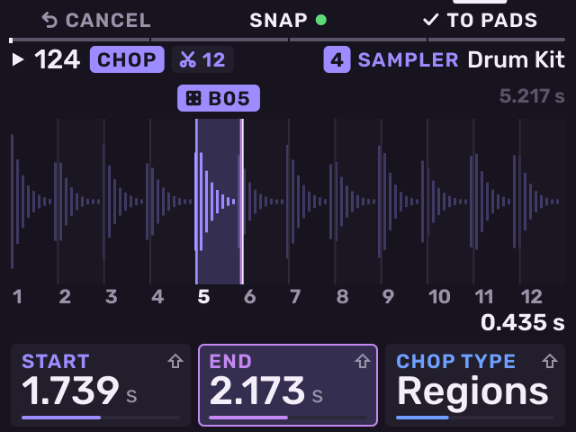

| Control | Action |
| --- | --- |
| **K1** / **K2** | Start / end of the selected slice. |
| **K3** | Chop type: Threshold, Regions, Beats, Manual or Auto. A sample with no slices yet opens on the type you picked last. |
| **SHIFT** + **K3** | The amount for that type: threshold, number of slices or division. On Auto: **SLICES**. |
| Encoder | Move the selected slice's start in fine steps (its end after **K2**). |
| **SHIFT** + encoder | Move that cut to the next or previous hit. |
| **−** / **+** | The slice before / after. |
| **SHIFT** + **K1** / **K2** | Zoom in at the slice's start / end. |
| **PAD BANK** | The next 16 slices on the pads (A: 1–16, B: 17–32, up to D). **SHIFT** + **PAD BANK**: the 16 before. |
| **B1** (**CANCEL**) | Leave without changing the pads. |
| **B3** (**TO PADS**) | Put the slices on pads, as Poly, Mono, Thru or Kit, with a pattern of them. |
| **SHIFT** + **B1** (**EXTRACT**) | Save the slice as a new file in `Melodee/Samples/Edits` and put it on the next empty pad. **SHIFT** + **ERASE** does the same. |
| **SHIFT** + **B2** (**SPLIT**) | Split the slice in two. |
| **SHIFT** + **B3** (**MERGE**) | Join the slice to the one before. |
| **ERASE** + pad | Take a slice out: it joins the one before (pad 1's joins the one after), and the pads after it move down one. **ERASE** on its own takes out the selected slice. |
| **ERASE** + **CHOP** | Take every cut out. |

Every cut lands on a zero crossing, so slices do not click.

A slice's pad plays it with the chopped pad's tuning and Warp, as it plays
once it is on a pad. A Manual take plays the sample at its own speed.

With more than 16 slices, the pads show the bank of the selected slice. The
bank lights and the header (**BANK B**) show which. Selecting a slice with
**−** / **+** moves the pads to its bank.

### Fixing a cut

1. Tap the slice's pad. It plays once and its start is selected: the wider
   line, with **START** at the bottom left.
2. Turn the encoder to move the start. The screen zooms in on the cut. When
   you stop, you hear the cut once, from just before it into the slice.
3. To jump the cut from hit to hit, hold **SHIFT** and turn the encoder. The
   hits are the small marks along the bottom of the waveform.

- To move the slice's end, turn **K2**. The encoder then moves the end
  (**END**) until you select another slice. You hear the slice's last
  second.
- A jump stays between the cuts on either side. With no hit left that way,
  the cut stays where it is.
- The next pad, **−** / **+** or **K1** / **K2** zoom back out. **SHIFT** +
  **K1** / **K2** set a zoom of your own, which stays.

### Chop types

**Threshold chop**: cuts at every hit at least as strong as the threshold
(0–100 %: the higher, the fewer slices). A hit is a change in the sound: a
drum, a hat over a held note, or a chord change at the same loudness. Each
cut lands just before the hit's attack.

**Regions chop**: cuts the region into 2 to 64 equal slices.

**Beats chop**: Melodee finds the sample's own tempo and where its beats
fall when it loads. Beats cuts a slice every division: 1/16, 1/8, 1/4 (one
beat), 1/2, 1 bar, 2 bars or 4 bars (a bar follows the project's time
signature). It counts from the beat nearest the region's start, so a
lead-in before the first beat gets a slice of its own. A free intro or
ending with no steady beat stays one slice. The tempo shows at the top
right. Each cut lands on the hit at that place, if there is one. To cut on
the bar, set the region's start near the bar's first beat. A sample with no
steady beat uses the project's tempo.

**Auto chop**: Melodee works out what the sample is and cuts it to suit.
What it found shows at the top right:

- **DRUMS**: a steady beat led by drums.
- **MUSIC**: a steady beat led by notes or chords.

  Both are cut on the beats Melodee finds in the sample, each cut on the hit
  there: every beat, every 2, 4, 8 or 16 beats, or eighths (each beat, and
  its strongest hit halfway to the next), whichever comes nearest
  **SLICES**. The tempo shows too.
- **SHOTS**: single sounds with silence between them. One slice for each
  sound. Each slice ends where its sound ends, and the silence is left out.
- **HITS**: anything else. A cut on the strongest hits, spread over the
  region, at least 150 ms apart.

**SHIFT** + **K3** sets **SLICES**: 8, 16 (to start), 32 or 64, the number of
slices Auto aims for. SHOTS always makes one slice for each sound. No slice is
shorter than 80 % of an eighth note (150 ms where there is no beat), and Auto
keeps its cuts that far from your hand cuts.

**B2** (**CLEAN**) on Auto finds the cuts on the sample's drums alone. The
first time, Melodee separates the sample as **STEMS** does (with **BEST**
off: about 15 seconds for 13 seconds of sound); the header shows
**SEPARATING** and the time left, and **B1** (**CANCEL**) calls it off. Then
the picture shows the drums stem and the cuts are found on it, so hits under
chords or a voice count too. The pads still play the sample, and **KIT**
lays the drums stem. Press **B2** again to cut from the sample. The four
stems stay in `Melodee/Samples/Stems`.

A chop holds at most 128 slices: if a type needs more, the last slice runs to
the end, and Melodee says so.

### Manual chop

Manual cuts where you tap the pads while the sample plays.

1. Set **K3** to Manual. The cuts the other types made are taken out; your
   hand cuts stay (see [Hand cuts](#hand-cuts)). With no cuts, pad 1 blinks
   red. To start over on a chop with cuts, press **ERASE** + **CHOP**.
2. Tap pad 1. The sample plays and pad 2 blinks red.
3. Tap the red pad on each hit you want to cut at. The red moves on to the
   next pad. After pad 16 the pads switch to bank B and its pad 1 blinks
   red, up to bank H (128 slices).
4. Let the sample play to the end. The take is done and the pads play the
   slices.

- While the take plays, only the red pad cuts. Each cut moves onto the
  strongest hit just before your tap.
- Tap a lit pad to go back: the sample plays again from that slice, and the
  cuts after it are taken out.
- To stop a take before the end, press another button, turn a knob or leave
  Chop. The red stays on the next pad: tap it to play on from the last cut.
- Undo (**SHIFT** + **−**) takes back a whole take.

### Hand cuts

A cut you make or move with **K1**, **K2**, the encoder, **SHIFT** + **B2**
(**SPLIT**) or a Manual take is a hand cut. Hand cuts stay when you change
the chop type, threshold, division or number of slices. They show in the
track's colour with a tab on top. A cut you take out with **ERASE** or
**SHIFT** + **B3** (**MERGE**) stays out. Where an automatic cut would
land just next to a hand cut, the hand cut wins and no sliver is left.
**ERASE** + **CHOP** takes out the hand cuts too.

### Slices on pads

1. Press **B3** (**TO PADS**). The sheet shows the number of slices and the
   first empty pad they go on, such as **from A05**. It starts on your last
   choice.
2. Turn the encoder to **POLY**, **MONO**, **THRU** or **KIT**:
   - **POLY**: slices play over each other.
   - **MONO**: one slice at a time. The slices share a mute group.
   - **THRU**: one slice at a time, and each plays on to the end of the
     region, so a slice's pad carries the loop on from there.
   - **KIT**: one pad for each sound. Slices that sound the same (the kicks
     of a break, say) share one pad, which gets the longest of them. Kicks
     come first, then snares, hats and the rest. The hats share a mute group.
     The card shows how many sounds there are.
3. Push the encoder. The slices go on the empty pads from that pad on, and
   Stage opens.

**B1** (**BACK**) closes the sheet. MONO, THRU and KIT's hats use the chopped
pad's mute group, or the first free one. Slices put on pads keep the chopped pad's
tune, Warp, mute group and other settings. With Warp on Seq and a number of
beats set, each slice keeps the tempo those beats give the chopped pad, so it
plays at the same speed.

The **PATTERN** card turns the pattern on or off (push the encoder on it).
When it is on, TO PADS also writes a pattern with a note for each slice where
it falls, so **PLAY** gives you the loop back, now on pads you can change.
With KIT, each slice's note plays the pad of its sound. The pattern goes into
the track's pattern if that is empty, else into the first empty one, which
then plays. The notes follow how the pads play: with Warp or Follow at the
loop's own tempo, else as it was recorded. Undo takes back the pads, the
pattern and which pattern plays in one step. If Seq Record is on, TO PADS
turns it off first, so the recording is a step of its own before it.

### Recording slices

You can record slices into a pattern straight from Chop, as on the stock MPC
Sample. The kit's pads stay as they are: no pad is taken for a slice.

1. Select the pad and press **CHOP**.
2. Press **SEQ RECORD**, then **PLAY**.
3. Tap the slice pads. Each slice plays with the pad's own sound (tune,
   envelope, filter, effects) and is recorded as a note of that pad. A note is
   as long as you hold its pad. **PAD BANK** reaches slices 17–64.
4. Press **SEQ RECORD** again to stop recording.

While Seq Record is off or the transport is stopped, the pads only play the
slices, as before. During a Manual take the pads still cut and nothing is
recorded.

A recorded slice note plays its slice as the chop is now. When you move a cut
with **K1**, **K2** or the encoder, the notes on that slice follow it. On
Step Edit and Roll the note shows its pad and slice, such as **A05 · 5**. A
slice note on a slice the chop no longer has is silent.

Changing the chop type or amount, **SPLIT**, **MERGE**, **ERASE** + pad and
**ERASE** + **CHOP** change which part of the sample a slice number plays.
When recorded slice notes use the slices that would change, Melodee asks
first (**Rechop?**, with how many notes change sound). **B3** (**RECHOP**)
goes ahead; it asks once a visit to Chop. Undo (**SHIFT** + **−**) takes the
change back.

An MPC 3 export puts each slice that is played on a free pad of the kit and
moves its notes there, as TO PADS would. If the kit has no free pad left, the
notes play the whole pad, and Melodee says how many.

### Slices in the WAV file

As on the MPC, slices belong to the sample and are stored in its WAV file.
Melodee also stores the chop type, its amount and your hand cuts there, so
they are kept after a restart. When you change the slices, Melodee writes
them back into the WAV file, so the MPC and other projects using the file
see the same slices. Slices made on an MPC load with the file, from an MPC
project or from the sample browser. They open as a Manual chop, with every
cut a hand cut. **CHOP** on any pad of a chopped sample shows its slices,
with the pad's slice selected. A sample that is not a WAV file keeps its
slices only while the project is open.

Each slice has its own start and end, so gaps between slices stay.
**K1** or **K2** moves an edge alone across a gap, and moves both slices
where two slices touch.

## Record a sample

Press **SAMPLE RECORD** on a kit to open **Record**.

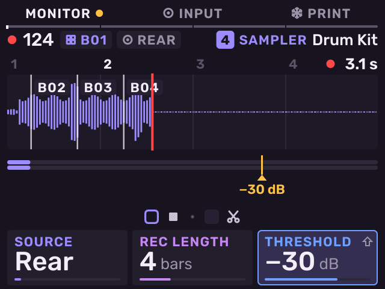

1. Use **K1** to choose the source, **K2** the length (Free, Seq, 1–16
   bars, or 24 to 128 bars) and **K3** the threshold.
2. Tap a pad, or push the encoder to record onto the first empty pad.
   Recording starts at the threshold, or when the pattern comes round if
   the length is Seq. To start at once, push the encoder again.
3. Tap other pads during the take to cut it there.
4. To stop, tap the pad again, press **STOP** or push the encoder. To stop
   and open **TRIM**, press **SAMPLE RECORD**.

Takes are saved in `Melodee/Samples/Recorded`. With a card, a take can run up to 6
hours; without one, 60 seconds. With the length Free, a take also ends by
itself after a quiet stretch.

On Record, **B1** (**MONITOR**) sets monitoring, **B2** (**INPUT**) opens
Input Config, and **B3** (**PRINT**) opens the PRINT sheet to
[freeze the track](tracks.md#freeze-a-track).

**Input Config** (**SHIFT** + **SAMPLE**, or **B2** on Record) sets the
input. **K1** source: Mic, Rear (L, R or both), USB (L, R or both),
Resample, or any track with a sound. **K2** length, **K3** threshold,
**SHIFT** + **K3** gain. With a track as the source, **SHIFT** + **K1**
records it **Post FX** (with its effect chain) or **Pre FX**.

- **B1** (**MONITOR**): Off, Auto or On. You hear the input as loud as the
  take will play back. Choosing Mic while the speaker plays sets Monitor
  to Off; choosing another source sets it back to what it was. With
  headphones or line out plugged in, Monitor stays as it is. While the
  mic is monitored the speaker goes quiet.
- **B2** (**INPUT FX**): run Knob FX on the input. You hear them while the
  input is monitored, and they are recorded.

The mic and the rear inputs cannot be used at the same time. While a MIDI
track or a Looper loop uses the rear inputs, the source Mic shows **IN USE**,
is silent and does not record. While one uses the mic and none uses the rear
inputs, Rear shows **IN USE** the same way.

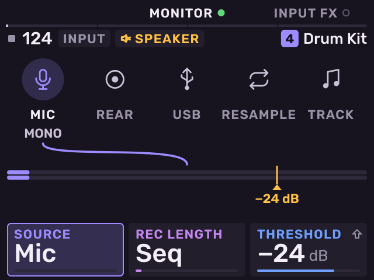

To sample a Melodee track, choose **Track** as the source. During the take
the pads play that track.

## Audio Recall and Resample

- **Audio Recall** (**SHIFT** + **SAMPLE RECORD**): the input is always
  recorded into a 25-second buffer. Audio Recall puts the last phrase onto
  the next empty pad.
- **Resample** (**SHIFT** + **Pad 11**, then a pad): records the selected
  pattern with every track playing onto the pad you press. On the Song page,
  it records the song. On a plug-in or MIDI track, **SHIFT** + **Pad 11**
  opens **AUTO SAMPLE** instead (see
  [Auto sample a plug-in](instrument-and-midi-tracks.md#auto-sample-a-plug-in)).
- **Trim Sample** (**SHIFT** + **Pad 13**): save the pad's region as a new
  file in `Melodee/Samples/Edits` and set the pad to all of it.
- **Save Sample** (**SHIFT** + **SAMPLE SELECT**): name the pad's region and
  save it as a WAV file in `Melodee/Samples`.

## Stems

Stems separates a pad's sample into four new samples: its drums, its bass,
its music (all other instruments) and its vocals.

1. Select the pad and open **TRIM**.
2. Press **SHIFT** + **B3** (**STEMS**). The STEMS sheet shows the four
   empty pads the stems go on, the sample's length and how long the job
   takes. **STEMS** in the Menu on Stage opens the same sheet.
3. **B2** (**BEST**) is on at first: the stems are separated up to
   16 kHz, in two passes. Turn it off for a job about three times
   quicker that separates up to 11 kHz in one pass; the highs above that
   are shared out as the band below them is.
4. Press **B3** (**SEPARATE**) or **Push**.

With **BEST** on, a 13-second sample takes about 40 seconds and a
60-second sample under 2 minutes; with it off, about 15 and 40 seconds.
You can leave the sheet and keep playing while the job runs. To stop it,
press **B1** (**CANCEL**) on the sheet.

When the job is done, **DRUMS**, **BASS**, **MUSIC** and **VOCALS** are on
the next four empty pads after the sample's pad. Each plays as the
sample's pad does: the same start, end, loop, tuning, warp, envelope and
filter, and the same slices in Chop. Played together, the four give the
sample back. One Undo removes all four. The files are in `Melodee/Samples/Stems`.

Stems needs a sample of one second or more and four empty pads on the
track. It does not work on a sampled instrument. **BEST** needs more
memory: when a long sample does not fit, the notice says whether it fits
with **BEST** off.

## 16 Levels

Tap **16 LEVELS** to spread the last pad (or a plug-in track's last note)
over all 16 pads. Tap it again to go back. 16 Levels has no page of its
own: the page in view stays.

Hold **16 LEVELS** to set it up from any page. The cards show **LEVELS**
(the type) and its two ends, **LOW** and **HIGH**.

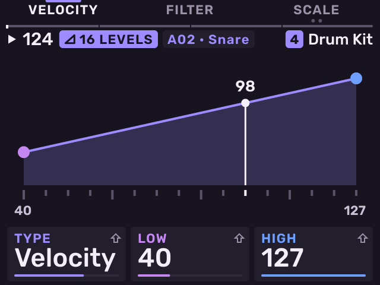

Turn **K1** while you hold **16 LEVELS**, or press **SHIFT** + **16 LEVELS**,
to choose the type:

- **Velocity**: each pad plays louder, from pad 1 to pad 16.
- **Filter** (kits): each pad opens the filter more.
- **Tune**: each pad plays a semitone higher. The original pitch is on pad 4.
- **Scale**: each pad plays the next note of the project's scale. **K2**
  (**ROOT**) sets the root, **K3** (**SCALE**) the scale.
- **Zones** (a pad holding an instrument): each pad plays one key that has
  a sound in the instrument, lowest on pad 1, so a drum or percussion
  instrument has every hit on a pad. Keys without a sound are skipped.
  With more than 16 keys, hold **16 LEVELS** and press **−** / **+** for the
  next 16. On an instrument with one sound per key, such as a drum kit, 16
  Levels opens in Zones when Scale or Tune was chosen.
- **Chords**: each pad plays a chord of the track's chord progression, with
  the pad's one sample at every note of the chord. Hold **16 LEVELS** and
  turn the encoder to pick a progression from the card: Melodee's own in
  `Melodee/Progressions`, and the `.progression` files of MPC expansions.
  **K2** (**KEY**) moves the progression to another key and **K3**
  (**VOICING**) sets how the notes are spread. A kit plays the first 16
  chords; pads with no chord stay dark. On an instrument track the chords
  are those of the bank in view, as on the Keys page's Prog layout.

While you hold **16 LEVELS**, **B1**–**B3** are its keys. They change with
the type:

| Type | B1 | B2 | B3 |
| --- | --- | --- | --- |
| Any type but Chords | **SCALE** | **CHORDS** | |
| Chords | **SCALE** | **FILE** | **SET** |

- **SCALE** and **CHORDS** choose that type and turn 16 Levels on, in one
  press.
- **FILE** lists the progression files on the card. Turn the encoder to a
  file and push it, or press **B3** (**PICK**). **B1** (**BACK**) leaves the
  progression as it was. The file the track plays has a check. You can let
  go of **16 LEVELS** while the list is open.
- **SET** makes a chord of your own. Tap the pad the chord goes on. Then
  **K1** (**ROOT**), **K2** (**CHORD**: m7, maj9, 7sus4 and so on) and **K3**
  (**INVERSION**) set it; tap the pad to hear it. **B3** (**DONE**) saves the
  progression and waits for the next pad. **B1** (**BACK**) puts the chord
  back as it was; pressed again it leaves SET. A track with no progression
  starts a new one, named Mine 1, Mine 2 and so on, in
  `Melodee/Progressions`. A progression from another folder is saved there
  as a copy.

With Chords on, holding **16 LEVELS** shows the chord of each pad, laid out
as the pads. The header's first chip reads **CHORDS** on every page while
the pads play chords.

For Velocity, Filter and Tune, **K2** (**LOW**) sets pad 1's value and **K3**
(**HIGH**) pad 16's. Hold **16 LEVELS** and press **−** / **+** to change the
octave in Scale, Tune and Chords. Letting go after a hold does not turn 16
Levels on or off.

In Scale and Chords, a sample that holds one note, such as a bass note, a
sung note or a synth note, plays from that note, so pad 1 plays the root of
the key. A chord stab plays from its chord's root. Melodee finds the note
when the sample is loaded or recorded. A drum or a phrase plays as if it
were a C, as do the samples of projects saved with older versions.

While 16 Levels is on a kit pad, a MIDI keyboard plays that pad on every key.
On a sample that holds one note, each key plays its own note. On other
samples, C4 (key 60) plays the sample as the pad plays it. An instrument
plays at its real pitch.

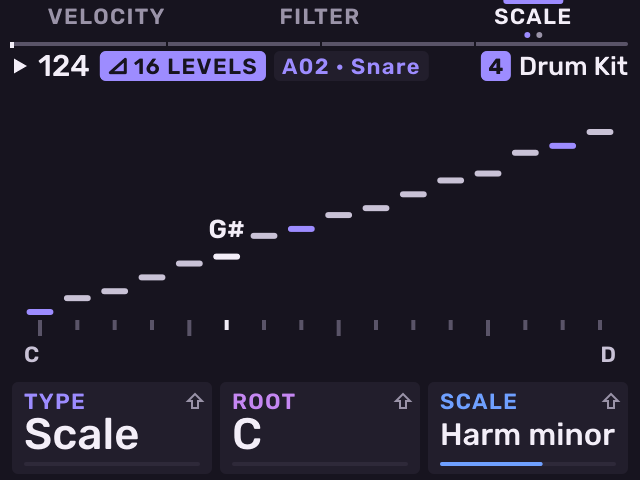

## Loop, reverse and Note On

These act on the last pad from any page:

- **LOOP**: loop the pad on or off.
- **SHIFT** + **LOOP**: reverse the pad.
- **SHIFT** + **CHOP**: switch between Note On (plays while held) and One
  Shot.
- **SHIFT** + **Pad 15** (Warp): Time stretch or Pitch for the kit.

---

Previous: [Tracks](tracks.md) · [Contents](../GUIDE.md) · Next: [Plug-ins](plug-ins.md)
