# Kits and sampling

Previous: [Tracks](tracks.md) · [Contents](../GUIDE.md) · Next: [Plug-ins](plug-ins.md)

A kit has 128 pads in 8 banks (A–H). Each pad plays a region of a sample, or
a sampled instrument. A project holds up to 64 samples.

## Stage on a kit

Press **SAMPLE** to open Stage. On a kit, Stage shows the pages of the last
pad you hit. Hit a pad to edit it, or hold **SAMPLE** and press a pad to
select it without playing it.

| Key | Pages |
| --- | --- |
| **B1** | **TRIM**, **LAYERS**, **TUNE**, **AMP ENV** |
| **B2** | **PLAY**, **COLOUR**, **FOLLOW**, **CLOUD** |
| **B3** | **MIX**, **SENDS**, **FILTER**, **FILT ENV**, **KIT FILT** |

Every track uses the keys the same way: **B1** for the sound's source, **B2**
for how it plays, **B3** for where it goes. Press the lit key again to go to
its next page. Each track remembers its last page. Press **−** / **+** to
change the bank.

**TRIM**

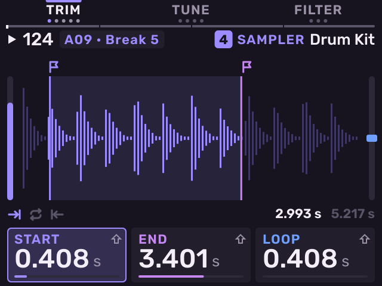

- **K1**: start. **K2**: end. **K3**: loop point.
- **SHIFT** + **K1**–**K3**: zoom in at that point.
- **SHIFT** + **B1**: Loop Lock. **SHIFT** + **B2**: Normalize.

**LAYERS**: up to four samples on one pad.

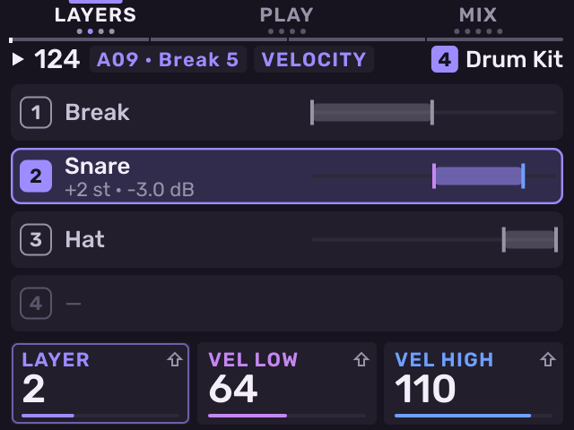

- **K1**: the layer. **K2** / **K3**: the lowest and highest velocity that
  plays it.
- **SHIFT** + **K1**: how a hit picks layers: **Velocity** (every layer in
  range plays), **Cycle** (the next layer each hit) or **Random**.
- **SHIFT** + **K2** / **K3**: the layer's tune and level.
- **SHIFT** + **B1** (**LOAD**): load a sample onto the layer. **SHIFT** +
  **B2** (**CLEAR**): remove the layer.

**MIX**: **K1** volume, **K2** kit volume, **K3** pan.

**AMP ENV**: **K1** attack, **K2** decay (release in Note On mode), **K3**
velocity sensitivity. **SHIFT** + **K2** sets whether decay starts from the
start or the end.

**SENDS**: the last pad's own sends. **K1** selects bus A–D, **K2** sets
the pad's send to it, **K3** the bus return. **SHIFT** + **K2** sets the
send of the whole kit track (**KIT SEND**). A pad's send is taken after its
Pad FX, volume and pan, and follows the kit's level, pan and mute. The pads
light as bright as their send to the bus shown; pads that send nothing stay
dark. With Seq Record on, turning a pad's send writes a lane of that pad.
See [Pad sends](mixer-and-effects.md#pad-sends) for an example.

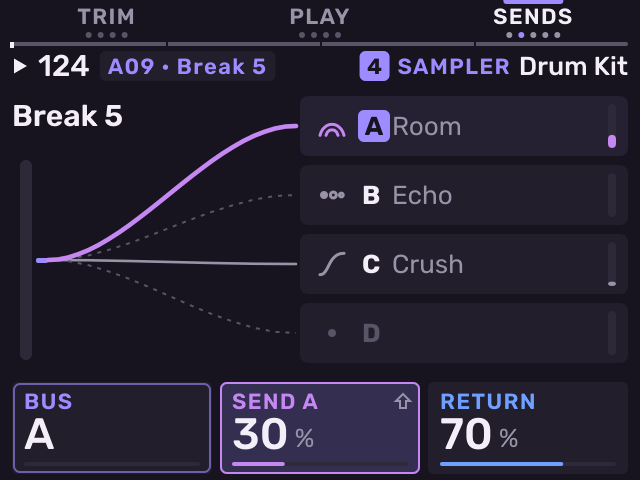

**TUNE**: **K1** semitones, **K2** fine tune in cents, **K3** Warp (Off,
50–200 %, or Seq to fit the sample to the tempo). **SHIFT** + **K3** sets
the number of beats in the sample.

**PLAY**: **K1** Mono or Poly, **K2** mute group, **K3** start offset.
**SHIFT** + **K2**: Pad Link. **SHIFT** + **K3**: loop crossfade. New pads
are Mono: a new hit stops the pad's last one at the same pitch, so 16 Levels
chords still sound. A loaded instrument is Poly.

**COLOUR**: the bank's pads, each in its colour; the last pad you hit has
a ring. **K1** or the encoder changes that pad's colour: **Track** (the
track's colour), one of 16 colours, or **Kit** (the colour the pad came with
from an MPC kit). Hit another pad to colour it. The pads light in their
colours on every kit page.

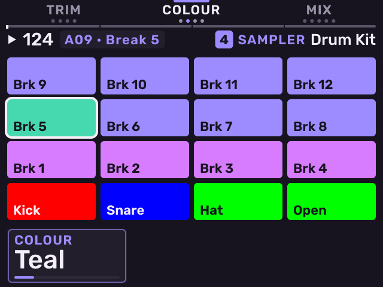

**FOLLOW**: the kit follows the project tempo. **K1** on or off, **K2** the
mode (Beats, Tones or Tape), **K3** how pitch follows.

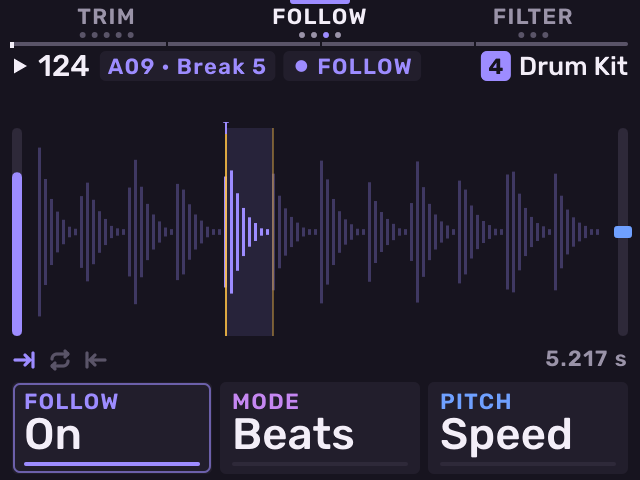

**CLOUD**: every pad of the kit plays as a grain cloud. **K1** position,
**K2** grain size, **K3** density. **SHIFT** + **K1** scan, **SHIFT** +
**K2** spread, **SHIFT** + **K3** Cloud on or off.

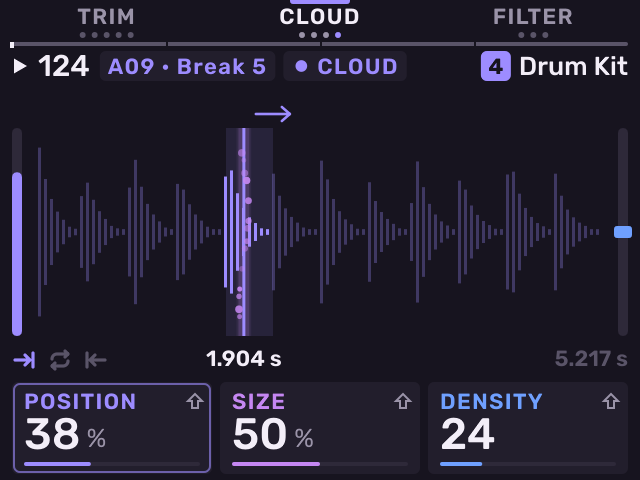

**FILTER**: **K1** cutoff, **K2** resonance, **K3** type (Off, Classic,
LPF2, LPF4, HPF2, HPF4, BPF2, BPF4).

**FILT ENV**: **K1** attack, **K2** decay, **K3** depth.

**KIT FILT**: one filter after every pad of the kit: cutoff, resonance and
type.

## The Pads page

Hold **SAMPLE** on a kit to see **Pads**: the bank in view, each pad with
its own waveform. While you hold it, press a pad to select it without
playing it, and turn **K1** pitch, **K2** level, **K3** pan of the last pad.
**B1**–**B3** open Stage's pages. On **Step Edit** and **Roll** the editor stays
in view and the header names the held pad.

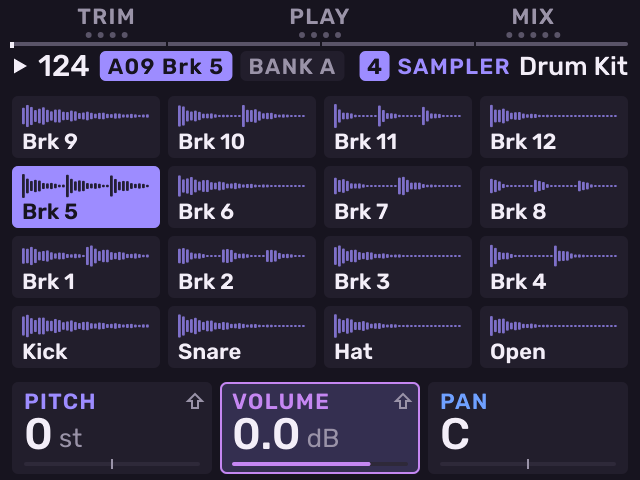

## Loading samples

Press **SAMPLE SELECT** on a kit to open the sample browser.

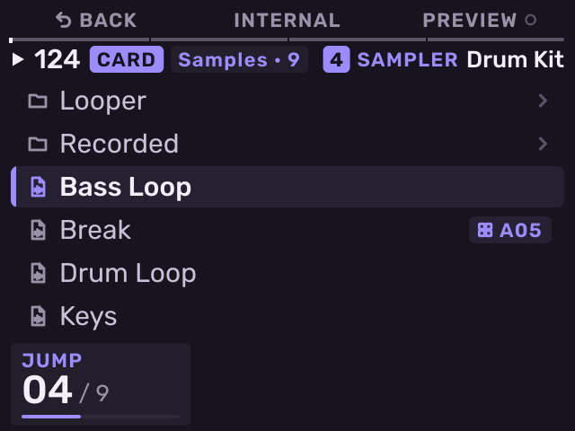

| Control | Action |
| --- | --- |
| Encoder, **−** / **+** | Move through the list. |
| Encoder push | Open a folder, or load the file onto the last pad you hit. |
| **B1** | Go back out of a folder. |
| **B2** | Switch between the card (**CARD**) and the MPC's factory samples (**INTERNAL**). The internal drive is read only. |
| **B3** | **PREVIEW**: play each file when you move to it. |
| **SHIFT** + pad | Load the file onto the next empty pad. |

Put your samples in a folder named `Samples` at the top level of the card.
Melodee reads WAV (16, 24 or 32-bit), MP3, FLAC, Ogg Vorbis and AIFF files, any sample
rate, up to 60 seconds. MP3, FLAC, Ogg and AIFF rows show their format at the right. It writes recordings and edits into `Samples` too.

## Sampled instruments

The browser loads multi-sampled instruments onto one pad. Each is tagged
with its type.

| Type | Files |
| --- | --- |
| SFZ | `.sfz` |
| MPC keygroup program | `.xpm`, or `.xty` from MPC 3 |
| MPC drum program | `.xpm` or `.xty`, tagged **KIT**: loads as the whole kit, with its pad colours and sends |
| MPC expansion | `.xpn`, tagged **INSTALL**: installs into `Samples/Expansions` |
| Logic EXS24 / Sampler | `.exs`, with its samples in the same folder |
| SoundFont | `.sf2`: opens as a folder of presets |
| DecentSampler | `.dspreset` |

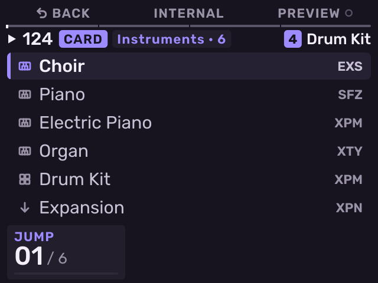

The first load decodes the instrument's files into `Melodee/Cache` on the
card. This can take a while for a large library. After that the instrument
opens at once and streams from the card.

On an instrument pad, Stage's **TRIM** page shows **ZONES**: the
instrument's key and velocity zones over a keyboard. The key you play
selects the zone. **K1** selects a zone, **K2** tunes it and **K3** sets its
level, for this pad only. If the instrument asks for something Melodee does
not play, it is named on this page.

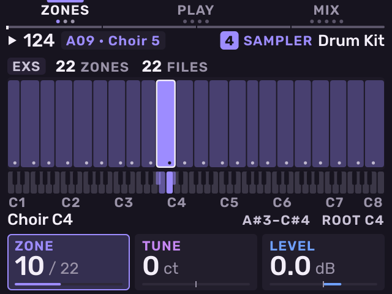

To play an instrument in pitch, use **16 LEVELS** with the type Scale or
Tune (see [16 Levels](#16-levels)). While 16 Levels is on, a MIDI keyboard
plays the instrument at its real pitch.

## Banks

A bank file saves one bank of 16 pads, with their settings and effects.

- To save the bank in view: open the sample browser and press **SHIFT** +
  **SAMPLE SELECT**. Name the bank. It is saved in `Samples/Banks`.
- To load a bank: select the bank with **PAD BANK**, then push the encoder
  on a bank file (tagged **BANK**) in the browser.

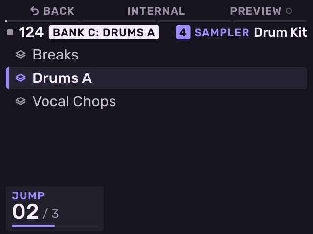

## Chop

Press **CHOP** to slice the last pad's sample. The pads play the slices.

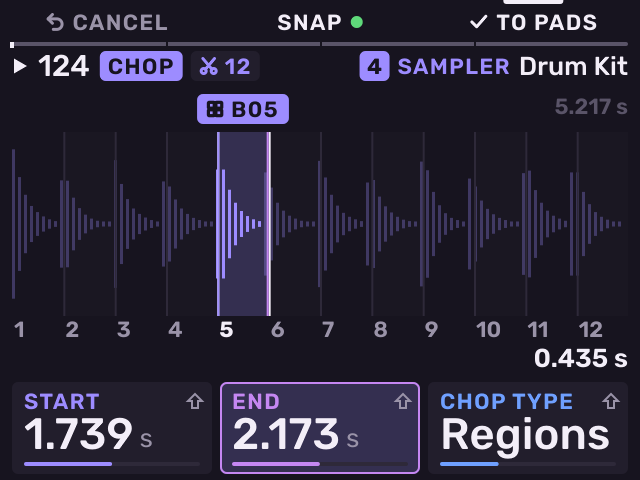

| Control | Action |
| --- | --- |
| **K1** / **K2** | Start / end of the selected slice. |
| **K3** | Chop type: Threshold, Regions, Beats or Manual. |
| **SHIFT** + **K3** | The amount for that type (threshold, number of regions, beats). |
| **SHIFT** + **K1** / **K2** | Zoom. |
| **B2** (**SNAP**) | Snap cuts to zero crossings, so slices do not click. |
| **B3** (**TO PADS**) | Put the slices on pads. |
| **B1** (**CANCEL**) | Leave without changing the pads. |
| **SHIFT** + **B1** | Extract the slice to a new file on the next empty pad. |
| **SHIFT** + **B2** / **B3** | Split / merge slices. |
| **ERASE** + pad | Remove a slice. |

**Beats chop**: Melodee finds the sample's own tempo and where its beats
fall when it loads. Beats cuts a slice every 1–8 of those beats, counted from
the beat nearest the region's start, so a lead-in before the first beat gets
a slice of its own. A free intro or ending with no steady beat stays one
slice. The tempo shows at the top right. Each cut lands on the hit at that
beat. To cut on the bar, set the region's start near the bar's first beat. A
sample with no steady beat uses the project's tempo.

**Manual chop**: set **K3** to Manual, or push the encoder. Pad 1 plays the
sample. Tap other pads while it plays to cut there.

Press **CHOP** again to return to **TRIM**. Melodee keeps each sample's
slices with the project.

## Record a sample

Press **SAMPLE RECORD** on a kit to open **Record**.

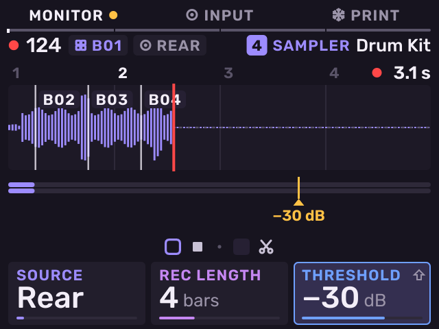

1. Use **K1** to choose the source, **K2** the length (Free, Seq, or 1–16
   bars) and **K3** the threshold.
2. Tap a pad. Recording starts at the threshold, or when the pattern comes
   round if the length is Seq.
3. Tap other pads during the take to cut it there.
4. To stop, tap the pad again, press **STOP** or push the encoder. To stop
   and open **TRIM**, press **SAMPLE RECORD**.

Takes are saved in `Samples/Recorded`, up to 60 seconds each.

**Input Config** (**SHIFT** + **SAMPLE**, or **B2** on Record) sets the
input. **K1** source: Mic, Rear (L, R or both), USB (L, R or both),
Resample, or any track with a sound. **K2** length, **K3** threshold,
**SHIFT** + **K3** gain. **B2** sets monitoring (Off, Auto, On). **B3**
records through Knob FX.

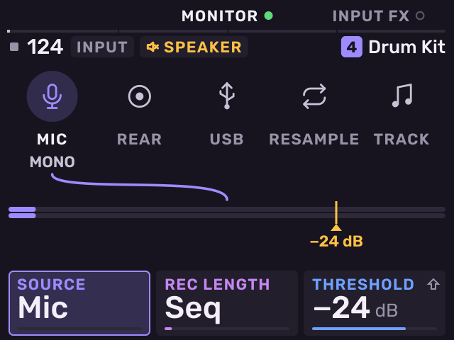

To sample a Melodee track, choose **Track** as the source. During the take
the pads play that track.

## Audio Recall and Resample

- **Audio Recall** (**SHIFT** + **SAMPLE RECORD**): the input is always
  recorded into a 25-second buffer. Audio Recall puts the last phrase onto
  the next empty pad.
- **Resample** (**SHIFT** + **Pad 11**, then a pad): records the selected
  pattern with every track playing onto the pad you press. On the Song page,
  it records the song.
- **Trim Sample** (**SHIFT** + **Pad 13**): save the pad's region as a new
  file and set the pad to all of it.
- **Save Sample** (**SHIFT** + **SAMPLE SELECT**): save the pad's region as
  a WAV file in `Samples`.

## 16 Levels

Press **16 LEVELS** to spread the last pad (or a plug-in track's last note)
over all 16 pads. Press it again to go back.

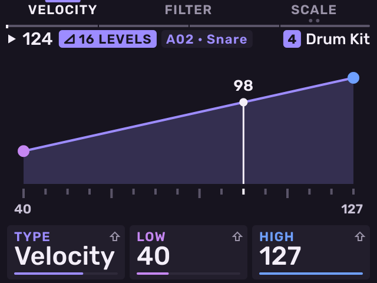

Use **K1** or **SHIFT** + **16 LEVELS** to choose the type:

- **Velocity**: each pad plays louder, from pad 1 to pad 16.
- **Filter** (kits): each pad opens the filter more.
- **Tune**: each pad plays a semitone higher. The original pitch is on pad 4.
- **Scale**: each pad plays the next note of the project's scale. **K2**
  sets the root, **K3** the scale.
- **Zones** (a pad holding an instrument): each pad plays one key that has
  a sound in the instrument, lowest on pad 1, so a drum or percussion
  instrument has every hit on a pad. Keys without a sound are skipped.
  With more than 16 keys, **−** / **+** show the next 16. On an
  instrument with one sound per key, such as a drum kit, 16 Levels opens in
  Zones when Scale or Tune was chosen.
- **Loop**: opens the Looper.

For Velocity, Filter and Tune, **K2** sets pad 1's value and **K3** pad 16's.
Press **−** / **+** to change the octave in Scale and Tune.

While 16 Levels is on a kit pad, a MIDI keyboard plays that pad on every key.
C4 (key 60) plays a sample as the pad plays it; an instrument plays at its
real pitch.

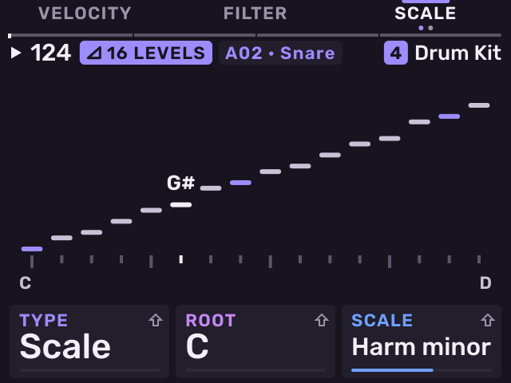

## Loop, reverse and Note On

These act on the last pad from any page:

- **LOOP**: loop the pad on or off.
- **SHIFT** + **LOOP**: reverse the pad.
- **SHIFT** + **CHOP**: switch between Note On (plays while held) and One
  Shot.
- **SHIFT** + **Pad 15** (Warp): Time stretch or Pitch for the kit.

---

Previous: [Tracks](tracks.md) · [Contents](../GUIDE.md) · Next: [Plug-ins](plug-ins.md)
