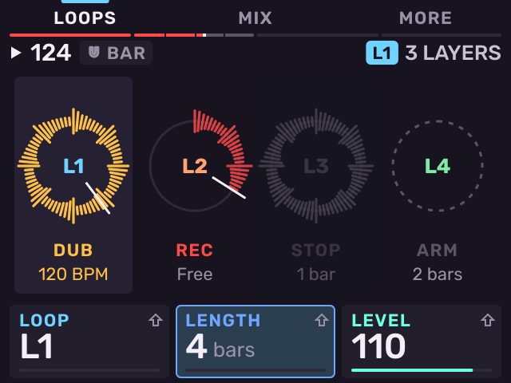
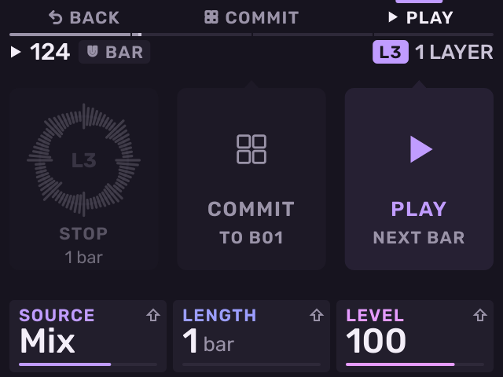

# Looper

Previous: [Song](song.md) · [Contents](../GUIDE.md) · Next: [Mixer and effects](mixer-and-effects.md)

The Looper records four audio loops, L1 to L4, that follow the tempo. Each
loop is a track with its own mixer strip and effect chain.

To open the Looper, press **LOOP** and **16 LEVELS** together, in either
order, from any page. The first time, the Looper is off: press **B3** or
push the encoder to turn it on. **SHIFT** + **LOOP** held for half a second
turns the Looper on or off (off asks first while a loop holds audio).

**B1** (**LOOPS**) shows four rings, one for each loop: its waveform, a hand
where it plays, its state and its length. Red: recording. Amber: overdub.
Grey: stopped.

- **K1** selects the loop, **K2** its length (Free, or 1–16 bars), **K3**
  its level.
- **SHIFT** + **K1** feedback, **SHIFT** + **K2** quantize (Bar, Beat,
  Off), **SHIFT** + **K3** what happens after a take (Play, Overdub, Stop).

To record a loop:

1. Press **B3** (**MORE**) and turn **K1** (**SOURCE**) to choose what the
   loop records: the input, a track, another loop, or the mix.
2. Press **PLAY**, then push the encoder. The loop starts recording at the
   next bar.
3. Push again: the loop closes at the next bar and plays.
4. Push while it plays to overdub. Push again to stop overdubbing.

A loop recorded at another tempo shows that tempo in amber. Push fits it to
the tempo now first (push again to cancel), then overdubs.

**ERASE** pressed alone clears the selected loop (asks first). In mute
mode, the pads mute the loops, one column per loop; **SHIFT** solos.

The pads control the loops too, one column per loop:

| Pads | Action |
| --- | --- |
| 13–16 | Record, overdub, play |
| 9–12 | Play or stop at the next bar (**SHIFT**: at once) |
| 5–8 | Undo, then redo, the last overdub |
| 1–4 | Hold to clear the loop |

**B3** (**MORE**) opens the loop's sheet. **B2** (**COMMIT**) puts the loop
onto the next empty pad of the selected kit. **B3** plays or stops the loop
at the next bar. With **SHIFT** held: **CLEAR**, **+ NOTE** (commit and add
a note at bar 1) and **STOP** / **PLAY** at once.

**B2** (**MIX**) shows L1–L4 as mixer strips: **K1** level, **K2** pan,
**K3** send, **SHIFT** + **K3** the bus. **SHIFT** + **KNOB FX** opens the
selected loop's effect chain; **B1** (**LOOPER**) goes back.

Loops are saved with the project, in a folder next to the project file.
For how the Looper was designed, see the
[Looper design notes](../LOOPER.md).

---

Previous: [Song](song.md) · [Contents](../GUIDE.md) · Next: [Mixer and effects](mixer-and-effects.md)
