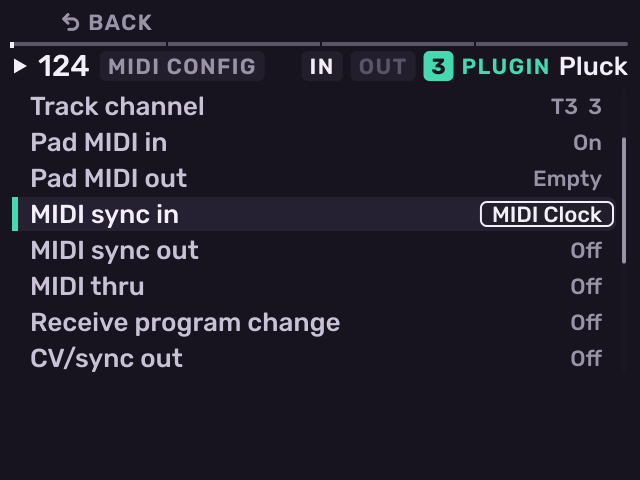

# MIDI and sync

Previous: [Mixer and effects](mixer-and-effects.md) · [Contents](../GUIDE.md) · Next: [Projects and files](projects-and-files.md)

Press **SHIFT** + **Pad 8**, then open **MIDI**. Turn the encoder to a row,
push to edit it, and press **−** / **+** to change it.

| Row | Setting |
| --- | --- |
| Port | External (the MIDI jacks) or USB |
| In channel | All or 1–16. Notes on this channel play the selected track. |
| Out channel | The channel for pads and patterns |
| Track channel | A track's own channel: it plays that track whichever track is selected |
| Pad MIDI in / out | Never, Always or Empty |
| MIDI sync in / out | Off, MIDI Clock or MTC |
| MIDI thru | On or off |
| Receive program change | A program change launches that pattern |
| CV/sync out | Clock pulses on the sync output, with base and division |
| Takeover rows | Knob, Knob FX and fader takeover |
| MIDI panic | Ends every note on every channel and port |
| Reset factory settings | Asks first |

- **MIDI in**: notes, pressure, CC 1 (mod wheel), the pitch wheel (on plug-in
  and MIDI tracks) and All Notes Off. A kit
  plays note 36 as pad A01. Notes record with **SEQ RECORD**.
- **MIDI clock in**: Start, Continue, Stop and tempo. The header shows **EXT
  CLOCK**.
- **MTC in** (24, 25, 29.97 drop-frame and 30 fps): Melodee follows the
  timecode. The header shows **EXT MTC**.
- **MIDI out**: pads, patterns, the arpeggiator, MIDI clock, MTC and the CV
  clock.

---

Previous: [Mixer and effects](mixer-and-effects.md) · [Contents](../GUIDE.md) · Next: [Projects and files](projects-and-files.md)
