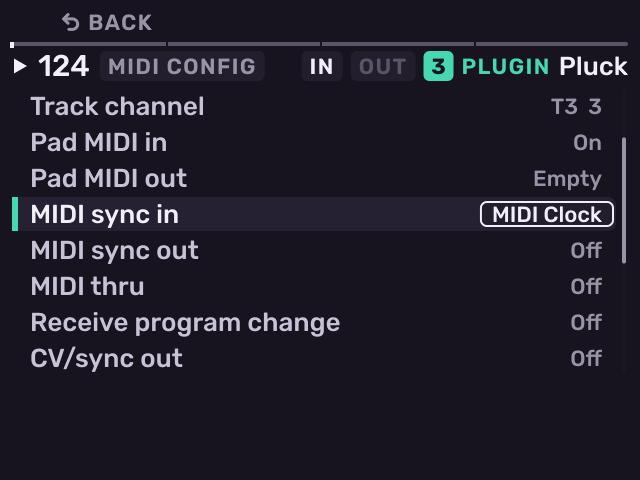

# MIDI and sync

Previous: [Mixer and effects](mixer-and-effects.md) · [Contents](../GUIDE.md) · Next: [Projects and files](projects-and-files.md)

Press **SHIFT** + **Pad 8**, then open **MIDI**. Turn the encoder to a row.
**K1** sets it: its card shows the row's name and value. **−** / **+** step
it one value at a time. **MIDI panic** and **Reset factory settings** are
done with **Push**. **B1** goes back. The header lights **IN** and **OUT**
as MIDI passes.

| Row | Setting |
| --- | --- |
| MIDI port | External (the MIDI jacks) or USB |
| MIDI in channel | All or 1–16. Notes on this channel play the selected track. |
| MIDI out channel | The channel for pads and patterns |
| Track channel | Off or 1–16: the selected track's own channel. It plays that track whichever track is selected, and the track's notes go out on it. |
| Track MIDI in | Where the track's own channel is heard: Any, External or USB |
| Pad MIDI in | On or off: whether notes and pressure in play the tracks |
| Scale on white keys | On or off. On a Scale or Chords track, the white keys play the scale with the root on C4, and the black keys play nothing. See [Play the scale on the white keys](#play-the-scale-on-the-white-keys). |
| Pad MIDI out | Never, Always or Empty (only pads and tracks with no sound of their own send notes) |
| MIDI sync in / out | Off, MIDI Clock or MTC |
| MIDI thru | On or off |
| Receive program change | Off or Sequence: a program change launches that sequence, as a pad on Sequences does |
| Remote channel | Off or 1–16: the channel of the Remote CCs |
| Remote track CC | Selects a track. Value 0 is track 1. Default CC 102. |
| Remote pattern CC | Launches a pattern on the selected track. Value 0 is A01. Default CC 103. |
| Remote sequence CC | Launches a sequence. Value 0 is the first sequence. Default CC 104. |
| CV/sync out | On or off: clock pulses on the sync output. **CV/sync base** (1–8) and **CV/sync division** (1–24) set how many a quarter note. |
| Parameter, Knob FX and Fader takeover | As in Settings, **KNOBS**: Pickup, Scaled or Instant |
| MIDI panic | Push: ends every note on every channel and port |
| Reset factory settings | Push, then **B3** to reset or **B1** to keep. Your starred sounds and Basic or Full are kept. |

- **MIDI in**: notes, pressure, CC 1 (mod wheel), the pitch wheel, the
  sustain pedal and other CCs, and All Notes Off, on every page and every
  kind of track. A kit plays note 36 as pad A01. Notes record with **SEQ RECORD**.
  - The pitch wheel bends plug-in tracks and kits (2 semitones each way on a
    kit). The mod wheel and the pitch wheel record as Motion lanes on the
    selected track.
  - The sustain pedal (CC 64) holds a kit's notes. Plug-in tracks get every
    CC as it comes. MIDI tracks send CCs out on their own port and channel.
  - Each track can take its own controller. Select the track (**PAD BANK**
    + pad), set **Track channel**, then **Track MIDI in**. The selected
    track, sync, Thru and program change listen on **MIDI port**; a track's own channel
    uses its Track MIDI in. Seq Record records every track that a channel
    plays, at once.
  - Remote CCs are heard from any port and are not passed on to the tracks.
    A value past the last track, pattern or sequence does nothing.
  - On **Step Edit** and **Roll**, keys write notes as the pads do. Step Edit
    writes at the caret and moves on when every key is let go. With a step
    held on Step Edit's pads, the keys played go into that step.
- **MIDI clock in**: Start, Continue, Stop, Song Position and tempo. The
  header shows **EXT CLOCK**. Continue plays on from the Song Position,
  counted at the selected track's speed (see
  [Track speed](tracks.md#track-speed)), as **SHIFT** + **PLAY**
  counts it.
- **MTC in** (24, 25, 29.97 drop-frame and 30 fps): Melodee follows the
  timecode: the song on Song, else the patterns. The header shows **EXT
  MTC**. A cue while stopped moves the playhead there, counted the same way.
- **MIDI out**: pads, patterns, the arpeggiator, MIDI clock (with Start,
  Continue, Stop and Song Position), MTC and the CV clock. What you play
  (pads, keys, MIDI in, the fader, knobs) goes out at once. Patterns, the
  arpeggiator and the clocks go out as their sound is heard, so outside
  gear plays in time with Melodee's own tracks.

## Using a MIDI controller

The examples use an Arturia MiniLab 3: 25 keys, 8 pads in two banks, a pitch
strip, a mod strip, 8 encoders, 4 faders and a sustain pedal input. Any
controller that sends notes and CCs works the same way.

What the MiniLab 3 sends as it comes. Shift and pad numbers in this section
are the MiniLab 3's own buttons, not the MPC's.

| Control | Sends |
| --- | --- |
| Keys | Notes on channel 1. To change the channel, hold the MiniLab 3's Shift and press a key: the first F is channel 1, each key up is one more, to channel 16. |
| Pads, bank A | Notes 36–43 on channel 10 |
| Pads, bank B (MiniLab 3 Shift + pad 2) | Notes 44–51 on channel 10 |
| Pitch strip | Pitch bend |
| Mod strip | CC 1 |
| Pedal input | The pedal's CC (CC 64 for a sustain pedal) |

### Connect it

The MPC's USB-C port is for a computer; a controller cannot plug into it.

- **MIDI In jack**: connect the MiniLab 3's 5-pin MIDI Out to the MPC's MIDI
  In jack with a 5-pin to 3.5 mm MIDI adapter. Power the MiniLab 3 from a USB
  power adapter. Set **MIDI port** to **External**.
- **Through a computer**: plug the MiniLab 3 and the MPC into the computer.
  Route the MiniLab 3 to the MPC's MIDI port in your DAW or MIDI app. Set
  **MIDI port** to **USB**.

### Example 1: play the selected track

1. Set **MIDI in channel** to **All**.
2. Select a track and play the keys. Bend with the pitch strip, use the mod
   strip, hold notes with the sustain pedal.
3. Press **SEQ RECORD** and **PLAY** to record. The pitch strip and the mod
   strip record as Motion lanes.

On **Step Edit**, each key writes a note at the caret. On **Roll**, a key
writes at the cursor.

#### Play the scale on the white keys

1. Hold **SAMPLE** on an instrument track to see **Keys**. Set the root
   with **K1**, the scale with **K2** and the layout to **Scale** or
   **Chords** with **K3**.
2. On **MIDI Config**, set **Scale on white keys** to **On**.
3. Play the white keys. C4 plays the root, D4 the second note of the
   scale, and so on. The black keys play nothing.

In a scale of seven notes, every C plays the root. A scale with fewer or
more notes, such as Minor pent, goes on up the white keys one note a key.
With the Chromatic scale, every key plays as it is. Kits, and tracks on
the Chromatic, Drums or Prog layout, are not changed.

### Example 2: keys on a synth track, pads on a kit

The pads send notes 36–51 on channel 10, and a kit plays note 36 as pad A01.
Bank A plays A01–A08 and bank B plays A09–A16.

1. Select the kit track. Set **Track channel** to **10**.
2. Select the synth or plug-in track. Set **Track channel** to **1**.
3. Play the pads and the keys. Both tracks play, whichever track is selected.
4. Press **SEQ RECORD** and **PLAY**. Melodee records both tracks in one pass.

### Example 3: two controllers on one MIDI In jack

The MPC has one MIDI In jack. To play two controllers, join them with a MIDI
merge box and connect its output to the MIDI In jack. Melodee tells the
controllers apart by channel, so each one needs its own channel.

This builds on Example 2: the MiniLab 3 plays a synth (keys, channel 1) and a
kit (pads, channel 10). A second keyboard plays a bass track.

1. Set the second keyboard to channel 2.
2. Select the bass track. Set **Track channel** to **2**.
3. Play both controllers. The keys, the pads and the second keyboard each
   play their own track, whichever track is selected, and **SEQ RECORD**
   records all three tracks.

**Track MIDI in** tells the MIDI In jack apart from a computer on USB-C: a
track set to **External** does not hear notes on its channel from the
computer, and a track set to **USB** does not hear the jack. The selected
track, sync, Thru and program change listen on **MIDI port** only.

### Example 4: change tracks, patterns and sequences from the MiniLab 3

Make a User program in Arturia's MIDI Control Center and send it to the
MiniLab 3. To select it, hold the MiniLab 3's Shift and press its pad 3: each
press steps through Arturia, DAW and the User programs on the MiniLab 3's
screen. Option names can differ between versions of MIDI Control Center.

| MiniLab 3 control | Set it to send | In Melodee |
| --- | --- | --- |
| Fader 1 | CC 102, channel 16, range 0–15 | Selects tracks 1–16 |
| Pads 1–8, bank A | CC 103, channel 16, values 0–7 | Launches patterns A01–A08 on the selected track |
| Pads 1–8, bank B | CC 104, channel 16, values 0–7 | Launches sequences 1–8 |

1. In Melodee, set **Remote channel** to **16**. **Remote track CC**,
   **Remote pattern CC** and **Remote sequence CC** are 102, 103 and 104
   already.
2. Move fader 1 to pick a track. Press a bank A pad to launch that track's
   pattern, or a bank B pad to launch a sequence. Both start at the next bar
   (at once when stopped).

Use a channel for Remote that no track plays on. Remote CCs do not reach the
tracks. With **Receive program change** on, a pad set to send Program Change
launches that sequence.

---

Previous: [Mixer and effects](mixer-and-effects.md) · [Contents](../GUIDE.md) · Next: [Projects and files](projects-and-files.md)
