# Mixer and effects

Previous: [Looper](looper.md) · [Contents](../GUIDE.md) · Next: [MIDI and sync](midi-and-sync.md)

## Signal flow

Each track plays through its effect chain (six slots), its level and pan,
and its sends to four buses (A–D). Each bus has its own chain (six slots)
and a return level. Everything then goes through the master chain (six
slots), the master compressor and **MAIN VOLUME**. A kit pad can have its
own chain of four effects before the track's chain, and its own sends to
the four buses.

The input you monitor joins the mix before the master chain, at the level
a take of it plays back. Its Rec Input FX are heard while you monitor.

Press **PAD FX** and **KNOB FX** together, from any page, to open the mixer
on **Tracks** (see [The Tracks page](tracks.md#the-tracks-page)). Tracks,
Sends and the effect chains share one row of keys: **B1** (**TRACKS**),
**B2** (**SENDS**) and **B3** (**FX**).

## Sends

Press **B2** (**SENDS**) on Tracks or on an effect chain to
open **Sends**: one bus at a time, with every track's send to it, eight
tracks at a time. Press **−** / **+** to change the bus. The top row shows
each bus with its first effect and its return.

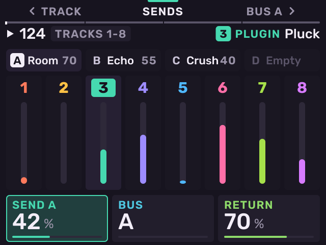

**K1** sets the selected track's send, **K2** selects the bus, **K3** sets
the bus return.

On a kit track press **B2** (**SENDS**) again to see the kit's pads
instead of the tracks (the bank in view, as the pads sit), each with its
own send to the bus shown. Hit a pad
or turn the encoder to select it; **K1** sets its send. Press **B2** again
to go back to the tracks.

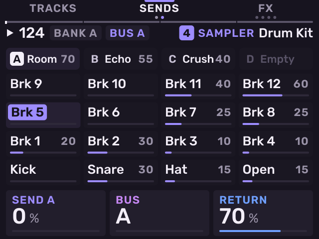

## Pad sends

On a kit, each pad has its own send to each of the four buses. Several pads
can share one effect on a bus. The effect runs once, however many pads send
to it. Each pad's own effect chain still works as before.

A pad's send is taken after its own chain, its volume and its pan, before
the kit track's chain. It then follows the kit track's level, pan, mute and
solo: turn the kit down and its reverb goes down with it.

### Example: one reverb for snare and hat, kick dry

1. Put the reverb on bus A. Press **PAD FX** and **KNOB FX** together, then
   **B2** (**SENDS**). Press **−** / **+** until bus A is shown. Press **B3**
   (**FX**) until the header shows **BUS A**. Push the encoder on **+**
   and choose a reverb.
2. Press **SAMPLE** on the kit track for Stage. Press **B3** until
   **SENDS** is lit.
3. Hit the snare pad. Turn **K2** to 30 %.
4. Hit the hat pad. Turn **K2** to 15 %.
5. Leave the kick at 0 %. Hold **SHIFT** and check that **K2** (**KIT
   SEND**) is 0 %, or the whole kit, kick included, goes to the bus.

### Controls

| Page | Control | Does |
|---|---|---|
| Stage, **SENDS** (kit) | Hit a pad | Selects the pad. |
| | **K1** | Selects the bus, A–D. |
| | **K2** | The selected pad's send to that bus. |
| | **K3** | The bus return. |
| | **SHIFT** + **K2** | The kit track's own send (**KIT SEND**). |
| Sends (kit), **B2** again | Hit a pad, or turn the encoder | Selects the pad. |
| | **K1** | The selected pad's send to the bus shown. |
| | **K2** | Selects the bus. |
| | **K3** | The bus return. |
| | **−** / **+** | The bus. |
| | **B2** | Back to the tracks. |

On both pages a pad lights as bright as its send to the bus shown. A pad
that sends nothing stays dark. The selected pad is white.

### Kit send and pad sends

The kit send (**SHIFT** + **K2** on Stage **SENDS**, and **K1** on Sends
with the tracks shown) sends the whole kit after the kit track's chain. A
pad send sends one pad before that chain. Both reach the same bus and add
up.

### Record send moves

With **SEQ RECORD** on, turning a pad's send writes a lane of that pad in
the pattern, as the pad's volume and pan do. Edit or erase it on the
Motion page.

### Freeze

A frozen kit keeps its pad sends. The prints hold them, and the frozen
kit plays them to the buses at its level, pan and mute. See
[Freeze a track](tracks.md#freeze-a-track).

### MPC programs

Loading an MPC drum program (`.xpm` or `.xty`) as a kit brings its pads'
Send 1–4 as their sends to buses A–D, and the program's own Send 1–4 as
the kit track's sends. Stock MPC Sample projects (`.xpj`) bring no sends.

## Effect chains

Press **B3** (**FX**) on Tracks or Sends to open the effect chains. Press
**FX** again to go to the next chain. The header names the chain in view,
and the dots under **FX** show where you are:

- **TRACK FX**: the selected track's chain.
- **BUS A**–**D**: the chain of the bus shown on Sends, with its return.
- **MASTER**: the master chain.
- On a kit, **PAD** and the pad's name: the last pad's own chain, four
  slots.

**SHIFT** + **KNOB FX** opens the track's chain from any page. Press it again
for Sends, the bus, then the master.

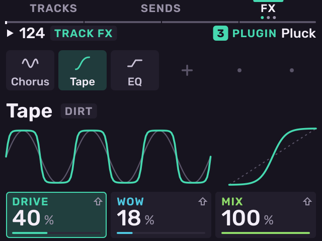

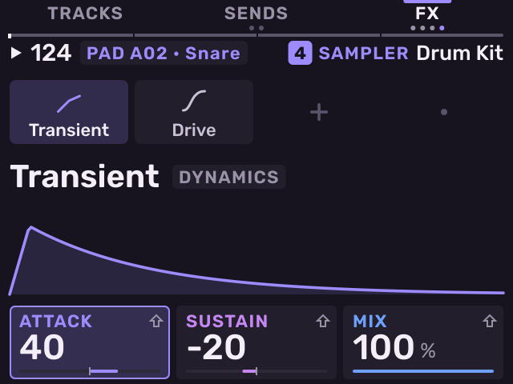

- Turn the encoder to select a slot.
- Push the encoder on the **+** to open the effect picker. Choose a family,
  then an effect.
- Push the encoder on an effect to open its sheet: change, presets, bypass,
  move and remove as cards, with bypass picked. Turn the encoder to pick one
  and push it. **B1** closes it. A plug-in effect's sheet also has
  **TRANSPORT**: whether the plug-in hears **PLAY** and **STOP** (see
  [Plug-in effects](plug-ins.md#plug-in-effects)).
- **ERASE** pressed alone removes the selected effect. **SHIFT** +
  **ERASE** copies it, placed after itself.
- **K1**–**K3** set the effect's values. **−** / **+** show its second row.

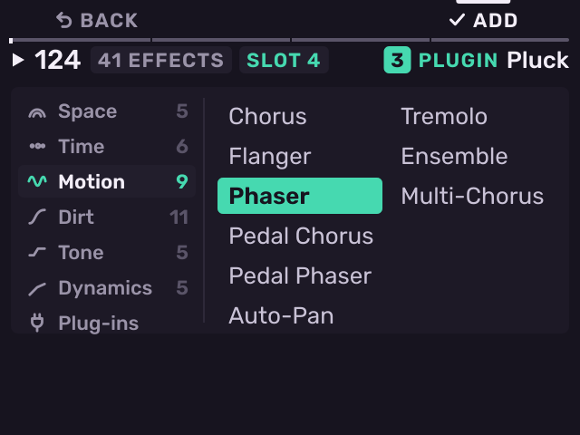

Melodee has 41 effects in six families:

| Family | Effects |
| --- | --- |
| Space | Room, Reverb, Plate, Shimmer, Spring |
| Time | Echo, Tape echo, Ping pong, Looper, Diff delay, Sample delay |
| Motion | Chorus, Flanger, Phaser, Pedal chorus, Pedal phaser, Auto-pan, Tremolo, Ensemble, Multi-chorus |
| Dirt | Drive, Tape, Crush, Spit, Fuzz, Amp sim, Tube drive, Soft clipper, Vintage, Vinyl, Tape emulator |
| Tone | EQ, Filter, Formant, Width, Auto-wah |
| Dynamics | Compressor, Gate, Transient, Limiter, Pumper |

The seventh family, **Plug-ins**, loads a plug-in effect (VST3, LV2, CLAP or VST2).
A pad's own chain takes no plug-ins. For amp captures beside the **Amp
sim**, add the Neural Amp Modeler plug-in (see
[Neural Amp Modeler](plug-ins.md#neural-amp-modeler)).

- **Sidechain**: the last row of a Compressor or Gate has **KEY**. Set it to
  a track or bus, and that sound controls the effect. For example, duck a
  bass under the kick.
- **Tempo sync**: the delays have a **SYNC** setting. Set a note value (1/32
  to 1/1, with triplets and dotted) and the delay time follows the tempo.

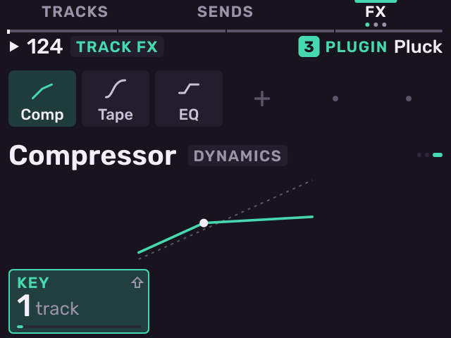

## Knob FX

Press **KNOB FX** to turn on Knob FX mode. **K1**–**K3** control one
performance effect on any page until you press **KNOB FX** again.

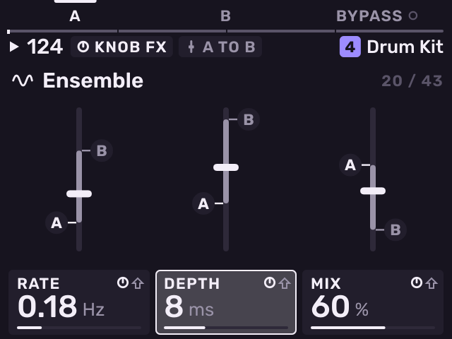

- Turn the encoder or press **−** / **+** to choose the effect: the MPC's 28,
  then Melodee's 15. Push the encoder to load it.
- **B1** (**A**) and **B2** (**B**) hold two settings of the knobs. The
  fader moves the effect from A to B.
- Press pads to send kit pads (on a kit) or tracks through the effect.
  **SHIFT** + **B2** selects all. **B3** bypasses the effect.

## Pad FX

Press **PAD FX**. Hold pads to play effect punches: up to four at once. Pad
pressure sets the depth. Over the pads, the screen draws the bar the
pattern is in: a row for each punch, where it sounds.

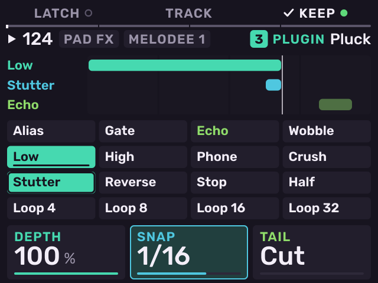

- 47 punches in three banks: the MPC's 16 in the stock order, then Melodee 1
  and Melodee 2. Press **PAD BANK** or **−** / **+** to change the bank.
  The header names the bank.
- On Melodee's punches, **K1** sets the depth, **K2** the **SNAP** grid and
  **K3** the tail. An MPC punch has its own **K1**–**K3**; with **SHIFT**,
  depth, snap and tail.
- **B1** (**LATCH**) keeps the last punch on.
- **B2** switches between the master and the selected track.
- **B3** (**KEEP**) records the punches of the last pass into the pattern.
  They play back with it. **ERASE** + pad removes a pad's kept punches.
  **ERASE** + **B3** removes them all (asks first).
- **SHIFT** + **B3** (**QUANTIZE**) turns quantize on or off. On (the
  default), a punch pressed while the sequence plays starts on the next
  line of the **SNAP** grid. Off, it starts at once, and the header shows
  a magnet with **OFF**. Punches always stop at once.

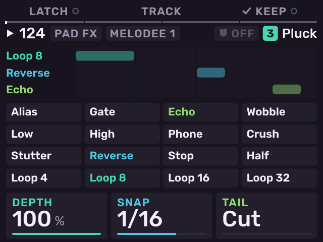

**SHIFT** + **PAD FX** opens **Flex Beat**: pad 1 is Empty, pads
2–16 are 15 time effects on the master. **K1** One Shot or Loop, **K3** mix,
**B3** quantize.

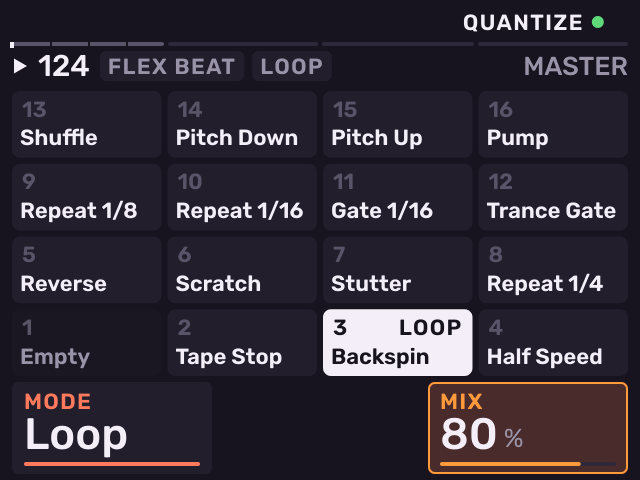

## Compressor

Press **SHIFT** + **Pad 5** for the master compressor.

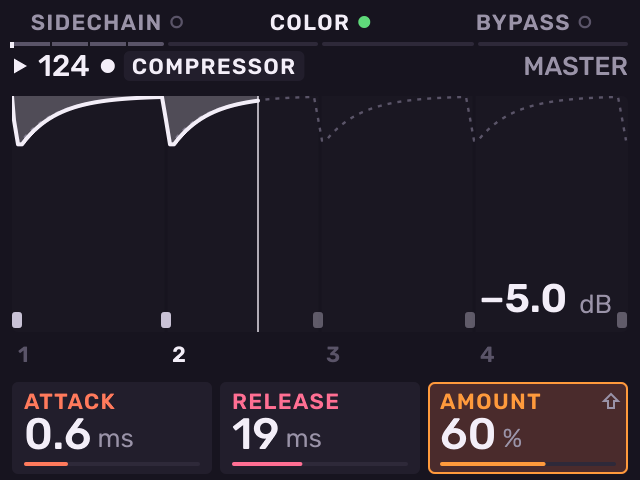

- **K1** attack, **K2** release, **K3** amount. **SHIFT** + **K3** In Boost.
- **B1** Sidechain, **B2** Color, **B3** Bypass.
- With Sidechain on, the pads select the track that triggers the
  compressor. On a kit, push the encoder to select a single pad (for example
  the kick).

The picture shows one bar: the gain reduction across it and the trigger
hits along the bottom.

## Fader

The fader controls the last knob you turned on the selected track: an
engine parameter, an effect, a pad value, the level, pan or a send. Some
pages give it their own job: the level on Tracks, the send on Sends, A to
B on Knob FX, the amount on the Compressor and the mix on Flex Beat.

Press **SHIFT** + **Pad 9** to open the **Fader** page. It shows the value
the fader follows, its name and the fader. Press **SHIFT** + **Pad 9** again
to close it.

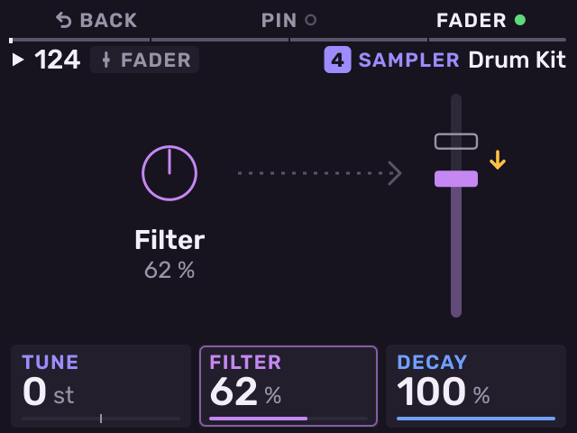

- **K1**–**K3** are the track's favourite values. Turn one, or any knob on
  any page, and the fader takes it.
- **B2** (**PIN**) keeps the fader on its current target.
- **B3** (**FADER**) turns the fader on or off.
- Turn the encoder to choose a fader target. On a kit track: Pad Volume,
  Pad Pan, Pad Tune, Pad Attack, Pad Decay, Pad Cutoff, Kit Volume. On
  every track: Mod Wheel, Track Level, Track Pan, Send A, Send B, Send C,
  Send D. On a plug-in or MIDI track: Pitch Bend, after Mod Wheel.

On Pitch Bend, the wide middle of the fader is no bend. When you let go of
your notes and leave the fader still for a second, the bend springs back to
the middle; bring the fader back through the middle to bend again. The
plug-in must respond to pitch bend (Melodee Poly, PD and Chip do).

The fader light shows the value. With **SEQ RECORD** on, the fader records
Motion.

---

Previous: [Looper](looper.md) · [Contents](../GUIDE.md) · Next: [MIDI and sync](midi-and-sync.md)
