# Mixer and effects

Previous: [Looper](looper.md) · [Contents](../GUIDE.md) · Next: [MIDI and sync](midi-and-sync.md)

## Signal flow

Each track plays through its effect chain (six slots), then its **strip**:
trim, a nine-band EQ, a compressor and width. Then its level and pan. A
track goes to the master or to one of eight **submixes**, and sends to the
four buses (A–D).

A submix has the same parts as a track: a chain, a strip, level, pan, mute,
solo and four sends. It plays to the master. Each bus has its own chain, a
strip and a return level. The master has a strip, its chain (six slots), the
master compressor and **MAIN VOLUME**.

A kit pad can have its own chain of four effects before the track's chain,
and its own sends to the four buses (see [Pad sends](#pad-sends)).

The input you monitor goes through its own strip and joins the mix before
the master chain. Its Rec Input FX are heard while you monitor.

### Level meters

The meter lights right of the screen show the mix, left and right, before
**MAIN VOLUME**. On Record and Input Config, and while a take waits or
runs, they show the input instead. They light as on the stock MPC Sample:

| Light, from the bottom | Lights above |
| --- | --- |
| 1, green | −24.1 dBFS |
| 2, green | −12.1 dBFS |
| 3, green | −6.1 dBFS |
| 4, yellow | −3.1 dBFS |
| 5, red | −0.1 dBFS |

A level shows at once and falls back by 60 dB a second.

## The mixer

Press **PAD FX** and **KNOB FX** together, from any page, to open the
mixer. It is also pad 9 (**MIXER**) on the Menu's **GO**.

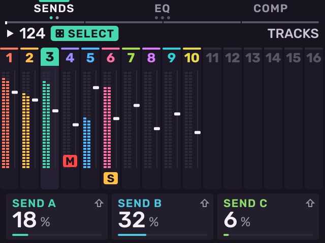

The mixer opens on the strips: every channel of the row side by side, each
with its number, a stereo meter, its fader and **M** or **S** when on. The
selected channel's strip is lit.

Hold **+** to open the selected channel's card. Hold **−** to go back to the
strips. The mixer stays on the view you left it on until Melodee restarts.

The card is in the middle. Its neighbours are narrow strips left and right.
The card shows the channel's name, **M** and **S**, its meter, its fader,
its pan and one block: the one **B1**–**B3** light. On the strips,
**K1**–**K3** still set the lit block.

| Key | Block | **K1**–**K3** |
| --- | --- | --- |
| **B1** | **SENDS**: the four sends, with each bus's first effect. | Send A, B, C. **SHIFT**: pan, output, send D. |
| **B1** again | **FX**: the channel's effect chain. | The lit effect's values. **SHIFT**: its second row. |
| **B2** | **EQ**: the nine bands as a curve. **B2** again: the next three bands. | The three bands in hand. |
| **B3** | **COMP**: the compressor's curve and its gain reduction. | Amount, ratio, speed. **SHIFT**: key, mix, gain. |

Each key's dots show which page of it is in view. The block you pick stays
when you pick another channel.

### Controls

| Control | Does |
| --- | --- |
| Pads | Select a channel. No sound. An empty track opens its [new track cards](tracks.md#make-a-new-track). |
| Encoder | Turn: select the next channel. |
| Encoder push | EQ or COMP: on or off. FX: edit the lit effect on its FX page; on the **+**, the effect picker. |
| **SHIFT** + encoder push | Name the selected track (see [Naming](projects-and-files.md#naming)). |
| **−** / **+** | Move through the lit block: SENDS and COMP their first and second row, EQ its three groups, FX its effects and the **+**. Acts when you let go. |
| Hold **+** | The card. |
| Hold **−** | The strips. |
| **SHIFT** + **−** / **+** | Undo / redo, as on every page. |
| Fader | The level of the selected channel. |
| **PAD BANK** | The tracks, or the submixes, buses, input and master (see [Submixes, buses, input and master](#submixes-buses-input-and-master)). |
| **MUTE** | As printed. Held or latched: a pad mutes its channel, **SHIFT** + pad solos it. **SHIFT** + **MUTE**: unmute all. On FX, a tap turns the lit effect off or on. |
| **ERASE** + pad | Clear that track (asks first). |
| **ERASE** | On FX: remove the lit effect. **SHIFT** + **ERASE** copies it. |
| **SHIFT** + **KNOB FX** | The selected channel's full effect page. **B1** (**MIXER**) comes back. |

A pad lights in its channel's colour, as bright as its level. The
selected channel's pad is lit full; a muted one is red.

In Basic, the mixer shows **SENDS** with send A only, and **SHIFT** +
**K1** pan. There are no EQ, COMP, FX or submixes (see
[Basic and Full](settings.md#basic-and-full)).

### SENDS

Each column is one bus: the send's amount, a bar, the bus letter and the
bus's first effect. **K1**–**K3** set sends A, B and C. Press **+** for the
second row: **K1** pan, **K2** output, **K3** send D. **−** goes back.
Holding **SHIFT** shows the other row while it is held.

**OUTPUT** sends a track to the master or to submix 1–8. A track that goes
to a submix shows the submix's number in its colour on its card.

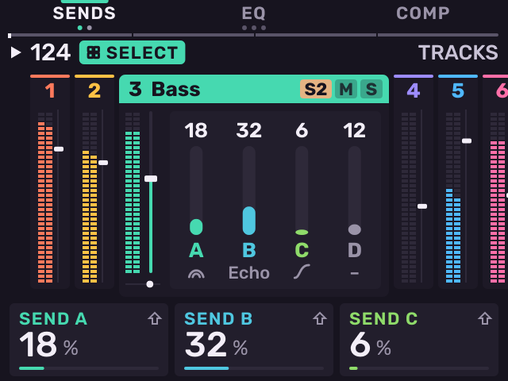

### FX

Press **B1** again for the channel's effect chain in the card. The lit
effect is the one **K1**–**K3** set; **−** / **+** move to the next effect
and to the **+**.

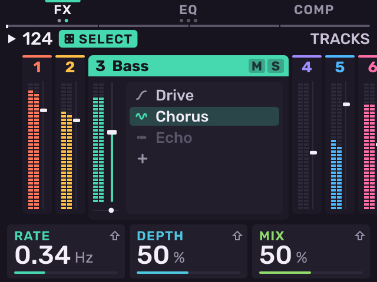

- Push the encoder on an effect to edit it on its FX page (every row, and a
  plug-in's own screen). **B1** (**MIXER**) comes back.
- Push the encoder on the **+** to open the effect picker. Once you add an
  effect or a plug-in, or press **B1** (**BACK**), you come back to the
  mixer.
- Tap **MUTE** to turn the lit effect off or on. An effect that is off is
  dim.
- Tap **ERASE** to remove the lit effect. **SHIFT** + **ERASE** copies it.

### EQ

Nine fixed bands, an octave apart: 63, 125, 250 and 500 Hz, and 1, 2, 4, 8
and 16 kHz, each ±12 dB. **K1**–**K3** set three bands at a time:

| Press | **K1**–**K3** |
| --- | --- |
| **B2** | 63, 125, 250 Hz (**EQ LOW**) |
| **B2** again, or **+** | 500 Hz, 1 kHz, 2 kHz (**EQ MID**) |
| **B2** again, or **+** | 4, 8, 16 kHz (**EQ HIGH**) |

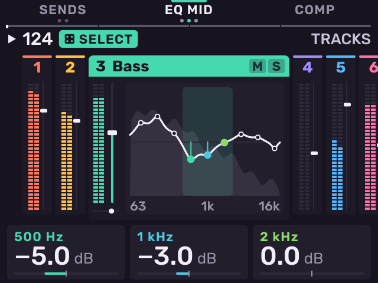

The curve shows the nine bands; the three in hand are shaded and drawn in
the knobs' colours. Behind the curve, in grey, is what the channel plays
now. Push the encoder to turn the EQ off or on; its values are kept. A band
at 0 dB uses no processing.

### COMP

**K1** amount: where the compressor starts, in dB below full scale (OFF at
0). **K2** ratio, 1.5:1 to 20:1. **K3** speed: **FAST**, **MED**, **SLOW**
or **AUTO**. The second row: **K1** key (the channel itself, a track, a bus
or a submix), **K2** mix (dry against compressed), **K3** gain after it.

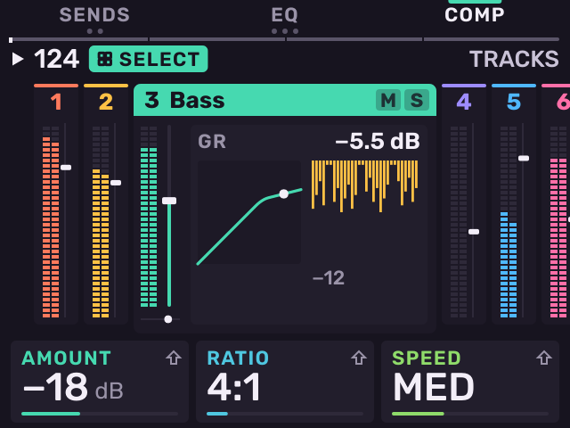

The picture shows the curve with the sound's dot on it, and the gain
reduction over the last seconds. Push the encoder to turn the compressor
off or on.

### Submixes, buses, input and master

Press **PAD BANK** for the second row: the eight submixes on pads 1–8, the
buses A–D on pads 9–12, the input on pad 15 and the master on pad 16. Press
**PAD BANK** again for the tracks. Hold **PAD BANK** and press a pad to
select a track and see the tracks again.

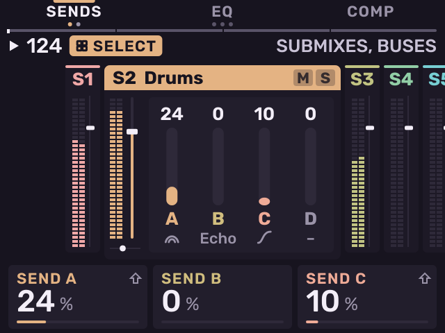

| Channel | Fader | **B1** | **B3** |
| --- | --- | --- | --- |
| Submix | Its level | **SENDS**, again **FX** | **COMP** |
| Bus | Its return | **FX** | **COMP** |
| Input | Input Config's gain | **INPUT** | **COMP** |
| Master | Its trim | **FX** | The master compressor |

Every channel has **EQ** on **B2**. Submixes have colours of their own;
buses have the Looper's.

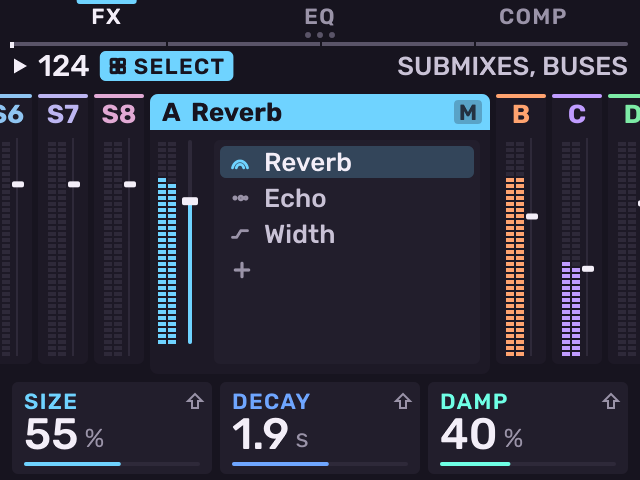

On the input, **INPUT** shows what it plays after its strip, with the peak
in dB. **K1** trim, **K2** monitor (**OFF**, **AUTO**, **ON**, as on Input
Config), **K3** record: **DRY** (takes record the input before its strip)
or **WET** (after it).

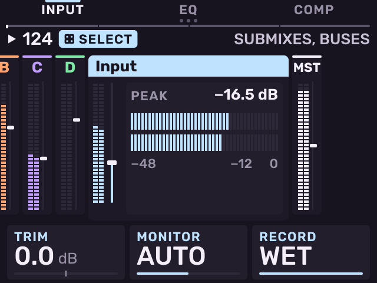

On the master, **B3** is the master compressor (**SHIFT** + **Pad 5**,
see [Compressor](#compressor)), with the same values: **K1** attack, **K2**
release, **K3** amount, **SHIFT** + **K3** In Boost. Push the encoder to
turn it on or off.

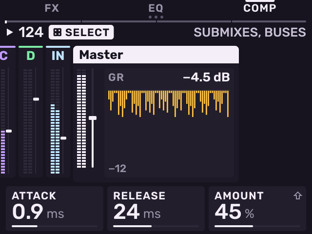

In mute mode on this row, a pad mutes its submix or bus, and **SHIFT** +
pad solos a submix. A submix's solo solos the tracks that go to it.

### Record mixer moves

With **SEQ RECORD** on, the selected track's level, pan, sends and strip
(trim, width, the nine bands and the compressor's values) are recorded as
Motion lanes in the pattern. Edit or erase them on the Motion page. Submix,
bus, input and master moves are not recorded.

## Pad sends

On a kit, each pad has its own send to each of the four buses. Several pads
can share one effect on a bus. The effect runs once, however many pads send
to it. Each pad's own effect chain still works as before.

A pad's send is taken after its own chain, its volume and its pan, before
the kit track's chain. It then follows the kit track's level, pan, mute and
solo: turn the kit down and its reverb goes down with it.

Set them on the kit's Stage: press **SAMPLE**, then **B3** until **SENDS**
is lit.

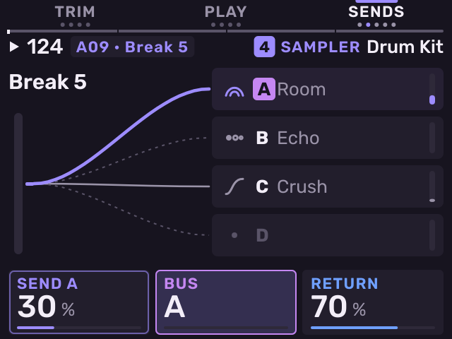

| Control | Does |
|---|---|
| Hit a pad | Selects the pad. |
| **K1** | The selected pad's send to the bus shown. |
| **K2** | Selects the bus, A–D. |
| **K3** | The bus return. |

A pad lights as bright as its send to the bus shown. A pad that sends
nothing stays dark. The selected pad is white.

The kit track's own sends are on the mixer's **SENDS**. They send the whole
kit after its chain. A pad send sends one pad before that chain. Both reach
the same bus and add up.

### Example: one reverb for snare and hat, kick dry

1. Put the reverb on bus A. Press **PAD FX** and **KNOB FX** together, press
   **PAD BANK**, then pad 9 (bus A). Push the encoder on **+** and choose a
   reverb.
2. Press **SAMPLE** on the kit track for Stage. Press **B3** until
   **SENDS** is lit.
3. Hit the snare pad. Turn **K1** to 30 %.
4. Hit the hat pad. Turn **K1** to 15 %.
5. Leave the kick at 0 %. On the mixer, check the kit's send A is 0 %, or
   the whole kit, kick included, goes to the bus.

### Record send moves

With **SEQ RECORD** on, turning a pad's send writes a lane of that pad in
the pattern, as the pad's volume and pan do. Edit or erase it on the
Motion page.

### Freeze

A frozen kit keeps its pad sends. The prints hold them, and the frozen
kit plays them to the buses at its level, pan and mute. See
[Freeze a track](tracks.md#freeze-a-track).

### MPC programs

Loading an MPC drum program (`.xpm` or `.xty`) as a kit brings its pads'
Send 1–4 as their sends to buses A–D, and the program's own Send 1–4 as
the kit track's sends. Stock MPC Sample projects (`.xpj`) bring no sends.

## Pad outputs

On a kit, each pad can play into a submix instead of the kit, as on MPC 3.
On the kit's Stage **SENDS** page, hit the pad, hold **SHIFT** and turn
**K2** (**OUTPUT**): **KIT** (the default) or **SUB 1** to **SUB 8**. The
page shows the submix under the pad's name, in the submix's colour.

- The pad goes to the submix after its own effects, volume and pan, at the
  kit track's level, pan and mute, where its pad sends are taken. The kit
  track's effects and strip are not on it.
- Soloing the submix keeps the kit heard.
- **STEMS** writes the pad in the submix's WAV, not the kit's. An **MPC 3**
  export sends it to the same submix in MPC 3. A **LIVE SET** plays it in
  the kit and says *mixer settings left out*.
- A kit with pads sent to submixes cannot be frozen: set them to **KIT**
  first.

## Effect chains

Each track, submix and bus, and the master, has an effect chain. In the
mixer press **B1** again for the selected channel's chain in the card (see
[FX](#fx)), or **SHIFT** + **KNOB FX** for its full FX page. **SHIFT** +
**KNOB FX** opens the selected track's chain from any other page.

On the FX page, **B1** (**MIXER**) goes back to the mixer on that channel.
**B3** (**FX**) goes to the next chain: the track's, a bus's (the one last
in view), the master's and, on a kit, the last pad's own chain (four slots). The header
names the chain in view, and the dots under **FX** show where you are.

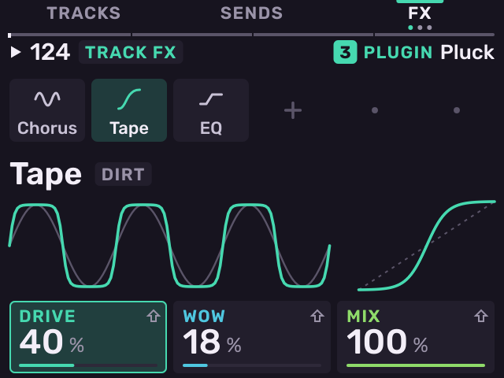

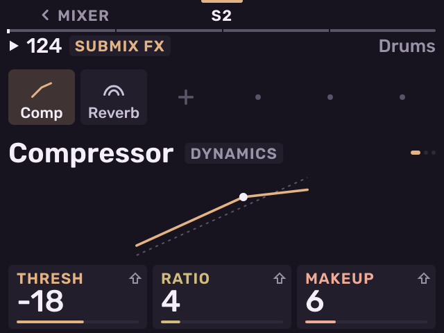

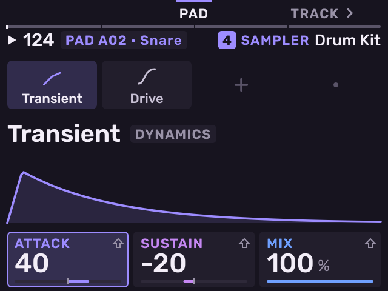

- Turn the encoder to select a slot.
- Push the encoder on the **+** to open the effect picker. Choose a family,
  then an effect.
- Push the encoder on an effect to open its sheet: change, presets, bypass,
  move and remove as cards, with bypass picked. Turn the encoder to pick one
  and push it. **B1** closes it. A plug-in effect's sheet also has
  **TRANSPORT**: whether the plug-in hears **PLAY** and **STOP** (see
  [Plug-in effects](plug-ins.md#plug-in-effects)).
- **ERASE** pressed alone removes the selected effect. **SHIFT** +
  **ERASE** copies it, placed after itself.
- **K1**–**K3** set the effect's values. **−** / **+** show its second row.

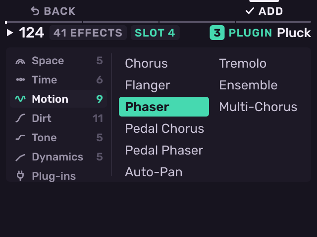

Melodee has 41 effects in six families:

| Family | Effects |
| --- | --- |
| Space | Room, Reverb, Plate, Shimmer, Spring |
| Time | Echo, Tape echo, Ping pong, Looper, Diff delay, Sample delay |
| Motion | Chorus, Flanger, Phaser, Pedal chorus, Pedal phaser, Auto-pan, Tremolo, Ensemble, Multi-chorus |
| Dirt | Drive, Tape, Crush, Spit, Fuzz, Amp sim, Tube drive, Soft clipper, Vintage, Vinyl, Tape emulator |
| Tone | EQ, Filter, Formant, Width, Auto-wah |
| Dynamics | Compressor, Gate, Transient, Limiter, Pumper |

The seventh family, **Plug-ins**, loads a plug-in effect (VST3, LV2, CLAP or VST2).
A pad's own chain takes no plug-ins. For amp captures beside the **Amp
sim**, add the Neural Amp Modeler plug-in (see
[Neural Amp Modeler](plug-ins.md#neural-amp-modeler)).

- **Sidechain**: the last row of a Compressor or Gate has **KEY**. Set it to
  a track or bus, and that sound controls the effect. For example, duck a
  bass under the kick.
- **Tempo sync**: the delays have a **SYNC** setting. Set a note value (1/32
  to 1/1, with triplets and dotted) and the delay time follows the tempo.

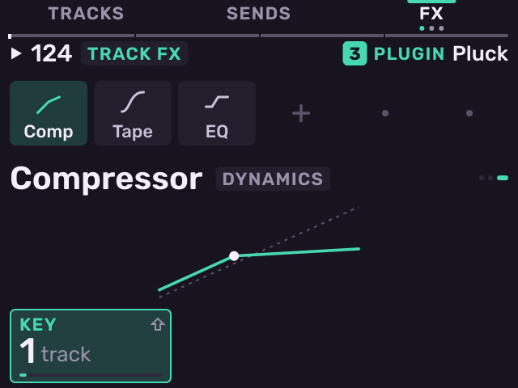

## Knob FX

Press **KNOB FX** to turn on Knob FX mode. **K1**–**K3** control one
performance effect on any page until you press **KNOB FX** again.

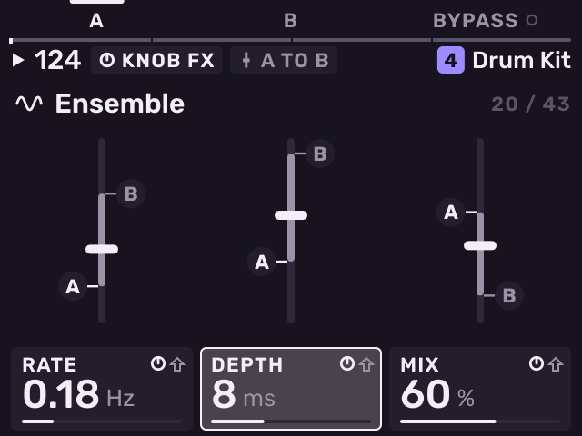

- Turn the encoder or press **−** / **+** to choose the effect: the MPC's 28,
  then Melodee's 15. Push the encoder to load it.
- **B1** (**A**) and **B2** (**B**) hold two settings of the knobs. The
  fader moves the effect from A to B.
- Press pads to send kit pads (on a kit) or tracks through the effect.
  **SHIFT** + **B2** selects all. **B3** bypasses the effect.

## Pad FX

Press **PAD FX**. Hold pads to play effect punches: up to four at once. Pad
pressure sets the depth. Over the pads, the screen draws the bar the
pattern is in: a row for each punch, where it sounds.

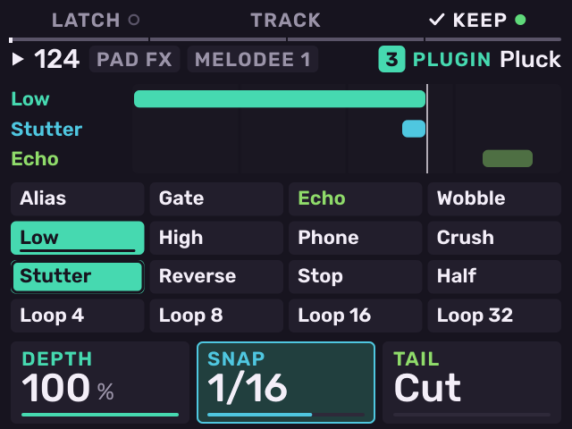

- 47 punches in three banks: the MPC's 16 in the stock order, then Melodee 1
  and Melodee 2. Press **PAD BANK** or **−** / **+** to change the bank.
  The header names the bank.
- On Melodee's punches, **K1** sets the depth, **K2** the **SNAP** grid and
  **K3** the tail. An MPC punch has its own **K1**–**K3**; with **SHIFT**,
  depth, snap and tail.
- **B1** (**LATCH**) keeps the last punch on.
- **B2** switches between the master and the selected track.
- **B3** (**KEEP**) records the punches of the last pass into the pattern.
  They play back with it and end where the pattern ends. **ERASE** + pad
  removes a pad's kept punches.
  **ERASE** + **B3** removes them all (asks first). Punches kept on a track
  go with it when you move the track (see
  [Select a track](tracks.md#select-a-track)).
- **SHIFT** + **B3** (**QUANTIZE**) turns quantize on or off. On (the
  default), a punch pressed while the sequence plays starts on the next
  line of the **SNAP** grid. Off, it starts at once, and the header shows
  a magnet with **OFF**. Punches always stop at once.

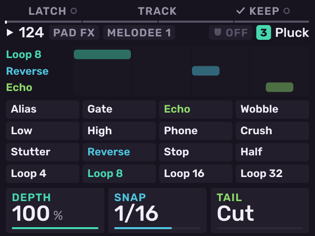

**SHIFT** + **PAD FX** opens **Flex Beat**: pad 1 is Empty, pads
2–16 are 15 time effects on the master. **K1** One Shot or Loop, **K3** mix,
**B3** quantize.

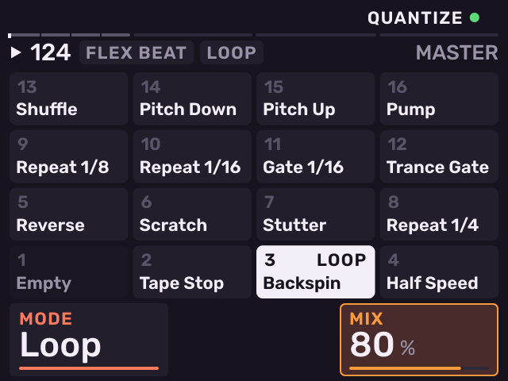

## Compressor

Press **SHIFT** + **Pad 5** for the master compressor. It is also the
master's **B3** in the mixer.

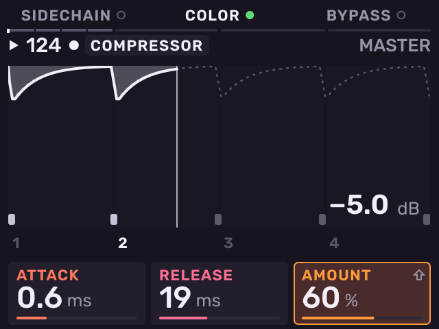

- **K1** attack, **K2** release, **K3** amount. **SHIFT** + **K3** In Boost.
- **B1** Sidechain, **B2** Color, **B3** Bypass.
- With Sidechain on, the pads select the track that triggers the
  compressor. On a kit, push the encoder to select a single pad (for example
  the kick).

The picture shows one bar: the gain reduction across it and the trigger
hits along the bottom.

## Fader

The fader controls the last knob you turned on the selected track: an
engine parameter, an effect, a pad value, the level, pan or a send. Some
pages give it their own job: the selected channel's level on the mixer, A
to B on Knob FX, the amount on the Compressor and the mix on Flex Beat.

Press **SHIFT** + **Pad 9** to open the **Fader** page. It shows the value
the fader follows, its name and the fader. Press **SHIFT** + **Pad 9** again
to close it.

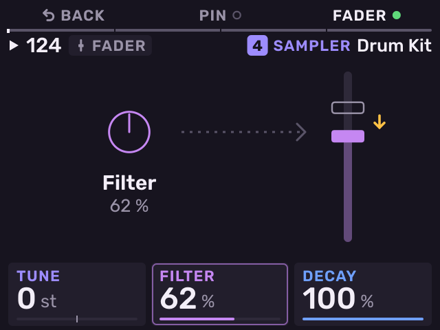

- **K1**–**K3** are the track's favourite values. Turn one and the fader
  takes it. Any knob on any page does the same while the fader is not
  pinned.
- **B2** (**PIN**) keeps the fader on its current target.
- **B3** (**FADER**) turns the fader on or off.
- Turn the encoder to choose a fader target. The target you choose is
  pinned: **B2** unpins it. On a kit track: Pad Volume,
  Pad Pan, Pad Tune, Pad Attack, Pad Decay, Pad Cutoff, Kit Volume. On
  every track: Mod Wheel, Track Level, Track Pan, Send A, Send B, Send C,
  Send D. On a plug-in, keygroup or MIDI track: Pitch Bend, after Mod Wheel.

On Pitch Bend, the wide middle of the fader is no bend. When you let go of
your notes and leave the fader still for a second, the bend springs back to
the middle; bring the fader back through the middle to bend again. The
plug-in must respond to pitch bend (Melodee Poly, PD and Chip do).

The fader light shows the value. With **SEQ RECORD** on, the fader records
Motion.

---

Previous: [Looper](looper.md) · [Contents](../GUIDE.md) · Next: [MIDI and sync](midi-and-sync.md)
