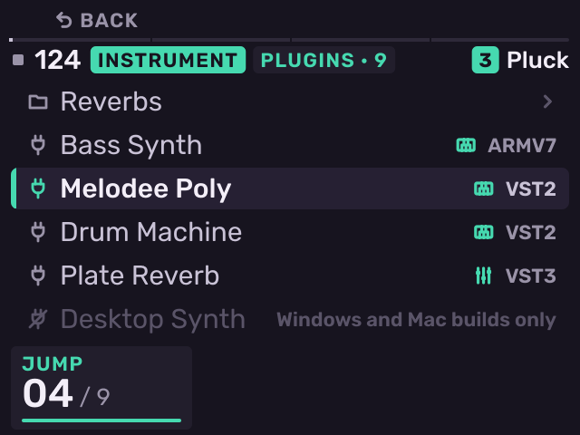
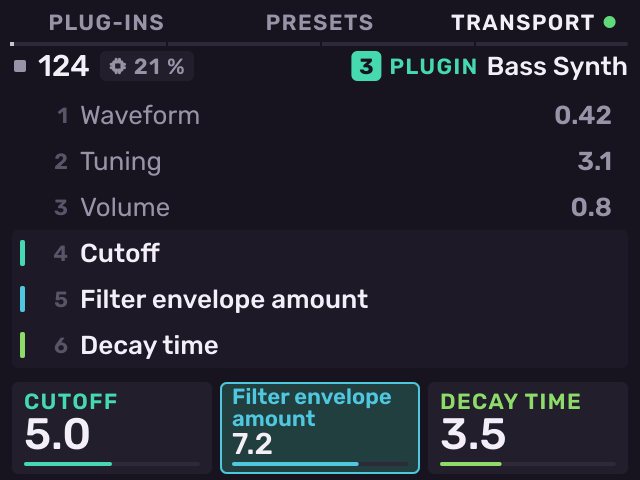
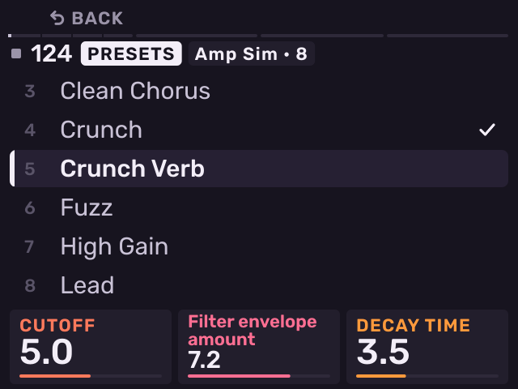
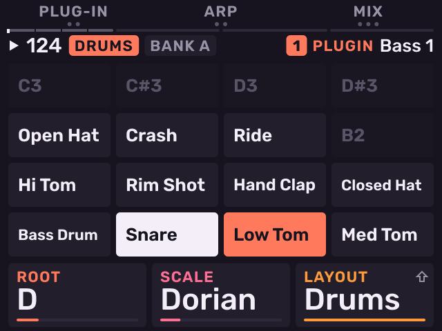
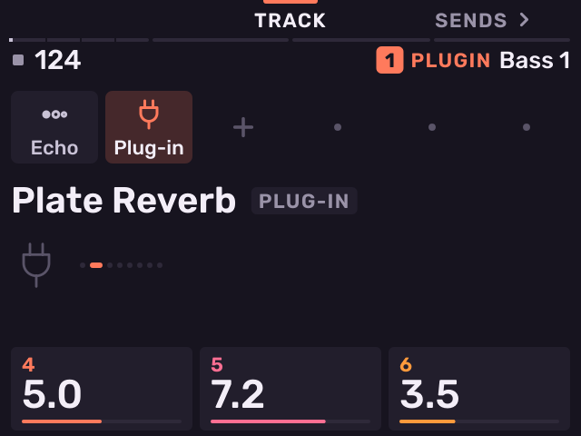

# Plug-ins

Previous: [Kits and sampling](kits-and-sampling.md) · [Contents](../GUIDE.md) · Next: [Instrument and MIDI tracks](instrument-and-midi-tracks.md)

Melodee hosts VST3, LV2, CLAP and VST2 plug-ins, instruments and effects.

## What runs

Put plug-ins in `Melodee/Plugins` on the card (the `Plugins` folder inside
the `Melodee` folder at the top level), in any subfolders. Earlier versions
read a `Plugins` folder at the top level of the card: move its contents into
`Melodee/Plugins`. Projects saved with an earlier version find their
plug-ins there.

Melodee loads plug-ins built for the MPC's ARM processor:

- VST3 bundles with a `Contents/aarch64-linux/` build.
- LV2 bundles (`.lv2` folders) built for 64-bit ARM Linux (aarch64).
- CLAP plug-ins (`.clap` files) built for 64-bit ARM Linux (aarch64).
  Surge XT needs its data folder: put `SurgeXTData` (the `resources/data`
  folder of Surge XT's source, for the same version) next to
  `Surge XT.clap`. Without it Surge XT has no presets or wavetables.
- [Open MPC](https://open-mpc.github.io) plug-in folders (a VST2 `.so`
  with a `plugin-meta.xml`).
- VST2 `.so` files for 64-bit ARM (aarch64), or 32-bit ARM (armv7). 32-bit
  plug-ins run in a separate bridge process. If one crashes, only the
  bridge stops.

Most commercial plug-ins have no Linux ARM build. The picker shows plug-ins
that cannot run dimmed, with the reason.

The Melodee synths are Open MPC plug-ins:

| Plug-in | Sound |
| --- | --- |
| **Melodee Poly** | Two oscillators with sync and noise, four-pole ladder filter, two envelopes, LFO, poly mod, glide, unison, drift. Eight voices. |
| **Melodee PD** | Phase distortion with eight waveforms, two lines, DCW and DCA envelopes. Eight voices. |
| **Melodee Chip** | Chip voice with ring and sync, pulse width LFO, crush and a multimode filter. Six voices. |

Each has factory presets, pad pressure and its own mod matrix. They are free
downloads: [Melodee Poly](https://github.com/keremimo/mpc-vst-melodee-poly/releases/latest), [Melodee PD](https://github.com/keremimo/mpc-vst-melodee-pd/releases/latest) and
[Melodee Chip](https://github.com/keremimo/mpc-vst-melodee-chip/releases/latest). From each release, download the
`-mpc-sample.zip` and copy it into `Melodee/Plugins`. The next time the plug-in
picker opens, Melodee unzips it, deletes the zip and lists the plug-in folder
(for example `Ellic Studio - VST - Melodee Poly`). A zip that cannot be
unzipped stays, dimmed, with **Won't unzip**.

To install a plug-in without moving the card, connect the MPC to a computer
with USB-C and open **http://melodee.local** (or **http://192.168.155.1**) while Melodee runs. On
**Device**, drop the `-mpc-sample.zip` on **Plug-ins** and press **Install**. Melodee
unzips it into `Melodee/Plugins` and the header shows **Plug-in installed**.
The same page updates Melodee: drop the release zip on **Update**, press
**Send**, then press **INSTALL** on the MPC. Its **Quickstart** and
**Manual** tabs hold this guide.

## Plug-in instruments

1. Select an empty track with **PAD BANK** + pad. Stage shows the
   new-track cards.
2. Turn the encoder to **SYNTH** and push it. The plug-in picker opens on
   `Melodee/Plugins`.
3. Turn the encoder to a plug-in and push to load it.

The picker tags each plug-in with its format (VST3, LV2, CLAP, VST2, ARMV7) and shows
a keyboard for instruments or sliders for effects. A bundle with many
plug-ins shows as one row with a count; push to open it.

To change a track's plug-in, press **SAMPLE SELECT** on the track.

**Edit**: press **B1** twice on Stage (**EDIT**), or push the encoder on
**Keys**, to open the plug-in's parameters.

- **K1**–**K3** set the three parameters shown, in their colours.
- Turn the encoder or press **−** / **+** to move to other parameters.
- The header shows how much of each audio block the plug-in uses.
- **B1** opens the picker. **B2** (**PRESETS**) opens the plug-in's presets.

**Presets**: turn the encoder to a preset and push to load it. The page
stays open, so you can play each preset in turn. **B1** goes back.

A plug-in that keeps its presets in folders (most CLAP plug-ins) lists the
folders first, each with the number of presets in it. Push to open a
folder; **B1** goes back out. A check marks the preset loaded and the
folder it is in. A CLAP plug-in's presets show a moment after it loads.
The first time, Melodee reads every preset file, which takes a while for
a plug-in with thousands.

The project saves each plug-in's state, so presets and edits come back when
you load the project.

## Drum machine plug-ins

A drum machine plug-in that names its voices (for example Open MPC drum
machines) sets its track's pads to **Drums**: pad 1 of bank A plays note 36,
the drum rack layout of the MPC and most DAWs. Each pad shows the voice it
plays. For any other drum plug-in, set **K3** to Drums on **Keys**.

## Plug-in effects

On an effect chain (see [Effect chains](mixer-and-effects.md#effect-chains)), open the effect
picker and choose the last family, **Plug-ins**. Track, bus, master and
loop chains take plug-ins.

To open a plug-in effect's presets, push the encoder on its slot.

## Neural Amp Modeler

Melodee's own amp sim is the **Amp sim** effect in the Dirt family. For amp
and pedal captures, the Neural Amp Modeler plug-in can be added on its own.
It plays amp and pedal captures (`.nam` files) with a cab
IR. Its MPC Sample build comes as `NeuralAmpModeler-<version>-mpc-sample.zip`:
unzip it into `Melodee/Plugins`. Put the files it plays in
`Melodee/Plugin Data/Neural Amp Modeler`:

- `Models`: `.nam` captures, in folders if you like.
- `IRs`: cab impulse responses (`.wav`).

Melodee makes both folders the first time the plug-in opens. Files added
later show the next time it opens.

Load it as a plug-in effect on a track chain. Its first row is **Model**,
**Cab** and **Output**; turn **K1** or **K2** to pick a file. The second row
is **Bass**, **Middle** and **Treble**. **Slim** sets the size an A2 capture
plays at: 0 (lite) runs in about a sixth of a block on the MPC, full costs
about four times that. A cab IR longer than 8192 samples is cut there.

## Plugin Data

Plug-ins save their settings and presets in `Melodee/Plugin Data` on the
card, laid out as a Linux home folder. Most use a hidden `.config` folder
there. On a Mac, press Cmd-Shift-. in Finder to show it.

## Latency and sample rate

Melodee compensates for plug-in latency: tracks, buses and MIDI out are
delayed to line up with the slowest path. Settings' **AUDIO** page shows
the compensation (**PDC**). Open MPC plug-ins run at 44.1 kHz. At 48 or 96
kHz Melodee converts their audio, so they play in tune at any rate.

---

Previous: [Kits and sampling](kits-and-sampling.md) · [Contents](../GUIDE.md) · Next: [Instrument and MIDI tracks](instrument-and-midi-tracks.md)
