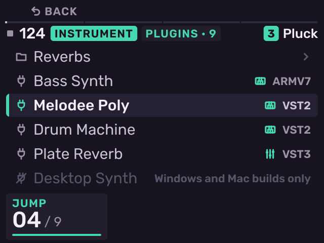
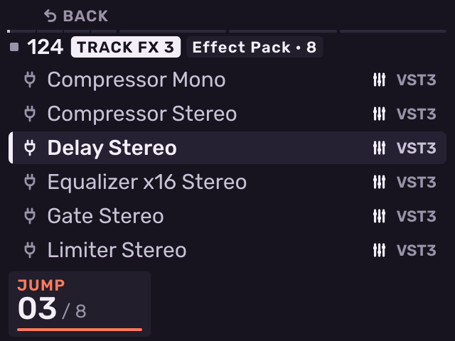
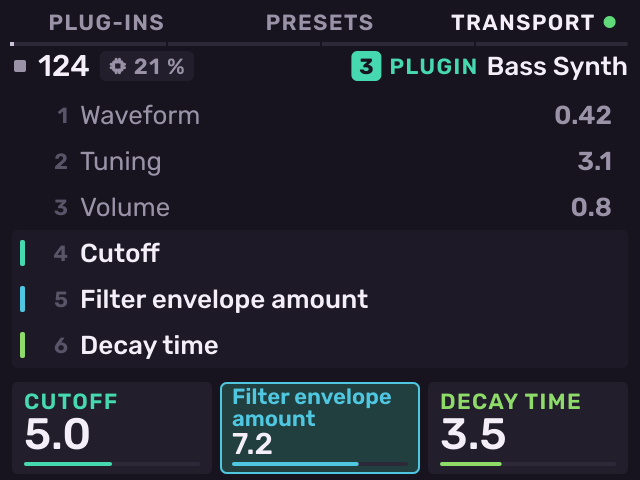
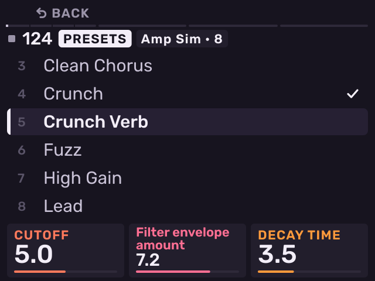
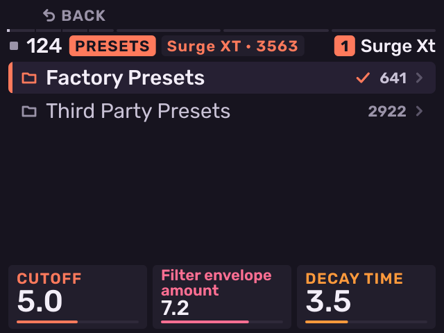
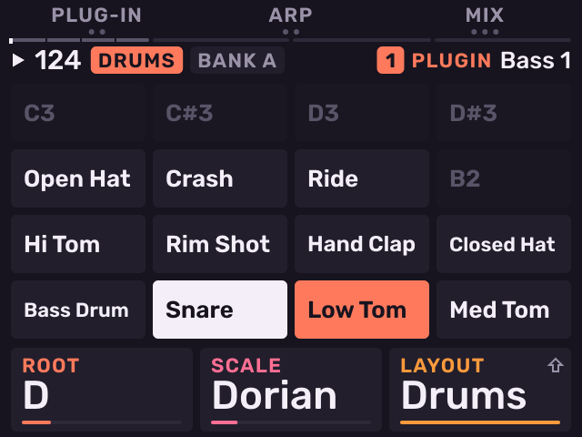
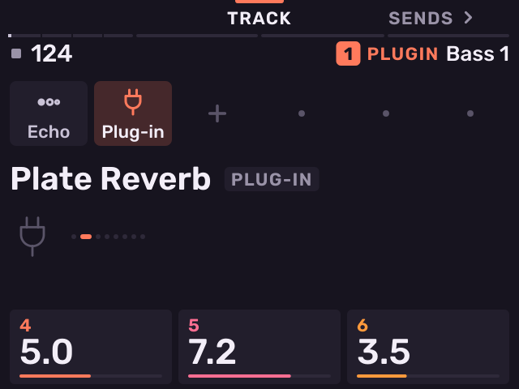
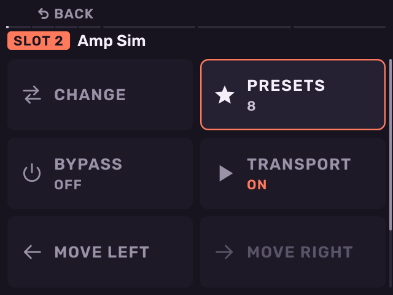

# Plug-ins

Previous: [Kits and sampling](kits-and-sampling.md) · [Contents](../GUIDE.md) · Next: [Instrument and MIDI tracks](instrument-and-midi-tracks.md)

Melodee hosts VST3, LV2, CLAP and VST2 plug-ins, instruments and effects.

## What runs

Put plug-ins in `Melodee/Plugins` on the card (the `Plugins` folder inside
the `Melodee` folder at the top level), in any subfolders. Earlier versions
read a `Plugins` folder at the top level of the card: move its contents into
`Melodee/Plugins`. Projects saved with an earlier version find their
plug-ins there.

The plug-in picker opens on `Melodee/Plugins` (the header says
**PLUGINS**), and after that on the folder and row you left it on. Press
**B1** (**BACK**) to go up a folder, as far as the top of the card, to load
a plug-in kept anywhere else on the card. At the top of the card the header
says **CARD** and **B1** reads **CANCEL**.

Melodee loads plug-ins built for the MPC's ARM processor:

- VST3 bundles with a `Contents/aarch64-linux/` build.
- LV2 bundles (`.lv2` folders) built for 64-bit ARM Linux (aarch64).
- CLAP plug-ins (`.clap` files) built for 64-bit ARM Linux (aarch64).
  Surge XT needs its data folder: put `SurgeXTData` (the `resources/data`
  folder of Surge XT's source, for the same version) next to
  `Surge XT.clap`. Without it Surge XT has no presets or wavetables.
- MPC plug-in folders, named `Maker - VST - Name`: the folder of a
  `-mpc-sdk.zip` (Akai's plug-in format, with a `plugin.json`), or an
  [Open MPC](https://open-mpc.github.io) folder (a VST2 `.so` with a
  `plugin-meta.xml`). Melodee opens the 64-bit build when the folder has
  one, else the 32-bit build. The plug-in's data (samples, skins, presets)
  is read from the card. Plug-ins kept in `VST2 Plugins` at the top of the
  card, where MPC Sample 1.4 reads them, load too: press **B1** (**BACK**)
  up to the top of the card and open `VST2 Plugins`.
- VST2 `.so` files for 64-bit ARM (aarch64), or 32-bit ARM (armv7). 32-bit
  plug-ins run in a separate bridge process. If one crashes, only the
  bridge stops.

Most commercial plug-ins have no Linux ARM build. The picker shows plug-ins
that cannot run dimmed, with the reason.

Melodee carries the libraries that plug-ins often need beside their own
files: libsndfile, libsamplerate and FFTW. A plug-in that needs another
library shows **MISSING LIBRARY** when it opens.

The Melodee synths are Open MPC plug-ins:

| Plug-in | Sound |
| --- | --- |
| **Melodee Poly** | Two oscillators with sync and noise, four-pole ladder filter, two envelopes, LFO, poly mod, glide, unison, drift. Eight voices. |
| **Melodee PD** | Phase distortion with eight waveforms, two lines, DCW and DCA envelopes. Eight voices. |
| **Melodee Chip** | Chip voice with ring and sync, pulse width LFO, crush and a multimode filter. Six voices. |

Each has factory presets, pad pressure and its own mod matrix. They are free
downloads: [Melodee Poly](https://github.com/keremimo/mpc-vst-melodee-poly/releases/latest), [Melodee PD](https://github.com/keremimo/mpc-vst-melodee-pd/releases/latest) and
[Melodee Chip](https://github.com/keremimo/mpc-vst-melodee-chip/releases/latest). From each release, download the
`-mpc-sample.zip` and copy it into `Melodee/Plugins`. The next time the plug-in
picker opens, Melodee unzips it, deletes the zip and lists the plug-in folder
(for example `Ellic Studio - VST - Melodee Poly`). A zip that cannot be
unzipped stays, dimmed, with **Won't unzip** (or **Card full** when the
card has no room for it). Zips in other folders on the
card are left as they are. Other MPC plug-in releases install the same
way: copy their `-mpc-sdk.zip` into `Melodee/Plugins`.

To install a plug-in without moving the card, connect the MPC to a computer
with USB-C and open **http://melodee.local** (or **http://192.168.155.1**) while Melodee runs. On
**Device**, drop the `-mpc-sample.zip` on **Plug-ins** and press **Install**. Melodee
unzips it into `Melodee/Plugins` and the header shows **Plug-in installed**.
An open plug-in picker lists it at once.
To remove one, press the delete button on its row under **Installed**.
The same page updates Melodee: drop the release zip on **Update**, press
**Send**, then press **INSTALL** on the MPC. Its **Quickstart** and
**Manual** tabs hold this guide.

## Plug-in instruments

1. Select an empty track with **PAD BANK** + pad. Stage shows the
   track types. A new project opens on track 1 with the track types.
2. Turn the encoder to **Plugin** and push it. The plug-in picker opens.
3. Turn the encoder to a plug-in and push to load it.

The picker tags each plug-in with its format (VST3, LV2, CLAP, VST2, ARMV7) and shows
a keyboard for instruments or sliders for effects. A check marks the plug-in
loaded. A bundle with many plug-ins shows as one row with a count; push to
open it. **K1** jumps through the list.

**ERASE** deletes the plug-in or the folder under the cursor from the card.
Melodee asks first (**B3 DELETE**, **B1 CANCEL**) and undo does not bring it
back. A plug-in the open project uses is not deleted. To remove a plug-in
with its data (Surge XT with its patches), delete its folder.

To change a track's plug-in, press **SAMPLE SELECT** on the track.

On Stage's **PRESETS** page, **K1**–**K3** are **FILTER**, **ECHO** and
**SPACE** on every plug-in (see
[Stage on a plug-in track](instrument-and-midi-tracks.md#stage-on-a-plug-in-track)).

**EDIT**: once you pick a plug-in, Stage opens on **EDIT**, the third page
under **B1**. A plug-in that draws its own screen shows it on **PANEL**, the
page before (see [A plug-in's own screen](#a-plug-ins-own-screen)).

- The page shows the plug-in's parameters in rows of three, each over its
  pot: **K1**, **K2**, **K3**. The row the pots turn is raised, in their
  colours. A pot that has not reached its parameter's value yet shows faint,
  with a white dot where the pot is.
- The plug-in's parameters come in pages, named at the top left; the dots
  at the right show which page is open. The pages are the plug-in's own (an
  Open MPC plug-in's skin tabs, a CLAP plug-in's pages), then its groups of
  parameters.
- Turn the encoder to move to the next row of three. Press **−** / **+** to
  go to the page before or after.
- A page with an envelope (attack, decay, sustain, release) or a filter
  (cutoff and resonance) draws it above the row.
- A page file sets the pages by hand: which parameters, their order, shorter
  names and a picture. Put it in `Melodee/Plugin Pages/` on the card; some
  plug-ins bring their own, and Melodee has one for Neural Amp Modeler. The
  format is in [Plug-in page files](../PLUGIN_PAGES.md).
- A page file can bring a skin: the maker's own art for the page, with its
  knobs and sliders turning with the values. On the controls **K1**–**K3**
  turn, a white dot shows where a pot sits until it reaches the value.
  Settings > SCREEN > **Plug-in screens** turns skins and plug-ins' own
  screens off for every plug-in.
- **SHIFT** + encoder steps the parameter turned last by one of its own
  values.
- **ERASE** + a pot sets its parameter back to the plug-in's default.
- Hold **SHIFT** on **PRESETS**, **PANEL** or **EDIT** for the plug-in's
  own keys. **SHIFT** + **B1** (**PLUG-INS**) opens the picker, as **SAMPLE
  SELECT** does. **SHIFT** + **B2** (**PRESETS**) opens the plug-in's
  presets, when it has some. Picking another plug-in in the picker asks
  "Replace Surge XT?" first. The old plug-in's sound and settings go;
  **SHIFT** + **−** (undo) brings it back with its settings. The same
  question comes on an effect slot.
- Every plug-in hears Melodee's Play and Stop, the tempo and the place in
  the song, so its own sequencer plays only while Melodee plays.
  **SHIFT** + **B3** (**TRANSPORT**) sets whether the plug-in hears Play and
  Stop. Its light is on by default. Turn it off for a plug-in with its own sequencer
  or arpeggiator, so that only the track's notes play it. It still follows
  the tempo.

**Presets**: turn the encoder to a preset and push to load it. The page
stays open, so you can play each preset in turn. **K1**–**K3** still set
the three parameters shown on **EDIT**. **B1** goes back. Push the encoder on
Stage's **PRESETS** page, or press **SHIFT** + **B2**, to open the same list.

A plug-in that keeps its presets in folders (most CLAP plug-ins) lists the
folders first, each with the number of presets in it. Push to open a
folder; **B1** goes back out. A check marks the preset loaded and the
folder it is in. The list opens in the folder of the preset picked last.

LV2 plug-ins list their presets too. An MPC plug-in folder's own preset
files (the `.xpl` files in its `Presets` folder) list after the plug-in's
programs, in a **Presets** folder, or at the top when the plug-in has no
programs of its own. A preset file with the same name as one of the
plug-in's programs is not listed twice. A CLAP plug-in's presets, and an
MPC plug-in's preset files, show a moment
after it loads; until then the page says **LOOKING**. The first time,
Melodee reads every preset file, which takes a while for a plug-in with
thousands. It keeps what it read in `Melodee/Plugin Data/.cache`, so later
it reads only new or changed files.

The project saves each plug-in's state, so presets and edits come back when
you load the project.

## Drum machine plug-ins

A drum machine plug-in that names its voices (for example Open MPC drum
machines) sets its track's pads to **Drums**: pad 1 of bank A plays note 36,
the drum rack layout of the MPC and most DAWs. Each pad shows the voice it
plays. For any other drum plug-in, set **K3** to Drums on **Keys**.

## Plug-in effects

On an effect chain (see [Effect chains](mixer-and-effects.md#effect-chains)), open the effect
picker and choose the last family, **Plug-ins**. Track, bus, master and
loop chains take plug-ins.

Push the encoder on a plug-in effect's slot to open its sheet.
**PRESETS** opens its presets, when it has some. **TRANSPORT** works as
**SHIFT** + **B3** on a plug-in track's Stage. A kit pad's own chain and Knob FX take no
plug-ins.

A plug-in effect that draws its own screen draws under the slots instead (see
[A plug-in's own screen](#a-plug-ins-own-screen)).

## A plug-in's own screen

Some plug-ins draw their own page on the MPC Sample. Melodee keeps **B1**–**B3**
and draws nothing over the plug-in's knobs: the plug-in shows where a pot sits
until it reaches its value. **K1**–**K3** turn the three parameters it names.

- **On a plug-in track**: on Stage, **B1** goes **PRESETS**, **PANEL** (its
  page), **EDIT** (Melodee's pages of its parameters). On its page the
  encoder, its push and **−** / **+** are the plug-in's. A page with a list of
  its own (an effect chain inside the plug-in) can take **MUTE** and
  **ERASE** taps too: **MUTE** switches the lit item off or on, **ERASE**
  removes it, and **ERASE** lights while it can. Held with pads, **MUTE**
  still mutes tracks.

- **As an effect**: on a chain the plug-in draws everything under the slots,
  with no cards. Push opens its full page; **B3** or **SHIFT** + push goes
  back. **SHIFT** + **B3** opens the slot's sheet (on any effect).

- Settings > SCREEN > **Plug-in screens** off: Melodee's own pages for every
  plug-in.

Plug-in makers: [Plug-in screens](../PLUGIN_SCREENS.md).

### A screen installed apart from the plug-in

A companion screen gives a VST2 plug-in a page of its own without changing
the plug-in. Copy the screen's folder into `Melodee/Plugin Screens/` on the
card; the plug-in stays in `Melodee/Plugins/` as it is.

- It shows on **PANEL** as a plug-in's own screen does, when the plug-in
  has none of its own.
- Melodee checks that the screen is for that plug-in and that every
  parameter it uses is where it expects. When one is not, Melodee shows its
  own pages and says why in `Melodee/Plugin Screens/problems.txt`.
- A screen that stops working is closed: Melodee's pages come back with a
  notice, and the plug-in plays on.
- Delete the screen's folder to go back to Melodee's pages. Projects never
  need the screen.

Screen makers: [Companion screens](../PLUGIN_COMPANIONS.md).

## Neural Amp Modeler

Melodee's own amp sim is the **Amp sim** effect in the Dirt family. For amp
and pedal captures, the Neural Amp Modeler plug-in can be added on its own.
It plays amp and pedal captures (`.nam` files) with a cab
IR. Its MPC Sample build is a free download:
[Neural Amp Modeler](https://github.com/keremimo/mpc-vst-neural-amp-modeler/releases/latest).
From the release, download `NeuralAmpModeler-<version>-mpc-sample.zip` and
copy it into `Melodee/Plugins`. The next time the plug-in picker opens,
Melodee unzips it into the `Neural Amp Modeler` folder. Put the files it plays in
`Melodee/Plugin Data/Neural Amp Modeler`:

- `Models`: `.nam` captures, in folders if you like.
- `IRs`: cab impulse responses (`.wav`).

Melodee makes both folders the first time the plug-in opens. Files added
later show the next time it opens.

Load it as a plug-in effect on a track chain. Its first row is **Model**,
**Cab** and **Output**; turn **K1** or **K2** to pick a file. The second row
is **Bass**, **Middle** and **Treble**. **Slim** sets the size an A2 capture
plays at: 0 (lite) runs in about a sixth of a block on the MPC, full costs
about four times that. Melodee leaves it as you set it. A cab IR longer than
8192 samples is cut there.

The TONE3000 plug-in plays its amp captures at the size its preset or the
saved project gives, lite or full. Full takes about three times the
processor of lite and can crackle. TONE3000 reads its presets from
`.config/TONE3000/Presets` in `Melodee/Plugin Data`.

## Plugin Data

Plug-ins save their settings and presets in `Melodee/Plugin Data` on the
card, laid out as a Linux home folder. Most use a hidden `.config` folder
there. On a Mac, press Cmd-Shift-. in Finder to show it.

## Latency and sample rate

Melodee compensates for plug-in latency: tracks, buses and sequenced MIDI
out are delayed to line up with the slowest path. MIDI you play goes out at
once. Settings' **AUDIO** page shows
the compensation (**PDC**). Open MPC plug-ins run at 44.1 kHz. At 48 or 96
kHz Melodee converts their audio, so they play in tune at any rate.

---

Previous: [Kits and sampling](kits-and-sampling.md) · [Contents](../GUIDE.md) · Next: [Instrument and MIDI tracks](instrument-and-midi-tracks.md)
