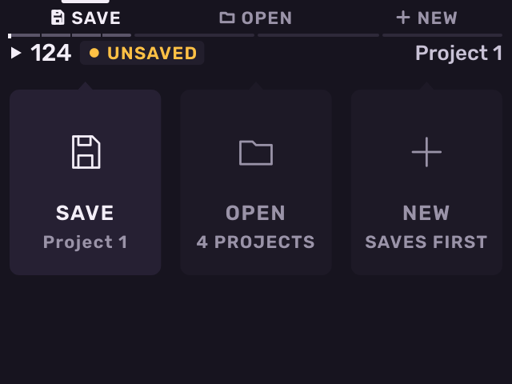
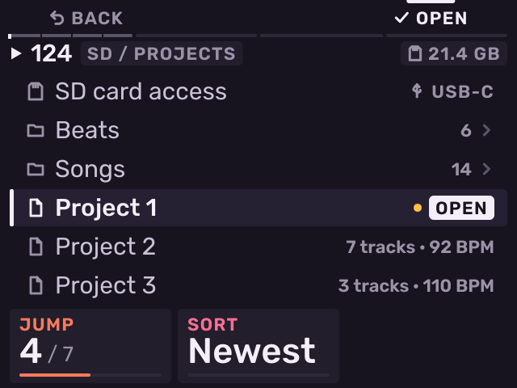
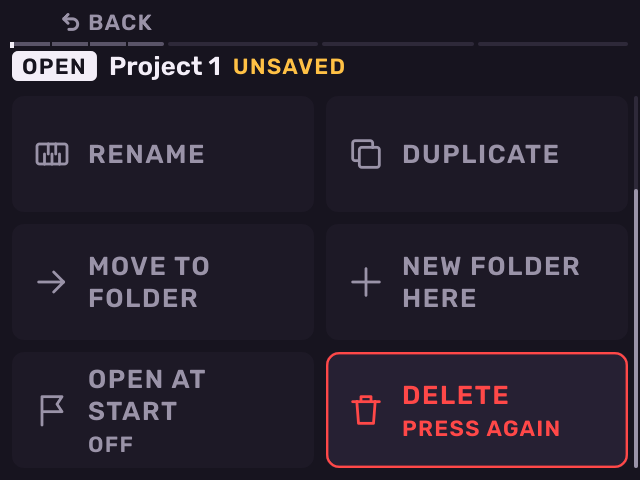
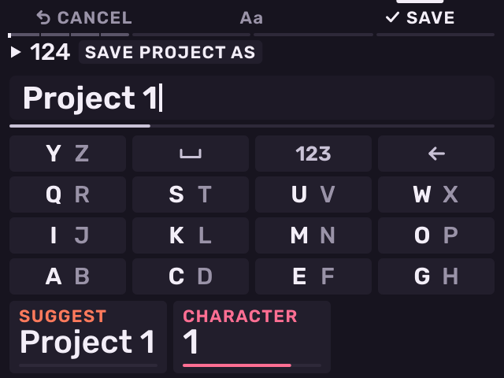
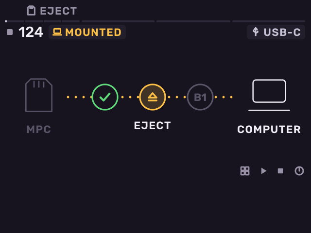
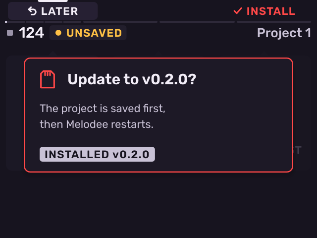

# Projects and files

Previous: [MIDI and sync](midi-and-sync.md) · [Contents](../GUIDE.md) · Next: [Settings](settings.md)

## The Project page

Press **SHIFT** + **Pad 16**.

- **B1** (**SAVE**): save the project. The first time, name it.
- **B2** (**OPEN**): the list of projects on the card.
- **B3** (**NEW**): start a new project (asks first).

Or turn the encoder to pick one and push it.

The header shows **UNSAVED** in amber while the project has changes.

In the list:

- Turn the encoder to move. **K1** jumps, **K2** sorts.
- Push the encoder or press **B3** to open a folder. **B1** goes back.
  At the top of `Melodee/Projects`, **B1** goes up to the card's own folders,
  so a project or kit anywhere on the card can be loaded. At the card's top,
  **B1** closes the list.
- Push the encoder on a project to open its sheet. Its jobs are cards:
  Save, Save as new, Rename, Duplicate, Move to folder, New folder here,
  Open at start and Delete. Another project has Load and **Load kit**
  (no patterns) first, which loads its first kit onto the selected track.
- Save (or Load) is picked when the sheet opens. Turn the encoder to pick
  another card and push it. **B1** closes the sheet. Delete asks again.

While a project loads, a Loading sheet shows its progress. The audio fades
out and back in.

## Naming

The Name sheet opens when you save or rename a project, sample, bank or
marker.

- The pads type like phone keys. Each pad shows the letter it types next.
  Pad 14 types a space, pad 15 switches to digits, pad 16 deletes.
- Turn the encoder to move the cursor. **K1** chooses a suggested name.
- **ERASE** deletes. **SHIFT** + **ERASE** clears the name.
- **B2** switches between capitals and lower case.
- **B3** (**SAVE**) or encoder push saves. **B1** cancels.

## MPC Sample projects

Melodee opens stock MPC Sample projects (`.xpj`). On the project list, open
the **MPC Sample** row at the top to see the stock app's projects, in
`MPC-Sample/Projects` and its folders.

Load opens a copy. The stock project is not changed. Save makes a Melodee
project (`.mldp`) that plays the samples from where they are.

- Each Drum track becomes a kit track. Each sequence becomes that numbered
  pattern, with its tempo.
- Carried over: pad regions, tune, volume, pan, play type, mono, mute
  group, envelope, loop, Warp, filter, and pads with several layers.
- Not carried over: Pad FX, insert effects, sends and songs.

## SD card access

Connect the MPC to a computer to copy files to and from the card, without
taking it out.

1. Connect the MPC to the computer with a USB-C cable.
2. Open the project list (**SHIFT** + **Pad 16**, **B2**) and push the
   encoder on **SD card access** at the top.
3. The card appears on the computer as a drive. Copy your files.
4. Eject the drive on the computer.
5. Press **B1** (**TAKE BACK**). Melodee reads the card again.

While the card is on the computer, the pads still play the selected track.
USB audio and USB MIDI keep working. If you press **B1** before you eject
the drive, Melodee asks whether to take the card back anyway.

## Files on the card

| Folder | Contents |
| --- | --- |
| `autorun/` | Melodee itself. Do not change it. |
| `Melodee/Projects/` | Projects (`.mldp`), and each project's loops |
| `Melodee/Mixdowns/` | Song mixdowns |
| `Melodee/Stems/` | Stems |
| `Melodee/MIDI/` | Exported MIDI files |
| `Melodee/Cache/` | Decoded instrument samples. Safe to delete: Melodee makes them again. |
| `Melodee/Plugins/` | VST3, LV2, CLAP and VST2 plug-ins |
| `Melodee/Plugin Data/` | Plug-in settings and presets |
| `Melodee/settings` | Melodee's settings |
| `Samples/` | Your samples. Melodee writes `Recorded/`, `Edits/`, `Banks/`, `Looper/` and `Expansions/` here. |
| `SysEx/` | `.syx` files for MIDI tracks |

## Update Melodee

1. Download the new release zip (`Melodee-MPC-Sample-<version>.zip`).
   Do not unzip it.
2. Copy the zip to the top level of the card, with **SD card access** or
   a card reader.
3. When playback is stopped, Melodee asks **Update to <version>?**. Press
   **B3** (**INSTALL**). To keep this version for now, press **B1**
   (**LATER**). Melodee asks again after SD card access or the next time
   it starts.
4. Melodee saves the project, checks the zip, writes it to the card and
   restarts. The header then shows **Updated to <version>**. Melodee
   deletes the zip from the card.

Melodee only offers official releases. A zip that was changed, or that
did not come from Melodee's releases page, is ignored. If the update fails
(for example, the card is full), the screen shows the reason and nothing is
changed. Press **B1** to close it. The previous version stays on the card
in `autorun/melodee.prev`.

---

Previous: [MIDI and sync](midi-and-sync.md) · [Contents](../GUIDE.md) · Next: [Settings](settings.md)
