# Sequencing

Previous: [Instrument and MIDI tracks](instrument-and-midi-tracks.md) · [Contents](../GUIDE.md) · Next: [Song](song.md)

## Patterns

Press **SHIFT** + **Pad 12** to open Song, Patterns and Scenes: **B1**
(**PATTERNS**), **B2** (**SCENES**) and **B3** (**SONG**) move between them.
**SHIFT** + **Pad 12** opens the one you used last; pressed on one of them, it
goes to **Patterns**.

**Patterns** lists the tracks down the screen and their 16 patterns across
it. A filled cell has notes. The pads play the selected track.

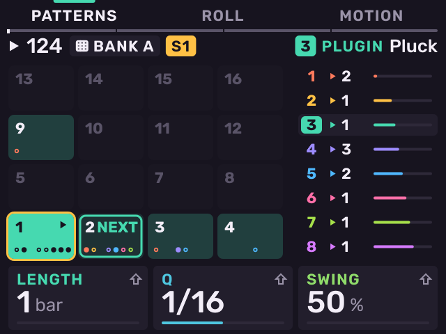

| Control | Action |
| --- | --- |
| **K1** | Pattern length: 1, 2, 4 … 128 bars. **SHIFT**: any number of bars. |
| **K2** | Grid (Q): 1/4 to 1/64, with triplets. **SHIFT**: time signature. |
| **K3** | Swing (50–75 %). **SHIFT**: metronome level. |
| Encoder | Move the playhead by a beat. **SHIFT** + **PLAY** continues from there. |
| Encoder push | Open Scenes. |
| **SEQ** | Open the selected track's editor: Steps, Roll or Motion. |
| **B1**–**B3** | **PATTERNS**, **SCENES**, **SONG**. |

## Hold SEQ

Hold **SEQ** on any page. The pads become the selected track's patterns:

- The playing pattern is bright, a queued pattern blinks, patterns with
  notes are dim.
- Press a pad to launch that pattern at the next bar (at once when stopped).
- Press more pads in the same hold to make a **pattern chain** (up to
  eight). Each pattern plays once, then the next.
- **SHIFT** + pad launches that **scene**: the pattern on every track that
  has notes there.
- Hold a pad and press another to copy the pattern.
- **ERASE** + pad clears the pattern (asks first).
- **K1**–**K3** set the pattern's length, grid and swing. The encoder sets
  the tempo.
- **B1**–**B3** open Steps, Roll and Motion.
- **−** / **+** launch the previous / next pattern.

After 0.3 seconds the **Sequence** sheet shows the patterns and the chain:
what plays now, what plays next, and the tempo.

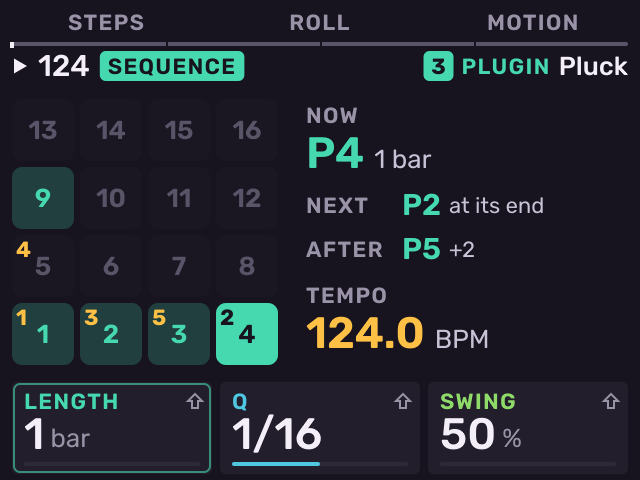

## Record

1. Select a track and a pattern.
2. Press **SEQ RECORD**. When stopped, this arms recording.
3. Press **PLAY**. Recording starts. When playing, **SEQ RECORD** records at
   once.
4. Press **SEQ RECORD** again to stop recording. Playback continues.

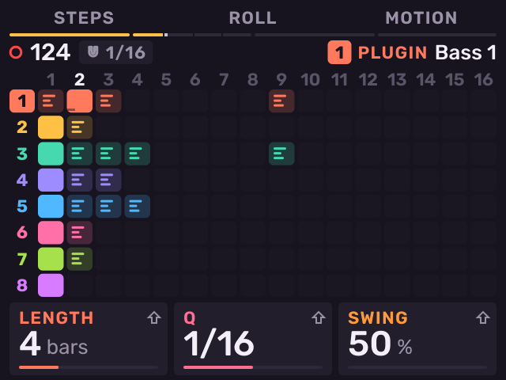

Recording adds to the notes already in the pattern. Each take is one undo
step. Turn a knob while recording to record it as Motion.

- **SHIFT** + **Pad 4**: count-in on or off.
- **SHIFT** + **TAP TEMPO**: metronome Off, On, or Rec (only while
  recording).
- **SHIFT** + **Pad 10**: **Rec Quantize**. **B3** turns it on or off. The
  encoder sets the grid: the pattern's Q, or its own.
- Hold **PLAY** while playing: Fill. Notes with a FILL condition play.

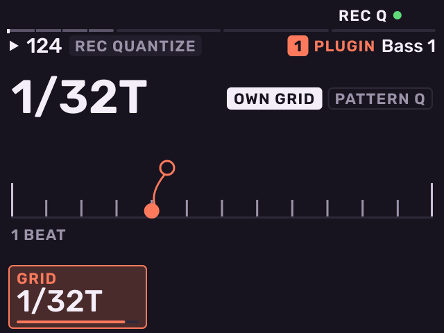

**Recall** (**SHIFT** + **SEQ RECORD**): Melodee always keeps the notes you
play, recording or not. Recall puts the last phrase into patterns: every
track that played goes into its next empty pattern, and those patterns
start playing. This is one undo step.

## The pattern editors

On Patterns, press **SEQ** to open the selected track's editor. **B1**
**STEPS**, **B2** **ROLL** and **B3** **MOTION** switch between them. Press
**SEQ** to go back to Patterns.

**Steps**

Steps shows the 16 steps of one bar on the pads. Each step's notes stack by
pitch and grow taller with velocity.

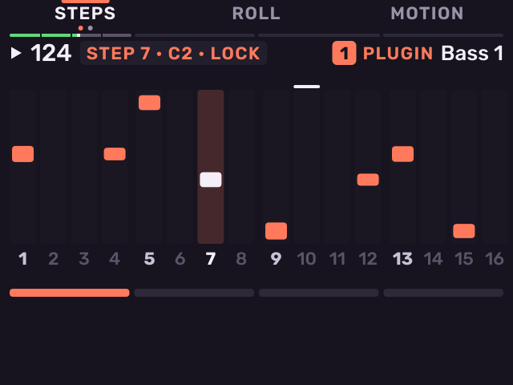

- Press a pad to set or clear a step. On a kit, Steps edits the last pad
  you hit. Turn the encoder while holding a step to move its note to
  another pad.
- **K1** length, **K2** velocity, **K3** chance of the step's note.
- **Hold a step** and turn a knob to lock a value on that step (a parameter
  lock). A locked step shows a square at its top.
- Press **STEPS** again for the **TRIG** row: **K1** ratchet (1–8 hits),
  **K2** ramp, **K3** trig condition (Always, n:m, Fill, First, Pre, Nei and
  their opposites).
- On a kit, press **STEPS** a third time for **EUCLID**: **K1** hits,
  **K2** steps, **K3** rotation.
- On a kit, **SHIFT** + **K1** sets the lane length, so a pad's lane can
  loop at its own length.
- Push the encoder for **VARY**: Thinner, Busier, Humanised, Reversed,
  Octave up or down. **B3** (**DO IT**) writes the result into the next empty
  pattern.

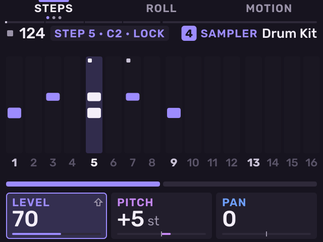

**Roll**

Roll is a piano roll. On a kit, each row is a pad.

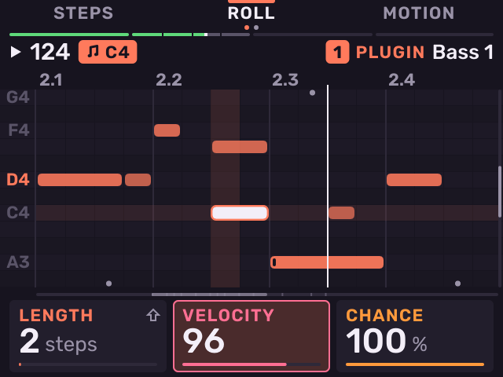

- Turn the encoder to move the cursor a step. **SHIFT** + encoder moves note
  to note. **−** / **+** move the cursor's pitch.
- A pad writes a note at the cursor, one step long.
- **K1** length, **K2** velocity, **K3** chance of the note under the cursor.
  **SHIFT** + **K1**: nudge the note early or late.
- **ERASE** pressed alone deletes the note under the cursor.
- Push the encoder for the note sheet: accent, slide, tie and delete as
  cards. Turn the encoder to pick one and push it. **B1** closes it.
- Press **ROLL** again for the note's ratchet.

**Step Edit**

Press **SHIFT** + **SEQ** to enter notes one step at a time, with the
transport stopped.

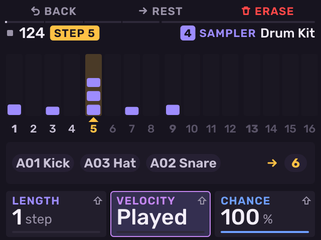

- Play a pad or a chord. It is written at the caret, and the caret moves to
  the next step.
- **B2** (**REST**) moves on without writing. **B3** (**ERASE**) goes back
  and clears that step. The encoder moves the caret.
- **K1** note length in steps, **K2** velocity (Played uses your velocity),
  **K3** chance.
- **B1**, encoder push or **SEQ** go back to the editor.

**Motion**

Motion shows the pattern's recorded knob movements as lanes. To record
Motion, turn a knob while **SEQ RECORD** is on. To clear a lane, press
**ERASE** + the knob.

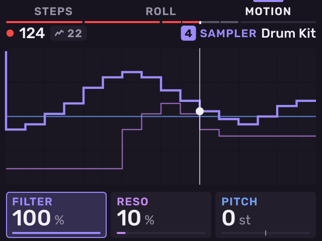

Press **MOTION** again for **MOD**:

- **B1** (**MOD**): eight modulators. Each is an LFO (synced or free) or an
  envelope follower of a track or bus. It moves up to four parameters
  anywhere in the project. **B3** (**ADD**) assigns the last knob you turned.
- **B2** (**MACRO**): eight macros. Each turns up to eight parameters at
  once, each between its own low and high value.

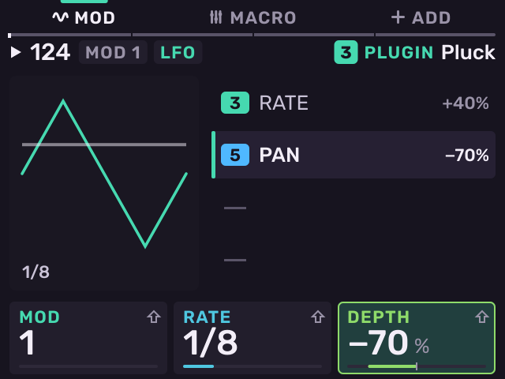

## Time Correct

Press **SHIFT** + **Pad 14**. Time Correct changes how the pattern plays
without moving the notes.

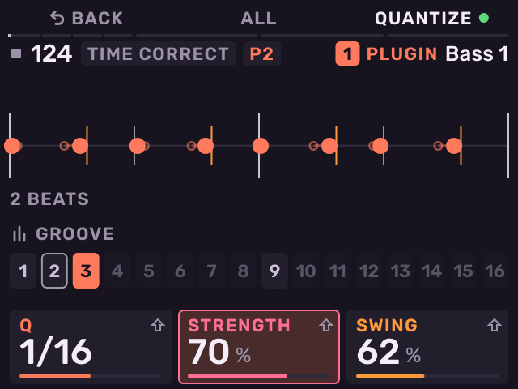

- **K1** grid, **K2** strength, **K3** swing.
- **SHIFT** + **K1** humanize, **SHIFT** + **K2** velocity humanize,
  **SHIFT** + **K3** groove amount.
- Press a pad to take the groove from another pattern of the track.
- **B3** (**QUANTIZE**) turns it off and on, to compare.
- **B2** (**ALL**) applies the same settings to the track's other patterns.

**SHIFT** + **Pad 2** / **Pad 3** halve / double the pattern length.
**SHIFT** + **Pad 6** / **Pad 7** play it at half / double speed.

## Scenes and follow actions

Press **B2** (**SCENES**) on Patterns, or push the encoder there, to open **Scenes**. A scene is one column of
patterns: scene 3 is pattern 3 on every track.

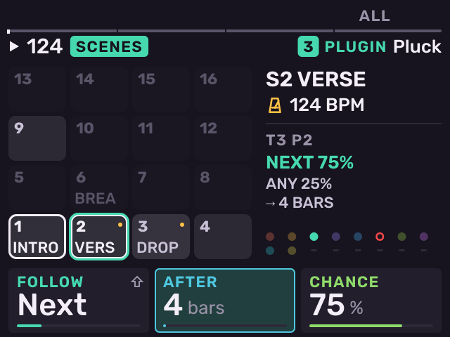

- Press a pad to launch its scene at the next bar. Tracks with no notes in
  that column keep playing.
- Push the encoder to name the scene. Turn the encoder to give it a tempo.
- **ERASE** + pad clears the scene's name and tempo.

The cards set the **follow action** of the selected track's pattern: what
the pattern does after it has played for a while.

- **K1** (**FOLLOW**): Next, Previous, Any, Again or Stop.
- **K2** (**AFTER**): after 1–64 bars, or 1–64 plays.
- **K3** (**CHANCE**): the chance of the first action. **SHIFT** + **K1**
  (**OR**) sets the second action.
- **SHIFT** + **B3** (**ALL**) applies the follow action to every track in
  the column.

## Tempo

Hold **TAP TEMPO** for half a second to open the **Tempo** page. Tap **TAP
TEMPO** to set the tempo by tapping.

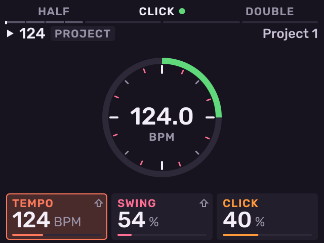

- **K1** tempo, **K2** swing, **K3** click level.
- **B1** halves, **B3** doubles the tempo. **B2** (**CLICK**) sets the
  metronome Off, On or Rec.
- The encoder changes the tempo by 0.1 BPM, **−** / **+** by 1 BPM.
- Push the encoder to switch between one tempo for the project and a tempo
  for each pattern.

---

Previous: [Instrument and MIDI tracks](instrument-and-midi-tracks.md) · [Contents](../GUIDE.md) · Next: [Song](song.md)
