# Sequencing

Previous: [Audio tracks](audio-tracks.md) · [Contents](../GUIDE.md) · Next: [Song](song.md)

## Sequences

A sequence keeps one pattern for each track, or keeps the track off.
Launching a sequence puts every track on its pattern at the next bar, as on
the stock app.

- The sequence you launched last is the sequence in hand. When you launch a
  pattern on a track (on Patterns, or with **SEQ** held), the sequence in
  hand keeps it.
- A new sequence keeps nothing: launching it changes no patterns, and every
  track plays on. The first pattern you launch in it keeps the patterns of
  all the tracks as they play now.
- **SEQ** + **STOP** turns the selected track off in the sequence in hand.
  It stops at the next bar. Press **SEQ** + **STOP** again, or launch one of
  its patterns, to turn it back on.
- A sequence keeps track mutes. Mute a track (**MUTE** + pad) and the
  sequence in hand keeps it muted. Launching a sequence mutes and unmutes
  its tracks as it keeps them, at the next bar. A track the sequence keeps
  nothing for keeps its mute.
- Patterns are shared. When two sequences keep the same pattern, an edit
  changes both. To change one of them, copy the pattern (hold a pad and
  press another) and launch the copy. A sequence copy (**SHIFT** + **ERASE**
  on Sequences) gets copies of the patterns.
- Follow actions, chains and the song do not change what a sequence keeps.

Press **SEQ** to open the sequence pages. **B1**–**B3** are **SEQUENCES**,
**ROLL** and **MOTION**. **SEQ** opens the page last open on the selected
track (Sequences until you open another). On one of these pages, **SEQ**
goes to Sequences. **SHIFT** + **SEQ** opens Step Edit (see
[The pattern editors](#the-pattern-editors)).

**Sequences** shows the bank's 16 sequences, laid out as the pads: pad 1
bottom left, pad 13 top left. Press a pad to launch its sequence at the next
bar (at once when stopped). See [Sequences page](#sequences-page) for the
rest of the page.

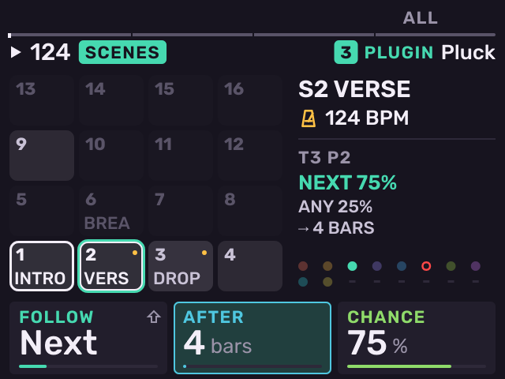

## Patterns

Press **B1** again on Sequences to open **Patterns**. The dots under **B1**
show which of the two pages is open. Patterns is the page for one track: use
it to pick the pattern the track plays in the sequence in hand.

**Patterns** shows the selected track's 16 patterns of the bank in view, laid
out as the pads. Press a pad to launch the pattern in that cell on the
selected track only. The sequence in hand keeps it. The header shows the
sequence in hand (**SEQ 2**), with its name when it has one. When there is
room, the header also shows the bank
(**BANK A**) and Rec Quantize: a magnet with **ON** or **OFF**. A track at
another speed shows its speed (**×2**) on the right.

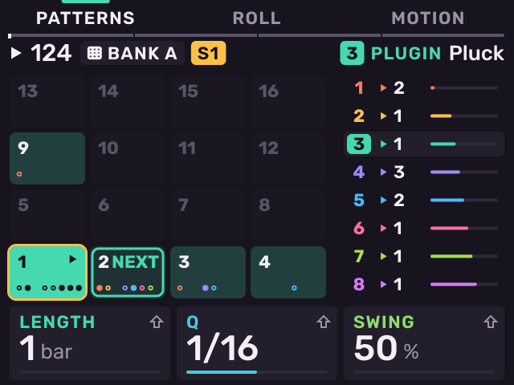

Each cell shows:

- The pattern number. ▶ when it plays. **NEXT** and a blinking ring when it
  is queued for the next bar.
- A tint when the pattern has notes.
- An arrow when the pattern has a follow action.
- The sequences that keep the pattern: **S1 S2**, or **S1 +2** for more. An
  edit to the pattern changes all of them.

The right side lists the eight tracks in view: the track's direction (▶
forward, ◀ **REV**, a die **RND**), the pattern each one plays, the track's
speed when it is not ×1, and a progress bar (– when nothing plays). **OFF** marks a track that is off
in its sequence. A ≠ mark shows a track that is not on the pattern the
sequence in hand keeps for it (a follow action, a chain or Song moved it).
Push the encoder to put every track back. The pads light as the cells.

| Control | Action |
| --- | --- |
| Pad | Launch the selected track's pattern at the next bar (at once when stopped). |
| Hold a pad + pad | Copy the pattern. |
| **ERASE** + pad | Clear the pattern: its notes and Motion (asks first). |
| **ERASE** alone | Clear the selected track's pattern the same way (asks first). |
| **SHIFT** + **ERASE** | Copy a pattern: press the pattern, then where it goes (on this or another track). |
| **SHIFT** + pad | The printed **SHIFT** jobs. |
| Encoder | Select the previous / next track. |
| **SHIFT** + encoder | Move the playhead by one grid step. Stopped, this sets where **SHIFT** + **PLAY** continues from. |
| Encoder push | Launch the sequence in hand again: every track goes back to the pattern it keeps. |
| **PAD BANK** | Pattern bank A–H. The bank LEDs show it. |
| **−** / **+** | Select the previous / next track. |
| **K1** | Pattern length: Free, 1 to 16 bars one bar at a time, then 24, 32, 48, 64, 96 and 128 bars. **Free** is there for an empty pattern: the first take sets the length (see [Free length](#free-length)). **SHIFT**: the length in 16th notes, 1 to 64 (up to four bars of 4/4). The card shows a length that is not whole bars as 16ths: **7/16**. Notes past a shorter length are kept and play again when the pattern is longer. |
| **K2** | Grid (Q): 1/4 to 1/64, with triplets. **SHIFT**: time signature. |
| **K3** | Swing (50–75 %). **SHIFT**: the track's speed, ×1/64 to ×4 (see [Track speed](tracks.md#track-speed)). The metronome level is on [Tempo](#tempo). |
| **SHIFT** + **LOOP** | The track's direction: **FWD**, **REV** or **RND** in turn (see [Track direction](tracks.md#track-direction)). |
| **SHIFT** + **B1** | **SEQUENCE**: the tempo and name of the sequence in hand. |
| **SHIFT** + **B2** | **FOLLOW**: the selected pattern's follow action. |
| **SHIFT** + **B3** | **VARY**: the variation sheet. |

**SHIFT** + **B1** or **B2** again goes back to the pattern cards. **B1**
goes to Sequences.

**SHIFT** + **PLAY** continues from where playback stopped: the selected
track's place in its pattern, also on a track at another speed.

**VARY**

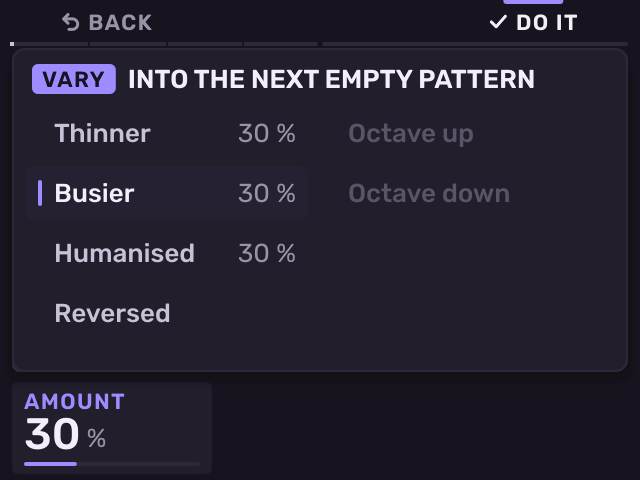

- Turn the encoder to pick Thinner, Busier, Humanised, Reversed, Octave up
  or Octave down. Octave up and Octave down are not available on a kit.
- **K1** sets the amount of Thinner, Busier and Humanised.
- Push the encoder or press **B3** (**DO IT**) to write the result into the
  next empty pattern. It plays from the next bar. **B1** (**BACK**) closes
  the sheet.

## Hold SEQ

Hold **SEQ** on any page. The pads become the selected track's patterns, as
on Patterns:

- The playing pattern is bright, a queued pattern blinks, patterns with
  notes are dim.
- Press a pad to launch that pattern on the selected track at the next bar
  (at once when stopped). The other tracks play on. An empty pattern starts
  as long as the one playing. The sequence in hand keeps it.
- Press more pads in the same hold to make a **chain** of patterns (up to
  eight). Each plays once, then the next.
- **SHIFT** + pad launches that **sequence** on every track, as on
  Sequences. While **SHIFT** is held, the pads and the sheet show the
  sequences. **SHIFT** + more pads in the same hold make a chain of
  sequences. Each sequence plays as long as the selected track's pattern in
  it, then the next one starts.
- Hold a pad and press another to copy the pattern. Hold a pad, step the
  bank and press a pad to copy across banks.
- **ERASE** + pad clears the pattern's notes and Motion (asks first).
  **SHIFT** + **ERASE** copies a pattern: press the pattern, then where it
  goes.
- **−** / **+** launch the previous / next pattern.
- **STOP** turns the selected track off in the sequence in hand, from the
  next bar. Press it again to turn the track back on.
- **K1**–**K3** set the length, grid and swing of the selected track's
  pattern. The encoder sets the tempo. Push it to switch between whole BPM
  and tenths.
- **B1**–**B3** open Sequences, Roll and Motion.
- **PAD BANK** steps the bank A–H (**SHIFT**: back).
- **SEQ RECORD** starts a new take in the track's next empty pattern.
- **SAMPLE RECORD** freezes or thaws patterns. See
  [Freeze a track](tracks.md#freeze-a-track).

After 0.3 seconds the sheet shows the selected track's patterns: what plays
now (**NOW**), what plays next (**NEXT**) and the tempo. With a chain,
**AFTER** shows what follows, and a small number on a pad shows its place in
the chain. With **SHIFT** held the sheet shows the sequences, and **OWN**
shows a track that is not on the pattern the sequence in hand keeps for it.
**NOW** shows **OFF** for a track that is off.

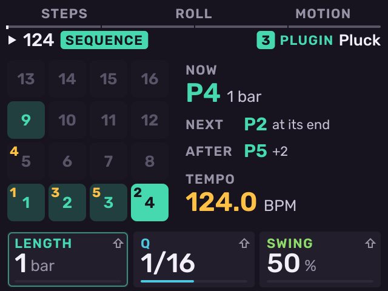

## Record

1. Select a track and a pattern.
2. Press **SEQ RECORD**. When stopped, this arms recording.
3. Press **PLAY**. Recording starts. When playing, **SEQ RECORD** records at
   once.
4. Press **SEQ RECORD** again to stop recording. Playback continues.

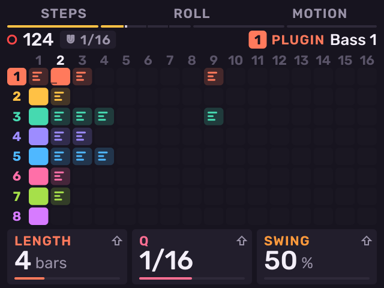

Recording adds to the notes already in the pattern. Each take is one undo
step. Turn a knob while recording to record it as Motion. On Chop, the slice
pads record too (see [Recording slices](kits-and-sampling.md#recording-slices)).

- **SHIFT** + **Pad 4**: count-in on or off. A pad hit in the last
  sixteenth of the count-in records at the start of the take, as long as
  you held it.
- **SHIFT** + **TAP TEMPO**: metronome Off, On, or Rec (only while
  recording).
- **SHIFT** + **Pad 10**: **Rec Quantize** on or off, as on the stock MPC.
  Notes land on the pattern's Q (**K2** on Patterns). The Patterns header
  shows a magnet with **ON** or **OFF**.
- Hold **PLAY** while playing: Fill. Notes with a FILL condition play.
- **ERASE** + **SEQ RECORD** on a kit: erase all notes of the selected pad
  (asks first).

### Free length

A new pattern is **Free**: you do not set its length before you record. The
**K1** card shows **Free**.

1. Select an empty pattern. **K1** shows **Free**.
2. Press **SEQ RECORD** and play. The pattern grows a bar at a time. The
   card shows **P1 FREE** and the bars so far.
3. Press **SEQ RECORD** again, or **STOP**. The pattern ends at the end of
   the bar that is playing, and loops from there.

- Pressed in the first eighth note of a bar, the pattern ends at the bar
  line just passed. What you played after the line moves to the start.
- When other tracks play patterns with notes, a Free pattern takes the
  length of the longest of them, and **K1** shows that length. Free is
  then not offered: the first take sets the length and the other tracks
  follow it.
- A pattern you launch on Patterns or with **SEQ** held takes the length of
  the pattern playing, as before.
- Turn **K1** to a number of bars, or use Half or Double Seq, to set the
  length yourself. On an empty pattern, turn **K1** below 1 bar for Free
  again.
- A take with nothing recorded leaves the pattern Free. One undo removes
  the take and makes the pattern Free again.
- A pattern grows to 128 bars at most. While the song plays, takes do not
  grow.

**Recall** (**SHIFT** + **SEQ RECORD**): Melodee always keeps the notes you
play, recording or not. Recall puts the last phrase into patterns: every
track that played goes into the pattern it plays when that one is empty,
else into its next empty pattern, and those patterns start playing. In a
new project, a jam lands in P1. This is one undo step. In [Settings](settings.md) (**SEQ**),
**Capture bars** sets how many bars Recall takes and **Capture quantize**
how it places the notes.

While the song plays, **SEQ RECORD** also writes the patterns you launch
into the song. See [Record into the song](song.md#record-into-the-song).

## The pattern editors

**B2** (**ROLL**) and **B3** (**MOTION**) open the pattern editors. Press
**SHIFT** + **SEQ** for **Step Edit**, on any page.

The header of Roll, Motion and Step Edit names the pattern they edit
(**P20**). It is amber while the track plays another pattern. The cards
that belong to one pattern name it too: **P20 LENGTH**, **P20 Q**.

A MIDI keyboard playing the track writes notes on Roll and Step Edit as the
pads do.

**Roll**

Roll is a piano roll. On a kit, each row is a pad.

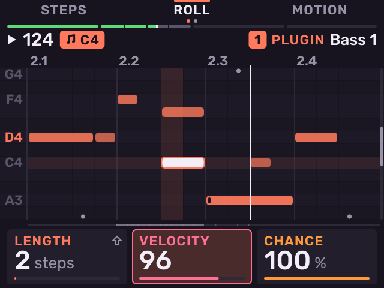

- Turn the encoder to walk through the notes of a step, low to high, then
  on to the next step. **−** / **+** walk the chord in the step, then move
  the cursor's pitch a semitone.
- The note under the cursor is white and named in the header.
- A pad writes a note at the cursor, one step long. **PAD BANK** moves the
  pads up an octave (**SHIFT**: down).
- **K1** length, **K2** velocity, **K3** chance of the note under the cursor.
  **SHIFT** + **K1**: nudge the note early or late.
- Hold a pad on the note under the cursor and turn **K1**–**K3** to lock
  Motion lanes on it. Hold **ERASE** too and turn a knob to clear that
  knob's lock. The note stays.
- **ERASE** pressed alone deletes the note under the cursor. **ERASE** + pad
  deletes every note of that pad's key (asks first).
- Push the encoder for the note sheet: accent, slide, tie and delete as
  cards. Turn the encoder to pick one and push it. **B1** closes it.
- Press **ROLL** again for the note's **TRIG** cards: **K1** ratchet, **K2**
  ramp, **K3** trig condition, as on Step Edit. Press **ROLL** again to go
  back.
- On a kit with 16 Levels on, Roll shows the 16 Levels pad, a row for each
  pitch. The rows are named from the sample's own note when it has one.

**Marked notes**: hold **SHIFT** and turn the encoder to mark notes one by
one. The header shows how many (**4 SEL**). Let go of **SHIFT**, and the
controls act on all the marked notes:

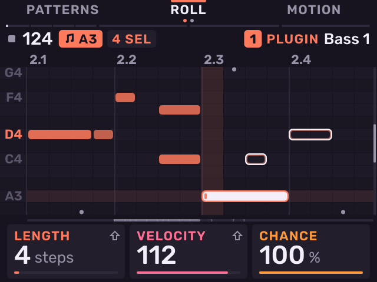

- The encoder moves them a step. **SHIFT** + encoder moves them a row.
- **−** / **+** move them an octave.
- **K1** and **K3** set their length and chance.
- **K2** moves their velocities together: 60, 85 and 100 turned up by 10
  become 70, 95 and 110. The card shows the lowest and the highest
  (**60-100**). It stops when the highest reaches 127 or the lowest 1.
- **SHIFT** + **K2** (**VEL RAMP**) ramps their velocity from the first to
  the last. At 0 they all take the first note's velocity, so **K2** then
  sets them all to one value.
- **ERASE** + encoder pulls them towards the grid, a quarter of the way
  for each click.
- **ERASE** deletes them. **MUTE** mutes them (drawn hollow); press it again
  to play them.
- **NOTE REPEAT** steps their ratchet: 2, 3, 4, 6, 8, off.
- **SHIFT** + **ERASE** copies them. Move the cursor and push the encoder
  to paste them there.
- Tap **SHIFT** to clear the marks.

The printed buttons act on the marked notes, or else on the note under the
cursor. They work on Step Edit too:

- **CHOP** splits each note in two.
- **SHIFT** + **CHOP** makes the notes legato: each one lasts until the
  next.
- **SHIFT** + **LOOP** reverses them (with none marked, the notes in view).
- **SHIFT** + **NOTE REPEAT** writes the track's arp over each chord as
  notes. Not on kit pads.
- **LOOP** plays only the bars in view over and over (on Roll with notes
  marked, their bars), also on a track at another speed. It stops when you
  press **LOOP** again, leave the editor, or select another track or
  pattern.

**Follow**: with **Follow** set in [Settings](settings.md) (**SEQ**),
Step Edit and Roll move with the playhead while the pattern plays:

- **Off**: the view stays where you left it.
- **Page**: when the playhead leaves the bar in view, the next bar comes into
  view. The caret keeps its place in the bar.
- **Step**: the caret goes to each step as it plays.

While it follows, the encoder does not move the caret. Stop to move it. While
you hold a step or a note, or a sheet is open, the view stays still.

**Note preview**: with **Note preview** on in [Settings](settings.md)
(**SEQ**, on at first), a note you write or move without playing it is heard
once:

- Step Edit in STEPS mode: a step you set with a pad, and a held step after
  you turn the encoder (its new pitch, or on a kit the pad it moved to).
- Roll: the marked notes after you move them up or down (**SHIFT** + encoder,
  **−** / **+** an octave) or paste them (push the encoder).

A move with the encoder is heard when the encoder stops. Pads and MIDI keys
are heard as you play them, with the setting on or off.

**Step Edit**

Press **SHIFT** + **SEQ** to open **Step Edit**, the step editor. It shows the
caret's bar: each step's notes stack by pitch and grow taller with velocity.
Ratchet hits sit side by side. A step can show an accent dot, a tie arc, a
slide sign, a lock square, a condition ring and the playhead tick. The caret's
step is amber. The pattern's bars are blocks at the foot. The panel below
shows the pads held, or the step's notes and the next step. The header shows
**STEP** and **BAR**.

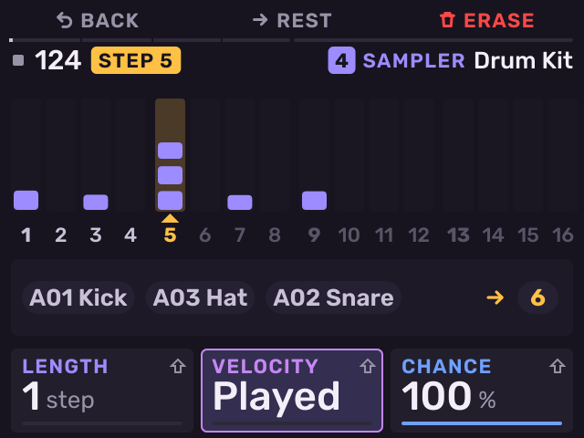

The pads have two modes. **SHIFT** + **B1** (**PADS**) switches between them.
The LED on **PADS** is lit in **STEPS** mode.

PLAY mode (step entry):

- Play a pad or a chord. It is written at the caret. The caret moves on when
  you release the pads.
- **B2** (**REST**) moves on without writing. **B3** (**BACKSPACE**) goes back
  and removes that step.
- The encoder moves the caret through every bar.
- **K1** length, **K2** velocity (Played uses your velocity), **K3** chance
  of what a pad writes.
- **ERASE** + pad erases all of that pad's events (asks first). **ERASE**
  pressed alone deletes the note at the caret.

STEPS mode:

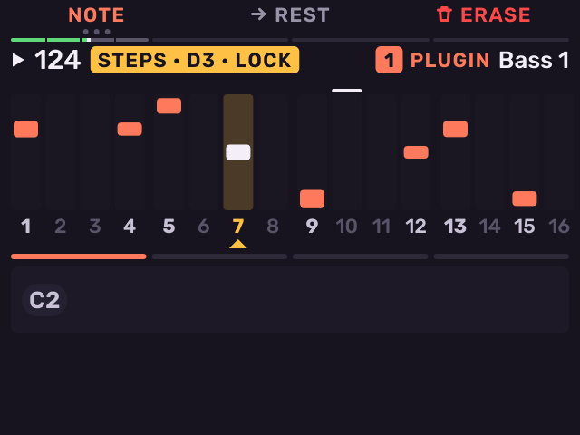

- The pads are the 16 steps of the caret's bar for one sound. On a kit or
  Drums track this is the last pad you hit; hold **SAMPLE** and press a pad
  to pick another. On a synth it is the last note. The header shows
  **STEPS** and the sound's name.
- Press a pad to set or clear a step. The pads light the bar's steps.
- **Hold a step** and turn **K1**–**K3** to lock Motion lanes on it (a
  parameter lock). Turn the encoder to change its pitch; on a kit this moves
  the note to the next pad.
- **Clear a lock**: hold the step, then hold **ERASE** and turn the knob of
  the lock. The step's notes and its other locks stay. **SHIFT** + **−**
  brings the lock back.
- **K1** length, **K2** velocity, **K3** chance of the step. On a kit,
  **SHIFT** + **K1** (**LANE**) sets the pad's lane length. See
  [Lanes of their own length](#lanes-of-their-own-length).
- **ERASE** + pad clears the step. **ERASE** pressed alone clears the
  caret's step.

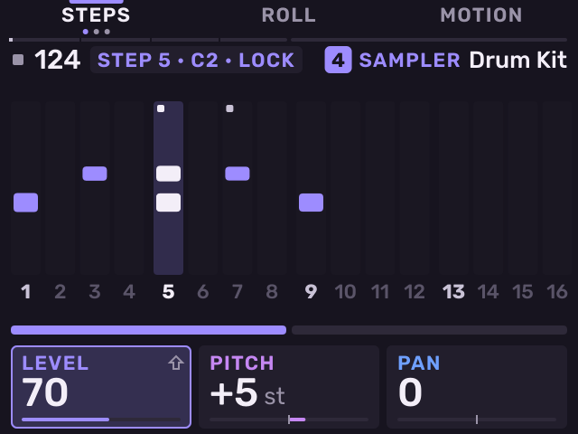

In both modes:

- **B1** steps through the card sets: **NOTE**, **LOCK** (the Motion lanes
  locked on the caret's step; **ERASE** + knob clears one), **TRIG**, on a
  kit or keygroup **SOUND** (see [A step's own sound](#a-steps-own-sound)) and,
  on a kit or Drums lane, **EUCLID**.
- **TRIG**: **K1** ratchet (1–8 hits), **K2** ramp, **K3** trig condition
  (Always, n:m, Fill, First, Pre, Nei and their opposites). On a kit,
  **SHIFT** + **K2** sets a pad's pitch ramp.
- **EUCLID**: **K1** hits, **K2** steps, **K3** rotation. **SHIFT** + **K1**
  sets the lane length.
- **SHIFT** + **B2** (**TIE**) ties the caret's notes into the next step.
  Press it again to untie.
- **SHIFT** + **B3** (**INSERT**) puts an empty step at the caret and moves
  the rest later. The last step's notes fall off the end.
- Otherwise **SHIFT** + **K1**–**K3** set the pattern length, Q and time
  signature.
- **−** / **+** change the octave (on a kit, the bank).
- Encoder push, **SEQ** or **SHIFT** + **SEQ** go back to Sequences,
  Patterns, Roll or Motion, whichever was open last on the track.

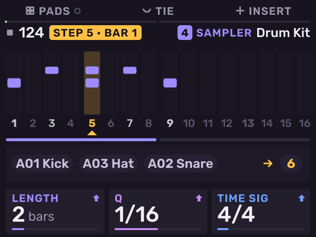

**A step's own sound**

On a kit or keygroup track, **B1** on Step Edit has a fourth card set,
**SOUND**. It sets what the caret's step plays, or the held step in STEPS
mode. On a kit it acts on the lane's note (the last pad's).

| Card | Values |
| --- | --- |
| **K1** **SOUND** | **PAD** (the pad's own sample), or any sample on a kit or keygroup pad of the project. The step plays it through its own pad: the pad's tune, envelope, filter, Pad FX and sends. |
| **K2** **SLICE** | **PAD** (the whole region), a slice of the sample's chop, or **RND** (a slice at random each hit). |
| **K3** **PLAY** | **PAD** (as the pad plays it), **FWD**, **REV**, or **RND** (forward or reversed at random each hit). |

- **ERASE** + knob sets that card back to **PAD**.
- A step with a sample of its own has a ring round its note. A note's ends
  show **PLAY**: pointed back for **REV**, forward for **FWD**, both for
  **RND**.
- The panel shows where the sound comes from (its track and pad), its name,
  and the whole sample with the step's slice lit.
- **RND** picks the same way each time the pattern plays from the top, so a
  print or a render plays as you heard it.

**SAMPLE SELECT** on Step Edit with a step held (or on the **SOUND** cards)
puts the sounds on the pads:

| Control | Action |
| --- | --- |
| Pad | The step plays that pad's sample. It is heard once. |
| **−** / **+** | The track whose pads are shown (kits and keygroups). |
| **PAD BANK** | The bank A–H (**SHIFT**: back). |
| Encoder | The next or previous sound of all the tracks. |
| **B1** (**CLEAR**) | The step plays its own pad again: **SOUND**, **SLICE** and **PLAY** back to **PAD**. |
| **B2** (**SLICES**) | The pads become the slices of the step's sample. Press a pad to set **SLICE**. |
| **SAMPLE SELECT** or encoder push | Back to the steps. |

A step keeps the sample, not the pad: a pad loaded with another sample later
leaves the step as it is.

**Make the pattern longer**: when the caret is on the last bar, a **+** and
an arrow show at the right edge. The pattern can grow.

1. Turn the encoder past the last step, or press **REST**, or keep writing.
   The caret goes on into a new bar. Its steps are outlines and the header
   shows **NEW BAR**.
2. Write a step there: a pad in PLAY mode, a pad in STEPS mode, or a key
   on a MIDI keyboard. The pattern grows to the end of that bar. The step
   and the new length are one undo.

- Leave the new bar empty and the pattern stays as it was. Turn on past it
  and the caret goes back to step 1.
- In STEPS mode, the pads past the pattern's end light faint, as empty
  steps do. Press one to grow the pattern.
- A pattern grows to 128 bars at most.

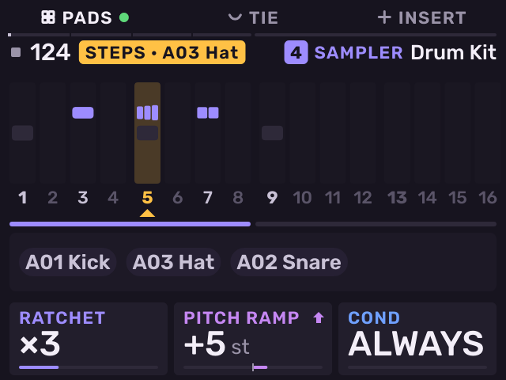

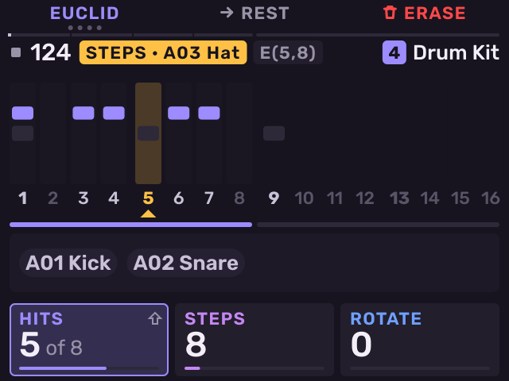

**Motion**

Motion shows the pattern's recorded knob movements as lanes. To record
Motion, turn a knob while **SEQ RECORD** is on. To clear a lane, hold
**ERASE** and turn its knob (asks first).

On a kit, pad mutes are recorded too. With **SEQ RECORD** on, hold **MUTE**
and press a pad: the mute goes into the pattern on the pad's **MUTE** lane,
on or off, with no steps between. Each pass of the pattern starts with the
mutes as you set them, and **STOP** puts them back. The lane shows on
Motion when its pad was hit last (**A05 MUTE**); turn its knob to mute or
unmute the pad there.

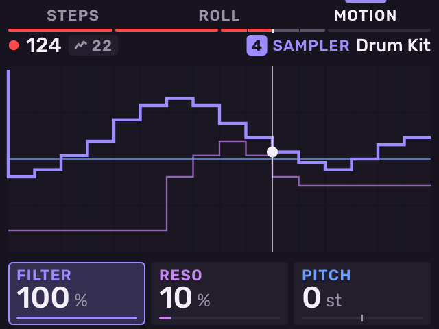

You can also draw Motion by hand, as points joined by straight lines,
without **SEQ RECORD**. Hold **SHIFT** and press **B3** (**DRAW**) to turn
draw mode on or off; **DRAW** shows in the header while it is on.

You draw on the parameter you turned last on this track, on any page: turn
a filter on the sound's page, open Motion and press **PUSH**, and its lane
starts there and shows on **K1**. With nothing turned, it is the lane of the
knob you turned last on Motion.

- Turn the **encoder** to move the cursor along the pattern, one step of Q
  at a time. It stops on each point of the lane on the way, and goes as
  far as the very end of the pattern: a point there is the value the lane
  reaches as the pattern comes round.
- **PUSH** adds a point at the cursor, at the value the lane has there. The
  lane goes in a straight line from it to the next point. From the start
  of the pattern to the first point the lane holds the first point's
  value, and after the last point it holds the last one's.
- Turn the lane's **knob** to set the value of the point under the cursor
  (with **SEQ RECORD** off). Its card shows the point's value. The fader
  does the same when it follows that knob.
- **SHIFT** + **encoder** moves the point under the cursor along the
  pattern.
- **ERASE** deletes the point under the cursor.
- **PUSH** on a point switches it between a line to the next point and a
  step that holds (recorded points hold). Points on a **MUTE** lane always
  hold.

Filled dots are points with a line, ringed dots points that hold. Each edit
is one undo step.

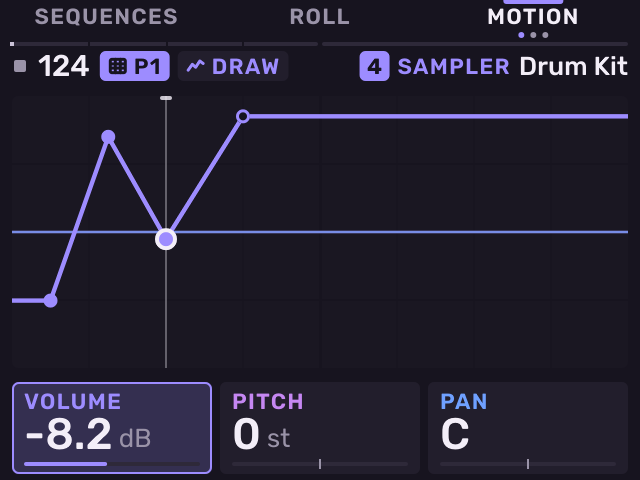

**B3** has three pages: **MOTION**, **MOD** and **MACRO**. Press **B3** again
to step through them. The dots under the key show which one is open. **B1**
and **B2** stay **SEQUENCES** and **ROLL** on all three.

- **MOD**: eight modulators. Each is an LFO (synced or free) or an
  envelope follower of a track or bus. It moves up to four parameters
  anywhere in the project.
- **MACRO**: eight macros. Each turns up to eight parameters at
  once, each between its own low and high value.
- **SHIFT** + **B3** (**ADD**) assigns the last knob you turned to the
  modulator or macro in view.
- **−** / **+** select the modulator or macro. Turn the encoder to pick a
  target. Push the encoder or press **ERASE** to remove it.

| Page | **K1** | **K2** | **K3** |
| --- | --- | --- | --- |
| **MOD** | Modulator 1–8 | Rate (a follower: rise) | The target's depth |
| **MOD**, **SHIFT** | Off, LFO or Follow | LFO shape, or the follower's source | Free or Sync (a follower: fall) |
| **MACRO** | Macro 1–8 | Its value | The target's high end |
| **MACRO**, **SHIFT** | | | The target's low end |

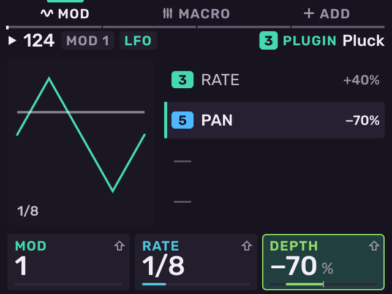

## Lanes of their own length

On a kit, each pad's lane can loop at a length of its own, shorter than the
pattern. A hi-hat lane of 6 steps in a 16-step pattern goes round on its
own against the other pads.

1. Press **SHIFT** + **SEQ** to open Step Edit.
2. Press **SHIFT** + **B1** (**PADS**) for STEPS mode.
3. Hold **SAMPLE** and press the pad whose lane you want to set.
4. Hold **SHIFT** and turn **K1** (**LANE**) to set the lane's length in
   steps. **All** is the pattern's length.

The header shows the lane's length (**LANE 6**). The steps past its end are
dark, and the playhead goes round with the lane.

| Control | Action |
| --- | --- |
| **SHIFT** + **K1** in STEPS mode | Set the lane's length: 1 step to **All**. |
| **SHIFT** + **K1** on the **EUCLID** cards | The same. |

- The lane starts with the pattern, then loops on its own. Trig conditions
  count the lane's own passes.
- **SEQ RECORD** and Note Repeat write the lane's notes where the lane plays
  them.
- Time Correct and the pattern's feel keep the lane's notes inside the
  lane.
- Notes past the lane's end are kept but not played.

## Patterns of odd lengths

Each track's pattern loops at its own length. A pattern of 7 16ths on one
track against 16 on another goes round against it: a polymeter across
tracks.

1. On Patterns, select the track.
2. Hold **SHIFT** and turn **K1** to set the length in 16ths, 1 to 64. The
   card shows **7/16**.

- The pattern starts on the bar it is launched on, then loops on its own.
- For whole bars, turn **K1** without **SHIFT**.

## Time Correct

Press **SHIFT** + **Pad 14**. Time Correct changes how the pattern plays
without moving the notes.

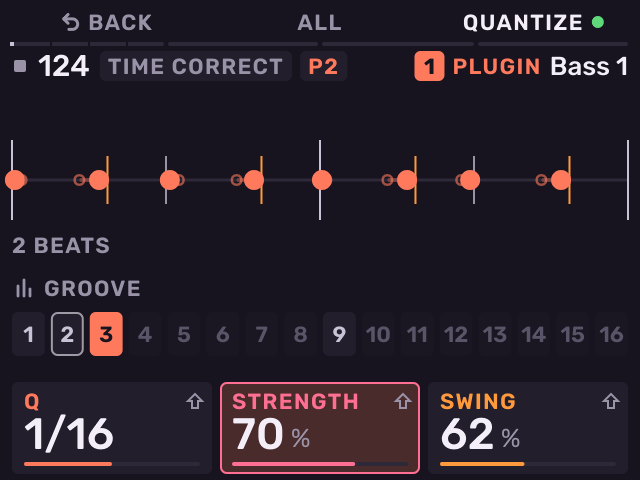

- **K1** grid, **K2** strength, **K3** swing.
- **SHIFT** + **K1** humanize, **SHIFT** + **K2** velocity humanize,
  **SHIFT** + **K3** groove amount.
- Press a pad to take the groove from another pattern of the track. Press
  it again to take the groove off.
- **B3** (**QUANTIZE**) turns it off and on, to compare.
- **B2** (**ALL**) applies the same settings to the track's other patterns.
- Press **SHIFT** + **Pad 14** again to close it.

## Half and double

| Control | Action |
| --- | --- |
| **SHIFT** + **Pad 2** (Half Seq) | Halve the pattern's length. What lies in the second half is removed. |
| **SHIFT** + **Pad 3** (Double Seq) | Double the pattern's length. The new half is a copy of the first, or empty: **Double Seq** in [Settings](settings.md) (**SEQ**). |
| **SHIFT** + **Pad 6** (Half Speed) | Each note twice as far from the start and twice as long. The length stays: notes moved past the end are removed. |
| **SHIFT** + **Pad 7** (Double Speed) | Each note half as far from the start and half as long. The length stays. |

Motion and kept Pad FX punches go with the notes. Each is one undo step.

## Sequences and follow actions

A sequence keeps a pattern, or off, for each track (see
[Sequences](#sequences)). Patterns shows the sequence in hand in its header.

- On Patterns, push the encoder to launch the sequence in hand again at the
  next bar: every track goes back to the pattern it keeps, at the sequence's
  tempo.
- **SHIFT** + **B1** (**SEQUENCE**): **K1** sets the tempo of the sequence
  in hand (below 30 is None), **K2** its colour. Push the encoder to name
  the sequence. Press **ERASE** to clear the sequence (one undo). The header
  shows **SEQ** and the sequence's number, and its name.

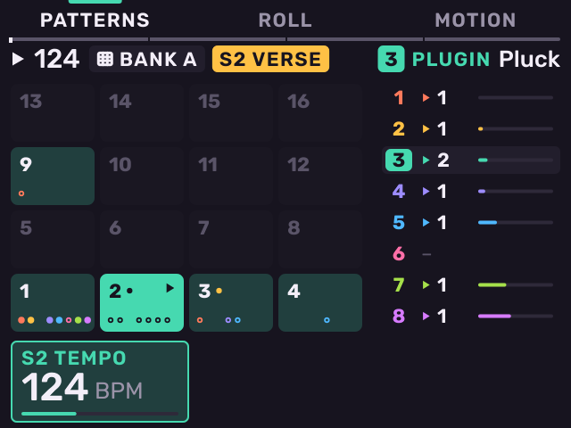

**SHIFT** + **B2** (**FOLLOW**) sets the **follow action** of the selected
pattern: what the pattern does after it has played for a while.

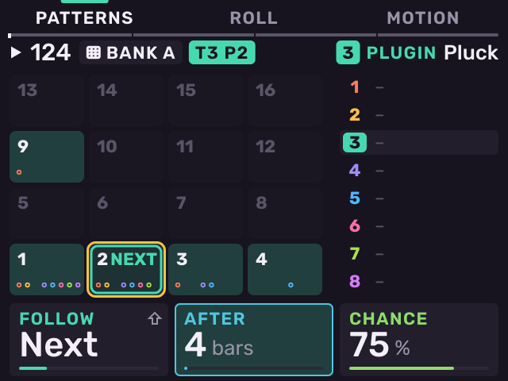

- **K1** (**FOLLOW**): Next, Previous, Any, Again or Stop.
- **K2** (**AFTER**): after 1–64 bars, or 1–64 plays.
- **K3** (**CHANCE**): the chance of the first action. **SHIFT** + **K1**
  (**OR**) sets the second action.
- Push the encoder to put the follow action on the pattern each other track
  is on.

### Sequences page

**SEQ** opens **Sequences**. On Patterns, press **B1**.

- The pads are the bank's 16 sequences, laid out as the pads. Press a pad
  to launch its sequence at the next bar. **PAD BANK** steps the bank.
- A cell is tinted when the sequence keeps patterns, and plain when it keeps
  nothing (it is new). A dash marks a sequence that keeps only silence: every
  track off or on an empty pattern.
- **ERASE** + pad clears the sequence: it keeps nothing again and loses its
  name, tempo and colour. Undo brings it back.
- **SHIFT** + **ERASE**, then two pads: copy the first sequence onto the
  second. The copy gets the name, tempo, colour and mutes. Each pattern the
  sequence keeps is copied into the track's next free pattern (empty, kept
  by no other sequence and not in the song), so the two sequences can be
  edited apart. A track with no free pattern keeps the same pattern in both:
  the notice says how many (**2 shared**). One undo. Press **ERASE** to
  stop.
- The sequence launched last is the sequence in hand. The encoder sets its tempo
  (below 30 is None). **SHIFT** + encoder sets its colour: its cell and its pad
  light in it. Push the encoder to name it. **ERASE** clears it.
- **K1**–**K3** set the selected pattern's follow action, as on **FOLLOW**.
  **SHIFT** + **K1** sets the second action. **SHIFT** + **B3** (**ALL**)
  puts the follow action on the pattern each other track is on. In Basic
  there are no follow actions: **K1**–**K3** set the length, grid and swing
  of the selected track's pattern, as on Patterns.
- **−** / **+** select the track. The marks on the right are the tracks:
  bright on the pattern the sequence in hand keeps, dim on another pattern,
  red when muted, a square when off, a red ring when stopped by a follow
  action.
- **SHIFT** + **B2** (**CAPTURE**), then a pad: that sequence keeps the
  patterns playing now (a stopped track is kept off), as one undo. No notes
  are copied. **B1** (**CANCEL**) stops before a pad.

## Tempo

Tap **TAP TEMPO** to set the tempo by tapping. Hold **TAP TEMPO** and turn
the encoder to set it by a whole BPM, as on the stock app: the **Tempo** page
shows while you hold, and goes back when you let go.

Hold **TAP TEMPO** for half a second without turning to open the Tempo page
and keep it open. Hold **TAP TEMPO** again there to close it.

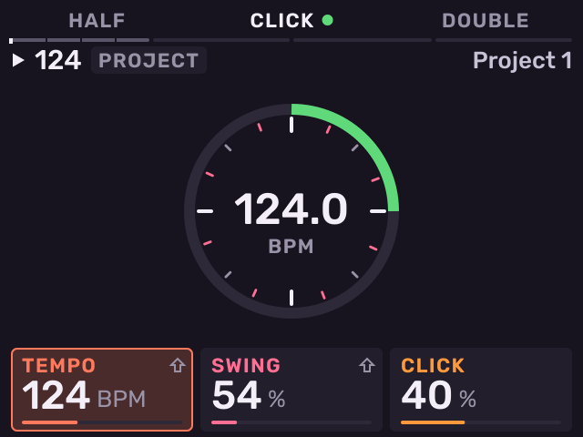

- **K1** tempo, **K2** swing, **K3** click level. **SHIFT** + **K1** and
  **SHIFT** + **K2** set the project's root and scale.
- **B1** halves, **B3** doubles the tempo. **B2** (**CLICK**) sets the
  metronome Off, On or Rec.
- The encoder changes the tempo by 0.1 BPM, **−** / **+** by 1 BPM.
- Push the encoder to switch between one tempo for the project and a tempo
  for each pattern.

Each tempo change is one undo step: a turn of **K1** or the encoder, or a
press of **B1**, **B3**, **−** / **+** or **TAP TEMPO**.

---

Previous: [Audio tracks](audio-tracks.md) · [Contents](../GUIDE.md) · Next: [Song](song.md)
