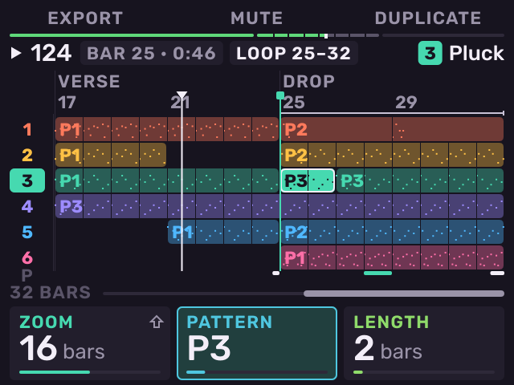
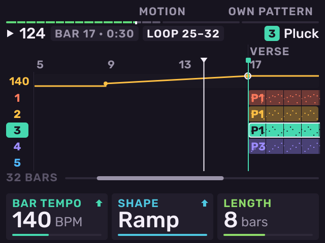
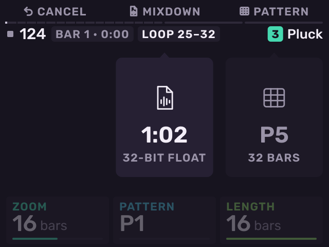

# Song

Previous: [Sequencing](sequencing.md) · [Contents](../GUIDE.md) · Next: [Looper](looper.md)

Press **SHIFT** + **Pad 12** to open **Song**. Press it again on Song to close
it. Song's own keys stay its actions: **B1** (**EXPORT**), **B2** (**MUTE**)
and **B3** (**PLACE**, or **DUPLICATE** on a clip). Each track has a lane.
Each lane holds clips of that track's patterns. The header shows the
cursor's bar and time, and the loop.

| Control | Action |
| --- | --- |
| Encoder | Move the cursor by a bar. |
| Pads | Select a lane. An empty track opens its [new track cards](tracks.md#make-a-new-track), then comes back to Song. |
| **K1** | Zoom (4–64 bars). |
| **K2** / **K3** | The next clip's pattern and length (1–128 bars), or those of the clip under the cursor. **K2** steps through the track's patterns that hold notes and the next empty one (A1, A2 … H16). |
| **PAD BANK** | Show all 16 tracks at once, or the selected track's lanes again. With all tracks shown, copy, paste and erase of a loop range work on every track. |
| **B3** | Place a clip of the pattern and length on **K2** and **K3**. On a clip: duplicate it after itself. |
| **B2** | Mute or unmute the clip. |
| **SHIFT** + **B2** (**MOTION**) | Open the clip's pattern on the Motion page. |
| **SHIFT** + **B3** (**OWN PATTERN**) | Make the clip's pattern its own copy. |
| **SHIFT** + **B1** (**JAMS**) | The jams you played outside Song, to put after the end of the song (see [Jam capture](#jam-capture)). |
| Encoder push | Open the clip's notes: Roll, or Step Edit on a kit. On empty time, place a clip. After a copy of bars: paste them at the cursor. |
| **CHOP** | Split the clip at the cursor. |
| **ERASE** | Delete the clip. With a loop range: take its bars out (see [Sections](#sections)). |
| **SHIFT** + **ERASE** | Copy the clip, placed after itself. With a loop range: copy its bars. |
| **NOTE REPEAT** | Repeat the clip up to the next marker. |
| **LOOP** | Press it at the first bar, move the cursor, press it at the last bar: that is the loop. On a clip, press it twice without moving the cursor to loop the clip's bars. With a loop on, a press turns it off. |
| **SHIFT** + encoder push | Add a marker. On a marker: name it. |
| **−** / **+** | Jump between markers (with no markers, between clip edges). |
| **PLAY** | Play the song from the cursor. |
| **SHIFT** + **PLAY** | After the song stopped: continue it from the bar where it stopped. |

Each clip edit is one undo step. While the loop plays, each time it comes
round every track's clip plays its pattern from where the song is, so a
loop inside a longer clip stays in time. A clip you change while it plays
is heard from the next bar.

**Tempo lane**: **SHIFT** + **K1** (**BAR TEMPO**) sets the tempo from the
cursor's bar. Turn it below 30 (**Off**) to remove that point. **SHIFT** +
**K2** (**SHAPE**) makes the change a **Step** at its bar or a **Ramp**
from the point before. Before the first point, the project's tempo plays.
With points, the lane shows over the tracks with the tempo at the cursor.

## Sections

The loop range marks a section of the song to copy, paste or take out.

1. Move the cursor to the section's first bar and press **LOOP**. Move
   the cursor to its last bar and press **LOOP** again. The
   header shows **LOOP** with the bars.
2. Press **PAD BANK** to work on all tracks (the header shows **ALL**), or
   leave it to work on the selected track.
3. Press **SHIFT** + **ERASE** to copy the section. The header shows
   **COPY**.
4. Move the cursor and push the encoder to paste. What is at the cursor and
   after it moves on to make room. Push again to paste another copy after
   it, for example to make a part longer. Press **ERASE** to stop pasting.

To take a section out, set the loop range and press **ERASE**. What comes
after it moves back to close the gap. With all tracks shown, markers and
tempo points move too. Each paste and each erase is one undo step.

Playing from a bar after the loop range, the song plays on to its end and
stops.

## Record into the song

With **SEQ RECORD** on while the song plays, each pattern you launch
becomes a clip.

1. Press **PLAY** on Song. The song plays from the cursor.
2. Press **SEQ RECORD**.
3. Launch patterns or sequences: on Patterns, on Sequences, or with **SEQ**
   held. Each launch starts a clip on that track's lane at the next bar.
   The clip grows a bar at a time while the pattern plays. After 128 bars a
   new clip carries on.
4. Press **SEQ RECORD** again, or **STOP**. Each clip ends with the bar that
   was playing.

Pad FX punches you play while recording are written into the song too.
They end where the song ends.

### Audio tracks

On an audio track's lane, **SEQ RECORD** records the track's input onto the
lane. The input is the one set on Stage's **INPUT** (**B2**).

1. Press the track's pad to select its lane. Move the cursor to the bar to
   start on.
2. Press **SEQ RECORD**, then **PLAY**. After the count-in the take starts
   at the cursor, in a new clip of the track's first empty pattern. The clip
   has a red frame and grows a bar at a time.
3. Press **SEQ RECORD** again, or **STOP**. The clip ends with the bar that
   was playing. Its pattern is as long as the clip.

- Press **SEQ RECORD** while the song plays: the take starts on the next bar.
- Clips under the take give way to it.
- With a loop on, the take stops when the loop comes round. A take is 128
  bars at most.
- **SHIFT** + **−** (Undo) takes back the clip and its take together.

## Jam capture

Melodee keeps each jam. From **PLAY** to **STOP** outside Song, it notes
for every bar the pattern each track plays, the tracks that are muted, the
tempo and the sequences you launch. You do not have to arm anything. Each
run from **PLAY** to **STOP** is a jam of its own. Song shows how many
there are at the bottom right (**3 JAMS**), with a red dot while one is
being written.

1. Play your patterns: launch patterns and sequences, mute and unmute
   tracks, change the tempo.
2. Press **STOP**.
3. Open Song (**SHIFT** + **Pad 12**) and press **SHIFT** + **B1**
   (**JAMS**).
4. Turn the encoder to pick a jam, and press **B3** (**TAKE**).

**JAMS** shows the picked jam large: the sequences you launched, the bars,
and each track's patterns. Under it, each jam has a row with a small picture
and its length, the newest first.

| Control | Action |
| --- | --- |
| Encoder, **−** / **+** | Pick a jam. |
| **K1** (**FROM**) / **K2** (**TO**) | The first and last bar to take. The rest is dimmed. |
| **B2** (**PLAY**), **PLAY** | Play the jam from **FROM** to **TO**, as Song will. Press it again, or **STOP**, to stop. |
| **B3** (**TAKE**), encoder push | Put the bars after the end of the song. |
| **ERASE** | Delete the jam. |
| **B1** (**BACK**) | Back to Song. |

**TAKE** puts the bars after the end of the song, or at bar 1 when the song
is empty, and goes back to Song:

- Each run of the same pattern on a track becomes one clip. A track that
  played nothing, or an empty pattern, gets no clip there.
- Bars where a track was muted (or another track was soloed) become muted
  clips. **B2** (**UNMUTE**) brings one back.
- Each launched sequence gets a marker with its name, or **SEQ** and its
  number.
- Tempo changes become steps in the tempo lane.

**TAKE** and **ERASE** are one undo step each. A jam stays in the list after
you take it. Melodee keeps the newest 8 jams and saves them with the
project. A run shorter than 2 bars is not kept. A jam fills Song up to 999
bars and 256 clips; the message says when some was left out.

## Export

Press **B1** (**EXPORT**):

- **B2** exports. Turn the encoder first to choose what: a **MIXDOWN**
  (32-bit float, 24-bit or 16-bit WAV), **STEMS** (one WAV per track and
  bus, one per submix the tracks play into, each kit pad the song plays, and
  the mix), a **MIDI FILE**, an **MPC 3** project or an Ableton
  **LIVE SET**. The key shows the choice. Then name the export (see
  [Naming](projects-and-files.md#naming)). A **MIDI FILE**, an **MPC 3**
  project and a **LIVE SET** also work with an empty song: they take the
  patterns.
- **B3** (**PATTERN**) writes the song into new patterns, end to end.
- **B1** (**CANCEL**) goes back to the song.

Exports go to `Melodee/Mixdowns`, `Melodee/Stems/<name>/` and
`Melodee/MIDI` on the card. A `.mid` file in the browser loads its notes
onto the selected track's pattern.

### Stems of kit pads

**STEMS** also writes each kit pad the song plays as a WAV of its own, in a
folder for each kit beside the kit's own WAV: `03 Drums pads/A01 Kick.wav`
is pad A01 of track 3, named after its sample.

- A pad's WAV is the pad after its own effects, volume and pan, at the kit
  track's level, pan and mute, as its pad sends are taken. The kit track's
  effects, filter and mixer strip are not on it: with none on the kit, its
  pads add up to the kit's WAV.
- The kit's own WAV holds all its pads, as before. Use one or the other, not
  both.
- A pad that stays silent in the song gets no WAV. A frozen kit's pads are
  not split.
- When there are more stems than one play of the song can write to the card,
  **STEMS** plays the song again for the rest of the pads. The message says
  which pass runs (*Stems: pass 2 of 3*). Each play has the same hits.

### MPC 3 project

**MPC 3** writes `Melodee/MPC 3/<name>.xpj` and its `<name>_[ProjectData]`
folder with the samples. MPC One, Live, Key, X and the MPC 3 software open it.

- Each kit track becomes a drum track. Its pads keep their samples, layers,
  trim, loop, tune, level, pan, mute group, envelope, filter and warp.
- A pad playing an instrument (SFZ, MPC keygroup program, EXS, DecentSampler),
  and a sample pad its patterns play at other pitches, becomes a keygroup
  track of its own. Its notes go with it.
- A keygroup track becomes an MPC keygroup track.
- An audio track becomes an MPC audio track. Each pattern's take becomes an
  audio region in its sequence.
- A plug-in track becomes an audio track of its prints. The export prints
  each pattern with notes first, skipping prints that are up to date. The
  project needs a file for its prints: save it first.
- Each pattern number becomes a sequence. The song becomes one sequence,
  **Song**, in the first free number, and MPC 3 opens on it.
- A MIDI track becomes an MPC MIDI track on its channel, with its bank and
  program. Pick its output port on the MPC.
- A track sent to a submix plays into the same submix in MPC 3. Each
  submix a track plays into keeps its level, pan, mute and solo.
- Effects, sends, the mixer's strips (trim, EQ, compressor, width), a
  submix's name, muted buses, the song's tempo changes and samples that are
  not WAV files are left out. The message after the export says what was
  (*mixer settings left out* for the mixer).

### Ableton Live Set

**LIVE SET** writes `Melodee/Ableton/<name> Project/` with `<name>.als` in
it and a copy of every sample in `Samples/Imported/`. Copy the whole folder
to a computer and open the `.als` in Ableton Live 12.1 or later.

- Each pattern becomes a clip in Session View, in the scene of its number:
  A1 is the first scene, B1 the seventeenth. Scenes keep their names and
  tempos.
- The song is laid out in Arrangement View. Its markers become locators,
  its loop becomes Live's loop and its tempo changes become tempo
  automation.
- Notes play as they do in Melodee: swing, ratchets, the pattern's speed
  and each lane's own length are written out.
- Each kit track becomes a Drum Rack with a Simpler on each pad. Pads keep
  their sample, trim, level, pan, tune, envelope, one shot or gate, loop,
  reverse, warp and velocity layers. A mute group becomes a choke group.
- A pad its patterns play at other pitches becomes a track of its own with
  a Simpler. A keygroup track becomes a Simpler, or a Sampler for an
  instrument with several zones (Sampler needs Live Standard or Suite).
- A plug-in track becomes a MIDI track of its notes with no instrument,
  plus an audio track of its prints beside it. The export prints each
  pattern with notes first, as for MPC 3: save the project first.
- A MIDI track becomes a MIDI track. Each clip sends its program.
- An audio track's takes become audio clips.
- Each track keeps its level, pan, mute, solo and sends. Buses that tracks
  send to become return tracks.
- Effects, Motion, pad filters, pad sends, the mixer's strips, the
  submixes and muted buses are left out: a track sent to a submix plays to
  the master. The message after the export says *mixer settings left out*
  when the mixer had any of them.

---

Previous: [Sequencing](sequencing.md) · [Contents](../GUIDE.md) · Next: [Looper](looper.md)
