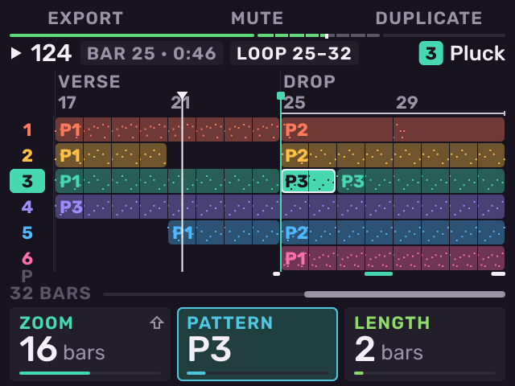
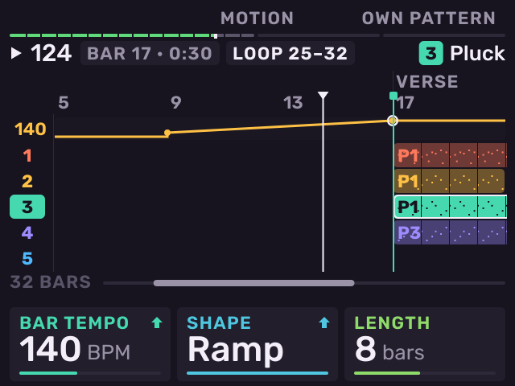
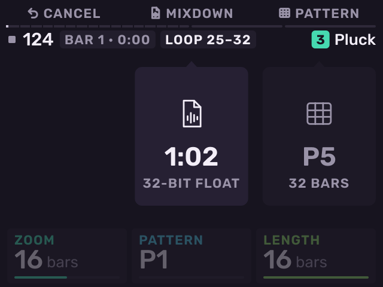

# Song

Previous: [Sequencing](sequencing.md) · [Contents](../GUIDE.md) · Next: [Looper](looper.md)

Press **SHIFT** + **Pad 12** to open **Song**. Press it again on Song to close
it. Song's own keys stay its actions: **B1** export, **B2** mute, **B3** place or
duplicate. Each track has a lane. Each
lane holds clips of that track's patterns.

| Control | Action |
| --- | --- |
| Encoder | Move the cursor by a bar. |
| Pads | Select a lane. |
| **K1** | Zoom (4–64 bars). |
| **K2** / **K3** | The next clip's pattern and length, or the clip under the cursor. |
| **B3** | Place a clip. On a clip: duplicate it after itself. |
| **B2** | Mute or unmute the clip. |
| **SHIFT** + **B2** | The clip's Motion on or off. |
| **SHIFT** + **B3** | Make the clip's pattern its own copy. |
| Encoder push | Open the clip's notes. On empty time, place a clip. |
| **CHOP** | Split the clip at the cursor. |
| **ERASE** | Delete the clip. |
| **NOTE REPEAT** | Repeat the clip up to the next marker. |
| **LOOP** | Loop the clip's bars. |
| **SHIFT** + encoder push | Add a marker. On a marker: name it. |
| **−** / **+** | Jump between markers. |
| **PLAY** | Play the song from the cursor. |

When the song plays, patterns you launch are recorded as clips.

**Tempo lane**: **SHIFT** + **K1** sets the tempo from the cursor's bar.
**SHIFT** + **K2** sets the change as a step or a ramp.

## Export

Press **B1** (**EXPORT**):

- **B2** exports. Turn the encoder first to choose what: a mixdown (32-bit
  float, 24-bit or 16-bit WAV), **STEMS** (one WAV per track and bus, plus
  the mix), or a **MIDI FILE**.
- **B3** (**NEW PATTERN**) writes the song into new patterns, end to end.

Exports go to `Melodee/Mixdowns`, `Melodee/Stems/<name>/` and
`Melodee/MIDI` on the card. A `.mid` file in the browser loads its notes
onto the selected track's pattern.

---

Previous: [Sequencing](sequencing.md) · [Contents](../GUIDE.md) · Next: [Looper](looper.md)
