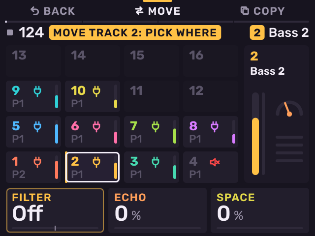
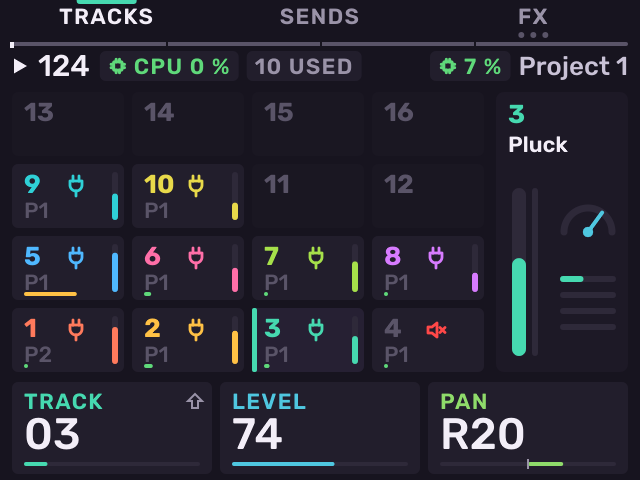
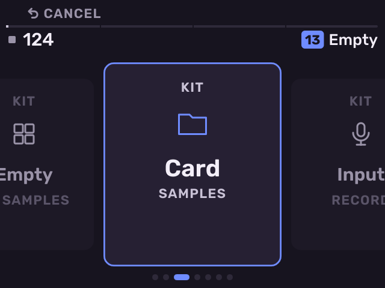
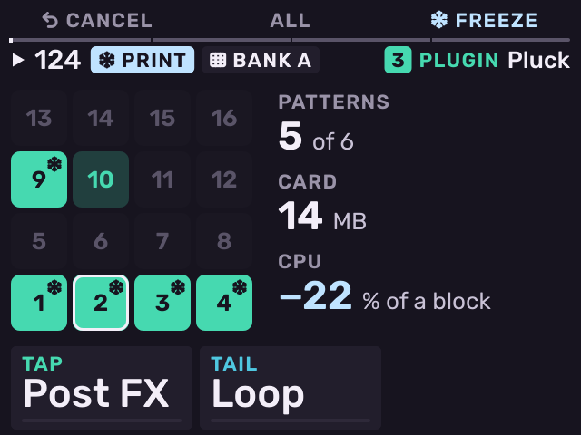

# Tracks

Previous: [Basics](basics.md) · [Contents](../GUIDE.md) · Next: [Kits and sampling](kits-and-sampling.md)

## Select a track

Hold **PAD BANK** and press a pad. This works on any page. Pad 1 is track 1.
To see all 16 tracks, open the [Tracks page](#the-tracks-page).

While **PAD BANK** is held the pads are the tracks, and the screen stays on
the page you are on:

- Press **B2** (**MOVE**), then a track, then a pad to move the track there.
  A track already there swaps places with it.
- Press **B3** (**COPY**) or **SHIFT** + **ERASE**, then a track, then a pad
  to copy the track there.
- During a move or copy the screen shows the tracks. **B1** (**BACK**) steps
  back.
- Press **ERASE** + pad to clear that track (asks first).
- Turn the encoder or press **−** / **+** to change the kit's bank.

## The Tracks page

Press **PAD FX** and **KNOB FX** together to open **Tracks**: all 16
tracks as the pads are laid out, with the selected track as a mixer strip on
the right.

Each cell shows the track number, the pattern it plays, a symbol for its
type and its level. A crossed speaker means muted. The bar along the
bottom of a cell shows how much processing the track uses (green, amber
from 60 %, red from 85 %).

| Control | Action |
| --- | --- |
| Pads | Select a track. An empty track opens its [new track cards](#make-a-new-track). |
| Encoder | Select a track. |
| **ERASE** + pad | Clear that track (asks first). |
| **K1** | Select a track. |
| **K2** | Level of the selected track. |
| **K3** | Pan of the selected track. |
| **SHIFT** + **K1** | Track speed: ×½, ×¾, ×1, ×1½ or ×2. The track's patterns play that much slower or faster. |
| Fader | Level of the selected track. |
| Encoder push | Open the track's Stage. |
| **B1** | Come back to Tracks from Sends or an effect chain. |
| **B2** | Open Sends. |
| **B3** | Open the effect chains (press again for the next chain). |
| **SHIFT** + **B2** / **B3** | Move / copy a track. |

Tracks, Sends and the effect chains share the keys **TRACKS**, **SENDS** and
**FX**. Press **PAD FX** and **KNOB FX** together to open Tracks from any
page. A frozen track shows a snowflake in its cell (see
[Freeze a track](#freeze-a-track)).

## Make a new track

Select an empty track with **PAD BANK** + pad, or press **SAMPLE** on an
empty track. Stage shows a row of cards, one for each kind of track. Turn the encoder to move along the row and push it to make the card
in the middle. Making a track is one undo step.

| Card | Makes |
| --- | --- |
| **SYNTH** Plugin | A plug-in track. The plug-in picker opens. The track stays empty until you pick a plug-in. |
| **KIT** Empty | A kit with no samples. |
| **KIT** Card | A kit. The Samples browser opens for its first sample. **B1** (**CANCEL**) at the top of Samples leaves the track empty. |
| **KIT** Input | A kit. Sample Record opens to record its first sample. |
| **MIDI** Out jack | A MIDI track on the MIDI Out jack. |
| **MIDI** USB-C | A MIDI track on the USB-C port. |
| **MIDI** All USB | A MIDI track on every USB MIDI device. |

Until the track is made, the other buttons wait. **PLAY**, **STOP** and
**TAP TEMPO** still work, and **PAD BANK** + pad selects another track.
**B1** (**CANCEL**) selects the nearest track that is not empty.

When you pick an empty track with a pad (on Tracks, with **PAD BANK** held,
or on a Song lane), Stage opens and, once the track is made, you go back to
the page you picked it on.

## Freeze a track

Freezing renders a track's patterns to audio files (prints) on the card.
The frozen track plays the prints instead of its sound and its effect
chain. This saves CPU. The pads still play the sound live.

1. Select the track.
2. Press **SAMPLE RECORD** to open the **PRINT** sheet. On a kit, press
   **SAMPLE RECORD** for Record, then **B3** (**PRINT**).
3. The pads are the track's patterns. Lit pads are printed. Tap a pad to
   leave its pattern out or take it back. **B2** (**ALL**) lights every
   pattern with notes. **−** / **+** change the bank of patterns.
4. **K1** (**TAP**): **Post FX** prints the sound with its effect chain;
   **Pre FX** prints the sound alone, and the chain runs live.
5. **K2** (**TAIL**): **Loop** (the end wraps into the start), **Ring** (one
   pass and its tail) or **Cut** (one pass).
6. Press **B3** (**FREEZE**).

Beside the pads the sheet shows how many patterns are lit, the space the
prints take on the card, and the CPU the freeze saves. While the prints
are made, **B1** (**CANCEL**) calls them off. The track plays live until the
prints are ready, then switches on a bar line.

To freeze single patterns, hold **SEQ** and press **SAMPLE RECORD**: each
pattern pad freezes or thaws that pattern. The prints are made when you let
go of **SEQ**. The other patterns play live.

**SHIFT** + **B3** (**DEEP FREEZE**) freezes every pattern with notes and
also unloads the track's plug-ins to save memory; its pads then play
nothing. It works on the PRINT sheet and on a frozen track's Stage.

MIDI tracks cannot be frozen yet: their sheet says **MIDI TRACKS** Later.

Level, pan, sends, mute and solo stay live on a frozen track. A kit's pad
sends are printed with it and still reach the buses. Tracks and Stage show
a snowflake on a frozen track; Stage shows the print of the pattern
playing. Cards whose values the print holds are dim with a snowflake.

Changing anything a print is made of (the sound, a pad, the chain, a
frozen pattern's notes) asks **Unfreeze track N?** first: **B3**
(**UNFREEZE**) or **B1** (**CANCEL**).

To unfreeze, open the **PRINT** sheet and press **SHIFT** + **B1**
(**UNFREEZE**), or press **B3** (**UNFREEZE**) with no pattern lit. A
deep-frozen track shows **THAWING** while its plug-ins load again; the
prints play meanwhile. The prints stay on the card. At the next freeze,
only patterns you changed are printed again.

---

Previous: [Basics](basics.md) · [Contents](../GUIDE.md) · Next: [Kits and sampling](kits-and-sampling.md)
