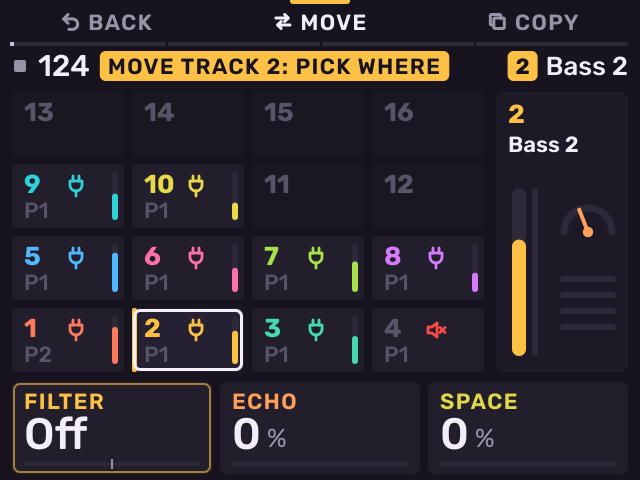
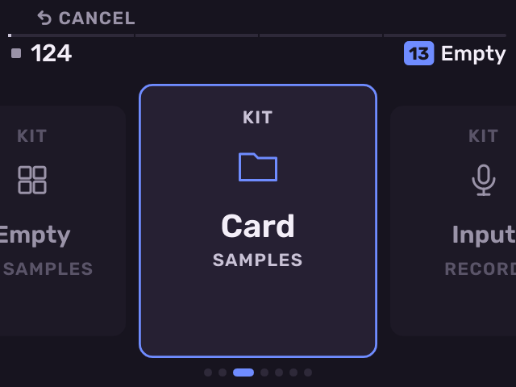
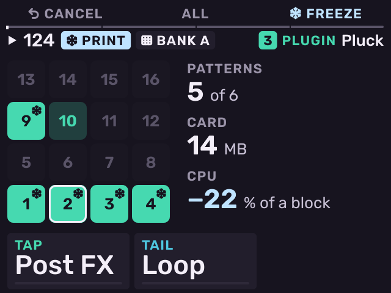

# Tracks

Previous: [Basics](basics.md) · [Contents](../GUIDE.md) · Next: [Kits and sampling](kits-and-sampling.md)

## Select a track

Hold **PAD BANK** and press a pad. This works on any page. Pad 1 is track 1.
To see the tracks side by side, open the [mixer](mixer-and-effects.md#the-mixer):
its pads select tracks too.

While **PAD BANK** is held the pads are the tracks, and the screen stays on
the page you are on. Only the keys change: **TRACKS**, **MOVE** and
**COPY**. Holding **PAD BANK** never changes the bank; only a tap does.
**K1**–**K3** set the selected track's level, pan and send to bus A while
it is held, on any page.

- Press **B1** (**TRACKS**) to open the mixer on the tracks.
- Press **B2** (**MOVE**), then a track, then a pad to move the track there.
  A track already there swaps places with it. The track takes its sound,
  patterns and mixer strip, and everything that refers to it: its Song
  clips, Looper sources, Knob FX tracks, sidechain keys, the Pad FX punches
  kept in any pattern, and **MOD** and **MACRO** lanes.
- Press **B3** (**COPY**) or **SHIFT** + **ERASE**, then a track, then a pad
  to copy the track there.
- During a move or copy the screen shows the tracks. **B1** (**BACK**) steps
  back.
- Press **ERASE** + pad to clear that track (asks first).
- Turn the encoder or press **−** / **+** to change the kit's bank.

## Track speed

A track can play its patterns slower or faster: ×1/64, ×1/32, ×1/16, ×1/8,
×¼, ×½, ×¾, ×1, ×1½, ×2 or ×4. Set it on Patterns with **SHIFT** + **K3**
(**SPEED**). At ×1/64 one bar of the pattern lasts 64 bars. The notes stay as
written. The Patterns header and track list show the speed when it is not ×1.

## Track direction

A track can play its patterns' steps forward (**FWD**), backward (**REV**) or
in a new order each pass (**RND**). Press **SHIFT** + **LOOP** on Patterns to
step through them. A step is one step of the pattern's Q; each note keeps its
place in its step and its length.

- **REV** plays the last step first.
- **RND** plays every step once a pass, in an order of its own each pass.
  The orders are the same each time the pattern plays from the top.
- Motion and its locks follow the steps. A kit lane of its own length turns
  round on its own length.
- The editors' playhead shows the step that plays.
- An audio track plays forward.

The Patterns header shows ◀ or a die beside the speed, and so does the
playing pattern's cell.

## Make a new track

A new project has no tracks: it opens on track 1 with the track types.

Select an empty track with **PAD BANK** + pad, or press **SAMPLE** on an
empty track. Stage shows the track types as on the MPC: **Drum**,
**Keygroup**, **Plugin**, **MIDI** and **Audio**. Turn the encoder to move along the
cards and push it to pick the card in the middle. Making a track is one undo
step.

| Type | Push |
| --- | --- |
| **Drum** | Opens the Drum sources (below). |
| **Keygroup** | Makes a [keygroup track](instrument-and-midi-tracks.md#keygroup-tracks): one instrument or sample played across the keys. The Samples browser opens for it. **B1** (**CANCEL**) at the top of Samples leaves the track empty. |
| **Plugin** | Makes a plug-in track. The plug-in picker opens. The track stays empty until you pick a plug-in. |
| **MIDI** | Opens the MIDI ports (below). |
| **Audio** | Makes an [audio track](audio-tracks.md), which records the input into its patterns. Stage opens on its **INPUT**. |

Drum and MIDI show their sources next. Push makes the card in the middle.
**B1** (**BACK**) goes back to the types.

| Source | Makes |
| --- | --- |
| **DRUM** Card | A kit. The Samples browser opens for its first sample. **B1** (**CANCEL**) at the top of Samples leaves the track empty. |
| **DRUM** Empty | A kit with no samples. |
| **DRUM** Input | A kit. Sample Record opens to record its first sample. |
| **MIDI** Out jack | A MIDI track on the MIDI Out jack. |
| **MIDI** USB-C | A MIDI track on the USB-C port. |
| **MIDI** All USB | A MIDI track on every USB MIDI device. |

Until the track is made, the other buttons wait. **PLAY**, **STOP** and
**TAP TEMPO** still work, and **PAD BANK** + pad selects another track.
To reach Project or Settings, hold the encoder for the
[Menu](basics.md#the-menu), press **B3** (**GO**), then pad 14 (Project)
or pad 15 (Settings).

On the types, **B1** (**CANCEL**) selects the nearest track that is not
empty. When every track is empty, **B1** has no job.

When you pick an empty track with a pad (on the mixer, with **PAD BANK**
held, or on a Song lane), Stage opens and, once the track is made, you go
back to the page you picked it on.

## Freeze a track

Freezing renders a track's patterns to audio files (prints) on the card.
The frozen track plays the prints instead of its sound and its effect
chain. This saves CPU. The pads still play the sound live.

1. Select the track.
2. Press **SAMPLE RECORD** to open the **PRINT** sheet. On a kit, press
   **SAMPLE RECORD** for Record, then **B3** (**PRINT**).
3. The pads are the track's patterns. Lit pads are printed. Tap a pad to
   leave its pattern out or take it back. **B2** (**ALL**) lights every
   pattern with notes. **−** / **+** change the bank of patterns.
4. **K1** (**TAP**): **Post FX** prints the sound with its effect chain;
   **Pre FX** prints the sound alone, and the chain runs live.
5. **K2** (**TAIL**): **Loop** (the end wraps into the start), **Ring** (one
   pass and its tail) or **Cut** (one pass).
6. Press **B3** (**FREEZE**).

Beside the pads the sheet shows how many patterns are lit, the space the
prints take on the card, and the CPU the freeze saves. While the prints
are made, **B1** (**CANCEL**) calls them off. The track plays live until the
prints are ready, then switches on a bar line.

To freeze single patterns, hold **SEQ** and press **SAMPLE RECORD**: each
pattern pad freezes or thaws that pattern. The prints are made when you let
go of **SEQ**. The other patterns play live.

**SHIFT** + **B3** (**DEEP FREEZE**) freezes every pattern with notes and
also unloads the track's plug-ins to save memory; its pads then play
nothing. It works on the PRINT sheet and on a frozen track's Stage.

A plug-in with a sequencer or arpeggiator of its own can play with no notes
in the pattern. When its **TRANSPORT** is on, you can light a pattern
without notes and freeze it like any other. Its print holds one pass of the
pattern as the plug-in plays it from the pattern's start, so a sequence
longer than the pattern, or one that changes from pass to pass, repeats
that pass. If the plug-in plays nothing there, the pattern is left live.
Such patterns are never lit for you, by **B2** (**ALL**) or by default. A
deep freeze takes the ones you lit on the sheet, or from Stage the ones
frozen.

While a print plays, and while a frozen track is stopped, its plug-in
hears the song as stopped, even when you play its pads. So it is not heard
under its own print, and it stops costing CPU. A plug-in that ends its
notes on Stop ends them there. When the track plays live again (a pattern
without a print, or Unfreeze), the plug-in hears Play at the song's place,
as after Stop and Play.

MIDI tracks cannot be frozen yet: their sheet says **MIDI TRACKS** Later.

Level, pan, sends, mute and solo stay live on a frozen track. A kit's pad
sends are printed with it and still reach the buses. Stage and the Menu's
header show a snowflake on a frozen track; Stage shows the print of the
pattern playing. Cards whose values the print holds are dim with a snowflake.

Changing anything a print is made of (the sound, a pad, the chain, a
frozen pattern's notes, the **TRANSPORT** of a plug-in the print holds) asks
**Unfreeze track N?** first: **B3** (**UNFREEZE**) or **B1** (**CANCEL**).

To unfreeze, open the **PRINT** sheet and press **SHIFT** + **B1**
(**UNFREEZE**), or press **B3** (**UNFREEZE**) with no pattern lit. A
deep-frozen track shows **THAWING** while its plug-ins load again; the
prints play meanwhile. The prints stay on the card. At the next freeze,
only patterns you changed are printed again.

---

Previous: [Basics](basics.md) · [Contents](../GUIDE.md) · Next: [Kits and sampling](kits-and-sampling.md)
